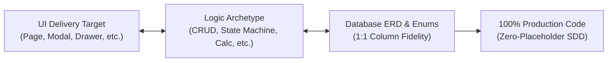

# Blueprint Studio, UI Delivery Targets & ERD System Invariants
> **Version:** 8.0.0 | **Standard:** SDD-Enterprise-Deterministic & PER Coding Style 2.0  
> **Target:** Autonomous Coding Agents (Antigravity, Claude, Gemini, Cursor) & Solution Architects  
> **Trigger Tags:** `@studio`, `@blueprint`, `#studio` | **GUI Route:** [`/admin/studio`](../../frontend/src/routes/admin/studio/+page.svelte)  
> **SSoT Companion:** [`doc/features/05_blueprint_studio.md`](../../doc/features/05_blueprint_studio.md), [`.agents/rules/universal_invariants.md`](./universal_invariants.md), [`doc/architecture.md`](../../doc/architecture.md)

---

## 1. PENDAHULUAN & PRINSIP UTAMA

Sistem perancangan perangkat lunak Valora Vault mengadopsi metodologi **Specification-Driven Development (SDD)**. Untuk mencegah diskoneksi antara prototipe visual (Living Canvas) dan skema database (ERD), seluruh perancangan dan generasi kode WAJIB tunduk pada aturan sistem berikut.

---

## 2. 6 ATURAN INVARIAN MUTLAK BLUEPRINT STUDIO

### [RULE-BP-01] DELIVERY TARGET GOVERNANCE (ANTI-ASUMSI HALAMAN TUNGGAL)
Fitur atau logika bisnis **TIDAK SELALU** membutuhkan rute halaman mandiri (`+page.svelte`). Pengembang dan AI Agent WAJIB mengonfigurasi dan menghormati salah satu dari 6 delivery target:

1. `standalone_page`: Halaman penuh dengan rute khusus (Dedicated Route) di bawah `src/routes/...`. Digunakan untuk modul utama berbobot besar.
2. `modal_dialog`: Dialog pop-up taktil untuk alur transaksi cepat, formulir entri terfokus, verifikasi voucher, atau konfirmasi tanpa navigasi.
3. `slide_over_drawer`: Panel samping geser (*slide-over*) untuk inspeksi detail data, audit trail log, atau konfigurasi multi-tab tanpa kehilangan konteks halaman asal.
4. `inline_action`: Tombol aksi langsung pada baris tabel atau trigger header (misal: tombol sinkronisasi status, toggle aktif/nonaktif, re-send webhook).
5. `embedded_widget`: Kartu metrik KPI, mini-chart, atau ringkasan status yang disematkan langsung di dashboard utama.
6. `headless_job`: Pekerjaan background/daemon tanpa antarmuka visual pengguna langsung (misal: pembersihan sesi kadaluarsa, sinkronisasi antrean).

> **Larangan Keras:** DILARANG mengenerate berkas rute halaman baru (`+page.svelte`) jika delivery target yang ditentukan dalam spesifikasi adalah `modal_dialog`, `slide_over_drawer`, `inline_action`, atau `embedded_widget`.

---

### [RULE-BP-02] LOGIC ARCHETYPE REALISM (ANTI-PEMAKSAAN CRUD)
Logika bisnis custom **DILARANG DIPAKSAKAN** menjadi antarmuka tabel dan form entri CRUD biasa jika alur aslinya berbeda. Agen WAJIB menerapkan taksonomi 5 Logic Archetype:

1. `crud`: Operasi standar data entri (Create, Read, Update, Delete) yang wajib mematuhi **Pola Enterprise UI** (Pills/Cards, Quick in-memory search, Table zero scroll, Modal form/detail).
2. `state_machine`: Alur persetujuan bertingkat (*Approval Pipeline*) dengan transisi status deterministik (misal: `draft` ➔ `in_review` ➔ `approved`/`rejected`).
   - Wajib memiliki visual stepper tahap status.
   - Wajib mencatat audit trail (aktor, waktu, status awal, status akhir, catatan review/penolakan).
3. `calculation_engine`: Kalkulator matematis dan formula agregasi dinamis (volume, tarif, diskon, PPN, amortisasi) yang dihitung seketika secara in-memory (< 0.1ms) dengan slider/input reaktif.
4. `data_pipeline`: Transformasi data batch/stream (ETL, migrasi skema, ekspor CSV O(1), impor parser spreadsheet).
5. `event_stream`: Penanganan webhook asinkron, dispatch event berkecepatan tinggi, dan worker processing.

---

### [RULE-BP-03] UI-TO-ERD 1:1 SCHEMA & ENUM INTEGRITY
Setiap elemen input atau kolom yang ditampilkan pada antarmuka Living Canvas WAJIB memiliki pemetaan 1:1 yang valid pada skema basis data:

1. **Dukungan Enum Penuh:**
   - Seluruh kolom bertipe `enum` pada ERD wajib didefinisikan pilihan nilainya secara eksplisit (misal: `['draft', 'in_review', 'approved', 'rejected']`).
   - Di antarmuka UI, status enum wajib dirender sebagai badge pills dengan warna indikator semantik yang seragam (Amber untuk draf, Sky untuk review, Emerald untuk approved, Rose untuk rejected).
2. **Keterkaitan Foreign Key (FK):**
   - Kolom foreign key wajib menyertakan target referensi tabel dan kolom yang presisi (misal: `user_id FK ➔ users.id`).
   - Pada migrasi Laravel, wajib menggunakan `$table->foreignId('...')->constrained()->cascadeOnDelete()` atau `restrictOnDelete()` sesuai aturan integritas data.
3. **Larangan Kolom Yatim (No Orphan Columns):**
   - Dilarang membuat form input di UI yang tidak memiliki kolom penyimpanan di database, atau sebaliknya membuat kolom non-nullable di database tanpa ada mekanisme pengisian pada UI/backend.

---

### [RULE-BP-04] HARMONISASI HUBUNGAN ANTAR MODUL & TABEL DATABASE
Sistem Valora Vault bersifat modular namun terintegrasi erat. Dalam merancang modul dan tabel database baru:

1. **Format Hak Akses (RBAC Harmonization):**
   - Setiap aksi modul wajib memiliki permission code yang seragam dengan format: `<modul>.<aksi>` (contoh: `students.view`, `students.create`, `students.edit`, `students.delete`, `students.export`).
   - Seluruh permission baru wajib didaftarkan pada [`backend/config/permissions.php`](../../backend/config/permissions.php).
   - Multi-role disimpan dalam format JSON array terindeks pada tabel `users` (dilarang menggunakan tabel pivot RBAC lambat).
2. **Keterkaitan Antar Tabel Lintas Modul:**
   - Relasi lintas modul (misal: Modul Transaksi merujuk ke Modul User) wajib menggunakan tipe data konsisten: `bigint unsigned` untuk id numerik.
   - Kolom relasi yang sering difilter wajib memiliki composite index: `$table->index(['user_id', 'status']);`.
3. **Pencegahan Ketergantungan Melingkar (Circular Dependency):**
   - Urutan eksekusi migrasi wajib menghormati dependensi (tabel induk dibuat sebelum tabel anak).
   - Dilarang keras membuat ketergantungan melingkar antar dua tabel yang saling mereferensikan foreign key secara bersamaan.

---

### [RULE-BP-05] 4-VISUAL-STATE DASHBOARD & CRUD MANDATE
Seluruh antarmuka yang dirancang melalui Blueprint Studio dan dieksekusi ke kode produksi wajib menangani 4 visual state:

1. **Loading State:** Skeleton loader reaktif via komponen kanonikal `ElementLoader` (menghindari layout shift).
2. **Empty State:** Tampilan ilustratif informatif saat data kosong (0 record) disertai tombol aksi primer untuk memandu pengguna (*Call to Action*).
3. **Error State:** Penanganan kesalahan jaringan/server format RFC 7807 dengan tombol interaktif 'Coba Lagi'.
4. **Success / Populated State:** Tampilan antarmuka normal:
   - **Untuk CRUD:** Summary Stat Pills, pencarian instan in-memory via `$derived.by()` (< 0.1ms), paginasi dinamis, modal form ber-tab, dan modal konfirmasi destruktif.
   - **Untuk Dashboard:** Kartu KPI metrik utama (Total, Aktif, Pending, Nominal), filter periode, dan chart analitis.

---

### [RULE-BP-06] DESIGN FREEZE & ZERO-HALLUCINATION CODE GENERATION
1. **Design Freeze Milestone:**
   - Sebelum kode backend atau database ditulis, seluruh kesepakatan desain UI (mockup canvas) dan skema ERD wajib dikunci (*Design Freeze*).
   - Dokumen spesifikasi SDD atomik disimpan ke `doc/features/{code}_{slug}.md` melalui endpoint `/api/v1/admin/studio/generate-spec`.
2. **Generasi Kode 1:1:**
   - AI Agent yang mengeksekusi Tahap 5 WAJIB membaca file spesifikasi tersebut sebagai SSoT mutlak.
   - Dilarang memotong kode (NO_PLACEHOLDER), dilarang menambahkan field liar di luar spesifikasi (NO_GHOST_FEATURES), dan wajib menguji kode dengan PHPUnit minimal 3 skenario (200, 422, 403).

---

## 3. CHECKLIST AUDIT SEBELUM MENYETUJUI DESAIN (DESIGN FREEZE GATE)

Sebelum Solution Architect atau Agen AI menandatangani status *Design Freeze*:
- [ ] Apakah delivery target sudah tepat (tidak memaksakan standalone page)?
- [ ] Apakah logic archetype mencerminkan kebutuhan bisnis nyata (state machine, calc engine, atau CRUD)?
- [ ] Apakah seluruh opsi status bertipe `enum` telah memiliki daftar nilai yang jelas?
- [ ] Apakah foreign key telah terikat ke tabel yang valid dengan onDelete behavior?
- [ ] Apakah permission code telah diselaraskan dengan `config/permissions.php`?
- [ ] Apakah UI menangani 4 visual state (Loading, Empty, Error, Success)?
