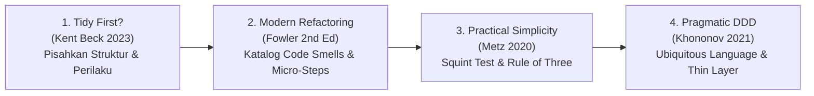

# Clean Code, Modern Refactoring & Architectural Invariants
> **Version:** 8.0.0 | **Standard:** SDD-Enterprise-Deterministic & Modern Software Craftsmanship  
> **Edisi Rujukan Mutakhir:**  
> 1. Martin Fowler — *Refactoring: Improving the Design of Existing Code* (2nd Edition, Modern JS/Functional)  
> 2. Kent Beck — *Tidy First?: A Personal Exercise in Empirical Software Design* (2023)  
> 3. Sandi Metz — *99 Bottles of OOP* (2nd Edition, 2020) & *Practical Object-Oriented Design* (POODR 2nd Ed)  
> 4. Vlad Khononov / Vaughn Vernon — *Learning Domain-Driven Design* (2021) / *DDD Distilled*  
> 5. Michael Nygard — *Release It!: Design and Deploy Production-Ready Software* (2nd Edition)  
> **Target:** Autonomous Coding Agents (Antigravity, Claude, Gemini, Cursor) & Senior Fullstack Engineers  
> **Trigger Tags:** `@clean-code`, `@refactor`, `#tidy` | **Playbook:** [`.agents/skills/clean-code-refactor/SKILL.md`](../skills/clean-code-refactor/SKILL.md)  
> **SSoT Companion:** [`.agents/rules/universal_invariants.md`](./universal_invariants.md), [`doc/architecture.md`](../../doc/architecture.md), [`AGENTS.md`](../../AGENTS.md)

---

## 1. PENDAHULUAN & PRINSIP DASAR

Sistem Valora Vault menolak "kode malas" (*code slop*), abstraksi prematur (*speculative generality*), dan kerumitan buatan (*incidental complexity*). Aturan di bawah ini adalah distilasi operasional dari edisi terbaru literatur rekayasa perangkat lunak dunia yang diterjemahkan menjadi **invarian sistem yang mengikat secara deterministik**.

---

## 2. 6 ATURAN INVARIAN MUTLAK MODERN CRAFTSMANSHIP

### [RULE-CC-01] GUARD CLAUSES & EARLY RETURN (KENT BECK 2023 / FOWLER 2ND ED)
- **Batasan Indentasi:** Kedalaman lekukan (*nesting level*) pada fungsi, method, atau blok Svelte 5 MAKSIMAL 2 tingkat.
- **Pola Guard Clause:** Tangani seluruh kondisi batas (*edge cases*), validasi gagal, atau otorisasi ditolak di bagian teratas fungsi dengan *early return* / *throw exception*.
- **Larangan `else` Bertumpuk (*Anti-Arrow Anti-Pattern*):**
  DILARANG menyusun `if (...) { if (...) { if (...) { ... } } }`. 
  Luruskan alur logika agar pembacaan kode mengalir vertikal dari atas ke bawah (*happy path at the bottom*).

---

### [RULE-CC-02] SEPARATION OF STRUCTURE AND BEHAVIOR (KENT BECK 2023 "TIDY FIRST?")
- **Dua Topi Rekayasa (*The Two Hats*):**
  Dalam setiap commit atau turn eksekusi agen, pisahkan secara tegas antara:
  1. **Perubahan Struktural (*Tidying*):** Merapikan penamaan, menghapus kode mati, mengekstrak variabel penjelas, atau menata urutan method tanpa mengubah perilaku fungsional sama sekali.
  2. **Perubahan Perilaku (*Behavioral Feature*):** Menambah fungsionalitas baru, mengubah logika bisnis, atau memodifikasi kontrak API.
- **Larangan Pencampuran Masif:** DILARANG mencampur refaktorisasi arsitektural besar dengan penambahan fitur baru dalam 1 giliran tanpa verifikasi perantara (*zero-regression proof*).

---

### [RULE-CC-03] SQUINT TEST & RULE OF THREE (SANDI METZ 2ND ED / YAGNI-KISS)
- **Heuristik Squint Test:** Jika kode dilihat dengan mata menyipit (*squint*) dan bentuk lekukan visualnya berubah-ubah secara liar atau warna syntax highlight terlalu beragam dalam 1 fungsi, fungsi tersebut mengalami pelanggaran kohesi (*Single Responsibility Violation*). Wajib dipecah.
- **Rule of Three (Anti-Abstraksi Dini):**
  - Duplikasi lebih murah daripada abstraksi yang salah (*Duplication is far cheaper than the wrong abstraction*).
  - DILARANG menciptakan helper, interface, repository, atau komponen bersama jika pola tersebut belum terbukti berulang minimal **3 kali** di tempat yang berbeda pada kode nyata.
  - Untuk operasi CRUD standar: Cukup gunakan Thin Controller + FormRequest + Eloquent Resource. DILARANG membuat lapisan Service/Repository fiktif.

---

### [RULE-CC-04] UBIQUITOUS DOMAIN NAMING (EVANS & KHONONOV 2021)
- **Penamaan Berorientasi Niat Bisnis (*Intention-Revealing Names*):**
  - DILARANG menggunakan nama variabel teknis generik yang membingungkan: `$data`, `$temp`, `$obj`, `$res`, `handle1()`, `processData()`.
  - Gunakan istilah bisnis dari *Ubiquitous Language* aplikasi: `$activeDeviceSessions`, `$revokedTokenCount`, `transitionToApproved()`, `calculateGrossAmortization()`.
- **Eliminasi Magic Numbers & Strings:**
  - Setiap konstanta numerik (misal timeout `5000`, kuota perangkat `3`, safe limit `1000`) wajib diberi nama konstanta eksplisit atau didokumentasikan dalam konfigurasi terpusat.
  - Nilai status domain WAJIB berformat `enum` atau konstanta bertipe, bukan string liar (*Primitive Obsession*).

---

### [RULE-CC-05] DEFENSIVE FAIL-FAST & RFC 7807 (NYGARD 2ND ED & BLOCH 3RD ED)
- **Fail-Fast Boundaries:** Validasi setiap input eksternal sesegera mungkin di pintu gerbang (*boundary*) menggunakan Laravel Form Request ketat.
- **Strict Typing:** Seluruh berkas PHP wajib diawali `declare(strict_types=1);` dengan type-hinting lengkap pada parameter, return type, dan property.
- **Standar RFC 7807:** Setiap kegagalan operasi HTTP (4xx & 5xx) wajib mengembalikan format Problem Details terstandar (`type`, `title`, `status`, `detail`, `errors`) tanpa membocorkan trace internal server.
- **Transactional Atomicity:** Mutasi data multi-tabel wajib dibungkus dalam `DB::transaction(fn() => ...)`.

---

### [RULE-CC-06] SVELTE 5 FUNCTIONAL SIMPLICITY (FOWLER 2ND ED MODERN JS)
- **Pure JavaScript Modern (ES2024+):** DILARANG menggunakan TypeScript (`.ts`) untuk frontend Valora Vault.
- **Runes Cohesion:**
  - Gunakan `$state` untuk state primitif/objek terfokus.
  - Gunakan `$derived.by()` untuk komputasi in-memory murni (misal: filtering tabel < 0.1ms tanpa mutasi array manual).
  - Gunakan `$effect` HANYA untuk sinkronisasi eksternal (DOM/listeners), bukan untuk kalkulasi state turunan.
- **4 Visual States Mandate:** Setiap komponen pemanggil data wajib menangani 4 visual state: Loading, Empty, Error, dan Success.

---

### [RULE-CC-07] ZERO ALIAS & CANONICAL EXPLICIT REFERENCES (ANTI-PROXY CONFUSION)
- **Larangan Alias & Synonym Map:** DILARANG KERAS membuat nama alias, kamus mapping alias (`aliases`, `alias_map`), wrapper alias, atau shorthand re-export untuk peran pengguna (*roles*), hak izin (*permissions*), rute (*routes*), method controller, model, tabel, kolom basis data, variabel state, maupun komponen antarmuka.
- **Transparansi SSoT:** Setiap referensi kode wajib memanggil nama kanonikal eksplisitnya. Hindari lapisan proxy atau nama samaran yang membingungkan alur pelacakan bug.

---

### [RULE-CC-08] ZERO UNAUTHORIZED CONSOLIDATION (PRESERVE BOUNDED CONTEXT & SRP)
- **Larangan Konsolidasi Monolitik Sepihak:** DILARANG KERAS menggabungkan (*merging/collapsing*) berkas terpisah, komponen terpisah, controller independen, skrip utilitas, atau peran pengguna yang berbeda menjadi modul monolitik raksasa (*mega-bundle*) tanpa persetujuan tertulis pengguna.
- **Integritas Relasional & Peran:** Dilarang mengonsolidasi beberapa peran menjadi peran gabungan fiktif (`consolidation_map`, `normalizeRoles`), dan dilarang mengonsolidasi tabel relasional 3NF menjadi kolom array/JSON bebas.
- **Prinsip Tanggung Jawab Tunggal:** Setiap file dan entitas harus menjaga batas domainnya (*Bounded Context*) dan fokus pada satu tanggung jawab saja (*Single Responsibility Principle*).

---

### [RULE-CC-09] ZERO-REGRESSION PROOF, ENTERPRISE TESTING DISCIPLINE & NO NEW BUGS (KHORIKOV 2020 / FOWLER / BECK)
- **Garansi 100% Bebas Bug Baru:** Setiap perubahan kode, baik penambahan fitur maupun refaktorisasi, WAJIB menjamin tidak merusak fitur yang sudah berjalan dan tidak menimbulkan masalah baru.
- **Audit Call Sites Komprehensif:** Sebelum memodifikasi struktur method, parameter, atau schema basis data, periksa seluruh tempat pemanggilan (*call sites*) untuk memastikan kompatibilitas penuh (*backward compatibility*).
- **4 Pilar Unit Test Berkualitas Tinggi (Vladimir Khorikov 2020):**
  1. *Protection against regressions* (Mencegah bug regresi).
  2. *Resistance to refactoring* (**Paling Utama**: Tes tidak boleh rusak saat struktur kode diubah selama perilakunya tetap benar; eliminasi *false positives*).
  3. *Fast feedback* (Eksekusi milidetik, small tests).
  4. *Maintainability* (Struktur DAMP over DRY, mudah dibaca, zero boilerplate liar).
- **Classical School (Detroit) Mandate & Anti-Over-Mocking:** DILARANG melakukan *mocking* terhadap database Eloquent, model, atau class internal. Mocking HANYA diperbolehkan untuk *unmanaged out-of-process dependencies* (email SMTP, payment gateway eksternal, SMS gateway).
- **Disiplin Pola AAA (Arrange-Act-Assert):** Setiap test case wajib dipisahkan secara tegas ke dalam 3 blok visual: Persiapan data (*Arrange*), Eksekusi method (*Act*), dan Verifikasi output observable (*Assert*).
- **Quality Gate Mandatory:** Wajib lulus 100% pengujian otomatis (`php artisan test` dan `npm run build`) sebelum commit atau laporan selesai. Rujukan SSoT Pengujian: [`doc/testing_standards.md`](../../doc/testing_standards.md).

---

### [RULE-CC-10] UNIVERSAL UI CARD MECHANISM, PER-PAGE CONTROLS, FRONTEND CSV EXPORT, ANTI-SESAK & FULLY VISIBLE TAB PANES
- **Tabel Data Wajib Berbasis Mekanisme Kartu & Ekspor CSV Front-End:** Setiap tabel data wajib mendukung transformasi kartu (auto-card stack pada mobile `< 768px`), kontrol interaktif pilihan jumlah data yang ditampilkan per halaman (`perPage`: 10, 25, 50, 100 entri), serta **tombol aksi ekspor CSV langsung dari sisi front-end** (*client-side in-memory zero-roundtrip* dengan UTF-8 BOM `\uFEFF`, escaping kutip dua ganda, dan mitigasi formula injection CWE-1236 via utility kanonikal `csvExport.js`).
- **Anti-Sesak & Spacious Breathing Room (HP & Laptop):** Seluruh antarmuka dilarang berdesakan atau terlihat penuh sesak. Gunakan padding, margin, spasi vertikal terukur, batas kontainer (`max-w-7xl`/`max-w-6xl mx-auto`), dan dock mobile mengambang yang tidak menutupi data.
- **Tab Pane Keterbacaan Penuh Tanpa Scroll Samping (Tab <= 6):** Panel tab navigasi moderat (<= 6 tab) dilarang menyembunyikan tab di balik scroll horizontal (`overflow-x-auto whitespace-nowrap`). Seluruh tab wajib langsung terlihat utuh menggunakan pembungkusan responsif (`flex flex-wrap items-center gap-1.5` atau layout grid adaptif).

---

### [RULE-CC-11] ELEGAN MINIMALIS, TIPOGRAFI TERBACA, NEGATIVE SPACE, & AKSESIBILITAS WCAG 2.2 AAA
- **Weniger, aber besser (Dieter Rams):** Hapus seluruh ornamen visual berlebih, border tebal, atau saturasi warna agresif. Keanggunan dicapai melalui fungsi yang jelas dan keselarasan proporsi.
- **Keterbacaan Tipografi (Robert Bringhurst):** Panjang baris teks paragraf dan form dibatasi ideal 45–75 CPL. Seluruh angka keuangan, timestamp, UUID, dan data tabular WAJIB menggunakan `font-mono`.
- **Negative Space & Rasio Data-ke-Tinta (Edward Tufte & Refactoring UI):** Maksimalkan rasio data-ke-tinta. Pisahkan kelompok data menggunakan whitespace terukur (*Gestalt Proximity*) dengan hairline border 1px lembut (`border-slate-200/80 dark:border-slate-800/80`) dan bayangan mikro `shadow-2xs`.
- **Batas Kontainer Terkendali:** Konten DILARANG membentang 100% tanpa batas pada monitor desktop lebar. Gunakan kontainer `max-w-3xl`/`max-w-4xl` untuk membaca/form dan `max-w-6xl`/`max-w-7xl` untuk dasbor/tabel dengan `mx-auto px-4 sm:px-6 lg:px-8`.
- **Aksesibilitas Universal:** Rasio kontras teks $\ge 4.5:1$ (AA) / $7:1$ (AAA), touch target $\ge 44\times 44$ px, dan cincin fokus keyboard tegas (`focus-visible:ring-2 focus-visible:ring-emerald-500`).

---

### [RULE-CC-12] MASTERPIECE CRAFTSMANSHIP, KEASLIAN KARYA (HUMAN-CRAFTED AUTHENTICITY), & KEBIJAKAN ANTI-AI SLOP
- **Eliminasi Klise Visual AI:** DILARANG KERAS menggunakan latar belakang gradient ungu-pink neon (`from-indigo-500 via-purple-500 to-pink-500`), cyan glow berlebihan, ornamen blob lingkaran blur (`blur-3xl opacity-30`) tanpa fungsi, atau frosted glass berlebihan yang mengorbankan keterbacaan teks.
- **Karya Berkarakter & Human-Crafted Feel:** Terapkan palet tonal teredam bermartabat (*dignified muted tonal palette*) monokrom Slate/Stone/Obsidian yang dipadukan dengan tepat 1 warna aksen fungsional berkarakter. Wajib menggunakan batas halus 1px hairline border, tipografi terstruktur, dan negative space proporsional.
- **Purpose-Driven UI (Ockham's Razor):** Setiap elemen antarmuka wajib memiliki alasan keberadaan fungsional yang jelas. Hapus seluruh ornamen dekoratif yang tidak meningkatkan pemahaman atau navigasi data.

---

## 3. CHECKLIST VERIFIKASI SEBELUM MENYATAKAN KODE "CLEAN"

Sebelum Agen AI atau Rekayasawan menandai tugas selesai:
- [ ] Apakah fungsi/method bebas dari indentasi lebih dari 2 tingkat?
- [ ] Apakah kondisi invalid/error ditangani pertama kali dengan Guard Clauses?
- [ ] Apakah tidak ada lapisan abstraksi berlebih (Service/Repository kosong) untuk operasi CRUD standar?
- [ ] Apakah nama variabel dan fungsi menggunakan kosakata domain bisnis yang jelas?
- [ ] Apakah tidak ada pembuatan alias penamaan (`aliases`, `alias_map`, dsb.) dan seluruh entitas memakai nama kanonikal eksplisit?
- [ ] Apakah tidak ada konsolidasi file, komponen, peran, atau tabel sepihak tanpa izin pengguna?
- [ ] Apakah seluruh tabel data mengimplementasikan mekanisme kartu, pemilih jumlah data per halaman (10, 25, 50, 100), dan fitur ekspor CSV front-end in-memory?
- [ ] Apakah antarmuka terhindar dari kesan sesak/penuh (anti-sesak & spacious breathing room) di layar HP dan laptop?
- [ ] Apakah seluruh bilah tab (<= 6 tab) langsung terlihat penuh tanpa terpotong scroll horizontal?
- [ ] Apakah antarmuka mematuhi standar minimalis elegan, ritme tipografi 45-75 CPL, negative space Tufte, batas kontainer 6xl/7xl, dan WCAG AAA?
- [ ] Apakah antarmuka terbebas dari klise visual AI (anti-AI slop, zero useless blobs, zero gaudy gradients) dan mencerminkan masterpiece human-crafted craftsmanship?
- [ ] Apakah mutasi multi-tabel terbungkus `DB::transaction`?
- [ ] Apakah frontend Svelte 5 murni Pure JavaScript dengan penanganan 4 visual state?
- [ ] Apakah seluruh tes PHPUnit lulus 100% dan build frontend bersih (0 error, 0 a11y warning)?
- [ ] Apakah eksekusi prompt terbukti 100% zero-regression tanpa menimbulkan bug atau masalah baru?
