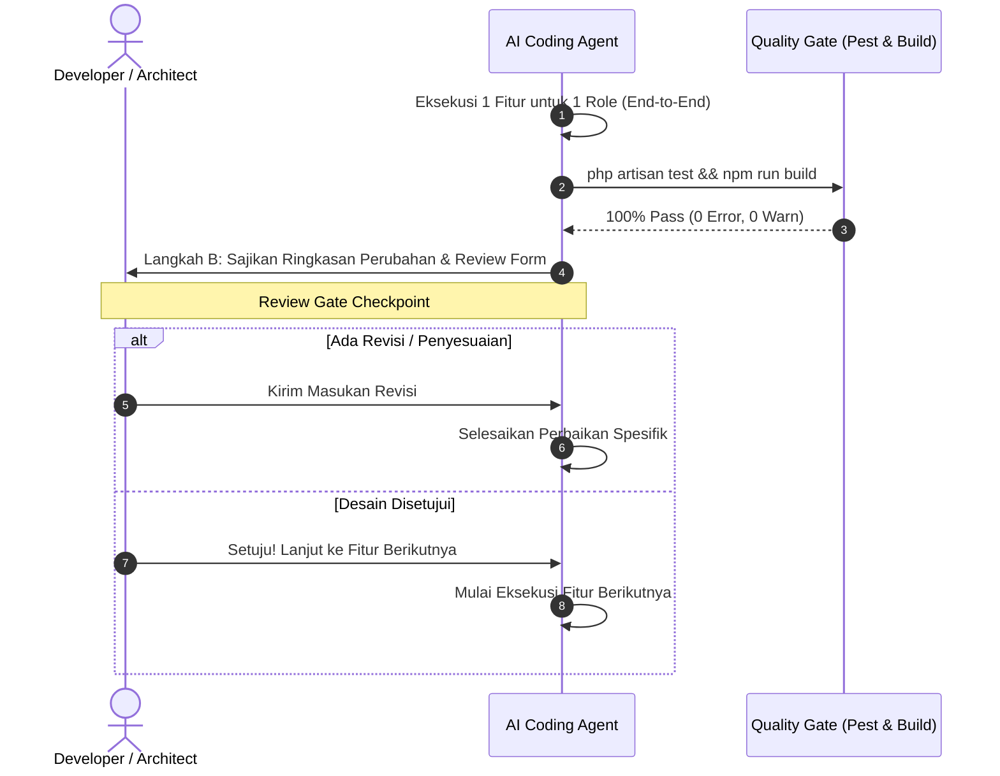

# Protokol Eksekusi AI Modular (Human-in-the-Loop)
> **Standard:** SDD-Enterprise-Deterministic v8.0.0  
> **Governance:** Zero-Hallucination & Anti-Slop Strict Enforcement

---

## 1. TUJUAN & LATAR BELAKANG

Penyusunan kode berskala besar sering kali menghasilkan *hallucination drift* dan kode dangkal (*code slop*) jika AI Agent diminta menghasilkan seluruh modul dan antarmuka sekaligus dalam satu giliran (*bulk generation*). Protokol ini menegakkan batasan kerja deterministik dengan kendali manusia penuh (*Human-in-the-Loop*).

---

## 2. ATURAN UTAMA PROTOKOL

### [RULE-HITL-01] Zero-Bulk Generation Policy
- **DILARANG KERAS** mengenerate semua peran (*roles*) dan seluruh fitur aplikasi sekaligus dalam satu putaran instruksi.
- Permintaan massal wajib dipecah menjadi unit kerja granular sebelum dieksekusi.

### [RULE-HITL-02] Granularitas Unit Kerja (Single Feature Turn)
- Eksekusi kode HANYA **1 Fitur untuk 1 Role** dalam satu kali giliran kerja (*single feature turn*).
- Setiap unit kerja wajib mencakup siklus hidup fungsional yang tuntas (*end-to-end*):
  1. Migrasi database dengan B-Tree index terdefinisi.
  2. Model Eloquent dengan `$fillable` dan relasi lengkap.
  3. Form Request untuk validasi input ketat.
  4. Laravel Policy untuk mencegah BOLA (Broken Object Level Authorization).
  5. Thin Controller / Action Class dengan transaksi atomik `DB::transaction`.
  6. Feature Test PHPUnit dengan minimal 3 skenario: 200/201 OK, 422 Unprocessable Entity, 403 Forbidden.
  7. Komponen UI Svelte 5 Runes murni dengan 4 state visual (Loading, Empty, Error, Success).

### [RULE-HITL-03] Review Gate & Approval Loop
Setiap akhir giliran eksekusi fitur, AI Agent WAJIB mengikuti 3 langkah persetujuan terstruktur:

- **Langkah A (Full End-to-End Delivery):** Tuntaskan seluruh berkas kode, pengujian, dan dokumentasi terkait fitur tersebut hingga `php artisan test` dan `npm run build` lulus 100%.
- **Langkah B (Review Gate Form):** Sajikan ringkasan perubahan teknis dan ajukan formulir peninjauan resmi:
  > *"Implementasi Fitur [Nama Fitur] untuk Role [Nama Role] selesai. Seluruh test lulus 100% dan UI menangani 4 visual state. Apakah ada perbaikan/revisi spesifik yang diinginkan sebelum melangkah ke fitur berikutnya?"*
- **Langkah C (Approval Proceed):** AI Agent DILARANG melanjutkan pembuatan kode untuk fitur atau peran berikutnya tanpa izin eksplisit dari pengguna.

### [RULE-HITL-04] Zero Aliasing & Explicit SSoT Naming Mandate
- **DILARANG KERAS** membuat atau memperkenalkan alias, mapping alias (`aliases`, `alias_map`), wrapper class/method buatan, shorthand re-export, atau nama alternatif untuk peran pengguna (*roles*), hak izin (*permissions*), endpoint rute (*routes*), method controller, model, tabel, kolom basis data, variabel state, maupun komponen antarmuka.
- Seluruh referensi wajib menggunakan nama kanonikal eksplisit (Single Source of Truth). Jika sistem membutuhkan pembedaan perilaku per peran, tuliskan pengecekan eksplisit tanpa menciptakan lapisan proxy atau kamus alias tersembunyi.

### [RULE-HITL-05] Zero Unauthorized Consolidation Mandate
- **DILARANG KERAS** menggabungkan (*consolidating/collapsing*) berkas terpisah, komponen terpisah, controller independen, skrip utilitas, atau peran pengguna yang berbeda menjadi berkas monolitik atau peran gabungan tanpa instruksi eksplisit tertulis dari pengguna.
- Setiap modul wajib menjaga batas domainnya (*Bounded Context*) dan prinsip tanggung jawab tunggal (*Single Responsibility Principle*).
- Dilarang mengonsolidasi tabel relasional 3NF menjadi kolom array/JSON bebas yang melanggar integritas data.

### [RULE-HITL-06] Zero Regression Execution & No New Bugs Verification Gate
- Setiap eksekusi prompt (fitur baru, perbaikan bug, atau refaktorisasi) WAJIB menjamin 0 bug baru dan 0 efek samping regresi terhadap fitur yang sudah berjalan.
- **Mandat Verifikasi Mutlak:**
  1. Jalankan `php artisan test tests/Feature` (100% lulus, 0 failure).
  2. Jalankan `cd frontend && npm run build` (100% sukses, 0 error).
  3. Cek menyeluruh seluruh *call sites* dan dependensi terkait sebelum mengubah fungsi, kontrak API, atau model yang sudah ada.
  4. Jika terdapat kegagalan atau efek samping yang muncul akibat eksekusi, agen WAJIB memperbaikinya secara otonom hingga tuntas dan bersih sebelum menyajikan formulir Review Gate ke pengguna.
