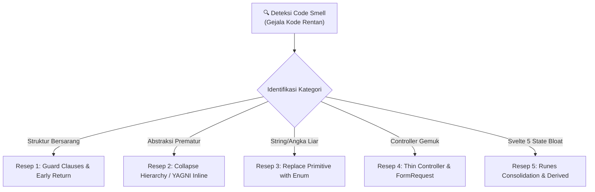

# Clean Code Craftsmanship & Empirical Refactoring Engine
> **Standar Edisi Terbaru:** Martin Fowler (2nd Ed, Modern JS/Functional), Kent Beck (*Tidy First?* 2023), Sandi Metz (*99 Bottles of OOP* 2nd Ed 2020), Vlad Khononov (*Learning Domain-Driven Design* 2021).  
> **Target:** Autonomous Coding Agents & Lead Engineers  
> **SSoT Companion:** `.agents/rules/clean_architecture_invariants.md`, `.agents/rules/universal_invariants.md`

---

## 1. IKHTISAR & FILOSOFI REKAYASA MODERN

Keahlian (*skill*) ini bukan sekadar panduan estetika visual, melainkan **metodologi empiris** untuk menjaga sistem tetap mudah dipahami, mudah dimodifikasi, dan bebas dari cacat regresi (*zero regression*).

### Tiga Hukum Kedewasaan Kode (Code Maturity Laws):
1. **The Cost of Change (Kent Beck 2023):**  
   Biaya mengubah perangkat lunak ditentukan oleh seberapa mudah struktur kode dipahami. Merapikan struktur sebelum menambah perilaku (*Tidy First?*) menurunkan biaya rekayasa jangka panjang.
2. **Duplication vs. Wrong Abstraction (Sandi Metz 2020):**  
   Duplikasi kode 10x lebih murah untuk diperbaiki daripada abstraksi prematur yang salah. Jangan mengekstrak shared module sebelum aturan *Rule of Three* terpenuhi.
3. **Continuous Micro-Refactoring (Martin Fowler 2nd Ed):**  
   Refaktorisasi bukan proyek besar 6 bulan yang membekukan bisnis, melainkan langkah-langkah mikro (*micro-steps*) yang dilakukan setiap hari di sela-sela penambahan fitur.

---

## 2. STRUKTUR DIREKTORI & MODUL PENDUKUNG

Skill ini dilengkapi dengan katalog resep refaktorisasi mendalam dan skrip auditor kualitas kode otomatis:

```
.agents/skills/clean-code-refactor/
├── SKILL.md                             # Playbook utama & orchestrator (berkas ini)
├── references/
│   └── code_smells_and_recipes.md      # Katalog komprehensif 7 code smells, anti-patterns & resep refaktor
└── scripts/
    └── audit-code-quality.ps1          # Skrip auditor otomatis kepatuhan Clean Code & Anti-Slop
```

---

## 3. KATALOG 7 MODERN CODE SMELLS & RESEP REFAKTORISASI
> **Rujukan Lengkap:** Rujuk panduan mendalam di [`references/code_smells_and_recipes.md`](./references/code_smells_and_recipes.md) untuk implementasi detail dan studi kasus.



### Smell 1: Arrow Anti-Pattern & Deep Nesting (> 2 Level)
- **Gejala:** Kode bercabang-cabang dengan `if` di dalam `if` di dalam `else` hingga membentuk anak panah ke kanan (*Pyramid of Doom*).
- **Akar Masalah:** Mencampur validasi kondisi batas (*edge cases*) dengan alur utama (*happy path*).
- **Resep Refaktor:** *Replace Nested Conditional with Guard Clauses* (Beck 2023 / Fowler 2nd Ed).
  - Pindahkan validasi gagal ke baris paling atas fungsi.
  - Segera return atau throw exception.
  - Alur utama diletakkan di tingkat indentasi terluar (tingkat 0/1).

### Smell 2: Speculative Generality & Over-Abstraction (Arsitektur Fiktif)
- **Gejala:** Menambahkan interface, DTO, Repository, dan Service berantai untuk modul yang hanya menjalankan operasi CRUD sederhana ke satu tabel database.
- **Akar Masalah:** Mengantisipasi kebutuhan masa depan yang belum tentu terjadi (*You Aren't Gonna Need It*).
- **Resep Refaktor:** *Collapse Hierarchy & Inline Class* (Metz 2020).
  - Gunakan Thin Controller langsung memanggil Eloquent ORM.
  - Validasi ketat pada Form Request.
  - Ekstrak Action Class HANYA jika terjadi mutasi lintas tabel yang transaksional (`DB::transaction`).

### Smell 3: Primitive Obsession pada Status & Tipe
- **Gejala:** Menggunakan string biasa (`'active'`, `'draft'`, `'in_review'`) yang tersebar di controller, query, dan frontend tanpa perlindungan tipe.
- **Akar Masalah:** Rawan *typo* dan menyulitkan pelacakan perubahan status.
- **Resep Refaktor:** *Replace Type Code with Enums & Visual Pills*.
  - Backend: Definisikan PHP 8.3 Backed Enum atau konstanta terpusat.
  - Database: Kolom `enum` eksplisit pada migrasi.
  - Frontend: Status badge pills dengan warna semantik seragam.

### Smell 4: Fat Controller & Multi-Responsibility
- **Gejala:** Satu method controller berisi 150 baris yang memvalidasi request, menghitung formula, menulis database, mengirim email, dan menyusun JSON response.
- **Akar Masalah:** Pelanggaran *Single Responsibility Principle* (SRP).
- **Resep Refaktor:** *Extract Form Request & Eloquent Resource*.
  - Pindahkan aturan validasi ke `FormRequest`.
  - Pindahkan transformasi data ke `JsonResource`.
  - Sisakan controller hanya sebagai *HTTP Traffic Conductor* (< 20 baris per method).

### Smell 5: Svelte Store / State Mutator Bloat
- **Gejala:** Menggunakan sintaks legasi Svelte 4 (`export let`, `$:`) atau memodifikasi array secara mutable (`items.push()`) yang memicu inkonsistensi rendering.
- **Akar Masalah:** Tidak memanfaatkan keunggulan kompilasi reaktif Svelte 5 Native Runes.
- **Resep Refaktor:** *Migrate to Native Runes ($state, $derived.by)*.
  - Filter dan kalkulasi tabel dihitung otomatis via `$derived.by()` (< 0.1ms).
  - Hindari `$effect` kecuali untuk integrasi event DOM eksternal.

### Smell 6: Silent Failure & Missing Error Representation
- **Gejala:** Menggunakan `try { ... } catch (\Exception $e) { return response()->json(['error' => 'fail']); }` tanpa logging dan tanpa detail kesalahan terstruktur.
- **Akar Masalah:** Mempersulit debugging tim dan membingungkan pengguna.
- **Resep Refaktor:** *Standardized RFC 7807 Problem Details & Structured Logging*.
  - Kembalikan objek RFC 7807 lengkap (`type`, `title`, `status`, `detail`, `errors`).
  - Log error kritis ke `storage/logs/laravel.log`.

### Smell 7: Broken 4-Visual-State Antarmuka
- **Gejala:** Halaman frontend langsung menampilkan layar kosong putih saat loading atau saat data di database 0 record.
- **Akar Masalah:** Mengabaikan siklus hidup visual komponen.
- **Resep Refaktor:** *Mandatory 4-State UI Assembly*.
  - Sediakan `ElementLoader` (Loading).
  - Sediakan ilustrasi bersahabat + CTA (Empty State).
  - Sediakan pesan RFC 7807 + tombol 'Coba Lagi' (Error State).
  - Sediakan tabel reaktif ber-filter in-memory (Success State).

### Smell 8: Aliasing & Proxy Naming Confusion (Zero Aliasing Violation)
- **Gejala:** Menambahkan kamus pemetaan alias (`aliases`, `alias_map`), method alias, atau re-export alternatif untuk peran (*roles*), hak izin (*permissions*), rute (*routes*), kolom database, atau komponen antarmuka.
- **Akar Masalah:** Mencoba mengakomodasi inkonsistensi penamaan dengan membuat lapisan alias alih-alih merapikan rujukan ke nama kanonikal aslinya.
- **Resep Refaktor:** *Eliminate Aliases & Enforce Canonical SSoT Naming*.
  - Hapus seluruh kamus mapping alias.
  - Panggil entitas hanya dengan nama kanonikal eksplisitnya di seluruh backend dan frontend.
  - Lakukan refaktorisasi serentak pada seluruh *call sites* menggunakan penamaan kanonikal yang sama.

### Smell 9: Unauthorized Consolidation & Mega-Bundle Bloat
- **Gejala:** Menggabungkan beberapa file modul terpisah, controller mandiri, skrip utilitas, atau beberapa peran pengguna (*roles*) menjadi satu file monolitik atau peran komposit tanpa persetujuan pengguna.
- **Akar Masalah:** Terjebak dalam ilusi "merampingkan file" padahal justru merusak prinsip pemisahan domain (*Bounded Context*) dan mempersulit pengujian.
- **Resep Refaktor:** *Preserve Bounded Context & Single Responsibility*.
  - Jaga setiap modul terpisah tetap fokus pada satu tanggung jawab (*Single Responsibility Principle*).
  - Dilarang mengonsolidasi tabel relasional 3NF menjadi kolom array/JSON bebas.
  - Pertahankan kemandirian setiap peran pengguna secara presisi.

---

## 4. CONTOH NYATA: BEFORE VS AFTER REFACTORING

### Kasus 1: Backend Controller (Laravel 13 / PHP 8.3+)

#### ❌ BEFORE (Messy, Deep Nesting, Primitive Obsession):
```php
public function updateStatus(Request $request, $id) {
    $user = User::find($id);
    if ($user) {
        if ($request->has('status')) {
            if ($request->status == 'active' || $request->status == 'suspended') {
                $user->status = $request->status;
                $user->save();
                return response()->json(['msg' => 'ok']);
            } else {
                return response()->json(['msg' => 'invalid status'], 400);
            }
        } else {
            return response()->json(['msg' => 'status required'], 400);
        }
    } else {
        return response()->json(['msg' => 'user not found'], 404);
    }
}
```

#### ✅ AFTER (Clean, Guard Clauses, Strict Typing, RFC 7807, Policy Guard):
```php
declare(strict_types=1);

namespace App\Http\Controllers\Api\V1\Admin;

use App\Http\Controllers\Controller;
use App\Http\Requests\Admin\UpdateUserStatusRequest;
use App\Models\User;
use Illuminate\Http\JsonResponse;

class AdminUserController extends Controller
{
    public function updateStatus(UpdateUserStatusRequest $request, User $user): JsonResponse
    {
        $this->authorize('update', $user);

        $newStatus = $request->validated('status');
        
        $user->update(['status' => $newStatus]);

        return response()->json([
            'message' => "Status pengguna berhasil diperbarui menjadi {$newStatus}.",
            'data' => [
                'id' => $user->id,
                'status' => $user->status,
                'updated_at' => $user->updated_at?->toIso8601String(),
            ]
        ], 200);
    }
}
```

---

### Kasus 2: Frontend Data Filter (Svelte 5 Runes)

#### ❌ BEFORE (Legacy Store, Mutation, Unhandled States):
```html
<script>
  export let users = [];
  let query = '';
  let filtered = [];

  $: {
    filtered = [];
    for (let i = 0; i < users.length; i++) {
      if (users[i].name.includes(query)) {
        filtered.push(users[i]);
      }
    }
  }
</script>

<input bind:value={query} />
{#each filtered as u}
  <p>{u.name}</p>
{/each}
```

#### ✅ AFTER (Svelte 5 Runes, In-Memory Derived < 0.1ms, 4 Visual States):
```svelte
<script>
  import ElementLoader from '$lib/components/ui/ElementLoader.svelte';

  let { users = [], loading = false, errorMessage = null, onRetry = () => {} } = $props();

  let searchQuery = $state('');

  // Svelte 5 In-Memory Pure Filtering (Zero Network Request, < 0.1ms)
  let filteredUsers = $derived.by(() => {
    const q = searchQuery.trim().toLowerCase();
    if (!q) return users;
    return users.filter((u) => u.name?.toLowerCase().includes(q) || u.email?.toLowerCase().includes(q));
  });
</script>

<div class="space-y-4">
  <input
    type="search"
    bind:value={searchQuery}
    placeholder="Cari pengguna berdasarkan nama atau email..."
    class="w-full px-4 py-2 text-xs rounded-xl border border-stone-300 dark:border-stone-700 bg-white dark:bg-stone-900"
  />

  {#if loading}
    <!-- 1. LOADING STATE -->
    <ElementLoader text="Memuat daftar pengguna..." />
  {:else if errorMessage}
    <!-- 2. ERROR STATE (RFC 7807 Friendly) -->
    <div class="p-6 rounded-2xl border border-rose-200 bg-rose-50/50 text-center space-y-2">
      <p class="text-xs font-bold text-rose-700">{errorMessage}</p>
      <button type="button" onclick={onRetry} class="px-3.5 py-1.5 bg-rose-600 text-white rounded-lg text-xs font-semibold">
        🔄 Coba Lagi
      </button>
    </div>
  {:else if filteredUsers.length === 0}
    <!-- 3. EMPTY STATE -->
    <div class="p-8 rounded-2xl border border-stone-200 text-center space-y-2">
      <p class="text-xs font-bold text-stone-700">Tidak ada pengguna ditemukan</p>
      <p class="text-[11px] text-stone-500">Coba ubah kata kunci pencarian Anda.</p>
    </div>
  {:else}
    <!-- 4. SUCCESS STATE -->
    <div class="divide-y divide-stone-100 dark:divide-stone-800">
      {#each filteredUsers as user (user.id)}
        <div class="py-2.5 flex items-center justify-between text-xs">
          <span class="font-bold text-stone-800 dark:text-stone-200">{user.name}</span>
          <span class="font-mono text-stone-500">{user.email}</span>
        </div>
      {/each}
    </div>
  {/if}
</div>
```

---

## 5. WORKFLOW OPERASIONAL: 4-STEP REFAC-TIDYING LOOP

Ketika dipanggil untuk membersihkan atau merapikan kode:

1. **Step 1: Check Inbound References (Zero Regression Proof):**
   Gunakan pencarian referensi sebelum menghapus fungsi/berkas apapun:
   ```powershell
   git grep "NamaMethodAtauBerkas"
   ```
2. **Step 2: Tidy Structurally First (Kent Beck 2023):**
   Rapikan guard clauses, ekstrak variabel penjelas, buang kode mati, dan format ulang file tanpa mengubah logika atau tanda tangan kontrak API.
3. **Step 3: Automated Quality & Craftsmanship Audit:**
   Jalankan skrip audit otomatis untuk memastikan kepatuhan mutlak terhadap 6 pilar Clean Code & Anti-Slop:
   ```powershell
   powershell -ExecutionPolicy Bypass -File .agents/skills/clean-code-refactor/scripts/audit-code-quality.ps1
   ```
4. **Step 4: Automated Verification Barrier (Zero New Bugs Guarantee):**
   Jalankan pengujian unit dan kompilasi build frontend untuk menjamin 100% tidak ada regresi dan tidak ada bug/masalah baru yang timbul:
   ```powershell
   cd backend && php artisan test tests/Feature
   cd ../frontend && npm run build
   ```
   Seluruh test wajib 100% Green dan build wajib 0 error sebelum menyatakan tugas tuntas.

---

## 6. UNIT & INTEGRATION TESTING CRAFTSMANSHIP PLAYBOOK (KHORIKOV / FOWLER / BECK / DODDS)
> **Whitepaper SSoT:** Panduan arsitektur pengujian lengkap dapat dibaca di [`doc/testing_standards.md`](../../../doc/testing_standards.md).

### 1. Template Uji Unit Backend Presisi (Pola AAA & Classical Detroit School)
```php
<?php

declare(strict_types=1);

namespace Tests\Unit;

use Tests\TestCase;

class SystemCalculationTest extends TestCase
{
    /**
     * Uji kalkulasi bisnis deterministik: Fast (< 5ms), 0 DB latency, 100% deterministik.
     */
    public function test_kalkulasi_metrik_presisi_tanpa_efek_samping(): void
    {
        // 1. ARRANGE
        $input = 1_000_000;
        $taxRate = 0.11;
        $expectedTax = 110_000;

        // 2. ACT
        $actual = (int) round($input * $taxRate);

        // 3. ASSERT (Uji observable outcome, bukan implementasi privat)
        $this->assertSame($expectedTax, $actual);
    }
}
```

### 2. Template Uji Boundary API & Sekuriti (Feature Testing)
```php
<?php

declare(strict_types=1);

namespace Tests\Feature;

use App\Models\User;
use Illuminate\Foundation\Testing\RefreshDatabase;
use Tests\TestCase;

class SecurityBolaAuthorizationTest extends TestCase
{
    use RefreshDatabase;

    public function test_pengguna_dilarang_mengakses_data_privat_pengguna_lain(): void
    {
        // 1. ARRANGE
        $userA = User::factory()->create(['is_active' => true]);
        $userB = User::factory()->create(['is_active' => true]);

        // 2. ACT
        $response = $this->actingAs($userA)->getJson("/api/v1/admin/users/{$userB->id}");

        // 3. ASSERT (Mitigasi OWASP A01 BOLA: Wajib 403 Forbidden RFC 7807)
        $response->assertStatus(403);
    }
}
```

