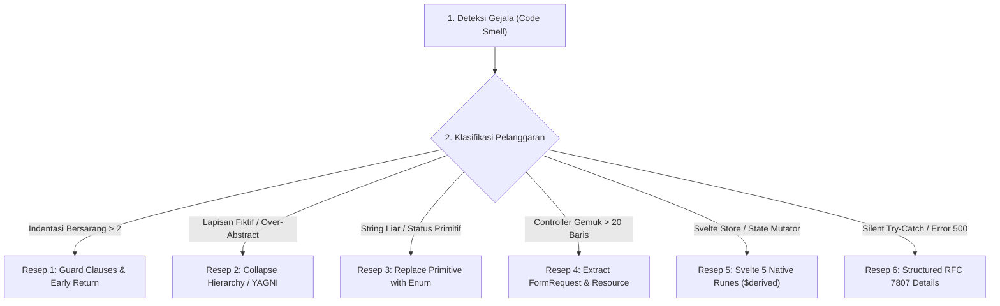

# Katalog Code Smells & Resep Refaktor Modern (code_smells_and_recipes.md)
> **Engine:** Valora Vault v6.31.0 / v8.0.0 SDD-Enterprise-Deterministic  
> **Standar Rujukan:** Martin Fowler (2nd Ed, Modern JS/Functional), Kent Beck (*Tidy First?* 2023), Sandi Metz (*99 Bottles of OOP* 2nd Ed 2020), Vlad Khononov (*Learning DDD* 2021)

---

## 1. TUJUAN & FILOSOFI REFAKTORISASI

Refaktorisasi di Valora Vault bukan tentang menulis ulang seluruh sistem dari nol, melainkan **langkah-langkah mikro terukur (*empirical micro-steps*)** untuk memperbaiki struktur internal tanpa mengubah perilaku eksternal (*Zero-Regression*).

---

## 2. KATALOG 7 MODERN CODE SMELLS & RESEP REFAKTORISASI

### Resep 1: Guard Clauses & Early Return (Kent Beck 2023 / Fowler 2nd Ed)
- **Gejala (The Arrow Anti-Pattern):** Indentasi kode bertingkat-tingkat (`if` di dalam `if` di dalam `else`) membentuk panah piramida ke kanan.
- **Penyelesaian:**
  - Evaluasi seluruh kondisi gagal atau *unauthorized* di baris paling awal.
  - Segera lakukan `return` atau lempar `HttpException`.
  - Pertahankan alur sukses (*happy path*) berada di tingkat indentasi terluar.

### Resep 2: Collapse Hierarchy & YAGNI Inline (Sandi Metz 2020)
- **Gejala (Speculative Generality):** Membuat DTO, Repository, dan Service berantai untuk satu tabel CRUD biasa.
- **Penyelesaian:**
  - *Rule of Three:* Jangan buat abstraksi bersama sebelum pola berulang minimal 3 kali pada kasus nyata.
  - Gunakan Thin Controller langsung dengan Eloquent ORM.
  - Buat Action Class HANYA jika melibatkan mutasi transaksional multi-tabel (`DB::transaction`).

### Resep 3: Replace Primitive with Backed Enum (Evans / Khononov 2021)
- **Gejala (Primitive Obsession):** Status transaksi disimpan sebagai string biasa (`'active'`, `'draft'`) di mana-mana sehingga rentan salah ketik (*typo*).
- **Penyelesaian:**
  - Backend: Definisikan PHP 8.3 Backed Enum (misal: `enum BerkasStatus: string`).
  - Database: Kolom `enum` eksplisit pada migrasi Laravel.
  - Frontend: Status badge pills dengan warna semantik seragam.

### Resep 4: Thin Controller & Resource Extraction (PoEAA Fowler)
- **Gejala (Fat Controller):** Method controller memuat validasi request, perhitungan matematis, kueri database, dan formatting JSON dalam satu tempat.
- **Penyelesaian:**
  - Pindahkan validasi ke `FormRequest`.
  - Pindahkan transformasi data ke `JsonResource`.
  - Jadikan controller hanya sebagai konduktor HTTP berukuran $< 20$ baris per method.

### Resep 5: Native Runes Consolidation (Svelte 5)
- **Gejala (State Bloat & Unhandled States):** Menggunakan sintaks legasi Svelte 4 (`export let`, `$:`) atau filter array manual di template.
- **Penyelesaian:**
  - Gunakan `$derived.by()` untuk pencarian dan pemfilteran tabel in-memory (< 0.1ms).
  - Pastikan 4 visual state ditangani: Loading, Empty, Error (RFC 7807), dan Success.

### Resep 6: RFC 7807 Problem Details (Nygard 2nd Ed)
- **Gejala (Silent Failure):** Menangkap exception tanpa logging atau mengembalikan `{ "error": true }` tanpa rincian.
- **Penyelesaian:**
  - Kembalikan format RFC 7807 terstandar: `type`, `title`, `status`, `detail`, `errors`.
  - Catat jejak error kritis secara aman ke storage log tanpa membocorkan kredensial ke klien.

### Resep 7: The Squint Test (Sandi Metz POODR)
- **Gejala:** Saat mata menyipit (*squint*), lekukan visual kode berubah-ubah secara drastis dalam satu fungsi.
- **Penyelesaian:**
  - Pecah fungsi menjadi fungsi-fungsi kecil yang memiliki tingkat abstraksi tunggal (*Single Level of Abstraction Principle - SLAP*).

### Resep 8: UI/UX Anti-Patterns & Visual Slop (Integrasi UI/UX Pro Max)
- **Gejala (The "Fisher-Price" & Inaccessible UI Smell):**
  1. *Invisible Accessibility:* Tombol ikon tanpa atribut `aria-label`, menghapus focus ring (`focus:outline-none` tanpa pengganti), atau teks abu-abu berlatar abu-abu dengan rasio kontras $< 4.5:1$ (WCAG AA) / $< 7:1$ (WCAG AAA).
  2. *Microscopic Hit Targets:* Tombol mikro atau aksi jempol dengan ukuran tap $< 44 \times 44\text{px}$ atau jarak antar-tombol $< 8\text{px}$ yang menyebabkan salah sentuh (*mis-taps* pada mobile).
  3. *Emoji as Structural Icons:* Menggunakan karakter emoji teks (misal: 📁, ⚙️, 🚀, 🗑️) sebagai ikon navigasi/tabel alih-alih vektor SVG yang dapat dikontrol warna dan ukurannya via design tokens.
  4. *Instant Jitter & Layout Thrashing:* Perubahan status 0ms seketika tanpa kehalusan visual, atau efek hover/active yang mengubah ukuran *layout bounds* (`border-width` membesar saat hover sehingga menggeser konten di sebelahnya).
  5. *Form Mystery Meat:* Formulir tanpa tag `<label>` visual yang hanya mengandalkan `placeholder`, atau menampilkan pesan kesalahan hanya di bagian atas layar tanpa indikasi inline di sebelah field yang bermasalah.
- **Penyelesaian:**
  - Wajib menyertakan `aria-label` deskriptif pada seluruh tombol berikon saja (*icon-only controls*).
  - Pastikan target sentuh mobile minimal $44\text{px}$ (dengan padding hit-area ekstra jika ikon visual berukuran kecil).
  - Wajib gunakan ikon vektor SVG kanonikal murni.
  - Terapkan transisi halus CSS (`transition-colors duration-150` atau spring physics terukur, durasi 80–150ms).
  - Wajib `<label for="...">` eksplisit dan inline error feedback tepat di bawah input field.

---

## 3. CHECKLIST PRA-MERGE ZERO-REGRESSION

Sebelum menandai refaktorisasi selesai:
- [ ] Inbound reference check membuktikan tidak ada pemanggil yang rusak (`git grep`).
- [ ] Seluruh endpoint memiliki Feature Test PHPUnit yang lulus 100%.
- [ ] Build frontend (`npm run build`) selesai dengan exit code 0 dan 0 warning aksesibilitas.
- [ ] Kueri backend mematuhi plafon kueri aman `limit(1000)`.
