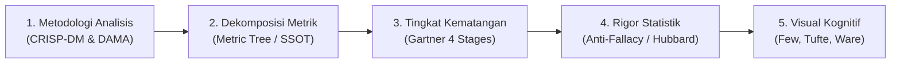
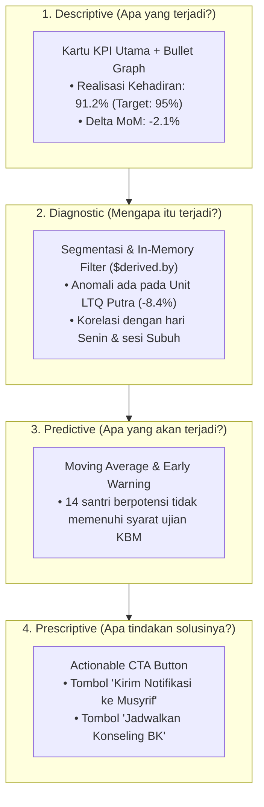

# Pedoman Praktik Terbaik Analisis Data Internasional (Data Analysis Best Practices)
> **Engine:** Hyperion Vault v6.31.0 / v8.0.0 SDD-Enterprise-Deterministic  
> **Standar Rujukan:** CRISP-DM (Chapman, 2000), DAMA-DMBOK 2nd Ed, Gartner Analytics Maturity, Ralph Kimball (2013), Stephen Few (2013), Edward Tufte (2001), Colin Ware (2020), Douglas Hubbard (2014)

---

## 1. PENDAHULUAN & TUJUAN ARSITEKTUR

Dokumen ini adalah rujukan teknis operasional (*technical reference manual*) bagi AI agent dan engineer di Hyperion Vault dalam mengeksekusi analitik data, pemodelan metrik, dan perancangan dasbor institusi. Dokumen ini menjabarkan implementasi praktis dari [`.agents/rules/temporal_dashboard_invariants.md`](../../../rules/temporal_dashboard_invariants.md).



---

## 2. METODOLOGI ANALISIS DATA: SIKLUS CRISP-DM DI HYPERION VAULT

Proses perancangan modul analitik mengikuti siklus **CRISP-DM** (*Cross-Industry Standard Process for Data Mining / Analytics*):

```
┌───────────────────────────────────────────────────────────────────────────┐
│ TAHAP SIKLUS CRISP-DM             IMPLEMENTASI DALAM HYPERION VAULT       │
├───────────────────────────────────────────────────────────────────────────┤
│ 1. Business Understanding  ───►  Petakan Jobs-to-be-Done (JTBD) pimpinan  │
│ 2. Data Understanding      ───►  Audit kelayakan tabel fakta transaksional│
│ 3. Data Preparation        ───►  Rollup periodik & dimensi kalender       │
│ 4. Modeling & Aggregation  ───►  Kalkulasi metrik atomik (SQL / Service) │
│ 5. Evaluation              ───►  Verifikasi komparasi target & baseline   │
│ 6. Deployment & Action     ───►  UI Svelte 5 Runes dengan 4 visual states │
└───────────────────────────────────────────────────────────────────────────┘
```

1. **Business Understanding (Pemahaman Domain):**
   - Jangan pernah membangun grafik hanya karena *"data itu ada"*.
   - Setiap metrik harus menjawab pertanyaan operasional: *"Keputusan apa yang akan diambil berdasarkan metrik ini?"* (Prinsip Douglas Hubbard).
2. **Data Understanding & Quality (Audit DAMA-DMBOK):**
   - Pastikan data memenuhi 6 dimensi mutu DAMA:
     - **Completeness:** Tidak ada sesi/transaksi yang luput tercatat.
     - **Accuracy:** Nilai mencerminkan fakta di lapangan.
     - **Consistency:** Metrik kehadiran di modul KBM konsisten dengan modul Pengasuhan.
     - **Timeliness:** Data tersedia sebelum rapat koordinasi dimulai.
     - **Uniqueness:** Tidak ada baris transaksi ganda (*deduplication*).
     - **Validity:** Format sesuai schema tipe data (misal: ISO-8601 YYYY-MM-DD).

---

## 3. GARTNER 4 STAGES OF ANALYTICS & POLA IMPLEMENTASI

Setiap modul dasbor tidak boleh berhenti hanya pada level deskriptif (rekapitulasi angka pasif):



### Panduan Implementasi per Level:
- **Descriptive:** Sajikan ringkasan metrik dalam kartu ringkas dengan baseline target.
- **Diagnostic:** Berikan kemampuan *drill-down* instan tanpa re-fetch (klik kartu langsung memfilter tabel rincian via Svelte 5 `$derived`).
- **Predictive & Prescriptive:** Buat *threshold trigger* semantik (misal: jika rasio $< 85\%$, tampilkan panel rekomendasi aksi beserta tombol CTA).

---

## 4. METRIC TREE DECOMPOSITION (ARSITEKTUR POHON METRIK)

Untuk mencegah interpretasi bias dan definisi ganda (*metric sprawl*), gunakan pola pohon metrik:

```
                            [ NORTH STAR METRIC ]
                        Indeks Keberhasilan Santri (IKS)
                                      │
            ┌─────────────────────────┴─────────────────────────┐
            ▼                                                   ▼
   [ Primary Metric 1 ]                                [ Primary Metric 2 ]
Rasio Kehadiran Terpadu (93.5%)                     Capaian Target Hafalan (88.2%)
            │                                                   │
   ┌────────┴────────┐                                 ┌────────┴────────┐
   ▼                 ▼                                 ▼                 ▼
[ Driver A ]      [ Driver B ]                      [ Driver C ]      [ Driver D ]
Kehadiran KBM   Kehadiran Sholat                  Setoran Ziyadah   Pengulangan Muroja'ah
(Formal)        (Pengasuhan)                      (Target Halaman)  (Target Juz)
```

### Standar Penulisan Formula (Single Source of Truth):
- Setiap metrik wajib didefinisikan satu kali di tingkat *Service Class* Laravel, bukan dihitung secara parsial di frontend.
- Dilarang membuat rumus ganda untuk konsep bisnis yang sama.

---

## 5. RIGOR STATISTIK & PENCEGAHAN FALASI MATEMATIS

### A. Bahaya Falasi *Averaging of Averages*
Salah satu kesalahan paling fatal dalam pelaporan bisnis adalah merata-ratakan persentase secara langsung tanpa mempertimbangkan bobot volume.

**Contoh Kasus Ekstrem:**
- Unit A (100 santri): Kehadiran $90\%$ ($90$ santri hadir).
- Unit B (10 santri): Kehadiran $40\%$ ($4$ santri hadir).
- **Kalkulasi Salah (Rata-rata Persentase):**
  $$\text{AVG}(90\%, 40\%) = \frac{90 + 40}{2} = 65\% \quad \text{[SALAH]}$$
- **Kalkulasi Benar (Rasio Atomik Berbobot):**
  $$\text{Rasio Sebenarnya} = \frac{90 + 4}{100 + 10} \times 100\% = \frac{94}{110} \times 100\% = 85.45\% \quad \text{[BENAR]}$$
  *Deviasi kesalahan perhitungan salah mencapai $20.45\%$!*

**Implementasi SQL Laravel 13:**
```php
// BENAR: Membagi total atomik di level query
$stats = DB::table('presensi_transaksional')
    ->selectRaw('
        SUM(CASE WHEN status = "hadir" THEN 1 ELSE 0 END) as total_hadir,
        COUNT(*) as total_sesi,
        ROUND((SUM(CASE WHEN status = "hadir" THEN 1.0 ELSE 0 END) / COUNT(*)) * 100, 2) as persentase_kehadiran
    ')
    ->first();
```

---

### B. Mitigasi *Simpson's Paradox*
*Simpson's Paradox* terjadi ketika suatu tren muncul di beberapa kelompok data yang berbeda, namun menghilang atau bahkan berbalik ketika kelompok-kelompok tersebut digabungkan.

**Aturan Penanganan di Dasbor:**
1. Jika agregat total institusi tampak stabil (misal kehadiran $94\%$), jangan berasumsi seluruh unit aman.
2. Sediakan **Small Multiples** (tampilan grafik berdampingan) untuk setiap unit institusi (Pesantren, LTQ, PKBM) agar disparitas internal terlihat seketika.

---

### C. Douglas Hubbard: Applied Information Economics (AIE)
1. **The Cost of Uncertainty:** Metrik hanya perlu diukur jika biaya pengukurannya lebih kecil dari nilai risiko kesalahan keputusan yang dihindarinya.
2. **Eliminasi Vanity Metrics:** 
   - *Vanity Metric:* "Total klik tombol menu dasbor", "Total halaman dilihat".
   - *Actionable Metric:* "Persentase santri yang membutuhkan intervensi musyrif dalam 24 jam terakhir".

---

## 6. MATRIKS PEMILIHAN VISUALISASI (FEW, TUFTE, & WARE)

Gunakan matriks keputusan ini saat menentukan komponen grafik:

| Kebutuhan Analitik | Komponen Visual Wajib | Komponen yang DILARANG | Alasan Desain (Cognitive Rationale) |
| :--- | :--- | :--- | :--- |
| **Pencapaian vs Target** | **Bullet Graph** (Few) | Speedometer / Dial Gauge analog | Speedometer membuang $80\%$ ruang dan tidak menampilkan rentang performa kualitatif. |
| **Tren Historis Mikro** | **Sparklines** inline SVG (Tufte) | Line chart besar bersumbu banyak | Sparkline menyatu dengan teks/tabel tanpa memecah konsentrasi mata. |
| **Perbandingan Antar Unit** | **Small Multiples** (Tufte) | Grafik batang 3D, Clustered Bar rumit | Small multiples menjaga skala sumbu $Y$ identik sehingga perbandingan visual instan. |
| **Distribusi Waktu & Hari** | **Hourly / Day Heatmap** | 3D Area / Surface chart | Sel warna monokromatik kontras langsung terbaca oleh *preattentive visual cortex*. |
| **Rincian Data Eksekutif** | **Tabel Monospace** (`font-mono`) | Donut chart bertumpuk | Angka finansial dan persentase wajib rata vertikal (*tabular figures*) untuk audit cepat. |
| **Konversi Tahapan Pipeline** | **Funnel / Linear Stepper** | Pie chart potongan banyak | Menampilkan konversi dan *drop-off* antar-tahap secara proporsional. |
| **Korelasi / Hubungan Data** | **Scatter Plot / Bubble SVG** | Grafik garis bertumpuk liar | Menunjukkan korelasi dua variabel kontinu tanpa asumsi tren sekuensial palsu. |

### Matriks Klasifikasi 25 Jenis Grafik & Aturan Aksesibilitas (Integrasi UI/UX Pro Max)
1. **Aturan Aksesibilitas Grafik (*Non-Color Data Distinction*):**
   - DILARANG mengandalkan warna semata untuk membedakan kategori grafik.
   - Wajib menyertakan penanda ganda: garis putus-putus (`stroke-dasharray`), simbol titik (*circle/square markers*), atau label langsung pada ujung garis (*direct endpoint labeling* alih-alih memaksa mata bolak-balik membaca legenda kecil).
   - Tooltip wajib tampil instan saat *hover/focus* menyajikan nilai riil dan satuan metrik.
2. **Skala Kepadatan Spasi Dasbor (*High-Density Spacing Scale*):**
   - Dasbor analitik enterprise mematuhi token jarak kompak:
     - Padding dalam kartu: `p-2.5` s/d `p-3.5` (10px–14px).
     - Jarak antar-kartu metrik (*grid gap*): `gap-2.5` s/d `gap-3.5` (10px–14px).
     - Margin vertikal antar-seksi: `space-y-4` s/d `space-y-6` (16px–24px).
     - Tipografi angka metrik: `font-mono text-xl sm:text-2xl font-bold tracking-tight`.
3. **Standar Zero-Dependency Pure SVG:**
   - Seluruh visualisasi grafik diimplementasikan menggunakan elemen `<svg>` deklaratif bawaan Svelte 5 (tanpa pustaka pihak ketiga berukuran besar seperti Chart.js 150KB atau D3.js 500KB). Menjamin latensi rendering $< 0.1\text{ms}$ dan kompatibilitas 100% SSR/SPA.

---

## 7. CHECKLIST INTEGRITAS ANALITIK SEBELUM PRODUKSI

- [ ] Seluruh kalkulasi rasio/persentase dihitung dari agregasi atomik ($\frac{\sum \text{Num}}{\sum \text{Den}}$).
- [ ] Setiap KPI utama menyertakan baseline target atau perbandingan periode sebelumnya ($\Delta\text{ MoM/YoY}$).
- [ ] Tidak ada penggunaan *chartjunk* (gauge analog, pie chart 3D, gradien menyolok).
- [ ] Angka tabel disajikan dengan font numerik tabular/monospace.
- [ ] Fitur *drill-down* diagnostik tersedia untuk menelusuri anomali makro.
- [ ] Terdapat tindakan atau rekomendasi operasional untuk metrik di bawah ambang batas (*actionable CTA*).
