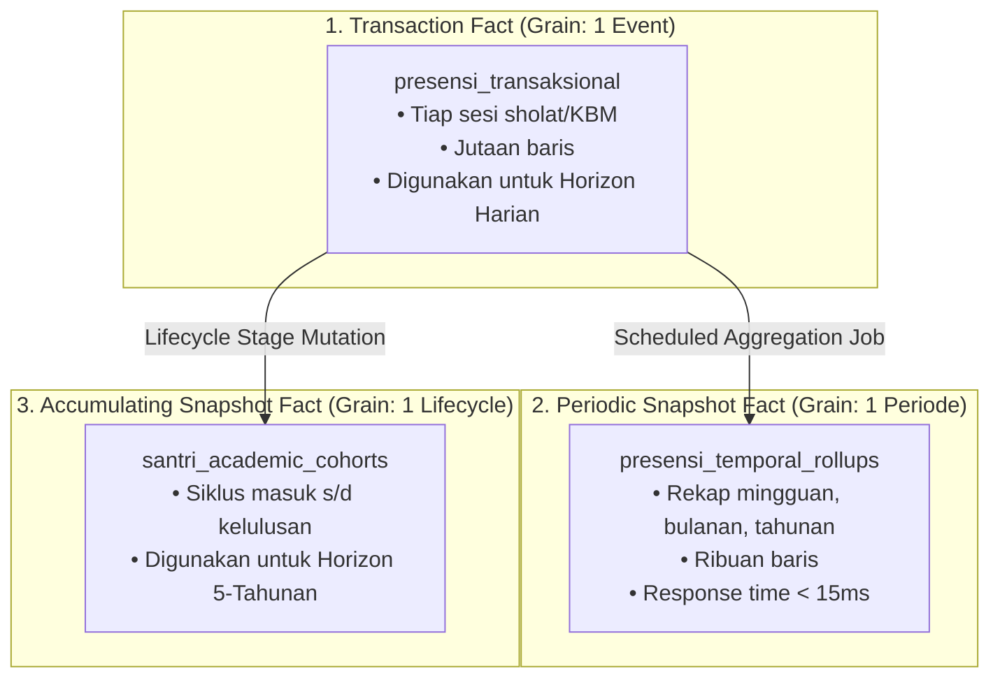

# Pemodelan Dimensi Temporal & Pola Rollup (Ralph Kimball Standard)
> **Referensi:** Ralph Kimball & Margy Ross, *The Data Warehouse Toolkit: The Definitive Guide to Dimensional Modeling* (3rd Edition, Wiley, 2013).

---

## 1. TIGA ARKETIPE TABEL FAKTA KIMBALL UNTUK ANALITIK

Kimball menetapkan bahwa data analitik tidak boleh disimpan dalam satu tabel raksasa (*flat sprawl*), melainkan dipisahkan menurut derajat butirannya (*Grain*):



---

## 2. DESAIN TABEL DIMENSI TANGGAL & KALENDER AKADEMIK (`dim_kalender_akademik`)

Tabel dimensi tanggal (*Conformed Date Dimension*) berfungsi menjembatani perbedaan antara Kalender Masehi dengan Kalender Domain Institusi (Tahun Ajaran):

| Kolom | Tipe | Contoh Nilai | Deskripsi & Peruntukan |
| :--- | :--- | :--- | :--- |
| `tanggal` | `DATE` | `2026-10-16` | Kunci primer (ISO-8601 YYYY-MM-DD). |
| `tahun_masehi` | `SMALLINT` | `2026` | Tahun kalender Masehi (1 Jan - 31 Des). |
| `bulan_masehi` | `TINYINT` | `10` | Bulan kalender (1 - 12). |
| `minggu_masehi` | `TINYINT` | `42` | Pekan ISO-8601 dalam 1 tahun. |
| `hari_indonesia` | `VARCHAR(10)` | `Jumat` | Nama hari lokal untuk pelaporan langsung. |
| `tahun_ajaran` | `VARCHAR(15)` | `2026/2027` | Siklus akademik (1 Juli $N$ s/d 30 Juni $N+1$). |
| `semester_akademik` | `TINYINT` | `1` | 1 = Ganjil (Juli-Des), 2 = Genap (Jan-Jun). |
| `pekan_efektif_kbm`| `TINYINT` | `14` | Nomor pekan belajar aktif kurikulum Diknas/Pesantren. |
| `is_hari_libur` | `BOOLEAN` | `false` | Menandai hari libur nasional / libur semester. |
| `five_year_cohort` | `VARCHAR(15)` | `2022-2026` | Pengelompokan 5 tahun kalender berurutan. |

---

## 3. MEKANISME IDEMPOTENSI ROLLUP PERIODIK

Tabel rollup (`presensi_temporal_rollups`) harus diisi dengan kueri terjadwal (*Scheduled Cron / Console Command*) yang bersifat **idempoten** menggunakan `updateOrCreate`:

```php
DB::table('presensi_temporal_rollups')->updateOrInsert(
    [
        'horizon' => 'monthly',
        'horizon_key' => $yearMonth, // e.g. "2026-10"
        'unit_tugas' => $unitKey,     // e.g. "pesantren"
    ],
    [
        'total_santri_aktif' => $activeStudents,
        'count_hadir' => $totalHadir,
        'count_sakit' => $totalSakit,
        'count_izin' => $totalIzin,
        'count_alpa' => $totalAlpa,
        'persentase_kehadiran' => $percentage,
        'calculated_at' => now(),
        'updated_at' => now(),
    ]
);
```

Dengan pola ini, jika kalkulasi ulang dijalankan berulang kali, data tidak akan terduplikasi.
