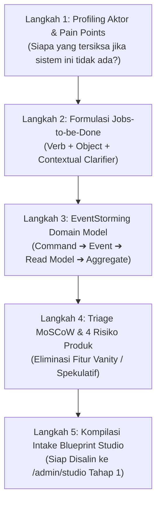

# Discovery Architect: Client Case-Study to Blueprint Studio Playbook
> **Standard:** Marty Cagan (INSPIRED & TRANSFORMED), Teresa Torres (Continuous Discovery), Anthony Ulwick (JTBD/ODI), Karl Wiegers (3rd Ed), Eric Evans (DDD), Martin Fowler (PoEAA), Edgar F. Codd (3NF), Markus Winand (SQL Indexing), Jakob Nielsen (NN/g), Don Norman, Jenifer Tidwell, Luke Wroblewski (Mobile First), Bill Scott & Theresa Neil, Ethan Marcotte (RWD), Steven Hoober (Thumb Zone), WCAG 2.2 AAA.

Skill ini memandu AI coding agent dan engineer dalam bertindak sebagai **Principal Product Discovery Architect & Requirements Engineer** untuk mewawancarai, menyaring, dan mengonversi kebutuhan mentah klien menjadi cetak biru teknis yang 100% mematuhi [`.agents/rules/product_discovery_invariants.md`](../../rules/product_discovery_invariants.md) dan [`.agents/rules/blueprint_studio_invariants.md`](../../rules/blueprint_studio_invariants.md).

---

## 1. STRUKTUR DIREKTORI & MODUL PENDUKUNG

```
.agents/skills/discovery-architect/
├── SKILL.md                                  # Playbook utama & orchestrator (berkas ini)
├── references/
│   ├── software_design_best_practices.md     # Rujukan 3-Pilar: Logika Bisnis (DDD/FSM), Basis Data (3NF/Index), UI/UX (NN/g/WCAG)
│   ├── ui_ux_component_decision_matrix.md   # Matriks Pohon Keputusan Pola UI/UX Web & Ergonomi Responsivitas Mobile (Thumb Zone)
│   ├── jtbd_formula_guide.md                 # Panduan sintaksis Job Statement & Outcome-Driven Innovation
│   └── eventstorming_syntax.md               # Notasi semantik Domain Events, Commands, & Read Models
├── templates/
│   ├── feature_design_audit_matrix.md        # Rubrik evaluasi audit desain fitur 3-pilar (12 Checkpoints, Target >= 90%)
│   ├── blueprint_intake_template.md          # Template teks intake siap disalin ke /admin/studio
│   └── feature_gherkin_contract.md           # Template skenario tes acceptance Gherkin (200, 422, 403)
└── scripts/
    ├── audit-feature-design.ps1              # Auditor otomatis kepatuhan desain 3-pilar dengan kalkulasi skor readiness
    └── validate-discovery-spec.ps1           # Skrip validasi ketiadaan kata sifat ambigu & kelengkapan JTBD
```

---

## 2. WORKFLOW 5-LANGKAH: DARI KELUHAN MENTAH MENJADI SPESIFIKASI

Setiap perumusan fitur dari studi kasus klien wajib melalui 5 tahapan deterministik berikut:



### Langkah 1: Profiling Aktor & Pain Points Mapping
1. Identifikasi aktor operasional riil yang menanggung beban kerja manual terberat.
2. Petakan ke dalam Peran Kanonikal sistem yang terdaftar resmi di `backend/config/permissions.php` (contoh pada Valora Vault Starter: `admin`, `manager`, `staff`, `auditor`, `user`; atau peran kanonikal spesifik yang didaftarkan pada domain klien). **DILARANG KERAS membuat nama alias peran atau mengonsolidasi peran-peran berbeda menjadi peran gabungan (Zero Aliasing & Zero Consolidation Mandate).**
3. Temukan dampak kerugian konkret jika sistem tidak dibuat (waktu terbuang, selisih finansial, kebocoran data).

### Langkah 2: Formulasi Jobs-to-be-Done (JTBD)
Konversikan setiap kebutuhan menjadi minimal satu pernyataan baku Anthony Ulwick:
$$\text{Job Statement} = \mathbf{\text{[Kata Kerja Aksi]}} + \mathbf{\text{[Objek Kontekstual]}} + \mathbf{\text{[Pengjelas Konteks/Kondisi]}}$$

### Langkah 3: EventStorming Ringkas
Petakan 4 blok penyusun domain:
- 🟦 **Command:** Pemicu dari aktor pengguna (`SubmitTransferOrder`, `CatatPresensi`).
- 🟨 **Aggregate:** Tabel/Model yang menjaga integritas (`MutasiStok`, `Santri`).
- 🟧 **Domain Event:** Fakta masa lalu yang terbit (`TransferOrderDispatched`, `PresensiRecorded`).
- 🟩 **Read Model:** Tampilan data yang dibutuhkan untuk mengambil keputusan (`TabelStokKritis`, `DaftarAlpa`).

### Langkah 4: Triage MoSCoW & Audit Desain 3-Pilar (Cagan, DDD, 3NF, NN/g)
1. **Audit 4 Risiko Produk (Marty Cagan):**
   - *Value Risk:* Apakah klien benar-benar butuh dan mau menggunakan fitur ini?
   - *Usability Risk:* Apakah antarmuka dapat dioperasikan tanpa pelatihan rumit?
   - *Feasibility Risk:* Apakah arsitektur saat ini (latensi $< 150\text{ ms}$, kuota database) mampu menopangnya?
   - *Business Viability Risk:* Apakah mematuhi SOP institusi dan aturan hukum/audit?
2. **Audit Kepatuhan Desain 3-Pilar (Triple-Pillar Audit):**
   - Rujuk pedoman mendalam di [`references/software_design_best_practices.md`](./references/software_design_best_practices.md) dan pohon keputusan UI/responsivitas mobile di [`references/ui_ux_component_decision_matrix.md`](./references/ui_ux_component_decision_matrix.md).
   - Isi matriks rubrik [`templates/feature_design_audit_matrix.md`](./templates/feature_design_audit_matrix.md).
   - Jalankan skrip verifikasi otomatis:
     ```powershell
     powershell -ExecutionPolicy Bypass -File .agents/skills/discovery-architect/scripts/audit-feature-design.ps1 -FilePath "path/to/spec.md"
     ```
   - Target kelulusan: Skor Kesiapan (*Readiness Score*) $\ge 87.5\%$ (Minimal 7 dari 8 kriteria teknis).

### Langkah 5: Kompilasi Format Intake Blueprint Studio
Gunakan template [`blueprint_intake_template.md`](./templates/blueprint_intake_template.md) untuk menyusun payload teks yang siap dimasukkan ke Tahap 1 antarmuka Blueprint Studio ([`/admin/studio`](../../../doc/features/05_blueprint_studio.md)).

---

## 3. CHECKLIST VERIFIKASI DISCOVERY SEBELUM REVIEW GATE

- [ ] Seluruh fitur memiliki minimal 1 pernyataan JTBD baku (Kata Kerja + Objek + Konteks).
- [ ] Bebas dari kata sifat subjektif/pemanis ("mudah", "cepat", "fleksibel").
- [ ] Fitur lolos audit 4 risiko produk Marty Cagan.
- [ ] Memiliki minimal 3 skenario Gherkin (Happy Path 200/201, Validasi 422, Security 403 BOLA).
- [ ] Memetakan 4 visual state antarmuka: Loading, Empty, Error, Success.
- [ ] Memetakan Delivery Target Web & Adaptasi Layar Sentuh Mobile (Bottom Sheet, Target $\ge 44\text{px}$, Thumb Zone) sesuai `ui_ux_component_decision_matrix.md`.
- [ ] Mematuhi Standar Pro-Grade Compact & Floating Thumb Dock (Eliminasi UI sesak, hairline 1px, accordion drawer default tertutup, navigasi jempol instan 0-scroll).
- [ ] Mematuhi Usability Risk Clearance pada antarmuka kaca (Apple Spatial Materials, contrast backing floor APCA $L_c \ge 75$, eliminasi visual noise di belakang form/tabel).
- [ ] Mematuhi Arsitektur Elevasi Permukaan 3-Tier (L0 Kanvas teduh, L1 Kartu Makro solid ber-border 1px presisi & shadow-2xs, L2 Elemen Mikro tersemat) dan bebas dari pseudo-glassmorphism transparan rendah di atas kanvas polos.
- [ ] Bebas dari pembuatan alias atau konsolidasi peran/komponen/tabel sepihak (Zero Aliasing & Zero Consolidation).
- [ ] Menjamin 100% zero-regression tanpa menimbulkan bug atau masalah baru pada modul yang telah berjalan.
- [ ] Lulus skrip audit kepatuhan desain 3-pilar (`audit-feature-design.ps1`) dengan skor $\ge 87.5\%$.
- [ ] Mematuhi Hirarki 10 Prioritas Desain UI/UX & Lulus Canonical Pre-Delivery UI/UX Checklist (A11y $\ge 4.5:1$, target sentuh $\ge 44\text{px}$, zero emoji icons, inline form validation).
- [ ] Teks analisis kompatibel 100% untuk disalin ke Tahap 1 Blueprint Studio (`/admin/studio`).
