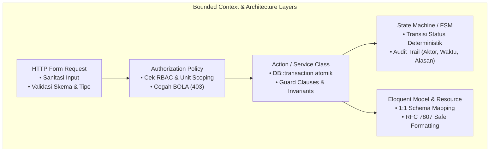

# Pedoman Praktik Terbaik Desain Perangkat Lunak Internasional (Software Design Best Practices)
> **Engine:** Valora Vault v6.31.0 / v8.0.0 SDD-Enterprise-Deterministic  
> **Standar Rujukan:** Eric Evans (DDD), Martin Fowler (PoEAA), Edgar F. Codd (3NF), Markus Winand (SQL Indexing), Jakob Nielsen (NN/g 10 Heuristics), Don Norman, Jenifer Tidwell, Luke Wroblewski (Mobile First), Ethan Marcotte (RWD), Steven Hoober (Thumb Zone), WCAG 2.2 AAA

---

## 1. PENDAHULUAN & RUANG LINGKUP

Dokumen ini adalah buku panduan operasional (*technical reference manual*) bagi AI agent dan engineer di Valora Vault untuk merancang, memvalidasi, dan mengaudit spesifikasi fitur dari sudut pandang **3 Pilar Rekayasa Perangkat Lunak Modern**:
1. **Pilar Logika Bisnis (Business Logic & Domain Architecture)**
2. **Pilar Basis Data (Database Design & Relational Modeling)**
3. **Pilar Antarmuka Pengguna (UI/UX Usability & Interaction Architecture)**

Dokumen ini menjabarkan aturan mutlak [`.agents/rules/product_discovery_invariants.md`](../../../rules/product_discovery_invariants.md) dan [`.agents/rules/blueprint_studio_invariants.md`](../../../rules/blueprint_studio_invariants.md) ke dalam implementasi teknis konkret.

---

## 2. PILAR 1: ARSITEKTUR LOGIKA BISNIS (DOMAIN & LOGIC DESIGN)



### 2.1 Domain-Driven Design (Eric Evans & Vaughn Vernon)
1. **Ubiquitous Language:**
   - Gunakan istilah kanonikal domain yang sama persis di seluruh layer: nama tabel, variabel PHP, properti Svelte, dan label antarmuka (misal: `Santri`, `Musyrif`, `Halqah`, `Marhalah`). Dilarang mencampuradukkan padanan kata asing yang berbeda untuk entitas yang sama.
2. **Aggregate Boundary & Consistency:**
   - Objek yang harus konsisten bersama wajib berada dalam satu *Aggregate*. Seluruh mutasi ke dalam aggregate harus melewati *Aggregate Root*.
   - Contoh: Ketika status setoran hafalan santri diubah menjadi `terverifikasi`, mutasi pencatatan capaian juz dan pembaruan riwayat mutasi wajib dieksekusi dalam satu batas transaksi yang sama.

### 2.2 Finite State Machines (FSM) untuk Alur Approval
Untuk fitur dengan Logic Archetype `state_machine` (seperti pengajuan cuti, pencairan dana kas, verifikasi beasiswa):
1. **Transisi Deterministik:** Definisikan seluruh transisi status yang valid. Lompatan status yang tidak terdaftar WAJIB ditolak dengan exception.
2. **Guard Clauses:** Setiap transisi wajib memiliki syarat sah (misal: transisi ke `approved` hanya boleh dilakukan jika peran pengguna adalah `mudir` dan berkas bukti telah diunggah).
3. **Immutability of Audit Trail:** Setiap transisi wajib mencatat riwayat ke tabel audit (`*_approval_logs`): ID record, status asal, status tujuan, aktor pelaksana (`user_id`), timestamp, dan catatan penolakan jika ditolak.

### 2.3 Patterns of Enterprise Application Architecture (Martin Fowler)
- **Thin Controller:** Controller dilarang memuat kueri SQL langsung atau logika mutasi bercabang.
- **Form Request:** Seluruh validasi input HTTP wajib ditaruh di Form Request class (`Authorize` + `Rules`).
- **Transactional Integrity:** Mutasi multi-tabel wajib dibungkus `DB::transaction(function () { ... })` dengan penanganan rollback otomatis jika terjadi kegagalan.

---

## 3. PILAR 2: ARSITEKTUR BASIS DATA & PEMODELAN RELASIONAL

### 3.1 Normalisasi 3NF (Edgar F. Codd & C.J. Date)
Seluruh tabel transaksional operasional wajib mematuhi **Third Normal Form (3NF)**:
1. **1NF (Bentuk Normal Pertama):**
   - Setiap kolom hanya memuat nilai skalar atomik tunggal. Dilarang menyimpan array ID atau string koma (`"1,2,3"`) pada kolom relasional.
2. **2NF (Bentuk Normal Kedua):**
   - Seluruh kolom non-kunci harus bergantung sepenuhnya pada *Primary Key* penuh, bukan sebagian.
3. **3NF (Bentuk Normal Ketiga):**
   - Tidak ada ketergantungan transitif ($A \rightarrow B \rightarrow C$). Kolom yang nilainya dapat dihitung dari kolom lain tidak boleh disimpan redundan pada tabel transaksi (kecuali pada tabel *rollup snapshot* khusus analitik).

### 3.2 Optimasi Indeks B-Tree (Markus Winand: *Use The Index, Luke!*)
Kaidah penataan kolom pada indeks komposit B-Tree:
$$\text{Aturan Urutan: } \mathbf{[\text{Kolom Kesetaraan / Equality}]} \longrightarrow \mathbf{[\text{Kolom Rentang / Range / Sort}]}$$

**Contoh Kasus Kueri Transaksi:**
```sql
SELECT * FROM presensi_santri 
WHERE unit_tugas = 'pesantren' AND status = 'hadir' AND tanggal >= '2026-10-01';
```
- **Indeks Komposit yang Tepat:**
  `$table->index(['unit_tugas', 'status', 'tanggal']);`
  *(Kolom `unit_tugas` dan `status` adalah kesetaraan `=`, diletakkan di depan; kolom `tanggal` adalah rentang `>=`, diletakkan di akhir).*
- **Larangan Non-SARGable Query:** Dilarang membungkus kolom berindeks dengan fungsi SQL (seperti `WHERE strftime('%Y', tanggal) = '2026'`) karena akan mematikan B-Tree scan dan memaksa *Full Table Scan*.

### 3.3 Foreign Key & Concurrency Lock (Jim Gray)
1. **Integritas Referensial Eksplisit:**
   - Relasi data master (seperti `users`, `santri`, `kelas`) wajib menggunakan `$table->foreignId('...')->constrained()->restrictOnDelete()` untuk mencegah terhapusnya data riwayat historis secara tidak sengaja.
   - Tabel anak yang bersifat murni komponen detail (seperti `voucher_items`) dapat menggunakan `cascadeOnDelete()`.
2. **Pessimistic Locking untuk Sumber Daya Terbatas:**
   - Mutasi stok logistik atau pagu anggaran wajib menggunakan `$model->newQuery()->lockForUpdate()->find($id)` di dalam transaksi guna mencegah anomali *Lost Updates* / *Double Spending*.

---

## 4. PILAR 3: ARSITEKTUR UI/UX & KOGNISI INTERAKSI

```
┌────────────────────────────────────────────────────────────────────────────────────────┐
│                      10 USABILITY HEURISTICS (JAKOB NIELSEN / NN/g)                    │
├────────────────────────────────────────────────────────────────────────────────────────┤
│ 1. Visibility of System Status  ──► Skeleton loader reaktif, progress spinner pada CTA │
│ 2. Match with Real World       ──► Terminologi operasional santri/pesantren, bukan DB  │
│ 3. User Control & Freedom      ──► Tombol Batal jelas, tutup modal via ESC / Backdrop  │
│ 4. Consistency & Standards     ──► Penempatan tombol primer di kanan, warna semantik   │
│ 5. Error Prevention            ──► Disabled state saat submit, modal konfirmasi bahaya │
│ 6. Recognition Over Recall     ──► Badge status, search dropdown, visual autocomplete  │
│ 7. Flexibility & Efficiency    ──► Pencarian in-memory < 0.1ms, keyboard accessibility │
│ 8. Aesthetic & Minimalist      ──► Data-Ink Ratio Few/Tufte, hapus dekorasi berlebih   │
│ 9. Recognize & Recover Errors  ──► Pesan RFC 7807 manusiawi + tombol retry 'Coba Lagi' │
│ 10. Help & Documentation       ──► Empty state informatif dengan panduan langkah awal  │
└────────────────────────────────────────────────────────────────────────────────────────┘
```

### 4.1 Pemilihan UI Delivery Target yang Deterministik
Dilarang memaksakan pembuatan rute halaman penuh (`+page.svelte`) untuk setiap interaksi:

| Kebutuhan Alur Kerja | Delivery Target Wajib | Komponen Svelte 5 | Alasan Kognitif (UX Rationale) |
| :--- | :--- | :--- | :--- |
| **Katalog Utama / Master View** | `standalone_page` | `+page.svelte` (Route) | Ruang pandang penuh untuk tabel data kompleks & filter makro. |
| **Transaksi Cepat / Konfirmasi** | `modal_dialog` | Dialog Component | Mempertahankan konteks latar belakang; fokus isolasi 1 tugas. |
| **Inspeksi Detail / Audit Trail**| `slide_over_drawer` | Drawer Component | Membaca riwayat tanpa meninggalkan daftar kerja saat ini. |
| **Aksi Cepat Baris Data** | `inline_action` | Action Button Row | Menghapus klik ganda (1-klik toggle status / cetak bukti). |
| **Ringkasan KPI Dasbor** | `embedded_widget` | KPI Card / Bullet SVG | Sekilas pandang (*at-a-glance monitoring*) tanpa navigasi. |
| **Pembersihan / Sinkronisasi** | `headless_job` | Artisan Console / Job | Tanpa UI; otomatisasi background daemon persisten. |

### 4.2 Aksesibilitas WCAG 2.2 AAA & Kontrak Tombol
1. **Atribut Tombol Eksplisit:** Setiap tag `<button>` wajib menyertakan atribut eksplisit `type="button"` atau `type="submit"`. Dilarang meninggalkan `<button>` tanpa atribut type.
2. **Rasio Kontras AAA ($\ge 7:1$):** Seluruh teks pada tema Daylight maupun Dark Obsidian wajib memiliki kontras minimal 7:1 terhadap latar belakangnya.
3. **Dukungan Keyboard Penuh:** Seluruh modal dan drawer wajib menangani penutupan via tombol `Escape` dan navigasi fokus `Tab`.

### 4.3 Responsivitas Mobile, Ergonomi Sentuh, & Zona Ibu Jari (Thumb Zone)
Desain antarmuka web wajib dirancang adaptif terhadap layar sentuh mobile (`< 768px`):
1. **Target Sentuh Minimum $\ge 44 \times 44\text{ px}$ (WCAG 2.2 AAA & Apple HIG):**
   Seluruh elemen interaktif (tombol aksi, checkbox, tautan navigasi) wajib memiliki area sentuh minimal $44 \times 44\text{ piksel}$ dengan spasi antar elemen minimal $8\text{ px}$ untuk mencegah kesalahan sentuh (*fat-finger error*).
2. **Bottom Sheet Menggantikan Modal Terpusat:**
   Pada layar mobile, modal dialog terpusat dilarang karena tertutup oleh keyboard virtual. Seluruh entri form modal wajib bertransisi menjadi *Swipeable Bottom Sheet* yang meluncur dari dasar layar.
3. **Ergonomi Zona Ibu Jari (*The Thumb Zone* — Steven Hoober):**
   Aksi primer (CTA Submit, Filter Cepat, Tambah Data) pada layar mobile wajib menempel pada bagian bawah layar (*sticky bottom action bar*) agar mudah dijangkau satu tangan.
4. **Reflow Tabel Responsif (*Card Stack Transformation*):**
   Tabel data dengan banyak kolom wajib bertransformasi menjadi susunan kartu vertikal (*Card Stack*) pada tampilan mobile (`hidden md:table` dan `md:hidden space-y-3`) guna mengeliminasi scroll horizontal yang membingungkan.
5. **Katalog Pohon Keputusan Komponen:**
   Rujuk pedoman komprehensif pemilihan UI dan adaptasi mobile pada [`ui_ux_component_decision_matrix.md`](./ui_ux_component_decision_matrix.md).
