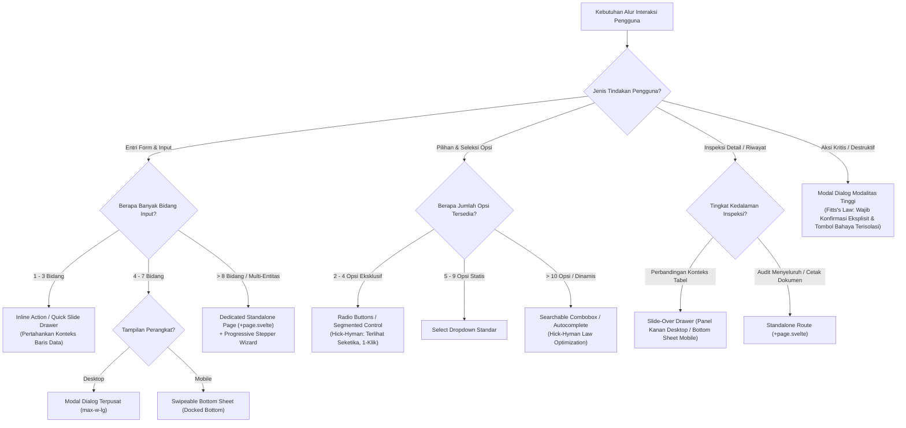

# Matriks Keputusan Pola UI/UX Web & Responsibilitas Mobile (UI/UX Component Decision Matrix)
> **Engine:** Valora Vault v6.31.0 / v8.0.0 SDD-Enterprise-Deterministic  
> **Standar Rujukan:** Jenifer Tidwell (Designing Interfaces 3rd Ed), Luke Wroblewski (Web Form Design & Mobile First), Bill Scott & Theresa Neil (Designing Web Interfaces), Steve Krug (Don't Make Me Think), Don Norman (The Design of Everyday Things), Nielsen Norman Group (NN/g), W3C WAI-ARIA APG, W3C WCAG 2.2 AAA, IBM Carbon, Atlassian Design System, Salesforce Lightning (SLDS), GOV.UK Design System, Apple HIG, Google Material Design 3.

---

## 1. PENDAHULUAN & PRINSIP ERGONOMI KOGNITIF

Pemilihan pola antarmuka (*UI Pattern*) dalam Valora Vault **bukan ditentukan oleh preferensi estetika visual**, melainkan oleh kalkulasi ilmiah terhadap:
1. **Beban Kognitif Pengguna (*Cognitive Load*):** Berapa banyak informasi yang harus diproses dan diingat sebelum mengambil tindakan.
2. **Konteks & Frekuensi Tugas (*Task Context & Frequency*):** Apakah aksi bersifat sekilas (1–3 detik), inspeksi audit, atau transaksi mendalam bertahap.
3. **Ergonomi Perangkat & Jangkauan Fisik (*Device Ergonomics & Viewport*):** Perbedaan mendasar antara manipulasi kursor mouse desktop (presisi tinggi) vs manipulasi ibu jari layar sentuh mobile (*touch target* dan *Thumb Zone*).

---

## 2. PILAR RUJUKAN KANONIKAL INTERNASIONAL

### A. Literatur Kanonikal Desain Pola Interaksi (The Canonical Books)
1. **Jenifer Tidwell, Charles Brewer, & Aynne Valencia — *Designing Interfaces: Patterns for Effective Interaction Design* (O'Reilly, 3rd Ed.)**
   - **Katalog Pola UI Komprehensif:** Mengelompokkan komponen berdasarkan tujuan pengguna:
     - *Information Architecture & Navigation:* Hub-and-Spoke, Tabs, Breadcrumbs.
     - *Making Selections:* Radio Buttons vs Checkbox vs Dropdown vs Dual-Listbox.
     - *Providing Input:* Inline editing vs Modal form vs Multi-step wizard.
     - *Action & Feedback:* Progressive disclosure, Hover reveals, Empty states.
2. **Luke Wroblewski — *Web Form Design: Filling in the Blanks* (Rosenfeld Media)**
   - **Standar Formulir Web:** Membedakan kapan form harus disajikan secara *in-context / inline*, kapan membutuhkan *modal dialog*, dan kapan harus menggunakan *dedicated page / stepper wizard* berdasarkan jumlah beban kognitif dan tingkat risiko data.
3. **Bill Scott & Theresa Neil — *Designing Web Interfaces: Principles & Patterns for Rich Interactions* (O'Reilly)**
   - **Direct Manipulation:** Efisiensi interaksi web. Membedakan hierarki:
     - *In-Page Editing:* Tabel interaktif dan edit langsung pada baris data.
     - *Overlays & Drawers:* Inspeksi detail dan log audit tanpa meninggalkan konteks daftar.
     - *Separate Pages:* Alur kerja mendalam yang membutuhkan fokus isolasi penuh.
4. **Steve Krug — *Don't Make Me Think, Revisited* (3rd Ed.) & Don Norman — *The Design of Everyday Things***
   - **Eliminasi Friksi Mental:** Signifier, affordance, dan prinsip bahwa UI terbaik adalah UI yang membuat aksi pengguna menjadi *self-evident* (terbukti dengan sendirinya tanpa instruksi manual).

---

### B. Lembaga Riset & Empiris UX Internasional
1. **Nielsen Norman Group (NN/g — Jakob Nielsen & Don Norman)**
   - **Modal vs. Modeless Dialogs:** Modal digunakan hanya saat alur kerja pengguna *harus* diinterupsi untuk mencegah kekeliruan fatal atau meminta keputusan krusial sebelum melanjutkan. Hindari modal berantai (*stacked modals*).
   - **Checkbox vs. Radio Button:**
     - *Radio Button:* Opsi eksklusif $\le 4$ item yang saling meniadakan (*mutually exclusive*). Seluruh pilihan wajib terlihat langsung.
     - *Checkbox Tunggal:* Status biner On/Off (Persetujuan syarat & ketentuan).
     - *Checkbox Grup:* Seleksi multi-pilihan non-eksklusif.
   - **Accordion vs. Tabs vs. Dropdowns:**
     - *Tabs:* Memisahkan kategori data paralel yang relevan pada konteks yang sama tanpa memanjangkan halaman.
     - *Accordion:* Menyembunyikan detail sekunder pada dokumen yang dibaca secara vertikal (terutama di layar mobile).
   - **Pagination vs. Infinite Scrolling vs. "Load More":**
     - *Pagination:* Wajib untuk data transaksional terstruktur, pencarian record spesifik, dan laporan keuangan (memungkinkan pembagian halaman deterministik).
     - *Infinite Scrolling / Load More:* Hanya untuk konten eksploratif non-kritis (feed media / log real-time santai). Dilarang untuk tabel audit transaksional.
2. **W3C WAI-ARIA Authoring Practices Guide (APG)**
   - **Aksesibilitas & Kontrak Keyboard:** Menjelaskan kontrak baku perilaku keyboard (`Escape` untuk menutup dialog, `Tab` untuk fokus berurutan, panah atas/bawah untuk navigasi combobox) dan kompatibilitas pembaca layar (*screen reader*).

---

### C. Enterprise Design Systems: Pohon Keputusan Komponen (Component Decision Trees)
1. **IBM Carbon Design System:**
   - Menetapkan batas pemakaian: *Inline Notification* untuk umpan balik konteks spesifik, *Toast* untuk konfirmasi asinkronus sekilas, *Modal* untuk tugas terisolasi berisiko tinggi, dan *Side Panel (Drawer)* untuk tugas konfigurasi atau inspeksi data berulang.
2. **Atlassian Design System:**
   - Matriks *"Form Dialog vs. Inline Edit vs. Full Page Form"*: Menggunakan inline editing untuk pembaruan atribut tunggal (misal: ubah status tugas), dialog untuk entri cepat 2–5 bidang, dan full-page untuk pembuatan entitas baru berskala besar.
3. **Salesforce Lightning Design System (SLDS):**
   - Pola relasi data enterprise kompleks: *Split View* (daftar master di kiri, panel detail di kanan) dan *Docked Utility Bar* untuk aksi persisten.
4. **GOV.UK Design System:**
   - Standar antarmuka berkecepatan tinggi, minim input salah, dan mengeliminasi jebakan interaksi (*dark patterns*).

---

### D. 4 Hukum Ergonomi Kognitif (Cognitive Psychology Laws)
1. **Hick-Hyman Law ($T = b \cdot \log_2(n + 1)$):**
   - Waktu mengambil keputusan meningkat logaritmik terhadap jumlah pilihan.
   - *Implementasi:* Jika opsi pilihan $> 7$ item, dilarang menggunakan tombol radio berderet atau select box panjang. Wajib menggunakan **Searchable Combobox / Autocomplete**.
2. **Fitts's Law ($T = a + b \log_2(2D / W)$):**
   - Waktu mencapai target interaksi bergantung pada jarak ($D$) dan lebar ukuran target ($W$).
   - *Implementasi:* Tombol destruktif bahaya harus diberi jarak isolasi. Tombol aksi primer harus memiliki target sentuh besar ($\ge 44\text{px}$) dan diletakkan pada jangkauan terdekat.
3. **Miller's Law (The Magical Number $7 \pm 2$ & Chunking):**
   - Memori kerja manusia hanya mampu menampung 5–9 butir informasi sekaligus.
   - *Implementasi:* Formulir dengan $> 8$ bidang input wajib dipecah (*chunked*) ke dalam tahapan logis bertingkat menggunakan **Stepper Wizard** atau grup kartu bertahap.
4. **Jakob's Law:**
   - Pengguna menghabiskan sebagian besar waktu mereka di platform web lain.
   - *Implementasi:* Gunakan pola interaksi konvensional (contoh: ikon keranjang/notifikasi di kanan atas, tombol simpan di kanan bawah form, tombol batal di sebelah kiri tombol simpan). Dilarang membuat gestur baru yang tidak lazim.

---

## 3. POHON KEPUTUSAN KOMPONEN WEB: FORM, DIALOG, & DETAIL INSPECTION



---

## 4. STANDAR RESPONSIVITAS PLATFORM MOBILE (MOBILE-FIRST ARCHITECTURE)

### 4.1 Ergonomi Zona Ibu Jari (*The Thumb Zone* — Steven Hoober & Josh Clark)
Berdasarkan penelitian empiris Steven Hoober (1.333 pengguna ponsel), **49% pengguna mengoperasikan ponsel cerdas dengan satu tangan**.

```
┌────────────────────────────────────────────────────────┐
│               MOBILE VIEWPORT THUMB ZONES              │
├────────────────────────────────────────────────────────┤
│ [ ⚠️ SULIT DIJANGKAU (Hard to Reach) ]                  │
│ Area atas layar (Top Bar): Hanya untuk label judul &   │
│ avatar pasif. DILARANG meletakkan aksi tombol utama!   │
│                                                        │
│ [ ⚡ ZONE TRANSISI (Stretch Zone) ]                     │
│ Area tengah layar: Cocok untuk kartu konten, visual    │
│ grafik data, dan teks penjelasan yang di-scroll.       │
│                                                        │
│ [ 🟢 NATURAL THUMB ZONE (Mudah Dijangkau Ibu Jari) ]    │
│ Area sepertiga bawah layar: Wajib untuk Bottom Nav,    │
│ CTA Utama (Submit / Tambah), Filter Bar, & Form Sheet. │
└────────────────────────────────────────────────────────┘
```

#### Aturan Deterministik Thumb Zone:
1. **Primary Floating Action Button (FAB) / Sticky Bottom Bar:**
   Tombol aksi primer (seperti *"Simpan Data"*, *"Submit"*, *"Presensi Masuk"*) pada layar mobile wajib menempel di bagian bawah viewport (`fixed bottom-0 left-0 right-0 p-4 bg-surface/95 backdrop-blur`) agar dapat dijangkau ibu jari tanpa meregangkan tangan.
2. **Bottom Sheet Menggantikan Modal Terpusat:**
   Pada layar mobile (`< 768px`), modal dialog yang berada di tengah layar adalah **anti-pattern** karena saat virtual keyboard muncul, modal akan terdorong ke luar layar. Seluruh modal form wajib otomatis bertransformasi menjadi **Bottom Sheet** yang meluncur dari dasar layar.

---

### 4.2 Standar Ukuran Target Sentuh (Touch Targets — WCAG 2.2 AAA & Apple HIG)
Jari manusia memiliki lebar bantalan sentuh rata-rata $10\text{ mm} - 14\text{ mm}$.
- **Target Minimum Absolut (Apple HIG & WCAG 2.2 AAA Target Size):**  
  Setiap elemen interaktif (tombol, input, checkbox, tab, baris menu) **wajib memiliki ukuran target minimum $44 \times 44\text{ piksel}$ CSS** (atau $48 \times 48\text{ dp}$ pada pedoman Google Material Design 3).
- **Spasi Antar Target (Spacing):**  
  Jarak bebas antar elemen interaktif minimal **$8\text{ px}$** untuk mencegah salah pencet (*fat-finger error*).
- **Ukuran Font Input Form:**  
  Setiap kolom input teks `<input>` pada mobile wajib memiliki `font-size: \ge 16px` (`text-base`). *Alasan:* Font di bawah 16px akan memicu *auto-zoom* otomatis browser iOS Safari yang merusak tata letak responsif.

---

### 4.3 Pola Reflow Tabel Data pada Layar Mobile (Responsive Data Tables — NN/g)
Tabel data horizontal dengan $> 4$ kolom tidak dapat dibaca di layar ponsel tanpa scroll horizontal yang membingungkan (*horizontal table fatigue*).

Wajib menerapkan salah satu dari 3 pola transformasi responsif:

| Pola Transformasi Mobile | Kapan Digunakan? | Implementasi Svelte 5 & Tailwind v4 |
| :--- | :--- | :--- |
| **Card Stack Transformation (Direkomendasikan)** | Modul data transaksional santri, presensi, inventaris, transaksi kas. | Sembunyikan tag `<table>` pada mobile (`hidden md:table`), tampilkan susunan `<div class="md:hidden space-y-3">` di mana setiap baris menjadi kartu terisolasi dengan label vertikal. |
| **Priority Column Reflow** | Katalog data dengan hierarki kepentingan jelas (Nama & Status adalah prioritas utama). | Tampilkan 2 kolom primer secara default. Kolom sekunder disembunyikan di balik ikon chevron expander (`accordion row`). |
| **Sticky First Column with Horizontal Scroll** | Matriks nilai atau perbandingan jadwal yang strukturnya wajib berbentuk kisi. | Kolom identitas (Nama Santri/ID) dibekukan (`sticky left-0 bg-surface z-10`), kolom nilai sisa diizinkan scroll horizontal (`overflow-x-auto touch-pan-x`). |

---

### 4.4 Optimasi Keyboard Virtual & Input Mobile (Luke Wroblewski)
Setiap field input form pada platform web wajib menyertakan atribut semantik keyboard virtual:

```html
<!-- Input Angka Moneter / Nominal Kas: Membuka numeric keypad instan -->
<input 
  type="text" 
  inputmode="numeric" 
  pattern="[0-9]*" 
  class="min-h-[44px] text-base font-mono" 
/>

<!-- Input Nomor Telepon / WhatsApp: Membuka keypad telepon -->
<input 
  type="tel" 
  inputmode="tel" 
  autocomplete="tel" 
  class="min-h-[44px] text-base" 
/>

<!-- Input Email: Membuka keyboard khusus email (@ dan domain shortcuts) -->
<input 
  type="email" 
  inputmode="email" 
  autocomplete="email" 
  class="min-h-[44px] text-base" 
/>
```

---

### 4.5 Standar Visual Pro-Grade Compact vs. Anti-Pattern UI Balita ("Fisher-Price" Bloat)
Dalam aplikasi enterprise data-dense (seperti manajemen pengguna, sesi, sistem, audit log, analitik), tampilan yang terlalu besar (*oversized elements*) dengan font raksasa dan padding longgar adalah cacat desain serius yang menurunkan produktivitas (*Fisher-Price UI Anti-Pattern*). Pengguna profesional membutuhkan rasio data-ke-tinta (*Data-Ink Ratio*) yang optimal di mana informasi dapat dipindai seketika tanpa kelelahan kognitif.

#### Tabel Komparasi Standar UI Pro-Grade vs Anti-Pattern:
| Elemen UI | Anti-Pattern (Bloated / Sesak) | Standar Pro-Grade Compact (Enterprise SSoT) | Tailwind v4 Token |
| :--- | :--- | :--- | :--- |
| **Garis Batas (Border)** | `border-2` solid tebal (memotong ruang & berisik) | 1px Hairline Crisp Border | `border border-slate-200/80 dark:border-slate-800/80` |
| **Bayangan (Elevation)** | `shadow-md` / `shadow-lg` buram berlebihan | Bayangan Mikro Halus (*micro elevation*) | `shadow-2xs` |
| **Padding Kartu Mobile** | `p-4` atau `p-3.5` (boros $>40\text{px}$ ruang samping) | Padding Rapat Kompak | `p-2` s/d `p-2.5` |
| **Spasi Vertikal** | `space-y-3` / `space-y-4` | Spasi Vertikal Presisi | `space-y-1.5` s/d `space-y-2` |
| **Header / Topbar** | Tinggi 60–70px (memotong 10% layar HP) | Slim Header | `h-11.5 sm:h-12` (~46-48px) |
| **Tombol Burger & Ikon** | Tombol 48–56px dengan ikon raksasa | Tombol Aksi Mikro | `w-8.5 h-8.5` (34px) dengan ikon `w-4 h-4` |
| **Tombol Aksi Tabel/Kartu**| Tombol blok `min-h-[44px]` teks 14px | Micro Action Button | `min-h-[30px] px-2.5 py-1 text-[11px] font-semibold` |
| **Tipografi Judul Kartu** | `text-sm` (14px) atau `text-base` (16px) | Tipografi Kompak Kontras Tinggi | `text-xs font-bold text-slate-900 dark:text-slate-100` |
| **Tipografi Metadata** | `text-xs` (12px) abu-abu pudar | Micro Meta Badge | `text-[11px]` atau `text-[10px] uppercase font-bold tracking-wider` |
| **Drawer Accordion Menu** | Terbuka semua (30+ menu terbuka sekaligus) | Default Tertutup (*Progressive Disclosure*) | Inisialisasi `false`, auto-expand hanya rute aktif |
| **Lebar Drawer Sidebar** | `w-64` s/d `w-72` (menutup 80-90% layar HP) | Kompak & Berimbang | `w-60` (240px) |

---

### 4.6 Pola Navigasi Jempol Cepat (Floating Thumb Dock) vs. Anti-Pattern Bilah Bawah Statis
Ketika pengguna ponsel membaca atau menelusuri data tabel yang panjang, timbul friksi navigasi:
- **Masalah 1 (Scroll Friction):** Pengguna harus melakukan scroll ke atas berulang kali hanya untuk menekan hamburger menu atau berpindah modul.
- **Masalah 2 (Screen Choking Anti-Pattern):** Solusi naif menambahkan *Full Static Bottom Navigation Bar* (ketinggian 56–64px) yang menempel permanen memotong area vertikal layar ponsel yang sudah terbatas.

#### Pola Floating Thumb Dock (Ergonomic Thumb Zone Solution):
Gunakan kapsul mengambang (*Floating Pill*) berbasis efek kaca (*frosted glass*) di tengah bawah viewport mobile:
1. **Posisi & Dimensi:**
   `fixed bottom-3.5 left-1/2 -translate-x-1/2 z-30 md:hidden flex items-center gap-1 p-1 rounded-full bg-white/92 dark:bg-slate-950/95 backdrop-blur-md border border-slate-200/90 dark:border-slate-800/80 shadow-xl select-none`
2. **Tri-Action Setup (3 Aksi Cepat Jempol):**
   - **`[ 🏠 Beranda ]`**: Tautan cepat ke rute `/dashboard`.
   - **`[ ↻ Segarkan ]`**: Tombol penyegaran data instan tanpa reload browser menyeluruh.
   - **`[ ☰ Menu ]`**: Trigger pembuka sidebar drawer lengkap yang langsung terjangkau oleh ibu jari saat jari berada di bawah layar.
3. **Safe Viewport Cushion:**
   Wadah utama `<main>` wajib menyertakan kelas Tailwind `pb-16 sm:pb-5` agar baris data paling bawah tidak tertutup oleh kapsul mengambang.

---

### 4.7 Arsitektur Motion & Transisi UI: Kapan CSS/Svelte Native vs GSAP (Boundary Internal App vs Public Landing)
Mengacu pada prinsip ilmiah browser rendering Paul Lewis (Google - FLIP Technique & Compositor Thread), Val Head (*Designing Interface Animation*), dan Rachel Nabors (*Animation at Work*):

#### A. Batasan Arsitektur Antara Modul Operasional vs Landing Page:
1. **Modul Aplikasi Internal & ERP (Domain `@discovery`):**
   - **DILARANG KERAS** memasang animasi berbasis GSAP ScrollTrigger, parallax, scroll-jacking, atau timeline berat di dalam modul operasional (seperti form transaksi, kasir, tabel master, dan mutabaah santri). Hal ini merupakan *cognitive chartjunk* yang memperlambat laju kerja staf dan membebani memori browser.
   - **Gunakan HANYA:**
     - **Pure CSS3 (Tailwind v4):** Untuk hover, state aktif, focus ring, dan skeleton shimmer (0 KB JS, 120 FPS GPU compositor).
     - **Svelte 5 Native Runes & Motion:** Untuk transisi DOM lifecycle (drawer slide, modal fade, accordion collapse via `transition:slide`, dan animasi angka saldo via `svelte/motion spring`).
2. **Landing Page Publik & Brand Storytelling (Domain `@landing`):**
   - Rujuk playbook [`.agents/skills/landing-architect/SKILL.md`](../../landing-architect/SKILL.md) dan [`doc/landing_page_standards.md`](../../../../doc/landing_page_standards.md).
   - GSAP + ScrollTrigger HANYA diizinkan untuk section storytelling yang memiliki *scrubbed timeline* terikat scroll atau *pinned showcase*, dengan syarat wajib lolos audit Core Web Vitals dan mematuhi `@media (prefers-reduced-motion: reduce)`.

#### B. Ringkasan Matriks Pemilihan Animasi Berdasarkan Granularitas:
| Granularitas UI | Kebutuhan Interaksi | Solusi Animasi Terbaik | Alasan Teknis & Anggaran Bundle |
| :--- | :--- | :--- | :--- |
| **Elemen Mikro** | Tombol hover, ripple, switch on/off, skeleton loader | **Pure CSS3 (Tailwind v4)** | 0 KB JS, GPU compositor thread, latensi $< 16\text{ms}$. |
| **Komponen / Panel** | Buka-tutup Drawer samping, Modal dialog, Accordion menu | **Svelte 5 `transition:slide/fade`** | Terikat reaktif dengan `$state`, auto-reversal saat klik dibatalkan, 0 dependensi eksternal. |
| **Transisi Nilai / Data** | Perubahan angka total kas, persentase keterisian kuota | **Svelte 5 `spring()` / `tweened()`** | Fisika pegas halus berbasis Runes modern tanpa beban framework eksternal. |
| **Section Storytelling** | Pinning layar, scrubbing animasi produk bertahap | **GSAP 3 + ScrollTrigger** | Interpolasi timeline multi-track presisi (Wajib Dynamic Import & Reduced Motion guard). |
| **Halaman / Rute SPA** | Navigasi antar halaman, shared element transition | **W3C View Transitions API** | Screenshot hardware cross-fade bawaan browser, bebas layar putih (white flash). |

---

### 4.8 Standar Desain Minimalis Elegan, Negative Space, & Keterbacaan (Dieter Rams, Tufte, Bringhurst)
1. **Reduksionisme Fungsional (Dieter Rams - "Weniger, aber besser"):**
   - Hapus seluruh dekorasi non-fungsional, bayangan tebal, dan border bertumpuk.
   - Keanggunan visual dicapai melalui keselarasan spasial dan perataan grid yang presisi.
2. **Keterbacaan & Ritme Tipografi (Robert Bringhurst):**
   - Panjang baris teks dibatasi antara 45–75 CPL.
   - Angka, data tabular, dan nilai teknis wajib menggunakan `font-mono`.
3. **Negative Space & Struktur Data (Edward Tufte & Refactoring UI):**
   - Whitespace digunakan sebagai pemisah struktural primer (*Gestalt Proximity*).
   - Hindari pola *"box-in-a-box"*: gunakan hairline border 1px lembut (`border-slate-200/80 dark:border-slate-800/80`) dan `shadow-2xs`.
4. **Batas Kontainer Terkendali (Restrained Layout Ceilings):**
   - Dilarang membentangkan konten 100% tanpa batas pada layar desktop ultrawide.
   - Gunakan `max-w-3xl` / `max-w-4xl` untuk form dan pembacaan; `max-w-6xl` / `max-w-7xl` untuk tabel dan dasbor analitik.
5. **Aksesibilitas Universal (WCAG 2.2 AAA):**
   - Kontras warna teks $\ge 4.5:1$ (AA) dan target $7:1$ (AAA).
   - Target sentuh minimal $44 \times 44\text{px}$ pada tombol primer dan aksi sentuh.
   - Cincin fokus keyboard wajib tampak jelas (`focus-visible:ring-2 focus-visible:ring-emerald-500`).

---

## 5. MATRIKS EVALUASI KEPUTUSAN UI/UX DISCOVERY

Saat menyusun spesifikasi fitur di `@discovery`, arsitek wajib mencocokkan kebutuhan dengan matriks berikut:

| Karakteristik Fitur / JTBD | Delivery Target Web (Desktop) | Adaptasi Mobile (Viewport < 768px) | Standar Ergonomi |
| :--- | :--- | :--- | :--- |
| **Master Data CRUD (Banyak Kolom)** | `standalone_page` (Data Table dengan in-memory search) | Card Stack Transformation + Filter Drawer | NN/g Mobile Tables, WCAG 1.4.10 Reflow |
| **Pencatatan Cepat (1-3 Input)** | `inline_action` atau `modal_dialog` | Swipeable Bottom Sheet dengan Sticky CTA | Hoober Thumb Zone, 44x44px target |
| **Alur Approval Transaksi FSM** | `slide_over_drawer` (Panel samping kanan) | Full-screen Slide Modal dengan Tombol Aksi di Bawah | Miller's Law, Error Prevention Heuristics |
| **Pengajuan Multi-Langkah (> 8 Field)**| `standalone_page` (Stepper Horizontal) | Stepper Vertikal Accordion + Bottom Sticky Next CTA | Wroblewski Form Chunking |
| **Pilihan Kategori Tunggal (< 4 Item)**| Segmented Control / Radio Buttons | Large Touch Pills (`min-h-[44px]`) | Fitts's Law, Apple HIG |
| **Pilihan Relasi Master (> 20 Item)**| Searchable Combobox | Full-screen Picker Search Modal | Hick-Hyman Law |

---

## 6. HIRARKI 10 PRIORITAS DESAIN UI/UX & PRE-DELIVERY CHECKLIST (INTEGRASI UI/UX PRO MAX)

Mengadopsi keunggulan intelijen desain dari `ui-ux-pro-max`, setiap perancangan antarmuka pada tahap Discovery dan implementasi komponen wajib mematuhi **Hirarki 10 Prioritas Keputusan Desain** serta lulus **Canonical Pre-Delivery UI/UX Checklist** berikut:

### A. Hirarki 10 Prioritas Keputusan Desain (Priority-First Design Hierarchy)

| Prioritas | Kategori Desain | Tingkat Dampak | Fokus Kunci (Must-Have) | Anti-Pattern yang Dilarang Keras |
| :---: | :--- | :---: | :--- | :--- |
| **1** | **Accessibility (A11y)** | **CRITICAL** | Rasio kontras teks $\ge 4.5:1$ (AA) / $7:1$ (AAA), `aria-label` pada tombol ikon, urutan fokus keyboard logis, skip-link ke `<main>`. | Menghapus cincin fokus (`outline-none` tanpa ring), tombol ikon tanpa teks label/aria, mengandalkan warna semata untuk status. |
| **2** | **Touch & Interaction** | **CRITICAL** | Target sentuh $\ge 44 \times 44\text{px}$, jarak antar-tombol $\ge 8\text{px}$, umpan balik visual (*active/press response*) dalam 80–150ms. | Hanya mengandalkan efek hover (rusak di layar sentuh), perubahan state 0ms seketika tanpa kehalusan visual. |
| **3** | **Performance & CLS** | **HIGH** | Format gambar WebP/AVIF, dimensi `width`/`height` eksplisit (cegah Cumulative Layout Shift $< 0.1$), skeleton loader untuk asinkronus. | *Layout thrashing*, pergeseran layout saat gambar termuat, blocking spinner durasi panjang tanpa skeleton. |
| **4** | **Style Discipline** | **HIGH** | Ikon vektor SVG konsisten (Lucide/Heroicons), palet tonal berkarakter sesuai domain industri, eliminasi penuh klise AI. | Menggunakan emoji sebagai ikon navigasi/tabel (📁, ⚙️), mencampur gaya outline dan filled secara acak, glassmorphism buram. |
| **5** | **Layout & Responsive** | **HIGH** | Mobile-first breakpoint (375/768/1024/1440), zero horizontal scroll di mobile, kontainer pembatas terkontrol (`max-w-6xl`/`7xl`). | Teks melebar melintasi layar ultrawide (> 75 CPL), scroll horizontal tak terduga, kontainer menempel tanpa safe insets. |
| **6** | **Typography & Color** | **MEDIUM** | Ukuran body minimal 16px di mobile (cegah iOS zoom), panjang baris 45–75 CPL, `font-mono` untuk data angka/keuangan/UUID. | Teks body $< 12\text{px}$, teks abu-abu di atas latar abu-abu, warna hex hardcoded liar tanpa semantic token. |
| **7** | **Animation & Motion** | **MEDIUM** | Transisi mikro Pure CSS / Svelte native spring, durasi proporsional jarak, kepatuhan `prefers-reduced-motion`. | Satu durasi animasi seragam untuk semua aksi, animasi berat memanipulasi `width`/`height` (bukan transform/opacity). |
| **8** | **Forms & Feedback** | **MEDIUM** | Tag `<label for="...">` selalu terlihat, pesan error inline tepat di bawah field, tombol disabled + spinner saat submit. | Hanya mengandalkan `placeholder` sebagai label, pesan error hanya di atas halaman tanpa indikasi field, tombol tetap aktif saat proses. |
| **9** | **Navigation Patterns** | **HIGH** | Alur kembali (*back-behavior*) deterministik, floating thumb dock di mobile, menu accordion default tertutup. | Menu bertumpuk membengkak di mobile, navigasi yang memaksa scroll ke atas untuk berpindah modul, modal bersarang (*nested modals*). |
| **10** | **Charts & Data Intelligence** | **MEDIUM** | Zero-dependency Pure SVG, tooltips informatif, pembedaan kategori dengan bentuk/pola bukan warna semata. | Grafik yang bergantung pada warna saja bagi pengguna buta warna, chart tanpa label angka atau satuan nilai. |

---

### B. Canonical Pre-Delivery UI/UX Checklist (Verifikasi Mandatori Sebelum Review Gate)

Sebelum mengajukan antarmuka ke Review Gate, agen dan pengembang WAJIB memverifikasi seluruh poin ini:

- [ ] **Accessibility & Keyboard:**
  - [ ] Rasio kontras teks primer dan sekunder $\ge 4.5:1$ teruji pada tema Daylight maupun Dark Mode.
  - [ ] Seluruh tombol yang hanya menampilkan ikon telah dilengkapi `aria-label` deskriptif.
  - [ ] Navigasi keyboard (`Tab` dan `Shift+Tab`) bergerak berurutan sesuai tata letak visual tanpa terjebak (*no keyboard trap*).
  - [ ] Cincin fokus tampak tegas saat diakses via keyboard (`focus-visible:ring-2 focus-visible:ring-emerald-500`).
- [ ] **Ergonomi Sentuh & Mobile (Viewport 375px):**
  - [ ] Seluruh tombol aksi primer memiliki area sentuh efektif minimal $44 \times 44\text{px}$.
  - [ ] Jarak antar-tombol yang berdekatan minimal $8\text{px}$ untuk mencegah salah sentuh (*mis-taps*).
  - [ ] Layar mobile (375px) bebas 100% dari scroll horizontal tak disengaja.
  - [ ] Floating Thumb Dock atau area navigasi bawah berada di zona jangkauan ibu jari (*Thumb Zone*).
- [ ] **Integritas Visual & Anti-Slop:**
  - [ ] Tidak ada karakter emoji yang digunakan sebagai ikon antarmuka struktural (seluruh ikon wajib SVG murni).
  - [ ] Gaya ikon konsisten (stroke 1.5px / 2px seragam dalam satu hierarki).
  - [ ] Tidak ada lonjakan tata letak (*layout jump / shift*) saat status tombol berubah dari normal ke pressed/loading.
  - [ ] Bebas dari efek gradasi neon murah, blob blur mengambang, atau glassmorphism buram.
- [ ] **Formulir & Umpan Balik:**
  - [ ] Seluruh input memiliki `<label>` visual yang tetap tampak saat kolom terisi.
  - [ ] Pesan kesalahan validasi (RFC 7807) muncul tepat di bawah kolom yang bersangkutan.
  - [ ] Tombol simpan/submit otomatis menampilkan indikator loading (*spinner*) dan dinonaktifkan (*disabled*) saat permintaan HTTP berlangsung.

---

## 7. HUKUM SAINS SPASIAL GESTALT, GRID 8-POINT, DAN PROPORSI TIPOGRAFI ROBERT BRINGHURST

### A. Rasio Jarak Kedekatan Gestalt 1:3:6 (Proximity Hierarchy)
| Skala Spasial | Jarak Token (Tailwind v4) | Pixel Value | Peruntukan Fungsional |
| :--- | :--- | :--- | :--- |
| **Micro-Distance ($1\times$)** | `gap-1` s/d `gap-2` / `p-1` s/d `p-2` | $4\text{px} - 8\text{px}$ | Jarak internal elemen atomik: ikon ke teks label, label form langsung di atas input field, badge status ke teks. |
| **Meso-Distance ($3\times$)** | `gap-3` s/d `gap-5` / `p-3` s/d `p-5` | $12\text{px} - 20\text{px}$ | Jarak antar elemen sekelompok: antar-baris formulir, antar kartu dalam grid seksi, padding kartu internal. |
| **Macro-Distance ($6\times$)** | `py-8` s/d `py-16` / `gap-8` s/d `gap-12` | $32\text{px} - 64\text{px}$ | Jarak pemisah antar seksi mandiri, margin luar modul besar, padding vertikal seksi landing page. |

### B. Batas Keterbacaan & Measure Robert Bringhurst
1. **Panjang Baris Optimal:** $45 - 75$ Karakter Per Baris (CPL). Kontainer baca/teks formulir wajib dibatasi maksimal `max-w-3xl` / `max-w-4xl`.
2. **Inverse Leading Law:**
   - Display/Heading ($32\text{px} - 48\text{px}$): Line-height rapat `leading-[1.15]` s/d `leading-[1.25]`.
   - Body & Paragraf ($14\text{px} - 16\text{px}$): Line-height renggang `leading-[1.5]` s/d `leading-[1.65]`.
   - Data Monospace Keuangan ($11\text{px} - 13\text{px}$): Wajib `font-mono` dengan `leading-none` atau `leading-tight`.

### C. Keseimbangan Bobot Visual Asimetris & Ruang Bernapas (Whitespace)
1. **Visual Weight Equilibrium:** Pada Bento Grid dan Hero Split, keseimbangan dicapai melalui gravitasi optik (55% teks berbobot tebal diimbangi 45% mockup interaktif).
2. **Eliminasi '1+1=3 Noise' (Edward Tufte):** Pisahkan kelompok data menggunakan ruang negatif proporsional dan hairline 1px border bertransparansi halus (`border-slate-200/80 dark:border-slate-800/80`). Dilarang *nested container bloat*.
