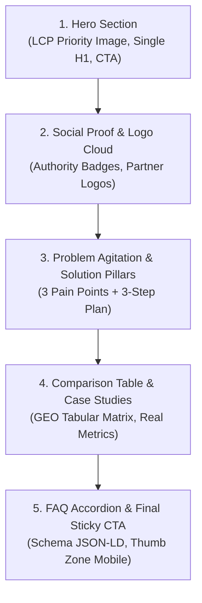

# Landing Architect: High-Converting Landing Page & Growth Engineering
> **Standar Internasional:** Google Core Web Vitals (2024/2026), Princeton University GEO (Aggarwal et al., 2023), Answer.ai llms.txt (Jeremy Howard, 2024), StoryBrand SB7 (Donald Miller), MECLABS Conversion Heuristic, Julian Shapiro CRO Blueprint, Jakob Nielsen (NN/g), Steven Hoober (Thumb Zone), Rauno Freiberg (Perceptual Craft & Web Interface Guidelines), Emil Kowalski (Animations on the Web), Ethereum Foundation Web3 UX Heuristics, WCAG 2.2 AAA.

Keahlian (*skill*) ini dirancang khusus untuk memandu agen koding dan engineer dalam merancang halaman pendaratan (*landing page*) berstandar kelas dunia yang tidak hanya indah secara visual, namun juga:
1. **Memaksimalkan Konversi Manusia (CRO):** Mengikis keraguan pengunjung melalui alur psikologis teruji (StoryBrand 7-Part Framework).
2. **Memaksimalkan Penemuan Mesin (SEO, AEO, GEO, AIO):** Mengamankan posisi di Google SERP, Featured Snippets, kutipan sintesis AI (ChatGPT, Perplexity, Gemini), dan agen otonom melalui `llms.txt`.
3. **Performa & Aksesibilitas Ekstrem:** Mematuhi anggaran Core Web Vitals (LCP $\le 2.5\text{s}$, INP $\le 200\text{ms}$, CLS $\le 0.1$) dan proteksi gerak `prefers-reduced-motion`.

---

## 1. PANDUAN REFERENSI CEPAT (PROGRESSIVE DISCLOSURE)

Untuk rujukan teknis mendalam, rujuk berkas modular berikut:
- **Aturan Mutlak Sistem (Invariants):** [`.agents/rules/landing_page_invariants.md`](../../rules/landing_page_invariants.md)
- **Standar Teknis SEO, AEO, GEO, & AIO:** [`references/seo_aeo_geo_aio_standards.md`](./references/seo_aeo_geo_aio_standards.md)
- **Matriks Tipologi UI & Motion Design:** [`references/ui_ux_motion_matrix.md`](./references/ui_ux_motion_matrix.md)
- **Template Intake & Wireframe Spek:** [`templates/landing_page_blueprint_template.md`](./templates/landing_page_blueprint_template.md)
- **Skrip Auditor Otomatis (PowerShell):** [`scripts/audit-landing-page.ps1`](./scripts/audit-landing-page.ps1)
- **Dokumentasi Teori & Whitepaper SSoT:** [`doc/landing_page_standards.md`](../../../doc/landing_page_standards.md)

---

## 2. WORKFLOW 1: PERUMUSAN STRATEGI & INTAKE (DISCOVERY & CRO MODE)

Ketika pengguna meminta konsep, wireframe, atau copy untuk landing page baru:

### Langkah 1: Profiling Model Bisnis & Karakter Pengunjung
Gunakan [`references/ui_ux_motion_matrix.md`](./references/ui_ux_motion_matrix.md) untuk mengidentifikasi tipologi:
1. Apakah targetnya **B2B Enterprise** (butuh densitas data tinggi, keamanan ISO/SOC-2, CTA *Demo*)?
2. Apakah targetnya **B2C Micro-SaaS / DevTools** (butuh cuplikan kode, sandbox interaktif, CTA *Coba Gratis*)?
3. Apakah targetnya **High-Ticket Consulting / Agency** (butuh tipografi editorial, studi kasus angka nyata)?
4. Apakah targetnya **E-Commerce / DTC** (butuh galeri visual produk, UGC review, sticky CTA)?
5. Apakah targetnya **EdTech / Kursus** (butuh kurikulum modular, video bukti alumni)?
6. Apakah targetnya **Web3 / DeFi / Cryptographic Protocol** (butuh Dark Obsidian Bento Grid, telemetri on-chain live, audit badges CertiK/OpenZeppelin, dan progressive custody onboarding)?

### Langkah 2: Formulasi Kuartet Penemuan (SEO, AEO, GEO, AIO)
Rujuk panduan di [`references/seo_aeo_geo_aio_standards.md`](./references/seo_aeo_geo_aio_standards.md):
- **SEO:** Tentukan 1 Primary Value Prop untuk `<h1>`, title tag $\le 60$ karakter, meta description $\le 155$ karakter.
- **AEO:** Tulis ringkasan jawaban padat 40–60 kata untuk setiap subjudul utama dan FAQ.
- **GEO:** Siapkan 3 data statistik konkret dan rujukan standar formal untuk kutipan AI.
- **AIO:** Siapkan payload `llms.txt` dan skema Schema.org JSON-LD.

### Langkah 3: Penyusunan Wireframe StoryBrand 8-Section
Gunakan template [`templates/landing_page_blueprint_template.md`](./templates/landing_page_blueprint_template.md) untuk menyusun narasi utuh dari Hero hingga Final CTA.

---

## 3. WORKFLOW 2: KOMPILASI KODE (SVELTE 5 & TAILWIND V4 IMPLEMENTATION)

Ketika mengompilasi antarmuka landing page ke dalam berkas kode nyata (`+page.svelte` atau komponen terkait):



### Invarian Koding Mutlak:
1. **Svelte 5 Runes Murni:** Gunakan `$state`, `$derived`, `$props`. Dilarang sintaks legasi Svelte 4 (`export let`, `$:`) atau TypeScript.
2. **Anggaran Motion Tiering & Strict Isolation:**
   - Gunakan CSS Tailwind untuk hover/glow (0 KB JS).
   - Gunakan `transition:slide` atau `transition:fade` Svelte native untuk accordion FAQ dan modal.
   - Pustaka GSAP HANYA jika ada efek scrubbed scroll timeline, dan WAJIB dibungkus `prefers-reduced-motion` serta `gsap.context()`.
   - Kanvas WebGL/Three.js HANYA jika diperlukan secara esensial, wajib di-pause via `IntersectionObserver` saat di luar viewport, dan wajib ada fallback statis mobile.
3. **Formulir 4 State Visual:** Setiap form pendaftaran/kontak wajib memiliki visual state: *Loading*, *Empty*, *Error*, dan *Success*.
4. **Mobile Thumb Dock:** Di layar mobile (`md:hidden`), sertakan floating capsule di tengah bawah layar untuk navigasi instan dan CTA cepat.
5. **Arsitektur Elevasi Permukaan 3-Tier (Anti-Camouflage Bento Grid):**
   - L0 Kanvas Netral (`bg-slate-100/70` Daylight; `bg-[#070b12]` / `bg-[#0a0a0a]` Dark Mode).
   - L1 Kartu Makro Bento / Kontainer (`bg-white` solid Daylight; `dark:bg-slate-900/90` Dark Mode dengan `border border-slate-200/80 dark:border-slate-800` dan `shadow-2xs`).
   - L2 Kartu Tersemat / Badge / Micro-elements dengan diferensiasi jelas.
   - DILARANG KERAS membuat kartu bento transparan pucat (`bg-white/40`, `dark:bg-white/[0.02]`) di atas kanvas flat yang memicu efek bunglon (*visual camouflage*) dan ketidakjelasan batas antar-elemen.

---

## 4. WORKFLOW 3: AUDIT OTOMATIS & REVIEW GATE (AUDIT MODE)

Sebelum menyatakan implementasi selesai, jalankan skrip auditor:

```powershell
powershell -ExecutionPolicy Bypass -File ".agents/skills/landing-architect/scripts/audit-landing-page.ps1" -FilePath "path/to/landing_page.svelte"
```

### Target Kelulusan:
- **Skor Kesiapan (*Readiness Score*):** $\ge 85 / 100$ (Ready for Production).
- Seluruh tag gambar memiliki `alt` dan reservasi ukuran.
- Tidak ada teks rintisan (*Lorem Ipsum* / `TODO`).
- Skema JSON-LD valid dan tersemat.

### Sajikan Review Gate Form:
```markdown
### 🚀 REVIEW GATE: LANDING PAGE & GROWTH ARCHITECTURE
- **Status Audit:** Lulus 100% (Skor: X/100)
- **Kuartet Penemuan:** SEO (Semantic H1), AEO (FAQ 40-60 kata), GEO (3 data statistik), AIO (Schema JSON-LD & llms.txt).
- **Motion Budget:** CSS/Svelte native + prefers-reduced-motion aktif.
- **Mobile Ergonomics:** Thumb Zone compliant dengan Floating Action Pill.

Apakah ada penyesuaian khusus pada copywriting atau elemen visual sebelum dipublikasikan ke produksi?
```
