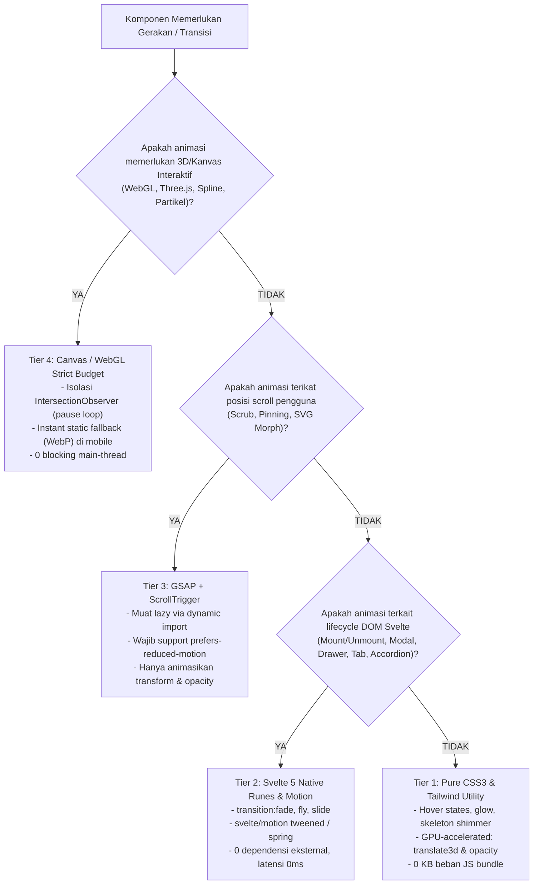

# Matriks Tipologi UI/UX & Rekayasa Motion Design (ui_ux_motion_matrix.md)
> **Engine:** Hyperion Vault v6.31.0 / v8.0.0 SDD-Enterprise-Deterministic  
> **Rujukan:** Jakob Nielsen (NN/g), Steven Hoober (Thumb Zone), WCAG 2.2 AAA, Google Web Vitals, GreenSock Animation Platform (GSAP), Svelte 5 Modern Runes.

---

## 1. MATRIKS TIPOLOGI UI BERDASARKAN UX PENGUNJUNG

Pemilihan tipologi antarmuka tidak boleh didasarkan pada selera estetika subjektif, melainkan harus dipetakan secara matematis terhadap **tingkat risiko persepsi (*perceived risk*)**, **model pengambilan keputusan (*buyer journey*)**, dan **toleransi friksi pengunjung**.

| Parameter Evaluasi | B2B Enterprise / High-Ticket | B2C Micro-SaaS / DevTools | High-Ticket Consulting / Agency | E-Commerce / DTC Retail | EdTech / Kursus Online | Web3 / DeFi / Cryptographic Protocol |
| :--- | :--- | :--- | :--- | :--- | :--- | :--- |
| **Karakter Audiens** | Skeptis, berbasis komite, prioritas kepatuhan & ROI. | Pragmatis, ingin bukti instan, menolak penjualan agresif. | Mencari otoritas pakar, reputasi, dan kecocokan metodologi. | Emosional/Impulsif, visual-driven, mengejar kenyamanan. | Cemas akan efektivitas, butuh jaminan kurikulum. | Sangat skeptis terhadap risiko keamanan/drainer, pseudonim, mementingkan desentralisasi & audit kode. |
| **Information Density** | **Tinggi (Compact Pro-Grade):** Tabel, spesifikasi, audit log. | **Sedang-Tinggi:** Kode monospace, preview UI interaktif. | **Sedang-Rendah (Editorial):** Tipografi lega, spasi negatif luas. | **Sedang:** Galeri gambar, ulasan bintang, badge diskon. | **Tinggi (Modular):** Silabus breakdown per minggu. | **Sangat Tinggi (On-chain Telemetry):** TVL, APY, 24h Volume, Gas tracker, hash kontrak `font-mono`. |
| **Primary Value Proof** | Sertifikasi SOC-2 / ISO, SLA 99.9%, studi kasus angka riil. | Live interactive demo, sandbox, performa benchmark ms. | Studi kasus before/after, biografi konsultan, klien prestisius. | Rating ulasan pembeli (UGC), foto pembeli asli. | Cuplikan materi video, profil LinkedIn alumni sukses. | Laporan Audit Smart Contract (CertiK, OpenZeppelin), Proof of Reserves, verifikasi Etherscan/Basescan. |
| **Primary CTA (Tindakan Utama)** | *Jadwalkan Konsultasi / Demo* | *Coba Gratis (Tanpa Kartu Kredit)* | *Kirim Aplikasi / Brief Proyek* | *Beli Sekarang / Masukkan Keranjang* | *Daftar Batch Sekarang / Ikuti Kelas* | *Launch App* / *Jelajahi Protokol* (Pemisahan eksplisit dari mutasi on-chain). |
| **Penanganan Friksi** | NDA resmi, kontak sales langsung, jaminan migrasi aman. | Dokumentasi API instan, onboarding mandiri < 2 menit. | Sesi konsultasi diagnostik gratis 30 menit. | Garansi retur 30 hari, bayar di tempat (COD) / multi-gateway. | Garansi uang kembali 14 hari tanpa syarat. | *Progressive Custody* (Sandbox preview tanpa paksaan connect wallet di awal), Human-Readable Signatures (anti-blind signing), panduan jaringan otomatis. |
| **Rekomendasi Estetika** | Slate netral, hairline 1px border, shadow-2xs halus. | Dark Obsidian / Neon accents, terminal typography, glassy cards. | Warm neutral / Editorial Serif + Sans-serif, layout asimetris. | High-contrast accent (Vibrant), fotografi produk makro. | Friendly energetic, visual badges progresif, avatar murid. | Dark Mode Luxury (Obsidian `#0a0a0a`), Hairline 1px border (`rgba(255,255,255,0.08)`), Bento Grid asimetris, Aksen Neon fungsional tunggal (Emerald/Mint atau Laser Cyan). |

---

## 2. POHON KEPUTUSAN & ARSITEKTUR MOTION DESIGN

Gerakan (*motion*) di web harus memiliki tujuan fungsional: **mengarahkan fokus**, **mengonfirmasi aksi**, atau **menciptakan kontinuitas visual**. Dilarang keras menambahkan animasi yang mengganggu pemahaman atau menurunkan skor Core Web Vitals.



---

## 3. PANDUAN IMPLEMENTASI TEKNIS MOTION DESIGN

### A. Tier 1: Pure CSS3 (GPU Composited)
Hanya gunakan properti yang dieksekusi di *compositor thread* tanpa memicu *Reflow/Layout Shift*:
- ✅ **Diizinkan:** `transform: translate3d(...)`, `transform: scale(...)`, `transform: rotate(...)`, `opacity`.
- ❌ **Dilarang Keras:** `top`, `left`, `bottom`, `right`, `width`, `height`, `margin`, `padding` (Penyebab utama anjloknya skor CLS dan INP).

```css
/* Contoh Micro-Interaction Tombol Berkinerja Tinggi */
.btn-cta {
  transition: transform 150ms cubic-bezier(0.16, 1, 0.3, 1), opacity 150ms ease;
  will-change: transform;
}
.btn-cta:hover {
  transform: translate3d(0, -2px, 0);
}
.btn-cta:active {
  transform: translate3d(0, 0, 0) scale(0.98);
}
```

### B. Tier 2: Svelte 5 Native Runes & Transitions
Untuk komponen dinamis yang muncul dan menghilang dari DOM:

```svelte
<script>
  import { slide, fade } from 'svelte/transition';
  
  let { isExpanded = false, title, content } = $props();
</script>

<div class="border border-slate-200 rounded-lg p-3 dark:border-slate-800">
  <button 
    type="button" 
    class="flex w-full items-center justify-between text-left font-semibold text-xs text-slate-900 dark:text-slate-100"
    onclick={() => isExpanded = !isExpanded}
    aria-expanded={isExpanded}
  >
    <span>{title}</span>
    <span class="transition-transform duration-200" class:rotate-180={isExpanded}>▾</span>
  </button>
  
  {#if isExpanded}
    <div 
      transition:slide={{ duration: 200 }} 
      class="mt-2 text-[12px] leading-relaxed text-slate-600 dark:text-slate-400"
    >
      {content}
    </div>
  {/if}
</div>
```

### C. Tier 3: GSAP + ScrollTrigger (Dengan Pengaman Aksesibilitas Mutlak & Disiplin Nested Motion)
Jika landing page membutuhkan storytelling bertahap (*pinned timeline*) atau koreografi masuk:

```javascript
import { onMount } from 'svelte';

let containerEl;

onMount(() => {
  // 1. Cek Preferensi Pengurangan Gerak (WCAG 2.2 AAA Mandate)
  const prefersReducedMotion = window.matchMedia('(prefers-reduced-motion: reduce)').matches;
  if (prefersReducedMotion) return; // Nétralkan animasi jika pengguna meminta reduced motion

  let ctx;
  (async () => {
    // 2. Dynamic Import untuk Menjaga Ukuran Bundle Awal LCP
    const { gsap } = await import('gsap');
    const { ScrollTrigger } = await import('gsap/ScrollTrigger');
    gsap.registerPlugin(ScrollTrigger);

    // 3. Inisiasi Timeline dengan Properti GPU-Safe & Koreografi Bersarang
    ctx = gsap.context(() => {
      const tl = gsap.timeline({
        scrollTrigger: {
          trigger: containerEl,
          start: 'top 80%',
          toggleActions: 'play none none none'
        }
      });

      // A. Gerak Makro Kontainer (y: 24px, durasi 0.5s, stagger 0.12s)
      tl.from('.feature-card', {
        y: 24,
        opacity: 0,
        duration: 0.5,
        stagger: 0.12,
        ease: 'power2.out'
      })
      // B. Gerak Mikro Teks (Judul y: 8px, durasi 0.3s, stagger 0.05s)
      .from('.feature-title', {
        y: 8,
        opacity: 0,
        duration: 0.3,
        stagger: 0.05,
        ease: 'power1.out'
      }, '-=0.3')
      // C. Gerak Mikro Paragraf (y: 6px, durasi 0.25s)
      .from('.feature-desc', {
        y: 6,
        opacity: 0,
        duration: 0.25,
        ease: 'power1.out'
      }, '-=0.2');
    }, containerEl);
  })();

  // 4. Wajib Cleanup Lifecycle untuk Mencegah Memory Leak di Svelte SPA
  return () => ctx?.revert();
});
```

### D. Tier 4: Canvas / WebGL / Three.js Strict Budgeting (Standar Web3 & Immersive Web)
Untuk visualisasi grafik node, bola dunia tokenomik, atau efek partikel interaktif:
1. **Pemisahan Thread & IntersectionObserver Lifecycle:**
   - Loop render WebGL (`requestAnimationFrame`) WAJIB dihentikan seketika saat elemen keluar dari viewport untuk menghemat baterai laptop/ponsel.
   - Gunakan `ResizeObserver` ter-debounce untuk mencegah layout thrashing.
2. **Mobile & Reduced Motion Fallback:**
   - Deteksi perangkat mobile (`window.innerWidth < 768`) atau `prefers-reduced-motion: reduce`: gantikan kanvas dengan gambar statis WebP resolusi tinggi (< 100 KB).
   - Dilarang memblokir Main Thread (target INP $\le 200\text{ms}$).

---

## 4. STANDAR SAINS WARNA 60-30-10 & KONTRAS PERSEPSI APCA / WCAG 2.2 AAA

1. **Alokasi Proporsi Warna 60-30-10 (OKLCH Standard):**
   - **60% Latar Belakang Kanvas:** Ruang netral tenang (`bg-slate-50` / `bg-slate-950`).
   - **30% Struktur Permukaan & Garis Pembatas:** Kartu data, header modal, hairline 1px border (`border-slate-200/80 dark:border-slate-800/80`), teks pendukung (`text-slate-600 dark:text-slate-400`).
   - **10% Titik Aksen CTA & Fokus:** Tombol tindakan utama, badge aktif, sorotan metrik. Hindari saturasi lebih dari 10%.
2. **Standar Kontras Persepsi APCA (Accessible Perceptual Contrast Algorithm - WCAG 3.0):**
   - **Teks Utama (Body / Deskripsi):** Wajib Lightness Contrast $L_c \ge 75$ (setara rasio WCAG AAA 7:1).
   - **Teks Judul / Heading ($\ge 20\text{px}$ bold):** Wajib Lightness Contrast $L_c \ge 60$ (setara rasio WCAG AA 4.5:1).
   - **Elemen Non-Teks & Border Interaktif:** Wajib $L_c \ge 45$ (WCAG SC 1.4.11 $\ge 3:1$).
   - Dilarang membuat border tebal di dekat teks tebal untuk menghindari efek getar visual *1+1=3 Noise* (Edward Tufte).

---

## 5. RITME TIPOGRAFI ROBERT BRINGHURST & SPASIAL 8-POINT

1. **Batas Optimal Baris Teks (Measure):** 45–75 karakter per baris (CPL).
2. **Tinggi Baris Proporsional:**
   - Display/Heading: `leading-[1.15]` s/d `leading-[1.25]`.
   - Body/Paragraf: `leading-[1.5]` s/d `leading-[1.65]`.
   - Data Tabular Finansial: `leading-none` / `leading-tight` dengan `font-mono`.
3. **Harmoni Grid 8-Point:** Kelipatan 4px/8px untuk seluruh properti jarak (`gap-1` [4px], `gap-2` [8px], `gap-3` [12px], `gap-4` [16px], `gap-6` [24px], `gap-8` [32px]).

---

## 6. PRINSIP INTERAKSI PERSEPTUAL & FISIKA ANIMASI MODERN (EMIL KOWALSKI & RAUNO FREIBERG)

1. **Snappy Physics & Fast-to-Start Timing (Emil Kowalski):**
   - Micro-interactions (hover, tombol tekan, switch, accordion toggle) wajib selesai dalam rentang **150ms – 250ms**.
   - Animasi transisi wajib bersifat **interruptible** (jika pengguna membatalkan klik atau menutup drawer di tengah animasi, transisi berbalik arah secara mulus tanpa sentakan patah).
   - Penentuan titik pangkal transformasi (*transform-origin*): Dropdown menu, popover, dan tooltip wajib berekspansi langsung dari elemen pemicunya (`transform-origin: top-left` atau sesuai letak tombol pemicu), bukan dari tengah layar.

2. **Invisible Details & Predictable Intent (Rauno Freiberg):**
   - **Hover Intent:** Berikan toleransi sudut gerak kursor (*safe triangle path*) pada navigasi mega-menu agar kursor yang bergerak diagonal tidak menutup submenu sebelum sampai ke tujuan.
   - **Multi-State Precision:** Setiap tombol wajib memiliki feedback optik tegas untuk 5 state: `default`, `hover`, `active (scale-98)`, `focus-visible (ring-2)`, dan `disabled (opacity-50 pointer-events-none)`.
   - **Ruang Warna OKLCH:** Terapkan transisi warna tombol dan border menggunakan ruang warna perseptual OKLCH untuk menjaga kestabilan tingkat kecerahan (*lightness*) tanpa pergeseran rona warna yang kotor (*gray dead zones*).

---

## 7. REKAYASA APPLE SPATIAL MATERIALS & AUDITORY UI (WEB AUDIO API)

### A. Formula CSS Tailwind v4 untuk Apple Spatial Glass
```html
<div class="relative overflow-hidden rounded-2xl
            bg-white/80 dark:bg-slate-900/80
            backdrop-blur-xl backdrop-saturate-150
            border border-slate-200/80 dark:border-white/10
            shadow-sm dark:shadow-[0_8px_32px_0_rgba(0,0,0,0.36)]
            before:pointer-events-none before:absolute before:inset-x-0 before:top-0 before:h-px
            before:bg-gradient-to-r before:from-transparent before:via-white/30 dark:before:via-white/20 before:to-transparent">
  <!-- Konten Kartu dengan Contrast Shield Terjaga -->
</div>
```

### B. Arsitektur Web Audio API untuk UI Feedback (0 KB Bundle)
```javascript
import { tactileAudio } from '$lib/utils/audioFeedback.js';

// 1. Umpan balik tap tombol / switch
tactileAudio.playTap();

// 2. Umpan balik accordion / popover ekspansi
tactileAudio.playPop();

// 3. Umpan balik konfirmasi sukses formulir
tactileAudio.playSuccess();
```
- **Prinsip Mutlak:** Audio hanya berjalan pasca interaksi pertama pengguna (*user gesture*), wajib dapat di-mute oleh pengguna, dan tidak menggantikan sinyal visual (WCAG 2.2 AAA Multimodal).
