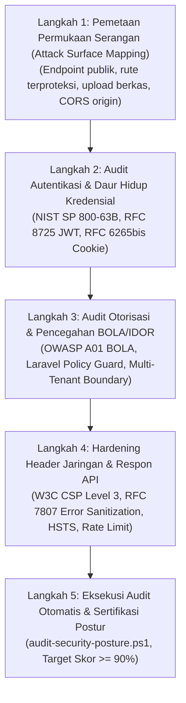

# Security & Hardening Architect: Enterprise Defense Playbook
> **Standard:** RFC 7807, RFC 9457, RFC 8725, RFC 6265bis, RFC 8446, RFC 9116, OWASP Top 10 (2021/2025), OWASP ASVS v4.0.3 (Level 2 Enterprise), OWASP API Security Top 10 (2023), NIST SP 800-63B, CIS Critical Security Controls v8, ISO/IEC 27001:2022 Annex A.8, SOC 2 Type II.

Skill ini memandu AI coding agent dan engineer dalam bertindak sebagai **Principal Application Security Architect & DevSecOps Engineer** untuk mengaudit, memperkuat (*harden*), dan mengonfirmasi postur keamanan aplikasi web dan REST API agar 100% mematuhi [`.agents/rules/security_invariants.md`](../../rules/security_invariants.md).

---

## 1. STRUKTUR DIREKTORI & MODUL PENDUKUNG

```
.agents/skills/security-hardening/
├── SKILL.md                                           # Playbook utama & orchestrator (berkas ini)
├── references/
│   ├── web_security_canonical_standards.md            # Kompendium standar RFC, NIST SP 800-63B, OWASP ASVS L2, CIS v8, ISO 27001
│   └── security_headers_and_csp_guide.md             # Panduan implementasi CSP Level 3, HSTS, Permissions-Policy, dan CORS
├── templates/
│   ├── security_audit_matrix.md                       # Rubrik evaluasi audit keamanan 12 Checkpoint (Target >= 90%)
│   └── vulnerability_disclosure_and_remediation.md   # Format standar RFC 9116 security.txt & SOP penanganan insiden kerentanan
└── scripts/
    ├── audit-security-posture.ps1                     # Auditor keamanan otomatis (Env, Policy, Query, Headers, Secret Leak)
    └── audit-skills-integrity.ps1                     # Verifikator integritas hash seluruh skill dan deteksi referensi rusak
```

---

## 2. WORKFLOW 5-LANGKAH: DARI PERMUKAAN SERANGAN HINGGA SERTIFIKASI AMAN

Setiap audit dan penguatan keamanan aplikasi wajib melalui 5 tahapan deterministik berikut:



### Langkah 1: Pemetaan Permukaan Serangan (Attack Surface Mapping)
1. Periksa seluruh endpoint API pada `backend/routes/api.php` dan `web.php`.
2. Pisahkan rute ke dalam 3 zona kepercayaan (*Trust Zones*):
   - **Zona Publik (Unauthenticated):** Rute login (`/auth/login`), CSRF cookie (`/sanctum/csrf-cookie`), dokumentasi publik, dan healthcheck.
   - **Zona Akun Standar (Authenticated User):** Rute profil, dashboard pengguna, pembacaan data santri/pegawai pribadi.
   - **Zona Administratif & Privileged:** Rute mutasi data sistem, manajemen pengguna, konfigurasi studio, dan telemetri server (`/api/v1/admin/*`).
3. Pastikan tidak ada endpoint mutasi liar tanpa middleware otentikasi (`auth:sanctum` atau session guard).

### Langkah 2: Audit Autentikasi & Daur Hidup Kredensial
1. **Penyimpanan Sandi (NIST SP 800-63B):**
   - Pastikan sandi di-hash dengan `Argon2id` atau `Bcrypt` (work factor $\ge 12$).
   - Larang autentikasi berbasis plain MD5/SHA1.
2. **Mitigasi Brute-Force & Credential Stuffing:**
   - Wajib terdapat rate limiting pada login: `throttle:5,1` (maksimal 5 percobaan gagal per menit).
3. **Audit Token & Sesi (RFC 8725 & RFC 6265bis):**
   - Periksa `SESSION_DRIVER`: Wajib `file`, dilarang `database`.
   - Periksa atribut cookie: `HttpOnly: true`, `SameSite: Lax/Strict`, `Secure: true` (pada produksi HTTPS).
   - Pastikan mekanisme pembatalan sesi instan (*Revocation*) berfungsi via `token_version` pada tabel `users` dan `user_devices`.

### Langkah 3: Audit Otorisasi & Pencegahan BOLA/IDOR (OWASP A01)
1. **Larangan Akses Bebas Berbasis ID:**
   - Setiap kali parameter `{id}` diterima di Controller (misal: `/santri/{id}`, `/halaqah/{id}`, `/kamar/{id}`), pastikan terdapat pemanggilan eksplisit:
     ```php
     $this->authorize('view', $targetEntity);
     // ATAU
     Gate::authorize('update', $targetEntity);
     ```
2. **Scoping Multi-Unit & Role:**
   - Pastikan peran spesifik (contoh: Ustadzah, Wali Santri, Pegawai PKBM) tidak dapat mengakses atau memanipulasi data di luar unit/santri binaannya.

### Langkah 4: Hardening Header Jaringan & Respon API (RFC 7807 & CSP Level 3)
1. **Injeksi Security Headers:**
   - Pastikan middleware `SecurityHeaders` aktif dan menyertakan header pertahanan: `Content-Security-Policy`, `X-Frame-Options: DENY`, `X-Content-Type-Options: nosniff`, `Referrer-Policy`, `Permissions-Policy`.
2. **Pencegahan Kebocoran Informasi (RFC 7807):**
   - Pastikan `APP_DEBUG=false` di `.env` produksi.
   - Pastikan exception handler memformat kegagalan sebagai objek RFC 7807 tanpa memperlihatkan stack trace atau kueri SQL internal.

### Langkah 5: Eksekusi Audit Otomatis & Sertifikasi Postur
Jalankan skrip auditor keamanan otomatis:
```powershell
powershell -ExecutionPolicy Bypass -File .agents/skills/security-hardening/scripts/audit-security-posture.ps1
```
- **Kriteria Kelulusan:** Skor Kesiapan Postur Keamanan (*Security Readiness Score*) $\ge 90\%$ (Minimal 9 dari 10 checkpoint hijau).
- Tinjau dan isi lembar kerja audit [`templates/security_audit_matrix.md`](./templates/security_audit_matrix.md).

---

## 3. CHECKLIST VERIFIKASI KEAMANAN SEBELUM REVIEW GATE

- [ ] Tidak ada query SQL string concatenation (`0 raw query injection`).
- [ ] Seluruh endpoint mutasi privat diproteksi oleh Laravel Policy (0 BOLA).
- [ ] Model Eloquent menggunakan `$fillable` eksplisit (dilarang `guarded = []`).
- [ ] Format respons error API 4xx/5xx mematuhi standar RFC 7807 / RFC 9457.
- [ ] Konfigurasi `SESSION_DRIVER=file` aktif dan tabel `user_devices` mencatat aktivitas login.
- [ ] Algoritma sandi menggunakan Argon2id atau Bcrypt dengan work factor aman.
- [ ] Cookie autentikasi Sanctum bertanda `HttpOnly`, `SameSite=Lax`, dan `Secure` (di HTTPS).
- [ ] Header keamanan W3C CSP Level 3 dan anti-clickjacking (`X-Frame-Options: DENY`) terpasang.
- [ ] Rate limiting login (`throttle:5,1`) aktif pada rute autentikasi.
- [ ] Berkas `/.well-known/security.txt` (RFC 9116) tersedia dan valid.
- [ ] Lulus skrip auditor `audit-security-posture.ps1` dengan skor $\ge 90\%$.
