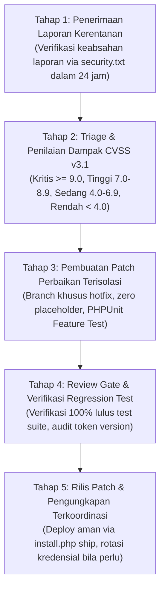

# Prosedur Pengungkapan Kerentanan Keamanan & Remediasi (RFC 9116)
> **Engine:** Hyperion Vault v6.31.0 / v8.0.0 SDD-Enterprise-Deterministic  
> **Standar Rujukan:** RFC 9116 (security.txt), ISO/IEC 29147 (Vulnerability disclosure), ISO/IEC 30111 (Vulnerability handling processes).

---

## 1. TEMPLATE BERKAS `/.well-known/security.txt`

Salin dan tempatkan berkas ini di direktori publik web (`public/.well-known/security.txt` atau root gateway Nginx):

```text
# Hyperion Vault Security Disclosure Policy
# Reference: https://www.rfc-editor.org/rfc/rfc9116.html

Contact: mailto:security@hyperion-vault.test
Expires: 2027-12-31T23:59:59.000Z
Preferred-Languages: id, en
Canonical: http://hyperion-vault.test/.well-known/security.txt
Policy: http://hyperion-vault.test/security-policy
Hiring: http://hyperion-vault.test/careers
Acknowledgments: http://hyperion-vault.test/hall-of-fame
```

---

## 2. STANDAR OPERASIONAL PROSEDUR PENANGANAN KERENTANAN (SOP REMEDIASI)



### SLA Remediasi Berdasarkan Tingkat Keparahan CVSS:
1. **Critical (CVSS 9.0 - 10.0) — Contoh: SQL Injection, Remote Code Execution (RCE), BOLA Auth Bypass:**
   - Respon Awal: $< 4\text{ jam}$.
   - Patch Rilis: $< 24\text{ jam}$.
   - Tindakan Darurat: Segera aktifkan mode maintenance (`php artisan down` atau flag `is_maintenance = 1`) jika eksploitasi aktif terdeteksi.
2. **High (CVSS 7.0 - 8.9) — Contoh: Stored XSS, Broken Multi-Device Revocation:**
   - Respon Awal: $< 12\text{ jam}$.
   - Patch Rilis: $< 48\text{ jam}$.
3. **Medium (CVSS 4.0 - 6.9) — Contoh: Missing Rate Limiting, Missing CSP Header:**
   - Respon Awal: $< 24\text{ jam}$.
   - Patch Rilis: $< 7\text{ hari kerja}$.
4. **Low (CVSS 0.1 - 3.9) — Contoh: Info disclosure versi server minor:**
   - Respon Awal: $< 48\text{ jam}$.
   - Patch Rilis: Dijadwalkan pada siklus rilis SemVer berikutnya.
