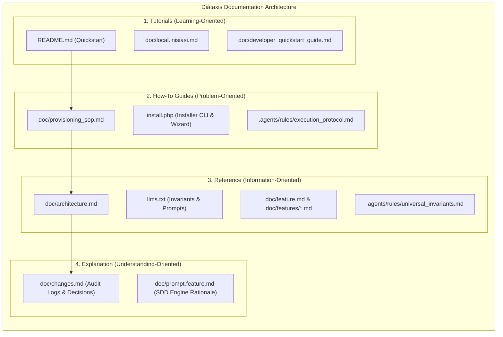
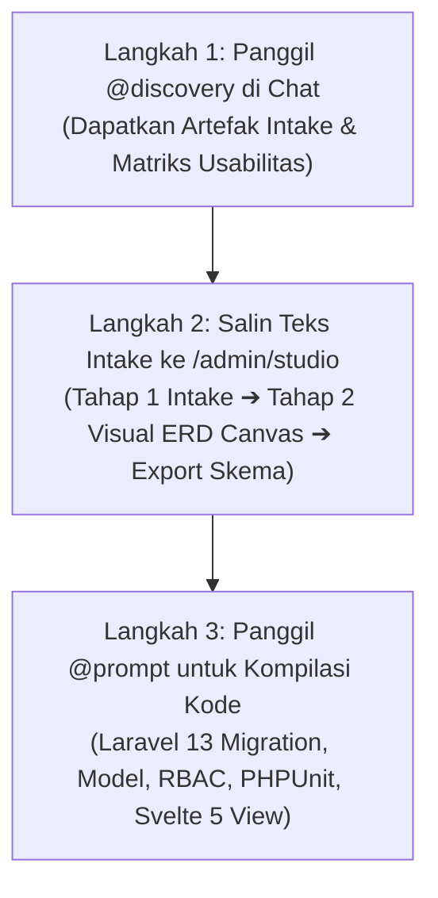
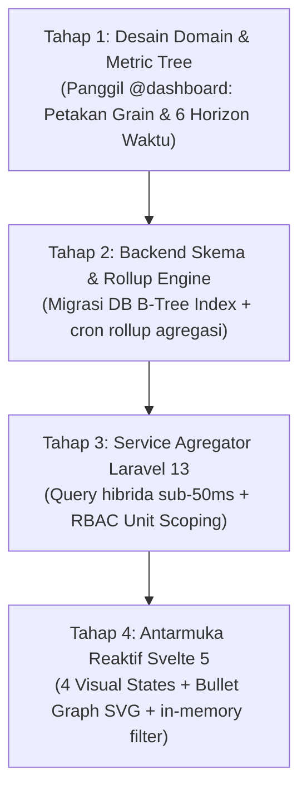
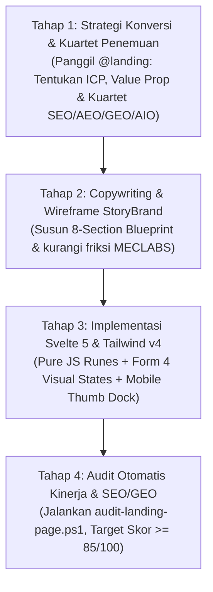

# ⚡ Hyperion Vault (v6.31.0)

> **Platform Web Skalabilitas Tinggi Berbasis Laravel 13 Sanctum & Svelte 5 Runes.**  
> Dirancang khusus untuk performa ultra-cepat (P99 < 150ms) dan anti-koneksi macet (*Zero Connection Exhaustion*) di Shared Hosting (seperti Hostinger) maupun VPS. Teruji dan tersinkronisasi dengan standar stabilitas produksi `yayasan-pqtm`.

[](LICENSE)
[](https://laravel.com)
[](https://svelte.dev)
[](https://tailwindcss.com)
[-brightgreen.svg)](backend/tests)
[](https://semver.org)

---

## 💡 Apa itu Hyperion Vault?

**Hyperion Vault** adalah *boilerplate* aplikasi web *full-stack* modern kelas enterprise siap pakai yang menggabungkan kecepatan reaktivitas **Svelte 5** dengan kehandalan backend **Laravel 13**.

Banyak aplikasi Laravel di *shared hosting* sering mengalami error **"Too Many Connections (Error 1040)"** karena setiap klik membuka koneksi MySQL baru untuk menyimpan sesi dan cookie. **Hyperion Vault memecahkan masalah ini secara tuntas!** Dengan arsitektur penyimpanan sesi berbasis disk NVMe SSD lokal (`SESSION_DRIVER=file`) dan filtrasi data langsung di memori browser, beban koneksi database ditekan hingga **0.064 koneksi**, membuktikan sistem aman meluncur kencang bahkan pada hosting murah dengan kuota ketat 25 koneksi.

---

## ✨ Fitur Unggulan

- 🚀 **Performa Secepat Kilat (P99 < 150ms):** Rata-rata latensi riil ~65ms, memuat data tanpa jeda.
- 🛡️ **Zero DB Connection Exhaustion:** Menyimpan sesi di disk lokal NVMe (0 koneksi DB) dan filtrasi pencarian di memori peramban tanpa query server per ketikan.
- 🔄 **Safe In-Place Updater ([install.php](file:///D:/laragon/www/hyperion-vault/install.php)):** Pembaruan sistem 1-langkah via CLI (`php install.php update`) atau Web Wizard tanpa risiko menghapus data pengguna (*non-destructive migrations*), lengkap dengan pencatatan riwayat audit versi di `.installed`.
- 👥 **Customizable RBAC Matrix ([permissions.php](file:///D:/laragon/www/hyperion-vault/backend/config/permissions.php)):** Matriks peran dan hak akses dinamis yang dapat dikustomisasi sesuai permintaan klien (misal: Dokter, Kasir, Auditor) tanpa perlu mengubah skema database.
- 📱 **Manajemen Multi-Device Real-Time:** Audit perangkat aktif (IP, User-Agent, OS, Browser, Expiry) dengan pencabutan granular per-device atau per-user.
- 🎨 **Konsep Desain Visual & Landing Page ([doc/design.md](file:///D:/laragon/www/hyperion-vault/doc/design.md)):** Kanvas Deep Obsidian `#090d16` & Daylight Mode, tipografi 3-font (`Outfit`, `Inter`, `JetBrains Mono`), grid 8pt, rasio kontras tinggi WCAG AAA 14.8:1, dan panduan kustomisasi wizard instalasi.
- ⚙️ **Autonomous Dual-Track Engine ([doc/prompt.feature.md](file:///D:/laragon/www/hyperion-vault/doc/prompt.feature.md)):** Sintesis fitur otomatis dari kebutuhan non-teknis klien (Track A) dan penyesuaian landing page / gaya visual berdasarkan studi kasus (Track B).
- 🚪 **Easy-to-Understand Action UX:** Tombol logout eksplisit **"Keluar Sesi Ini"** di sidebar serta pemisahan tegas antara **"Keluar Akun"** dan **"Ganti Akun"** di dashboard.
- 🧙‍♂️ **Wizard Instalasi Visual & CLI 1-Klik:** Diagnostik otomatis via [install.php](file:///D:/laragon/www/hyperion-vault/install.php) yang memvalidasi 13 parameter server dan database hanya dalam 2 detik.
- 🤖 **Ramah AI & Junior Developer:** Indeks [llms.txt](file:///D:/laragon/www/hyperion-vault/llms.txt) padat informasi untuk agen AI (hemat token) dan panduan teknis lengkap di [doc/architecture.md](file:///D:/laragon/www/hyperion-vault/doc/architecture.md).

---

## 🗺️ Peta Kesinambungan Dokumen & Kerangka Diátaxis

Struktur dokumentasi Hyperion Vault mengadopsi standar internasional **Diátaxis Framework** (Tutorials, How-To Guides, Reference, Explanation):



| Diátaxis Kuadran | Berkas | Peruntukan & Tujuan | Standar RFC 2119 |
|---|---|---|---|
| **Reference** | [`.agents/rules/universal_invariants.md`](file:///D:/laragon/www/hyperion-vault/.agents/rules/universal_invariants.md) | **Binding Operational Rules:** 14 Hard Invariants sistem dan Definition of Done. | `MUST` dipatuhi AI & Dev |
| **Reference** | [`.agents/rules/product_discovery_invariants.md`](file:///D:/laragon/www/hyperion-vault/.agents/rules/product_discovery_invariants.md) | **Invariants Product Discovery:** JTBD mandatory, audit 4 risiko produk, dan eliminasi fitur spekulatif. | `MUST` dipatuhi perumusan fitur |
| **Reference** | [`.agents/rules/temporal_dashboard_invariants.md`](file:///D:/laragon/www/hyperion-vault/.agents/rules/temporal_dashboard_invariants.md) | **Invariants Dasbor Multi-Temporal:** Mandat 4 visual states, rasio data-ink Few/Tufte, dan rollup Kimball. | `MUST` dipatuhi modul analitik |
| **Reference** | [`.agents/rules/clean_architecture_invariants.md`](file:///D:/laragon/www/hyperion-vault/.agents/rules/clean_architecture_invariants.md) | **Invariants Clean Code & Refactoring:** Guard clauses, anti-nesting, dan zero regression. | `MUST` dipatuhi refaktorisasi |
| **Reference** | [`.agents/rules/blueprint_studio_invariants.md`](file:///D:/laragon/www/hyperion-vault/.agents/rules/blueprint_studio_invariants.md) | **Invariants Blueprint Studio:** Spesifikasi living mockup, logic archetypes, dan ERD. | `MUST` dipatuhi studio |
| **Reference** | [`.agents/rules/security_invariants.md`](file:///D:/laragon/www/hyperion-vault/.agents/rules/security_invariants.md) | **Invariants Security Hardening:** OWASP ASVS L2, BOLA Policy, sanitasi input, dan RFC 7807. | `MUST` dipatuhi keamanan |
| **Reference** | [`.agents/rules/landing_page_invariants.md`](file:///D:/laragon/www/hyperion-vault/.agents/rules/landing_page_invariants.md) | **Invariants Landing Page:** Core Web Vitals (LCP/INP/CLS), StoryBrand SB7, AEO, GEO, AIO, dan motion budget. | `MUST` dipatuhi halaman publik |
| **Reference** | [`llms.txt`](file:///D:/laragon/www/hyperion-vault/llms.txt) | **Router Tugas AI & Token Saver:** Index cepat, 24 Golden Invariants, SOP pasca-clone & safe update. | `REQUIRED` untuk prompt AI |
| **Tutorials** | [`README.md`](file:///D:/laragon/www/hyperion-vault/README.md) | **Pintu Masuk Utama:** Gambaran umum arsitektur, quickstart 1-klik, panduan update, ringkasan fitur. | `RECOMMENDED` bagi pemula |
| **Reference** | [`doc/architecture.md`](file:///D:/laragon/www/hyperion-vault/doc/architecture.md) | **Master Technical Blueprint:** SOP detail backend, auth, database, routing, FastCGI, pengujian. | `MUST` jadi acuan teknis |
| **Reference** | [`doc/design.md`](file:///D:/laragon/www/hyperion-vault/doc/design.md) | **Standar UI/UX & Desain:** SSoT visual (Daylight & Dark Obsidian), token warna, grid 8pt, WCAG AAA. | `SHALL` diikuti frontend |
| **Explanation** | [`doc/prompt.feature.md`](file:///D:/laragon/www/hyperion-vault/doc/prompt.feature.md) | **Autonomous Feature Engine:** Mesin orchestrator intake spesifikasi fitur (Track A) & landing page (Track B). | `SHOULD` memandu SDD |
| **Reference** | [`doc/feature.md`](file:///D:/laragon/www/hyperion-vault/doc/feature.md) | **Master Feature Index:** Ringkasan seluruh domain fitur + folder spesifikasi modular [`doc/features/`](file:///D:/laragon/www/hyperion-vault/doc/features/). | `REQUIRED` untuk katalog |
| **Tutorials** | [`doc/local.inisiasi.md`](file:///D:/laragon/www/hyperion-vault/doc/local.inisiasi.md) | **Runbook Deterministik Lokal:** Panduan instalasi langkah demi langkah dari nol untuk Laragon. | `MAY` dipakai setup awal |
| **Tutorials** | [`doc/developer_quickstart_guide.md`](file:///D:/laragon/www/hyperion-vault/doc/developer_quickstart_guide.md) | **Panduan Cepat Pengembang (Diátaxis Quickstart):** Setup 3-menit, kloning repositori, arsitektur Spawner 5-detik, Single Feature Turn SDD, dan cheat-sheet `install.php`. | `MUST` orientasi pengembang baru |
| **How-To** | [`doc/provisioning_sop.md`](file:///D:/laragon/www/hyperion-vault/doc/provisioning_sop.md) | **SOP Provisioning Turunan:** Panduan kloning & kustomisasi starterkit ke repositori produksi baru. | `MUST` untuk turunan baru |
| **Explanation** | [`doc/changes.md`](file:///D:/laragon/www/hyperion-vault/doc/changes.md) | **Log Audit & Jejak Perubahan:** Histori akar masalah, audit teknis, dan evolusi SemVer lockstep. | `SHALL` mencatat perubahan |
| **How-To** | [`doc/version_sync.php`](file:///D:/laragon/www/hyperion-vault/doc/version_sync.php) | **Automated SemVer Synchronizer:** Alat CLI sinkronisasi versi semantik dan update dokumentasi serentak. | `MUST` menjaga lockstep |
| **Reference** | [`doc/data_analysis_standard.md`](file:///D:/laragon/www/hyperion-vault/doc/data_analysis_standard.md) | **Standar Analisis Data & Intelijen Bisnis:** CRISP-DM, DAMA-DMBOK, Douglas Hubbard, dan Kimball Star Schema. | `MUST` memandu analitik data |
| **Reference** | [`doc/software_design_standards.md`](file:///D:/laragon/www/hyperion-vault/doc/software_design_standards.md) | **Standar Rekayasa 3-Pilar:** Logika Bisnis DDD/FSM, Basis Data 3NF/Index, UI/UX NN/g & WCAG AAA. | `MUST` memandu arsitektur fitur |
| **Reference** | [`doc/security_standards.md`](file:///D:/laragon/www/hyperion-vault/doc/security_standards.md) | **Standar Keamanan & Hardening:** SSoT RFC (7807/8725/6265bis/8446/9116), OWASP ASVS L2, NIST SP 800-63B, CIS v8. | `MUST` memandu keamanan sistem |
| **Reference** | [`doc/landing_page_standards.md`](file:///D:/laragon/www/hyperion-vault/doc/landing_page_standards.md) | **Standar Rekayasa Landing Page:** SSoT Kuartet Penemuan (SEO, AEO, GEO, AIO/llms.txt), StoryBrand SB7, MECLABS, Motion Tiering. | `MUST` memandu halaman penawaran |
| **How-To** | [`.agents/skills/discovery-architect/SKILL.md`](file:///D:/laragon/www/hyperion-vault/.agents/skills/discovery-architect/SKILL.md) | **Skill Discovery Architect:** Playbook elisitasi studi kasus JTBD, validasi 4 risiko produk Cagan, standar minimalis Dieter Rams, negative space, dan mesin inspeksi ketajaman visual Laplacian Canvas 5-titik skala 1:1. | `SHOULD` dipicu `@discovery` |
| **How-To** | [`.agents/skills/clean-code-refactor/SKILL.md`](file:///D:/laragon/www/hyperion-vault/.agents/skills/clean-code-refactor/SKILL.md) | **Skill Clean Code Refactor:** Playbook refaktorisasi micro-tidying (Beck/Fowler), garansi 100% zero-regression, zero-aliasing policy, dan eliminasi code smell. | `SHOULD` dipicu `@clean-code`, `@refactor` |
| **How-To** | [`.agents/skills/dashboard-architect/SKILL.md`](file:///D:/laragon/www/hyperion-vault/.agents/skills/dashboard-architect/SKILL.md) | **Skill Dashboard Architect:** Playbook dasbor analitik multi-temporal 6 horizon, Stephen Few Bullet Graph, Tufte Data-Ink, mekanisme Card View, dan Page-Size selector (10/25/50/100). | `SHOULD` dipicu `@dashboard` |
| **How-To** | [`.agents/skills/security-hardening/SKILL.md`](file:///D:/laragon/www/hyperion-vault/.agents/skills/security-hardening/SKILL.md) | **Skill Security Hardening:** Playbook audit OWASP ASVS Level 2, proteksi BOLA berkas kependudukan & RBAC, pentest otomatis, sanitasi input, dan RFC 7807 problem details. | `SHOULD` dipicu `@security` |
| **How-To** | [`.agents/skills/landing-architect/SKILL.md`](file:///D:/laragon/www/hyperion-vault/.agents/skills/landing-architect/SKILL.md) | **Skill Landing Architect:** Playbook landing page konversi tinggi, StoryBrand SB7, MECLABS CRO, Kuartet Penemuan (SEO, AEO, GEO, AIO/llms.txt), dan CWV budget. | `SHOULD` dipicu `@landing` |
| **How-To** | [`.agents/skills/prompt-architect/SKILL.md`](file:///D:/laragon/www/hyperion-vault/.agents/skills/prompt-architect/SKILL.md) | **Skill Prompt Architect:** Audit rubrik 6-dimensi, Enterprise SDD v8.0.0, eliminasi AI slop/hallucination, dan compiler prompt terstruktur XML. | `SHOULD` dipicu `@prompt`, `@pa` |

---

## 🧠 Ekosistem Autonomous Agent Skills & Canonical Engineering Rules

Hyperion Vault menerapkan pendekatan rekayasa modern yang memadukan **Invarian Mutlak Sistem (`.agents/rules/`)** dan **Spesialisasi Keahlian Agen (`.agents/skills/`)**. Seluruh agen koding AI (Antigravity, Gemini, Claude, Cursor) maupun pengembang manusia wajib mematuhi standar ini untuk menjamin kode 100% *production-ready*, bebas kode pemalas (*Anti-Slop*), dan terbebas dari *regresi*.

```mermaid
flowchart LR
    subgraph SSoTRules ["Invarian Mutlak Sistem (.agents/rules/)"]
        R1["universal_invariants.md<br/>(14 Hard Invariants & Anti-Slop)"]
        R2["product_discovery_invariants.md<br/>(No Speculative, JTBD, 4 Risks)"]
        R3["temporal_dashboard_invariants.md<br/>(4 Visual States, Few Data-Ink, Rollup)"]
        R4["clean_architecture_invariants.md<br/>(Guard Clauses, Fowler/Beck Standard)"]
        R5["blueprint_studio_invariants.md<br/>(Living Mockup, ERD Explorer)"]
        R6["security_invariants.md<br/>(OWASP ASVS L2, BOLA, RFC 7807)"]
        R7["landing_page_invariants.md<br/>(Core Web Vitals, AEO/GEO/AIO)"]
    end

    subgraph AgentSkills ["Katalog Keahlian Otonom (.agents/skills/)"]
        S1["discovery-architect<br/>Trigger: @discovery, @feature, @jtbd"]
        S2["clean-code-refactor<br/>Trigger: @clean-code, @refactor, #tidy"]
        S3["dashboard-architect<br/>Trigger: @dashboard, @analytics, #kpi"]
        S4["security-hardening<br/>Trigger: @security, @hardening, #owasp"]
        S5["landing-architect<br/>Trigger: @landing, @geo"]
        S6["prompt-architect<br/>Trigger: @prompt, @pa, #pa"]
    end

    SSoTRules -->|Mengikat & Mengawal| AgentSkills
    AgentSkills -->|Eksekusi Deterministik| ProductionCode["Production Ready Code & UI"]
```



### 📚 Matriks Keahlian Otonom, Rujukan Basis Literatur & Trigger Penggunaan

| Keahlian (*Agent Skill*) | Trigger Chat | Rujukan Teoretis & Literatur Basis Dunia | Tujuan & Penggunaan Praktis |
| :--- | :---: | :--- | :--- |
| [**`discovery-architect`**](file:///D:/laragon/www/hyperion-vault/.agents/skills/discovery-architect/SKILL.md) | `@discovery`<br>`@feature`<br>`@jtbd` | • **Marty Cagan (2017/2024):** *INSPIRED & TRANSFORMED* (Discovery vs Delivery, 4 Risiko Produk)<br>• **Teresa Torres (2021):** *Continuous Discovery Habits* (Opportunity Solution Tree)<br>• **Anthony Ulwick & Clayton Christensen:** *Jobs-to-be-Done / Outcome-Driven Innovation*<br>• **Karl Wiegers & Joy Beatty (3rd Ed):** *Software Requirements* (Taksonomi Kebutuhan 3-Tingkat)<br>• **Jeff Patton (2014):** *User Story Mapping* (Backbone & Walking Skeleton)<br>• **Alberto Brandolini (2019):** *Introducing EventStorming* (Domain Events & Commands)<br>• **Dieter Rams & W3C WCAG 2.2 AAA:** *Minimalisme elegan, negative space, dan aksesibilitas universal*<br>• **Empirical Visual Legibility Engine:** *Standar ketajaman dokumen in-memory canvas 5-titik skala 1:1 (Laplacian variance $\ge 15.0 - 18.0$, pemblokiran berkas buram $< 8.0$)* | • Elisitasi keluhan operasional & studi kasus bebas klien menjadi kebutuhan terukur.<br>• Formulasi pernyataan baku Jobs-to-be-Done (JTBD: Kata Kerja + Objek + Konteks).<br>• Audit eliminasi fitur spekulatif (*vanity features*) via MoSCoW & 4 Risiko Produk.<br>• Penegakan standar dokumen legal santri (KTP/KIA, KK, Pas Foto, Ijazah/SKL) dan pencegahan unggah berkas buram.<br>• Kompilasi artefak teks intake siap pakai untuk Tahap 1 Blueprint Studio ([`/admin/studio`](file:///D:/laragon/www/hyperion-vault/frontend/src/routes/admin/studio/+page.svelte)). |
| [**`clean-code-refactor`**](file:///D:/laragon/www/hyperion-vault/.agents/skills/clean-code-refactor/SKILL.md) | `@clean-code`<br>`@refactor`<br>`#tidy` | • **Martin Fowler (2nd Ed, 2018):** *Refactoring: Improving the Design of Existing Code*<br>• **Kent Beck (2023):** *Tidy First? A Personal Journey Through Empirical Software Design*<br>• **Sandi Metz (2nd Ed):** *Practical Object-Oriented Design (POOD)*<br>• **Vlad Khononov (2021):** *Learning Domain-Driven Design*<br>• **Universal System Invariants:** *Kebijakan Anti-Alias mutlak (`RULE-NO-ALIAS`), Anti-Konsolidasi sepihak (`RULE-NO-UNAUTHORIZED-CONSOLIDATION`), dan Garansi 100% Zero-Regression (`RULE-ZERO-REGRESSION-EXECUTION`)* | • Audit kualitas kode & pembersihan *dead code*.<br>• Eksekusi refaktorisasi bergaransi *100% Zero-Regression* (wajib kelulusan `php artisan test` dan `npm run build`).<br>• Eliminasi alias penamaan palsu dan pelestarian *Single Responsibility Principle* (SRP) serta *Bounded Context*.<br>• Transformasi *nested conditionals* menjadi *Guard Clauses* linier.<br>• Konsolidasi duplikasi (*DRY*) tanpa mengubah perilaku aplikasi. |
| [**`dashboard-architect`**](file:///D:/laragon/www/hyperion-vault/.agents/skills/dashboard-architect/SKILL.md) | `@dashboard`<br>`@analytics`<br>`#kpi` | • **Stephen Few (2nd Ed, 2013):** *Information Dashboard Design* & Bullet Graph Specification<br>• **Edward R. Tufte (2nd Ed, 2001):** *The Visual Display of Quantitative Information* (Data-Ink Ratio)<br>• **Ralph Kimball & Margy Ross (3rd Ed, 2013):** *The Data Warehouse Toolkit* (Periodic Snapshots & Star Schema)<br>• **Ben Shneiderman (1996):** *Visual Information-Seeking Mantra* (*Overview first, zoom & filter, details-on-demand*)<br>• **Colin Ware (4th Ed, 2020):** *Information Visualization: Perception for Design* (Preattentive attributes & WCAG 2.2 AAA)<br>• **Pro-Grade UX Standards:** *Mandat Card View otomatis mobile & Desktop toggle, serta kontrol baris per halaman (10, 25, 50, 100 entri) (`RULE-TABLE-CARD-AND-PAGE-SIZE`), dan tata letak visual lapang anti-sesak (`RULE-SPACIOUS-BREATHING-ROOM`)* | • Perancangan & pembuatan dasbor analitik interaktif 6 horizon waktu (Harian, Mingguan, Bulanan, Tahunan, 5-Tahunan, dan Tahun Ajaran).<br>• Visualisasi data bebas *chartjunk* menggunakan *Bullet Graph* & *Sparklines* SVG native tanpa dependensi pustaka berat.<br>• Arsitektur kueri hibrida sub-50ms (on-the-fly untuk $\le 31$ hari vs tabel rollup untuk $\ge 1$ bulan).<br>• Komponen Svelte 5 Runes murni dengan penanganan mutlak 4 visual states (*Loading, Empty, Error, Success*).<br>• Mekanisme tampilan kartu (*Card View*) dan selektor ukuran halaman responsif pada seluruh tabel data. |
| [**`security-hardening`**](file:///D:/laragon/www/hyperion-vault/.agents/skills/security-hardening/SKILL.md) | `@security`<br>`@hardening`<br>`#owasp` | • **OWASP ASVS 4.0.3 Level 2:** *Application Security Verification Standard*<br>• **IETF RFCs:** *RFC 7807 (Problem Details), RFC 8725 (JWT BCP), RFC 6265bis (Cookies), RFC 8446 (TLS 1.3)*<br>• **NIST SP 800-63B:** *Digital Identity Guidelines & Authentication*<br>• **CIS Controls v8:** *Center for Internet Security Critical Controls*<br>• **Defense-in-Depth File Hardening:** *Proteksi BOLA berkas kependudukan santri, verifikasi otorisasi bertingkat, dan validasi MIME/dimensi server* | • Audit kepatuhan keamanan web & proteksi celah BOLA (Broken Object Level Authorization).<br>• Proteksi otorisasi penuh pada berkas digital santri lintas peran (`admin_yayasan`, `admin_pkbm`, `wali_santri`).<br>• Validasi parameter binding bebas SQL Injection & mitigasi XSS/CSRF.<br>• Penetration testing otomatis & simulasi serangan endpoint autentikasi.<br>• Sertifikasi zero-vulnerability & format respon insiden RFC 7807. |
| [**`landing-architect`**](file:///D:/laragon/www/hyperion-vault/.agents/skills/landing-architect/SKILL.md) | `@landing`<br>`@geo` | • **Google Core Web Vitals (2024/2026):** *LCP $\le 2.5\text{s}$, INP $\le 200\text{ms}$, CLS $\le 0.1$*<br>• **Princeton University GEO (Aggarwal et al., 2023):** *Generative Engine Optimization*<br>• **Answer.ai (Jeremy Howard, 2024):** *Standar llms.txt & llms-full.txt*<br>• **StoryBrand SB7 (Donald Miller) & MECLABS Heuristic:** *Conversion Rate Optimization (CRO)*<br>• **Paul Lewis & Val Head:** *FLIP Technique & GPU Composited Motion (prefers-reduced-motion)* | • Perancangan landing page konversi tinggi dengan anatomi StoryBrand 8-Section.<br>• Kuartet optimasi penemuan ganda: SEO (Google SERP), AEO (Voice & Snippets), GEO (Kutipan LLM), dan AIO (`llms.txt`).<br>• Anggaran performa gerak: Pure CSS & Svelte Native vs GSAP ScrollTrigger.<br>• Audit kesiapan produksi via skrip PowerShell `audit-landing-page.ps1` (target $\ge 85/100$). |
| [**`prompt-architect`**](file:///D:/laragon/www/hyperion-vault/.agents/skills/prompt-architect/SKILL.md) | `@prompt`<br>`@pa`<br>`#pa` | • **Anthropic:** *Constitutional AI & XML-Delimited Prompting Standard*<br>• **OpenAI:** *Structured Outputs & Developer System Directives*<br>• **Google DeepMind:** *Cognitive Directive Framing*<br>• **Enterprise SDD v8.0.0:** *Specification-Driven Development Invariants, Anti-Slop, Zero-Aliasing, Zero-Hallucination* | • Audit & penilaian prompt AI berbasis rubrik 6-dimensi (skor 0-100).<br>• Pendeteksian dini terhadap *prompt smells*, bias halusinasi, dan celah *code slop*.<br>• Penegakan kepatuhan terhadap aturan sistem mutlak (Anti-Alias, Anti-Konsolidasi sepihak, Zero-Regression).<br>• Sintesis otomatis prompt koding enterprise berbasis blok XML terisolasi.<br>• Generator prompt audit forensik dan refaktorisasi instan via PowerShell script. |

### 💡 Cara Menggunakan Skill dalam Percakapan (Pair Programming)

Cukup sertakan *trigger tag* di awal instruksi Anda, misalnya:
- **Product Discovery & Perumusan Fitur:**  
  `@discovery ekstrak transkrip keluhan operasional logistik ini menjadi format intake Blueprint Studio.`
- **Refaktorisasi Kode:**  
  `@clean-code tolong rapikan controller ini agar menggunakan guard clauses dan hilangkan nested if.`
- **Perancangan Dasbor Analitik:**  
  `@dashboard rancang modul analitik kehadiran dan capaian santriwati dari studi kasus ini lengkap dengan filter 6 horizon waktu.`
- **Audit Keamanan & Hardening Server:**  
  `@security audit seluruh route API dan controller ini terhadap risiko BOLA dan kepatuhan RFC 7807.`
- **Perancangan Landing Page & Pertumbuhan:**  
  `@landing rancang landing page publik program penerimaan santri baru dengan StoryBrand SB7 dan skema AEO/GEO.`
- **Penyusunan / Audit Prompt:**  
  `@prompt evaluasi dan tingkatkan prompt ini ke standar internasional agar mematuhi aturan anti-slop sistem.`

### 🗺️ Peta 5+2 Engine Arsitektur Rekayasa Hyperion Vault

Sistem diorganisasikan ke dalam matriks simetris yang menghubungkan **Invarian Mutlak Aturan (`.agents/rules/`)**, **Keahlian Eksekusi Agen (`.agents/skills/`)**, dan **Dokumen Landasan SSoT (`doc/`)**:

| No | Ranah Engine (*Architecture Domain*) | Invarian Aturan Mutlak | Spesialisasi Skill / Tooling | Dokumen Master SSoT |
|:---|:---|:---|:---|:---|
| **1** | **Product Discovery & Elisitasi** | [`.agents/rules/product_discovery_invariants.md`](file:///D:/laragon/www/hyperion-vault/.agents/rules/product_discovery_invariants.md) | [`.agents/skills/discovery-architect/`](file:///D:/laragon/www/hyperion-vault/.agents/skills/discovery-architect/SKILL.md)<br>(`@discovery`) | [`doc/software_design_standards.md`](file:///D:/laragon/www/hyperion-vault/doc/software_design_standards.md)<br>(3-Pilar Rekayasa DDD/3NF/WCAG) |
| **2** | **Living Mockup & ERD Studio** | [`.agents/rules/blueprint_studio_invariants.md`](file:///D:/laragon/www/hyperion-vault/.agents/rules/blueprint_studio_invariants.md) | Modul Studio UI: [`/admin/studio`](file:///D:/laragon/www/hyperion-vault/frontend/src/routes/admin/studio/+page.svelte)<br>(Visual Prototype & Compiler) | [`doc/features/05_blueprint_studio.md`](file:///D:/laragon/www/hyperion-vault/doc/features/05_blueprint_studio.md)<br>(Blueprint Engine Spec) |
| **3** | **Dasbor Multi-Temporal & Analitik** | [`.agents/rules/temporal_dashboard_invariants.md`](file:///D:/laragon/www/hyperion-vault/.agents/rules/temporal_dashboard_invariants.md) | [`.agents/skills/dashboard-architect/`](file:///D:/laragon/www/hyperion-vault/.agents/skills/dashboard-architect/SKILL.md)<br>(`@dashboard`) | [`doc/data_analysis_standard.md`](file:///D:/laragon/www/hyperion-vault/doc/data_analysis_standard.md)<br>(Sains Data, CRISP-DM, Kimball) |
| **4** | **Clean Code, Guard Clauses & Anti-Slop** | [`.agents/rules/clean_architecture_invariants.md`](file:///D:/laragon/www/hyperion-vault/.agents/rules/clean_architecture_invariants.md) | [`.agents/skills/clean-code-refactor/`](file:///D:/laragon/www/hyperion-vault/.agents/skills/clean-code-refactor/SKILL.md)<br>(`@clean-code`, `#tidy`) | [`doc/architecture.md`](file:///D:/laragon/www/hyperion-vault/doc/architecture.md)<br>(Master Technical Blueprint) |
| **5** | **Security Hardening & Zero-Vuln** | [`.agents/rules/security_invariants.md`](file:///D:/laragon/www/hyperion-vault/.agents/rules/security_invariants.md) | [`.agents/skills/security-hardening/`](file:///D:/laragon/www/hyperion-vault/.agents/skills/security-hardening/SKILL.md)<br>(`@security`, `#owasp`) | [`doc/security_standards.md`](file:///D:/laragon/www/hyperion-vault/doc/security_standards.md)<br>(Standar OWASP ASVS L2 & RFC) |
| **+1** | **Landing & Growth Architect** | [`.agents/rules/landing_page_invariants.md`](file:///D:/laragon/www/hyperion-vault/.agents/rules/landing_page_invariants.md) | [`.agents/skills/landing-architect/`](file:///D:/laragon/www/hyperion-vault/.agents/skills/landing-architect/SKILL.md)<br>(`@landing`, `@geo`) | [`doc/landing_page_standards.md`](file:///D:/laragon/www/hyperion-vault/doc/landing_page_standards.md)<br>(Kuartet SEO/AEO/GEO/AIO) |
| **+2** | **(Meta) Prompt Architect & Quality Audit** | [`.agents/rules/prompt_architect_trigger.md`](file:///D:/laragon/www/hyperion-vault/.agents/rules/prompt_architect_trigger.md) | [`.agents/skills/prompt-architect/`](file:///D:/laragon/www/hyperion-vault/.agents/skills/prompt-architect/SKILL.md)<br>(`@prompt`, `@pa`) | [`doc/prompt.feature.md`](file:///D:/laragon/www/hyperion-vault/doc/prompt.feature.md)<br>(SDD Feature Compiler & Audit) |

---

## 🎯 Panduan Pembuatan Modul Awal Menggunakan @discovery (Tepat Sasaran & Zero-Slop)

Kunci agar perumusan modul awal menghasilkan arsitektur yang **100% tepat sasaran**, **bebas fitur spekulatif (*vanity features*)**, dan **langsung siap dieksekusi di Blueprint Studio** adalah dengan memberikan **Narasi Masalah Riil (Problem Space)**, BUKAN mendikte solusi teknis prematur.

### 1. Pola 4 Komponen Cerita Klien (Bahan Baku Utama)
Saat memanggil `@discovery`, sertakan 4 data kontekstual berikut:
1. **Aktor Utama (*Who*):** Siapa personel operasional yang menanggung beban kerja manual terberat? (Petakan ke peran kanonikal sistem, misal: `admin`, `manager`, `staff`, `user`).
2. **Pain Point & Frustrasi Akut (*Pain*):** Hambatan apa yang paling menyiksa? (Misal: dokumen basah/robek, rekapitulasi data manual butuh lembur 3 hari, klien komplain tidak ada laporan berkala).
3. **Alur Data Konvensional Saat Ini (*As-Is Flow*):** Bagaimana proses berjalan hari ini? (Misal: kertas form ➔ disalin manual ke Excel lokal ➔ difoto kirim ke grup pesan).
4. **Dampak Kerugian Konkret (*Impact*):** Angka kerugian riil jika sistem tidak dibuat (Misal: selisih kas bulanan, 15 jam kerja staf terbuang, data rahasia tercecer).

### 2. Template Prompt Pemicu @discovery (Copy-Pasteable)

Salin dan sesuaikan template prompt berikut ke dalam obrolan dengan AI Agent:

```text
@discovery tolong bantu saya merumuskan modul baru untuk [NAMA_MODUL_ATAU_INISIASI].

Berikut adalah konteks nyata di lapangan:
1. Aktor yang Terlibat: [Sebutkan peran, misal: staff dan manager]
2. Keluhan & Masalah Utama: [Ceritakan keluhan riil staf/pengguna dalam bahasa sehari-hari]
3. Alur Kerja Saat Ini: [Bagaimana mereka mencatatnya sekarang, misal: form kertas / Excel]
4. Dampak Kerugian: [Berapa jam kerja terbuang / apa risiko finansial & hukum yang terjadi]

Harap lakukan 5 tahapan discovery standar:
- Profiling persona aktor & pain points mapping
- Formulasi Jobs-to-be-Done baku (Anthony Ulwick: Kata Kerja + Objek + Konteks)
- EventStorming ringkas (Command, Aggregate, Domain Event, Read Model)
- Triage MoSCoW & eliminasi 4 risiko produk (Marty Cagan) + Matriks Komponen UI NN/g
- Kompilasi format teks intake yang siap saya salin ke menu /admin/studio (Tahap 1)
```

### 3. Alur Kerja Kaskade Menuju Kode Nyata (3-Langkah Deterministik)



1. **Langkah 1 (Discovery Chat):** `@discovery` menghasilkan spesifikasi kebutuhan bebas kata sifat subjektif, kontrak pengujian Gherkin (200, 422, 403), dan blok intake Blueprint Studio.
2. **Langkah 2 (Visual Blueprint Studio):** Buka antarmuka [`/admin/studio`](file:///D:/laragon/www/hyperion-vault/frontend/src/routes/admin/studio/+page.svelte). Tempel teks intake pada Tahap 1, validasi diagram hubungan antar-tabel di Tahap 2 (ERD Canvas), lalu unduh draf migrasi pada Tahap 3.
3. **Langkah 3 (Kompilasi Kode Siap Produksi):** Panggil `@prompt` dengan intake dari Blueprint Studio untuk mengompilasi kode utuh (100% no-placeholder) hingga `php artisan test` dan `npm run build` lulus 100%.

---

## 📊 Panduan Pembuatan Modul Dasbor Analitik Menggunakan @dashboard (Multi-Temporal & Anti-Chartjunk)

Membangun dasbor analitik yang **tepat sasaran** dan menghasilkan **rekomendasi manajerial terbaik** bukanlah tentang memperbanyak grafik hiasan (*vanity chartjunk*), melainkan menyajikan **kejelasan keputusan seketika (*instant decision clarity*)** bagi pimpinan maupun staf operasional dalam $\le 5$ detik.

Skill [`@dashboard`](file:///D:/laragon/www/hyperion-vault/.agents/skills/dashboard-architect/SKILL.md) menggabungkan standar sains data internasional: **Stephen Few** (efisiensi visual & Bullet Graph), **Edward Tufte** (rasio *data-ink* tinggi & Small Multiples), **Ralph Kimball** (Star Schema & Rollup Temporal), serta arsitektur performa tinggi **Laravel 13 sub-50ms** dan **Svelte 5 Runes 4-Visual-State UI**.

### 1. 4 Bahan Baku Utama Merancang Dasbor Tepat Sasaran
Saat memanggil `@dashboard`, berikan 4 elemen kunci berikut agar AI menghasilkan arsitektur analitik deterministik:

1. **North Star Metric & Metric Tree (*What & Why*):**
   - Tentukan satu metrik penentu keberhasilan institusi/bisnis (misal: *Tingkat Kepuasan Pelanggan $\ge 90\%$* atau *Tingkat Presensi/Retensi $\ge 95\%$*).
   - Petakan metrik turunan (*driver inputs*) yang mempengaruhi angka tersebut. Dilarang *vanity metrics* yang tidak mengarah pada keputusan bisnis.
2. **Fact Atomik & Grain Definition (Ralph Kimball):**
   - Definisikan satu kejadian atomik terkecil yang dicatat sistem (misal: *1 baris transaksi per pengguna per sesi/waktu*, bukan langsung angka total).
3. **Dimensi Pemilahan & Batasan RBAC (*Who & Scope*):**
   - Berdasarkan apa metrik dipilah? (Pengguna, Divisi, Cabang, Kategori, atau Unit Organisasi).
   - Pastikan lingkup data (*data scoping*) menghormati hak akses peran (misal: `manager` hanya melihat divisinya; `admin` melihat makro sistem).
4. **Target Komparatif & Ambang Batas (*Thresholds*):**
   - Tetapkan target kuantitatif institusi (misal: Ambang Aman $\ge 90\%$, Waspada $80-89\%$, Kritis $< 80\%$) untuk divisualisasikan dalam *Bullet Graph*.

### 2. 6 Horizon Temporal Standar & Strategi Kueri Sub-50ms

Dasbor wajib menyediakan filter **6 Horizon Waktu** dengan strategi pemrosesan backend hibrida:

| Horizon Waktu | Granularitas Data | Sumber Backend | Latensi Target | Visualisasi Utama (Anti-Chartjunk) |
| :--- | :--- | :--- | :---: | :--- |
| **1. Harian** | Per Sesi / Waktu / Jam | On-the-fly (tabel transaksi atomik) | $< 20\text{ ms}$ | Status Pill, Baris Sesi, Hourly Heatmap |
| **2. Mingguan** | 7 Hari Kalender Berjalan | On-the-fly rolling window | $< 25\text{ ms}$ | Sparkline 7-hari, Ringkasan Rata-rata |
| **3. Bulanan** | Rekap Tutup Buku 1-12 Bulan | Rollup (`*_temporal_rollups`) | $< 15\text{ ms}$ | Bullet Graph (Target vs Realisasi), MoM Variance |
| **4. Tahunan** | Tahun Kalender (1 Jan - 31 Des) | Rollup (`*_temporal_rollups`) | $< 15\text{ ms}$ | Small Multiples, Tren YoY 3-Tahun |
| **5. 5-Tahunan** | Kohort Makro 5 Tahun Renstra | Rollup (`*_temporal_rollups`) | $< 15\text{ ms}$ | Garis Tren Renstra, Retensi Kohort |
| **6. Th. Ajaran / Fiskal** | Periode Siklus 1 Tahun Operasional | Rollup + Dimensi Semester/Kuartal | $< 20\text{ ms}$ | Breakdown Semester/Kuartal, Evaluasi Periode |

> [!TIP]
> **Aturan Emas Anti-Chartjunk (Few & Tufte):**
> - **Bullet Graph:** Wajib digunakan menggantikan *speedometer / gauge* analog (menghemat $80\%$ ruang layar dan bebas distorsi sudut).
> - **Small Multiples:** Gunakan kartu grafik mikro seragam dengan sumbu Y identik ($0\% - 100\%$) untuk membandingkan performa antar-divisi/cabang seketika.
> - **Font Monospace:** Seluruh angka persentase dan komparasi tabular wajib menggunakan `font-mono` agar digit selaras vertikal.

### 3. Template Prompt Pemicu @dashboard (Copy-Pasteable)

Salin dan sesuaikan template prompt berstandar Prompt Architect XML-Delimited berikut ke dalam obrolan AI:

```text
@dashboard rancang modul dasbor analitik multi-temporal untuk [NAMA_MODUL_ATAU_UNIT].

Berikut adalah konteks kebutuhan analitik:
1. North Star Metric: [Sebutkan KPI utama, misal: Tingkat Kepatuhan Presensi Pegawai >= 95%]
2. Fact Atomik: [Kejadian terkecil, misal: tabel presensi_harian dengan grain per pegawai per hari kerja]
3. Dimensi Pemilahan: [Misal: per pegawai, per divisi, per cabang operasional]
4. Target & Threshold: [Target Institusi: 95%, Warning: 85-94%, Danger: < 85%]
5. Aktor Pengguna: [Sebutkan peran, misal: manager untuk divisi & admin_executive untuk makro]

Harap hasilkan arsitektur dasbor lengkap:
- Pemetaan Metric Tree (Input Drivers -> Intermediate Outcomes -> North Star)
- Skema tabel rollup (*_temporal_rollups) dan composite index B-Tree
- Service Agregator Laravel 13 (TemporalAnalyticsService) dengan safe limit ceiling 1000 item
- Komponen Svelte 5 Runes murni dengan 4 visual states (Loading, Empty, Error, Success)
- Visualisasi Bullet Graph SVG native Few/Tufte dan pencarian in-memory $derived.by()
```

### 4. Alur Kerja Kaskade Menuju Dasbor Hidup (4-Tahap Deterministik)



---

## 🚀 Panduan Pembuatan Landing Page Menggunakan @landing (Kuartet Penemuan & Konversi Tinggi)

Membangun halaman pendaratan (*landing page*) yang **tepat sasaran** dan menghasilkan **konversi maksimal (CRO)** bukanlah tentang estetika visual semata, melainkan memadukan **psikologi konversi manusia (StoryBrand SB7 & MECLABS)** dan **keterbacaan mesin cerdas ganda (Kuartet Penemuan: SEO, AEO, GEO, AIO)** dengan performa secepat kilat (*Core Web Vitals*).

Skill [`@landing`](file:///D:/laragon/www/hyperion-vault/.agents/skills/landing-architect/SKILL.md) memandu perancangan halaman publik berstandar internasional yang siap memenangkan persaingan di Google SERP, kutipan AI (ChatGPT, Perplexity, Gemini), maupun direktori otonom via `llms.txt`.

### 1. 4 Bahan Baku Utama Merancang Landing Page Tepat Sasaran
Saat memanggil `@landing`, berikan 4 elemen kontekstual berikut:

1. **Target Audiens & Model Penawaran (*Who & ICP*):**
   - Siapa calon pengunjung utama? (Misal: Pengambil keputusan B2B, calon pelanggan SaaS, atau klien enterprise).
   - Apa karakter keputusan mereka? (B2C emosional vs B2B terukur; butuh formulir kontak, demo interaktif, atau coba gratis).
2. **Kuartet Optimasi Penemuan (*Discovery Quartet*):**
   - **SEO (Search Engines):** 1 proposisi nilai utama untuk `<h1>`, kata kunci fokus, dan target meta deskripsi $\le 155$ karakter.
   - **AEO (Answer Engines):** Pertanyaan spesifik calon pengunjung yang wajib dijawab dalam 40–60 kata padat (Featured Snippets).
   - **GEO (Generative Engines - Princeton):** 3 fakta statistik terverifikasi & rujukan standar industri agar dikutip oleh LLM (Perplexity/ChatGPT).
   - **AIO (AI Crawler Engines):** Ringkasan ringkas institusi untuk dimasukkan ke `llms.txt` dan skema Schema.org JSON-LD.
3. **Anatomi StoryBrand 8-Bagian (Donald Miller SB7):**
   - **Hero:** Hero Headline pemikat + Subheadline solusi + Primary CTA.
   - **Proof Bar:** Angka kredibilitas (misal: 100+ Enterprise Clients, 99.9% Uptime, Audit Sertifikasi).
   - **Problem Agitation:** 3 rasa sakit calon pelanggan (arsitektur lambat, koneksi database sering crash, biaya membengkak).
   - **The Guide & 3-Step Plan:** Mengapa solusi ini tepat + 3 langkah mudah onboarding.
   - **Core Pillars:** 3 keunggulan distingtif (Sub-50ms P99, Zero Connection Exhaustion, Pure Svelte 5 Runes).
   - **GEO Comparison Matrix:** Tabel perbandingan objektif dengan platform konvensional.
   - **FAQ Accordion:** 4–6 pertanyaan kritis penjawab keraguan (*friction reducer*).
   - **Final CTA & Sticky Mobile Dock:** Ajakan bertindak penutup dengan navigasi jempol (*Thumb Zone*).
4. **Anggaran Gerak & Kinerja (*Performance Budget*):**
   - Wajib patuh Core Web Vitals (LCP $\le 2.5\text{s}$, INP $\le 200\text{ms}$, CLS $\le 0.1$).
   - Utamakan Pure CSS Tailwind v4 dan Svelte native transition. GSAP HANYA jika ada scroll scrub timeline, dan wajib dibungkus `prefers-reduced-motion`.

### 2. Template Prompt Pemicu @landing (Copy-Pasteable)

Salin dan sesuaikan template prompt berstandar Prompt Architect XML-Delimited berikut ke dalam obrolan AI:

```text
@landing rancang landing page konversi tinggi untuk [NAMA_PRODUK_ATAU_SOLUSI].

Berikut adalah konteks penawaran:
1. Target Pengunjung (ICP): [Sebutkan profil calon pengunjung, misal: CTO / VP Engineering yang mencari web framework ultra-cepat]
2. Primary Value Proposition: [Satu kalimat janji manfaat utama untuk H1]
3. 3 Masalah Utama Pengunjung: [Sebutkan 3 keresahan terbesar mereka saat ini]
4. Kredibilitas & Otoritas: [Angka statistik, benchmark kecepatan, sertifikasi, jumlah pengguna]
5. Call to Action Utama: [Misal: "Mulai Uji Coba Gratis" atau "Jadwalkan Demo Arsitektur"]
6. Data GEO & AEO: [3 fakta konkret untuk kutipan AI & 4 pertanyaan FAQ tersering]

Harap hasilkan arsitektur landing page lengkap:
- Copywriting StoryBrand 8-Section (Hero, Social Proof, Agitation, The Guide, Pillars, GEO Matrix, FAQ, Final CTA)
- Optimasi Kuartet Penemuan: Tag Meta SEO, Jawaban Padat AEO (40-60 kata), Matriks GEO, dan Schema.org JSON-LD
- Komponen Svelte 5 Runes murni dengan Tailwind CSS v4 (@theme)
- Form registrasi/kontak 4 Visual States (Loading, Empty, Error, Success)
- Floating Thumb Dock di tengah bawah layar mobile (md:hidden)
```

### 3. Alur Kerja Kaskade Menuju Landing Page Hidup (4-Tahap Deterministik)



---

## 📋 Prasyarat Komputer Anda (Sebelum Memulai)

Pastikan lingkungan komputer memenuhi spesifikasi berikut:
1. **OS**: Windows 10/11 (Laragon 6.x) atau Linux (Nginx).
2. **PHP 8.3 atau 8.4**: Pastikan ekstensi `pdo_sqlite`, `sqlite3`, `curl`, `mbstring`, `openssl`, `fileinfo`, `json`, dan `pdo_mysql` aktif di `php.ini`.
3. **Composer 2.x**: Untuk dependensi backend Laravel.
4. **Node.js versi 20+ & npm**: Untuk frontend Svelte 5 (didukung universal via `frontend/.npmrc`).
5. **Laragon Nginx & Hosts**: Berjalan pada port `80` dengan host mapping `127.0.0.1 hyperion-vault.test`.

---

## 🚀 Panduan Instalasi Cepat Pasca Clone (Pemula & Awam)

Ikuti 3 langkah mudah berikut di terminal PowerShell:

### Langkah 1: Unduh Repositori
```powershell
cd D:\laragon\www
git clone https://github.com/misbahudin98/hyperion-vault.git
cd hyperion-vault
```

### Langkah 2: Jalankan Instalasi Otomatis (1-Langkah Cerdas)
Cukup ketik satu baris perintah ini:
```powershell
php install.php install
```
*Skrip cerdas ini otomatis mendeteksi dan memasang dependensi Composer & npm jika belum ada, membuat konfigurasi `.env`, membangkitkan kunci keamanan `APP_KEY`, menyiapkan database SQLite WAL, mengisi data awal (seeding), dan mengompilasi bundel statis.*

Anda juga dapat langsung menentukan identitas kustom saat instalasi:
```powershell
php install.php install --name="Portal Santri" --domain="portal-santri.test" --desc="Sistem Informasi Pesantren"
```

---

## ⚡ Golden Archetype Spawner (Duplikasi Proyek Baru dalam ~5 Detik)

Setelah `hyperion-vault` terinstal sekali sebagai mesin induk (*Golden Master Archetype*), Anda **tidak perlu lagi mengulang proses clone, `composer install`, maupun `npm install`** untuk proyek baru berikutnya. 

Gunakan perintah `spawn` untuk melahirkan aplikasi baru secara instan:
```powershell
# Format: php install.php spawn <nama-folder-target> [--name="..."] [--domain="..."] [--desc="..."]
php install.php spawn portal-santri --name="Portal Santri Terpadu" --desc="Sistem Manajemen Santri"
```

**Atau gunakan Web GUI Wizard:**
Buka [http://hyperion-vault.test/install.php](file:///D:/laragon/www/hyperion-vault/install.php) di peramban, isi formulir pada kartu **"🚀 Spawner Proyek Baru"**, dan klik **"Duplikasi & Inisiasi Proyek Baru Sekarang"**.

**Apa yang terjadi dalam 5 detik?**
1. Seluruh berkas engine, `vendor`, dan `node_modules` disalin via *multi-threaded I/O* (Zero download internet).
2. Berkas `.git`, riwayat sesi, dan database lama dibersihkan secara otomatis.
3. Kunci kriptografi `APP_KEY` baru digenerate secara independen (mencegah *key collision*).
4. Berkas `.env` backend dan frontend dikonfigurasi otomatis dengan mode *Host-Only Cookie* (bebas *cookie drop* / 419).
5. Database SQLite baru dibuat dan di-seed dengan akun administrator baru (`admin@portal-santri.test`).
6. Repositori Git baru diinisialisasi bersih (`git init`).

---

### Langkah 3: Nyalakan Server
Jalankan perintah ini di PowerShell:
```powershell
# Jalankan worker PHP Laragon persisten (Port 9003 & 9004)
$env:PHP_FCGI_MAX_REQUESTS = "0"
Start-Process "D:\laragon\bin\php\8.3\php-cgi.exe" -ArgumentList "-b 127.0.0.1:9003" -WindowStyle Hidden
Start-Process "D:\laragon\bin\php\8.3\php-cgi.exe" -ArgumentList "-b 127.0.0.1:9004" -WindowStyle Hidden

# Jalankan frontend dev Vite
cd frontend
Start-Process "cmd.exe" -ArgumentList "/c npm run dev -- --host 127.0.0.1 --port 5173" -WindowStyle Hidden
cd ..
```

Buka peramban Anda di: **[http://hyperion-vault.test](http://hyperion-vault.test)**  
*(Atau kunjungi [http://localhost:5173](http://localhost:5173) jika menggunakan port langsung)*.

---

## 🔄 Panduan Pembaruan Sistem (Safe Update)

Jika repositori proyek ditarik versi terbarunya dari GitHub (`git pull origin main`):
```powershell
# Jalankan pembaruan aman 1-langkah (non-destructive)
php install.php update
```
*Skrip aman ini membersihkan cache (`optimize:clear`), menjalankan migrasi pending tanpa menghapus data (`migrate --force`), mengompilasi ulang aset SPA, dan mencatat riwayat pembaruan di `.installed`.*

Anda juga dapat membuka `http://hyperion-vault.test/install.php` melalui browser dan mengklik tombol **"Perbarui Sistem Sekarang (Safe Update)"**.

---

## 🚢 Automated Smart Ship (Atomic Commit & Push dengan Detail Changelog)

Fitur `ship` mengotomatisasi audit berkas yang diubah sejak push terakhir, mengelompokkannya secara semantik (*Backend*, *Frontend*, *Dokumentasi*, *Aturan AI*, *Gateway*), menyusun pesan Conventional Commit multi-baris berstruktur lengkap, serta mengeksekusi commit dan push secara atomik:

```powershell
# 1. Commit dan Push dengan pesan semantik kustom
php install.php ship "refactor(auth): penyempurnaan session domain dan spawner engine"

# 2. Atau jalankan otomatis tanpa pesan (Otomatis mendeteksi kategori dominan)
php install.php ship

# Opsi pendukung:
php install.php ship --dry-run   # Pratinjau pesan commit & daftar berkas tanpa mutasi git
php install.php ship --no-push   # Buat commit lokal tanpa melakukan push ke remote
```

---

## 🔄 Sinkronisasi Tata Kelola AI & Dokumen SSoT (`sync-skills`)

Fitur `sync-skills` mendistribusikan pembaruan aturan sistem (`.agents/rules/`), skill rekayasa (`.agents/skills/`), dan dokumen buku putih SSoT (`doc/`, `AGENTS.md`, `GEMINI.md`, `llms.txt`) secara deterministik dari Master Archetype ke repositori turunan produksi:

```powershell
# 1. Sinkronisasi otomatis ke proyek turunan terdeteksi (default: ../yayasan-pqtm)
php install.php sync-skills

# 2. Sinkronisasi ke direktori proyek spesifik
php install.php sync-skills --target="D:\laragon\www\yayasan-pqtm"

# 3. Simulasi preview perubahan delta tanpa menulis berkas
php install.php sync-skills --dry-run

# 4. Validasi integritas tautan dan YAML seluruh skill
powershell -ExecutionPolicy Bypass -File .agents/skills/security-hardening/scripts/audit-skills-integrity.ps1
```

---

## 👥 Kustomisasi Hak Akses (RBAC Matrix)

Klien seringkali membutuhkan peran khusus (misal: *Kasir*, *Dokter*, *Auditor*). Anda dapat menyesuaikannya langsung di [backend/config/permissions.php](file:///D:/laragon/www/hyperion-vault/backend/config/permissions.php) tanpa migrasi database:

```php
'roles' => [
    'admin'   => ['*'], // Akses ke seluruh modul
    'manager' => ['users.view', 'users.create', 'users.edit', 'sessions.view', 'reports.view', 'reports.export'],
    'auditor' => ['users.view', 'sessions.view', 'reports.view', 'reports.export'],
    'user'    => ['profile.view', 'profile.edit'],
],
```

- **Di Backend:** Lindungi rute dengan `Route::middleware('permission:reports.export')->...`
- **Di Frontend:** Sembunyikan elemen tombol secara reaktif:
  ```svelte
  {#if authState.hasPermission('reports.export')}
    <button onclick={exportData}>Ekspor Laporan</button>
  {/if}
  ```

---

## 🎨 Panduan Kustomisasi Branding & White-Labeling

1. **Mengganti Logo & Tampilan Installer ([install.php](file:///D:/laragon/www/hyperion-vault/install.php)):**
   - Panduan lengkap variabel CSS dan elemen SVG terdapat di [doc/design.md](file:///D:/laragon/www/hyperion-vault/doc/design.md) (Seksi 4.A).
   - Ganti elemen SVG di dalam class `.logo-box` pada [install.php](file:///D:/laragon/www/hyperion-vault/install.php).
   - Sesuaikan palet warna di variabel CSS `:root` (`--bg`, `--indigo`, `--cyan`).
2. **Kustomisasi Landing Page ([frontend/src/routes/+page.svelte](file:///D:/laragon/www/hyperion-vault/frontend/src/routes/+page.svelte)):**
   - Rujuk 5 preset gaya desain visual di [doc/design.md](file:///D:/laragon/www/hyperion-vault/doc/design.md) dan [doc/prompt.feature.md](file:///D:/laragon/www/hyperion-vault/doc/prompt.feature.md) (Track B).
   - Anda dapat mengganti Maskot AI 'Volt' dengan ilustrasi atau tangkapan layar produk klien.

---

## 🔑 Akun Bawaan untuk Uji Coba

Gunakan kredensial berikut untuk masuk ke sistem:

| Akun | Email | Kata Sandi | Hak Akses |
|---|---|---|---|
| **Administrator** | `admin@hyperion-vault.test` | `password123` | Akses Penuh: Kelola User, Forensik Sesi Multi-Device, Dashboard Admin |
| **Pengguna Biasa** | `user@hyperion-vault.test` | `password123` | Dashboard Pengguna & Profil Akun |

---

## 📂 Struktur Folder Repositori

```
hyperion-vault/
├── backend/                  # Server Laravel 13 (API RESTful Sanctum & SQLite WAL)
│   ├── app/Http/Controllers/ # Logika API (Auth, Kelola User, Audit Sesi)
│   ├── config/permissions.php# Matriks Hak Akses (Client RBAC)
│   ├── database/migrations/  # Struktur tabel database berindeks B-Tree
│   └── routes/api.php        # Daftar rute endpoint API
├── frontend/                 # Antarmuka Svelte 5 Runes + Tailwind CSS v4
│   ├── src/lib/components/   # Komponen UI (Tabel instan, Modal, Badge, Mascot)
│   ├── src/lib/state/        # State store autentikasi, tema & toast reaktif Svelte 5
│   └── src/routes/           # Halaman web (Landing, Login, Dashboard, Admin)
├── deploy_ftp.php            # Mesin deployment otomatis FTP (Zip stream & atomic unpack)
├── deploy_ssh.php            # CLI orchestrator deployment SSH jarak jauh
├── deploy_ssh.sh             # Skrip automasi shell produksi Linux/VPS (Hardened OWASP)
├── .env.deploy.example       # Template konfigurasi kredensial deployment produksi
├── doc/                      # Seluruh dokumentasi teknis & modul fitur terkonsolidasi
│   ├── README.md             # Indeks panduan & peta navigasi dokumentasi
│   ├── architecture.md       # Master spesifikasi teknis arsitektur lengkap
│   ├── design.md             # Standar konsep desain visual Universal Dual-Theme & UI/UX
│   ├── prompt.feature.md     # SDD Master Orchestrator (Track A & Track B)
│   ├── feature.md            # Master Feature Catalog
│   ├── local.inisiasi.md     # Runbook eksekusi lokal efisien token
│   ├── changes.md            # Log rekayasa teknis & catatan perubahan arsitektur
│   ├── version_sync.php      # Mesin otomasi sinkronisasi versi SemVer & doc sync
│   └── features/             # Spesifikasi modular terstruktur (01_auth, 02_user, 03_telemetry)
├── index.php                 # Gateway universal Nginx (Zero-Config, Brotli/Gzip)
├── install.php               # Pemandu instalasi visual, diagnostik & updater aman (v6.30.0)
├── .installed                # Berkas lock keamanan & pencatat riwayat versi
├── llms.txt                  # Indeks cepat pemercepat kerja AI (Hemat Token)
```

---

## 🚀 Panduan Deployment Mode Produksi (Production Best Practices)

Hyperion Vault dirancang fleksibel untuk dapat di-deploy baik pada **Shared Hosting hemat biaya** (cPanel / LiteSpeed via FTP) maupun **Cloud VPS / Dedicated Server** berstandar Enterprise OWASP via SSH.

```
+-----------------------------------------------------------------------------------------+
|                                ALUR DEPLOYMENT PRODUKSI                                 |
+-----------------------------------------------------------------------------------------+
|  [OPSI A: FTP ONLY]                               [OPSI B: SSH / VPS]                   |
|  - Shared Hosting / cPanel / LiteSpeed            - Dedicated VPS / Linux Cloud         |
|  - Eksekusi: php deploy_ftp.php                   - Eksekusi: php deploy_ssh.php        |
|  - Metode: Single Zip Stream + Ephemeral Runner    - Metode: Git Pull + Hardened OWASP   |
|  - Durasi: ~15-30 detik (vs 60 menit manual)      - Durasi: Sub-menit                   |
+-----------------------------------------------------------------------------------------+
```

---

### Opsi A: Shared Hosting / cPanel / LiteSpeed via FTP (Metode Zip Stream Deploy)

Metode ini dirancang khusus untuk deployment ke Shared Hosting / cPanel ketika Anda **hanya diberikan akses FTP tanpa terminal SSH interaktif**.

#### 1. Mengapa Metode "Single Zip Stream + Server Unpack" Jauh Lebih Unggul?
- **Perbandingan Kecepatan Protokol FTP:**
  - *Metode Tradisional (Loose Files):* Mengunggah ribuan file `vendor/` dan aset statis satu per satu membutuhkan negosiasi *TCP handshake* berulang untuk setiap file. Memakan waktu **45–90 menit** dan berisiko tinggi mengalami *connection reset* / *broken pipe*.
  - *Metode Zip Stream (1 File):* Seluruh proyek dikemas rapi ke dalam satu file arsip terkompresi `deploy_package.zip` (~14 MB). Diunggah via FTP stream berkecepatan penuh dalam waktu **hanya ~15–30 detik**.
- **Ekstraksi Atomik & Provisioning di Sisi Server:**
  - Skrip PHP runner ringan (`deploy_runner.php`) dieksekusi di server melalui permintaan HTTPS aman dengan token kriptografis satu kali pakai (*one-time dynamic token*).
  - PHP `ZipArchive` mengekstrak arsip langsung pada disk NVMe berkecepatan tinggi server dalam tempo **1–2 detik**.
  - Skrip otomatis menyetel izin direktori (`chmod 775` untuk `storage`, `bootstrap/cache`, `database` dan `chmod 664` untuk `database.sqlite`).
  - Skrip otomatis menjalankan `optimize:clear`, `migrate --force`, dan me-refresh cache (`config:cache`, `route:cache`, `view:cache`).
  - **Pembersihan Otomatis (*Self-Destruct*):** Berkas `deploy_package.zip` dan `deploy_runner.php` langsung dihapus secara mandiri oleh server segera setelah selesai, sehingga tidak ada celah keamanan atau residu instalasi yang tertinggal.

#### 2. Cara Menjalankan Deployment FTP 1-Perintah
1. Salin template konfigurasi deployment:
   ```powershell
   cp .env.deploy.example .env.deploy
   ```
2. Isi kredensial FTP dan domain Anda pada `.env.deploy`:
   ```env
   DEPLOY_FTP_HOST="ftp.domainanda.com"
   DEPLOY_FTP_USER="user@domainanda.com"
   DEPLOY_FTP_PASS="KataSandiKuat123!"
   DEPLOY_APP_DOMAIN="https://domainanda.com"
   ```
3. Eksekusi perintah deployment otomatis:
   ```powershell
   php deploy_ftp.php
   ```
   *(Atau lewat argumen CLI: `php deploy_ftp.php --host=... --user=... --pass=... --domain=https://...`)*

---

### Opsi B: Produksi Enterprise via SSH (Hardened Security: Pemisahan Direktori di Luar `public_html`)

Standar tertinggi industri (Enterprise OWASP Architecture): Seluruh kode sumber backend, berkas `.env`, vendor, dan basis data diletakkan **DI LUAR** web root publik. Hanya file statis terkompilasi dan pintu gerbang `index.php` yang dapat dijangkau dari internet publik.

#### 1. Arsitektur Pemisahan Folder di Server Linux / VPS
```
/home/username/                     # Direktori beranda non-publik
├── apps/
│   └── hyperion-vault/
│       └── backend/                # TERLINDUNGI 100% DI LUAR WEB ROOT
│           ├── .env                # Kebal dari permintaan HTTP langsung
│           ├── app/
│           ├── bootstrap/
│           ├── config/
│           ├── database/
│           ├── storage/
│           ├── vendor/
│           └── artisan
└── public_html/                    # HANYA DOKUMEN PUBLIK & ASET STATIS
    ├── .htaccess (atau Nginx site)
    ├── index.php                   # Gateway yang memanggil autoload backend
    ├── _app/                       # Aset statis Svelte 5 SPA
    └── favicon.svg, robots.txt, dll.
```

#### 2. Cara Menjalankan Deployment SSH
**Dari Komputer Lokal Developer (Workstation):**
```powershell
# Jalankan runner SSH lintas platform
php deploy_ssh.php
```

**Atau Langsung di Terminal Server (SSH Terminal):**
```bash
# Eksekusi skrip deployment shell (Mode Hardened Split)
bash deploy_ssh.sh --split
```

#### 3. Konfigurasi Nginx Server Block (VPS / Cloud Dedicated)
```nginx
server {
    listen 80;
    server_name nama-domain-anda.com;
    return 301 https://$host$request_uri;
}

server {
    listen 443 ssl http2;
    server_name nama-domain-anda.com;

    root /home/username/public_html;
    index index.php index.html;

    # SSL Configuration
    ssl_certificate /etc/letsencrypt/live/nama-domain-anda.com/fullchain.pem;
    ssl_certificate_key /etc/letsencrypt/live/nama-domain-anda.com/privkey.pem;

    # Enterprise Security Headers
    add_header X-Frame-Options "SAMEORIGIN" always;
    add_header X-Content-Type-Options "nosniff" always;
    add_header X-XSS-Protection "1; mode=block" always;
    add_header Referrer-Policy "no-referrer-when-downgrade" always;

    # Gzip & Brotli Static Assets Cache
    location ~* \.(js|css|png|jpg|jpeg|gif|svg|ico|woff|woff2|br|gz)$ {
        expires 1y;
        add_header Cache-Control "public, immutable";
        try_files $uri =404;
    }

    # Universal Gateway & API Routes
    location / {
        try_files $uri $uri/ /index.php?$query_string;
    }

    location ~ \.php$ {
        fastcgi_pass unix:/var/run/php/php8.3-fpm.sock;
        fastcgi_param SCRIPT_FILENAME $realpath_root$fastcgi_script_name;
        include fastcgi_params;
        fastcgi_hide_header X-Powered-By;
    }

    location ~ /\.(?!well-known).* {
        deny all;
    }
}
```

#### 4. Checklist Verifikasi Pasca-Deployment
1. **Uji Beranda Single Page Application:** Buka `https://nama-domain-anda.com` $\to$ Pastikan landing page dan maskot termuat sempurna.
2. **Uji Telemetri & API Versi:** Buka `https://nama-domain-anda.com/api/v1/admin/version` $\to$ Pastikan respon JSON HTTP 401 (terproteksi auth).
3. **Uji Login & Sesi HTTPS:** Masuk melalui `/login` dengan kredensial admin $\to$ Pastikan cookie `auth_jwt` dan sesi aktif tersimpan aman dengan atribut `Secure; HttpOnly; SameSite=Lax`.

---

## ❓ Pertanyaan yang Sering Diajukan (FAQ)

<details>
<summary><b>1. Mengapa muncul pesan "502 Bad Gateway" di browser?</b></summary>
Ini terjadi jika worker PHP di Laragon belum dinyalakan atau prosesnya mati. Jalankan perintah di Langkah 3 di atas untuk mengaktifkan worker FastCGI ganda persisten dengan `$env:PHP_FCGI_MAX_REQUESTS="0"`.
</details>

<details>
<summary><b>2. Mengapa tidak menggunakan MySQL biasa untuk sesi login?</b></summary>
Pada hosting murah seperti Hostinger Shared Hosting, jumlah koneksi MySQL dibatasi maksimal 25 koneksi simultan. Jika sesi disimpan di MySQL (`SESSION_DRIVER=database`), setiap klik pengunjung membuka koneksi baru dan memicu crash `1040 Too Many Connections`. Hyperion Vault menyimpan sesi di file disk lokal NVMe (`SESSION_DRIVER=file`), sehingga kuota koneksi database Anda 100% aman dan bebas macet.
</details>

<details>
<summary><b>3. Bagaimana cara melakukan pembaruan jika ada update di GitHub?</b></summary>
Tarik pembaruan dengan <code>git pull</code>, lalu jalankan <code>php install.php update</code>. Data database Anda dijamin tidak akan terhapus.
</details>

<details>
<summary><b>4. Bagaimana cara mengulang instalasi dari awal?</b></summary>
Hapus berkas <code>.installed</code> di folder utama aplikasi, lalu jalankan <code>php install.php install --force</code>.
</details>

---

## 🧪 Pengujian Otomatis (Quality Check)

Sistem telah dilengkapi pengujian otomatis 100% lulus:
```powershell
# Uji backend (PHPUnit: 18 passed, 250 assertions - 100% pass)
cd backend && php artisan test

# Kompilasi frontend statis (Vite + Svelte 5: 0 warning a11y, exit code 0)
cd frontend && npm run build

# Uji antarmuka browser otomatis (Playwright UAT)
cd frontend && npx playwright test
```

---

## 📄 Lisensi
Dilisensikan di bawah lisensi terbuka [MIT License](LICENSE). Bebas digunakan untuk proyek komersial maupun pribadi.
