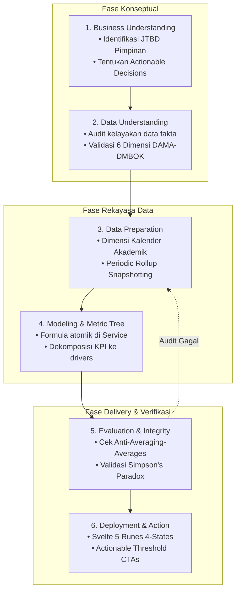

# Cetak Biru Standar Analisis Data, Intelijen Bisnis, & Pelaporan Eksekutif (data_analysis_standard.md)
> **Engine:** Hyperion Vault v6.31.0 / v8.0.0 SDD-Enterprise-Deterministic  
> **Status:** Single Source of Truth (SSoT) — Standar Arsitektur Analitika Data Institusi  
> **Target Audience:** Arsitek Sistem, Tim Rekayasa Perangkat Lunak, Analis Data, dan AI Coding Agents

---

## 1. PENDAHULUAN & FILOSOFI ANALITIKA

Data dalam ekosistem institusi pesantren dan pendidikan (santri, presensi, kurikulum KBM, hafalan Al-Qur'an, dan keuangan) bukan sekadar catatan riwayat transaksi (*dormant logs*), melainkan aset strategis untuk memandu pengambilan keputusan pimpinan.

Cetak biru ini menetapkan standar analitika data kelas dunia di lingkungan Hyperion Vault dengan berpijak pada prinsip fundamental **Douglas W. Hubbard (*Applied Information Economics*)**:
> *"Suatu pengukuran atau analitika data hanya bernilai jika ia mengurangi ketidakpastian dalam pengambilan keputusan nyata. Jika angka yang disajikan tidak mengubah keputusan apa pun, angka tersebut adalah kesia-siaan (vanity metric)."*

Dokumen ini menjadi rujukan konseptual tertinggi (*Tier 3*) yang menopang aturan sistem mutlak [`.agents/rules/temporal_dashboard_invariants.md`](../.agents/rules/temporal_dashboard_invariants.md) (*Tier 1*) dan playbook operasional [`.agents/skills/dashboard-architect/SKILL.md`](../.agents/skills/dashboard-architect/SKILL.md) (*Tier 2*).

---

## 2. TAKSONOMI STANDAR INTERNASIONAL TERPADU

Hyperion Vault menyintesis 6 standar internasional ke dalam satu kesatuan arsitektur yang deterministik:

```
┌──────────────────────────────────────────────────────────────────────────────────┐
│              SINTESIS STANDAR INTERNASIONAL ANALITIKA DATA HYPERION VAULT         │
├──────────────────────────────────────────────────────────────────────────────────┤
│ 1. SIKLUS PROSES      │ CRISP-DM (Chapman et al., 2000)                          │
│ 2. TATA KELOLA DATA   │ DAMA-DMBOK 2nd Edition (Data Management Association)     │
│ 3. TINGKAT KEMATANGAN │ Gartner Analytics Maturity Framework (Descriptive->Presc)│
│ 4. PEMODELAN DIMENSI  │ Ralph Kimball & Margy Ross (The Data Warehouse Toolkit)  │
│ 5. PERSEPSI VISUAL    │ Stephen Few (Bullet Graph) & Edward Tufte (Data-Ink)     │
│ 6. EKONOMI PENGUKURAN │ Douglas Hubbard (Applied Information Economics - AIE)    │
└──────────────────────────────────────────────────────────────────────────────────┘
```

---

## 3. SIKLUS HIDUP ANALITIKA INSTITUSI (CRISP-DM FRAMEWORK)

Setiap inisiatif analitika dan modul pelaporan wajib menempuh 6 tahap siklus terstruktur:



1. **Business Understanding:** Menentukan masalah nyata pimpinan (misal: penurunan kedisiplinan sholat subuh santri putra) dan keputusan operasional apa yang akan diambil jika metrik diketahui.
2. **Data Understanding:** Memeriksa ketersediaan data pada tabel transaksional atomik (`presensi_transaksional`).
3. **Data Preparation:** Menyiapkan skema *Periodic Rollup* dan tabel *Conformed Calendar Dimension* (`dim_kalender_akademik`).
4. **Modeling & Aggregation:** Mengunci formula kalkulasi pada level *Laravel Service* (mencegah komputasi terpecah di antarmuka).
5. **Evaluation:** Menguji kalkulasi terhadap falasi matematika, deviasi sampel, dan memverifikasi batas latensi sub-50ms.
6. **Deployment:** Menghadirkan antarmuka reaktif Svelte 5 dengan 4 visual states (Loading, Empty, Error, Success).

---

## 4. TINGKAT KEMATANGAN ANALITIK (GARTNER 4 STAGES)

Dasbor eksekutif di Hyperion Vault dilarang hanya berfungsi sebagai "buku rekapitulasi statis". Setiap antarmuka dirancang untuk memfasilitasi perjalanan kognitif pengguna:

```
1. DESCRIPTIVE (Apa yang terjadi?)
   └─► Tampilan: Kartu KPI Ringkas + Bullet Graph target 95% + Persentase Capaian Aktual (91.2%).
2. DIAGNOSTIC (Mengapa hal itu terjadi?)
   └─► Tampilan: Filter in-memory instan ($derived.by) untuk mengisolasi anomali:
                 "Penurunan dipicu oleh Unit LTQ Putra pada hari Senin pekan ke-3".
3. PREDICTIVE (Apa yang kemungkinan akan terjadi?)
   └─► Tampilan: Tren rolling sparkline 7-hari & proyeksi sederhana moving averages:
                 "Jika tren berlanjut, 12 santri berisiko tidak lulus syarat kehadiran ujian".
4. PRESCRIPTIVE (Apa tindakan solusinya?)
   └─► Tampilan: Ambang batas intervensi (Actionable CTA Button):
                 Tombol interaktif [Kirim Notifikasi Wali Kelas] atau [Jadwalkan Konseling].
```

---

## 5. PEMODELAN DATA DIMENSIONAL & SEMANTIC LAYER

### 5.1 Tiga Arketipe Tabel Fakta (Ralph Kimball)
Untuk memastikan skalabilitas ribuan santri dengan puluhan juta log transaksi tanpa degradasi kecepatan, Hyperion Vault membagi data ke dalam 3 tabel:

1. **Transaction Fact Table (`*_transaksional`):**
   - *Grain:* 1 baris per kejadian atomik (misal: 1 santri per 1 sesi presensi).
   - *Pola Akses:* Digunakan khusus untuk Horizon Waktu Harian dan Mingguan. Dilindungi oleh indeks komposit `['tanggal', 'status']` dan plafon kueri `limit(1000)`.
2. **Periodic Snapshot Fact Table (`*_temporal_rollups`):**
   - *Grain:* 1 baris per agregat horizon waktu (Bulanan, Tahunan, Kohort 5-Tahunan, Semester Akademik).
   - *Pola Akses:* Diisi secara otomatis oleh *Scheduled Background Command* secara idempoten (`updateOrInsert`). Menjamin respon kueri dasbor $< 15\text{ ms}$.
3. **Accumulating Snapshot Fact Table (`*_cohort_lifecycle`):**
   - *Grain:* 1 baris per seluruh siklus hidup santri dari awal pendaftaran, kelulusan marhalah, hingga status alumni.

### 5.2 Dekomposisi Pohon Metrik (Metric Tree)
Pimpinan tidak boleh dibanjiri puluhan angka acak. Metrik disusun secara hierarkis:

$$\text{North Star Metric} \longrightarrow \text{Primary KPIs} \longrightarrow \text{Driver Metrics}$$

*Contoh Kasus Kedisiplinan Terpadu:*
- **North Star Metric:** Indeks Kedisiplinan Pondok (IKP).
- **Primary KPIs:** Rasio Kehadiran KBM Formal ($40\%$) + Rasio Kehadiran Sholat Berjamaah ($60\%$).
- **Driver Metrics:** Waktu kedatangan musyrif, ketersediaan air wudhu, dan status kesehatan santri di asrama.

---

## 6. INTEGRITAS STATISTIK & PENCEGAHAN FALASI

### 6.1 Larangan Keras *Averaging of Averages*
Merata-ratakan nilai persentase secara langsung tanpa memperhitungkan jumlah populasi menghasilkan galat matematis yang menyesatkan pengambil kebijakan.

$$\text{SALAH: } \frac{P_1 + P_2 + \dots + P_n}{n} \quad\neq\quad \text{BENAR: } \frac{\sum \text{Numerator Atomik}}{\sum \text{Denominator Atomik}} \times 100\%$$

*Kaidah Baku Hyperion Vault:*
Seluruh kalkulasi rasio wajib dilakukan melalui pembagian total agregat atomik di level kueri database engine atau service agregator:
```php
$summary = DB::table('presensi_transaksional')
    ->where('horizon_key', $key)
    ->selectRaw('
        SUM(CASE WHEN status = "hadir" THEN 1 ELSE 0 END) as total_hadir,
        COUNT(*) as total_sesi,
        ROUND((SUM(CASE WHEN status = "hadir" THEN 1.0 ELSE 0 END) / COUNT(*)) * 100, 2) as persentase_kehadiran
    ')
    ->first();
```

### 6.2 Mitigasi *Simpson's Paradox*
Agregasi tingkat institusi yang tampak sehat sering kali menyembunyikan krisis akut pada sub-unit tertentu.
- **Solusi Visual:** Dasbor pimpinan wajib menyertakan tata letak **Small Multiples** (tiga atau empat grafik paralel berukuran sama dengan skala sumbu $Y$ identik) untuk membandingkan performa Pesantren, LTQ, dan PKBM secara simultan.

### 6.3 Audit Dimensi Kualitas Data (DAMA-DMBOK)
Sebelum data diagregasikan ke tabel rollup, integritas data diverifikasi berdasarkan 6 dimensi mutu:
1. **Completeness:** Apakah seluruh santri di kelas memiliki status presensi tercatat?
2. **Accuracy:** Apakah pencatatan absensi sesuai bukti log fisik/fingerprint?
3. **Consistency:** Apakah angka santri aktif di modul akademik sinkron dengan santri di modul asrama?
4. **Timeliness:** Apakah snapshot rollup bulanan selesai sebelum hari kerja pertama bulan berikutnya?
5. **Uniqueness:** Apakah data transaksi presensi bebas dari duplikasi waktu dan santri?
6. **Validity:** Apakah nilai status presensi sesuai enum (`hadir`, `sakit`, `izin`, `alpa`)?

---

## 7. PRINSIP DESAIN INFORMASI & KOGNISI VISUAL

### 7.1 Standar Stephen Few & Edward Tufte
1. **Penerapan Rasio Data-Ink Maksimal:**
   - Hapus *chartjunk*: gridlines tebal, drop-shadow pekat, efek glossy, dan diagram 3D.
   - Sumbu grafik dibuat tipis dan minimalis; angka disajikan dengan kontras jelas.
2. **Mandat Bullet Graph (Stephen Few Standard):**
   - Menggantikan dial/speedometer bulat yang memakan $80\%$ ruang layar tanpa faedah komparatif.
   - Menggabungkan: (1) Ukuran aktual, (2) Garis penanda target institusi, dan (3) Tiga rentang kualitatif (buruk, cukup, baik) dalam satu batang horizontal padat.
3. **Mandat Sparklines (Edward Tufte Standard):**
   - Garis tren historis mini tanpa sumbu yang di-render secara inline berbasis native SVG berukuran tinggi $\le 24\text{px}$.
4. **Penyajian Data Tabular Monospace:**
   - Seluruh tabel pelaporan dan ringkasan persentase wajib menggunakan font monospace (`font-mono` / tabular figures) agar angka sejajar vertikal dan mudah dibandingkan secara cepat oleh mata pimpinan.

### 7.2 Standar Ben Shneiderman & Colin Ware
- **Mantra Visual Shneiderman:** *"Overview first, zoom and filter, then details-on-demand."*
  - Level 1: Kartu KPI global di bagian atas halaman.
  - Level 2: Filter waktu dan unit untuk penyaringan cepat.
  - Level 3: Tabel rincian santri granular dengan pencarian memori $< 0.1\text{ ms}$.
- **Preattentive Visual Attributes (Colin Ware):**
  - Gunakan warna hanya untuk fungsi semantik (hijau = tercapai, merah = kritis di bawah target). Hindari mewarnai grafik dengan warna-warni dekoratif pelangi yang membingungkan fokus mata.

### 7.3 Standar Proporsi Warna 60-30-10 & Kontras APCA pada Dasbor Analitika
1. **Kaidah 60-30-10 Analitika:**
   - 60% kanvas dasar netral (Deep Obsidian / Daylight).
   - 30% panel kartu metrik & pembatas hairline 1px (`border-slate-200/80 dark:border-slate-800/80`).
   - 10% indikator aksen semantik (Emerald capaian target, Amber peringatan, Rose deviasi kritis).
2. **Kontras Persepsi APCA ($L_c \ge 75$):**
   - Angka KPI metrik dan label status analitik wajib memiliki kontras tajam tanpa menyilaukan mata demi mencegah kelelahan operator (*anti-eye-fatigue*) saat pemantauan jangka panjang.
3. **Motion Transisi Mikro Grafik:**
   - Animasi pembaruan angka/grafik dibatasi maksimal $300\text{ms}$ berbasis properti GPU, wajib mematuhi preferensi `prefers-reduced-motion`.

### 7.4 Standar Apple Spatial Materials, Kurva Pegas & Tactile Auditory UI pada Dasbor
1. **Apple Spatial Materials & Selective Translucency:**
   - Dasbor analitik menerapkan efek kaca Apple (`backdrop-blur-xl backdrop-saturate-150`) pada elemen navigasi melayang (*sticky header* dan *floating thumb dock*).
   - Kartu metrik KPI dan tabel rincian data WAJIB menggunakan lapisan dasar semi-opak (`bg-white/85 dark:bg-slate-900/85`) dengan garis batas spekular 1px (`before:h-px before:bg-gradient-to-r before:via-white/20`). DILARANG menaruh blur berat di belakang angka atau grafik mikro untuk mencegah kegagalan pemisahan visual (*figure-ground segregation failure* - NN/g 2021).
   - Teks metrik analitik wajib mematuhi kontras APCA $L_c \ge 75$ (WCAG AAA $7:1$).
2. **Restraint GPU Layar Ponsel (Mobile 60 FPS):**
   - Pada layar mobile ($< 768\text{px}$), efek blur berat dinonaktifkan pada kartu metrik bergulir dan tabel, digantikan dengan material semi-opak ringan (`bg-white dark:bg-slate-900/95 border border-slate-200 dark:border-slate-800`). Hal ini mengeliminasi *GPU overdraw* dan *thermal throttling* pada smartphone kelas menengah.
3. **Fisika Pegas Teredam (Damped Spring Physics):**
   - Transisi kartu menggunakan kurva pegas Apple: `cubic-bezier(0.34, 1.56, 0.64, 1)` dengan `active:scale-95` dan plafon durasi $\le 450\text{ms}$.
4. **Tactile Auditory UI (Web Audio API):**
   - Sintesis suara mikro native Web Audio API ($0\text{ KB}$ aset eksternal) HANYA diaktifkan pada peristiwa mutasi/pencapaian bermakna (Ekspor CSV selesai, konfirmasi aksi, error RFC 7807), berstatus **default muted** dengan kontrol toggle persisten di `localStorage`. DILARANG menghasilkan suara pada interaksi pasif seperti hovering grafik atau scrolling tabel.

### 7.5 Arsitektur Elevasi Permukaan 3-Tier & Eliminasi Pseudo-Glassmorphism (Anti-Camouflage)
1. **Pemisahan Tonal 3-Tier Wajib:**
   - **Tingkat 0 (L0 - Canvas Ground):** Kanvas latar dasar wajib memiliki kontras terukur terhadap kartu di atasnya (`bg-slate-100/70` di Daylight; `bg-[#070b12]` atau `bg-[#090D16]` di Dark Obsidian).
   - **Tingkat 1 (L1 - Macro Surface):** Panel kartu analitik utama (kartu metrik KPI, widget Bullet Graph, wadah pipeline, tabel analitika) WAJIB berupa permukaan solid/semi-opak berbobot (`bg-white` Daylight; `dark:bg-slate-900/90` Dark Obsidian) dengan garis batas 1px (`border border-slate-200/80 dark:border-slate-800`) dan bayangan mikro `shadow-2xs`.
   - **Tingkat 2 (L2 - Micro Surface):** Elemen anak di dalam kontainer L1 (kartu rel status, baris tabel interaktif, rincian audit) WAJIB memiliki diferensiasi fisik nyata (`bg-slate-50/70 hover:bg-white` atau `bg-white hover:bg-slate-50` Daylight; `dark:bg-slate-950/70 hover:dark:bg-slate-800` atau `dark:bg-slate-900` Dark Obsidian dengan `border border-slate-200 dark:border-slate-800/80` dan `shadow-2xs`).
2. **Larangan Keras "Pseudo-Glassmorphism" di Atas Kanvas Datar:**
   - Efek blur kaca (`backdrop-blur`) di atas kanvas warna polos (*flat canvas*) tanpa elemen grafis dinamis di belakangnya menghasilkan degradasi visual serius: kartu menjadi transparan pucat (`bg-white/40`, `dark:bg-white/[0.02]`) sehingga batas fisik kartu lenyap dan menyatu dengan background kanvas (*visual camouflage*).
   - Efek kaca blur HANYA diizinkan pada bilah melayang di atas konten bergulir. Seluruh kartu statis wajib menggunakan lapisan solid dengan rasio kontras garis minimal 3:1 dan teks APCA $L_c \ge 75$.

---

## 8. ARSITEKTUR TEKNIS IMPLEMENTASI HYPERION VAULT

```
┌────────────────────────────────────────────────────────────────────────┐
│ STACK TEKNIS ANALITIK HYPERION VAULT                                   │
├────────────────────────────────────────────────────────────────────────┤
│ • Backend   : Laravel 13, PHP 8.3/8.4 strict_types=1                   │
│ • Database  : SQLite WAL Mode (foreign_keys=ON, busy_timeout=5000)     │
│ • Engine    : Hybrid Rollup Routing (On-the-fly vs Rollup Snapshot)    │
│ • Ceilings  : limit(1000) safe query ceilings + B-Tree composite index │
│ • Frontend  : Svelte 5 Pure JS Runes ($state, $derived, $effect)       │
│ • Interaksi : In-memory table search & filter (< 0.1ms via $derived)   │
│ • Styling   : Tailwind CSS v4 (@theme tokens, Dark Obsidian / Daylight)│
│ • Kontrak   : RFC 7807 problem details untuk penanganan error aman     │
└────────────────────────────────────────────────────────────────────────┘
```

---

## 9. REFERENSI & BIBLIOGRAFI INTERNASIONAL

1. **Chapman, P., et al. (2000).** *CRISP-DM 1.0: Step-by-step data mining guide.* CRISP-DM Consortium.
2. **DAMA International. (2017).** *DAMA-DMBOK: Data Management Body of Knowledge (2nd Edition).* Technics Publications.
3. **Few, S. (2013).** *Information Dashboard Design: Displaying Data for At-a-Glance Monitoring (2nd Edition).* Analytics Press.
4. **Few, S. (2012).** *Show Me the Numbers: Designing Tables and Graphs to Enlighten (2nd Edition).* Analytics Press.
5. **Hubbard, D. W. (2014).** *How to Measure Anything: Finding the Value of Intangibles in Business (3rd Edition).* John Wiley & Sons.
6. **Kimball, R., & Ross, M. (2013).** *The Data Warehouse Toolkit: The Definitive Guide to Dimensional Modeling (3rd Edition).* John Wiley & Sons.
7. **Knaflic, C. N. (2015).** *Storytelling with Data: A Data Visualization Guide for Business Professionals.* John Wiley & Sons.
8. **Shneiderman, B. (1996).** *The eyes have it: A task by data type taxonomy for information visualizations.* IEEE Symposium on Visual Languages.
9. **Tufte, E. R. (2001).** *The Visual Display of Quantitative Information (2nd Edition).* Graphics Press.
10. **Ware, C. (2020).** *Visual Thinking for Design (2nd Edition).* Morgan Kaufmann.
