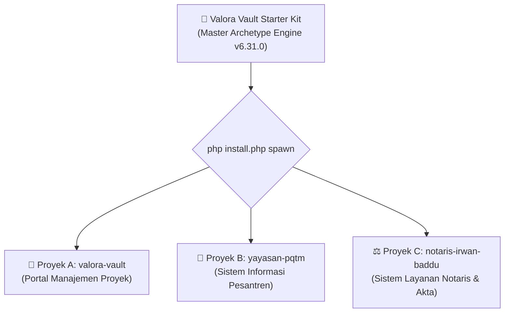

# Panduan Cepat Pengembang: Valora Vault Starter Kit (doc/developer_quickstart_guide.md)
> **Engine:** Valora Vault v6.31.0 / v8.0.0 SDD-Enterprise-Deterministic  
> **Klasifikasi Diátaxis:** Tutorial & How-To Guide (Pragmatis, Deterministik, Bebas Asumsi)  
> **Target Audiens:** Lead Architect, Software Engineer, Junior Developer, & AI Coding Agents

---

## 1. PENDAHULUAN: POLA GOLDEN MASTER ARCHETYPE

Valora Vault dirancang bukan sebagai aplikasi monolitik yang membengkak, melainkan sebagai **Golden Master Archetype & Project Spawner**. Dari satu direktori inti Valora Vault, Anda dapat melahirkan (*spawn*) puluhan aplikasi web mandiri tingkat enterprise dalam hitungan detik (~3-5 detik) tanpa perlu mengunduh ulang dependensi `composer` dan `npm`.



---

## 2. PRASYARAT SISTEM MINIMAL

Sebelum menjalankan Valora Vault di Laragon atau server lokal:
- **PHP:** $\ge 8.2$ (Sangat direkomendasikan PHP 8.3 / 8.4)
- **Ekstensi PHP Wajib:** `pdo_sqlite`, `sqlite3`, `curl`, `mbstring`, `openssl`, `fileinfo`, `json`
- **Node.js:** $\ge 20.x$ / 22.x LTS
- **Web Server:** Laragon (Nginx / Apache) atau PHP Built-in Server
- **Database Engine:** SQLite dengan mode WAL (*Write-Ahead Logging*)

---

## 3. LANGKAH 1: INISIASI ROOT STARTER KIT

Jalankan perintah berikut untuk menginisialisasi starter kit pertama kali:

```bash
# 1. Masuk ke direktori starter kit
cd D:/laragon/www/valora-vault

# 2. Cek status diagnostik prasyarat
php install.php status

# 3. Jika belum terinstal, jalankan instalasi otomatis
php install.php install --name="Valora Vault" --domain="valora-vault.test"
```

Aplikasi master akan aktif di:
- **URL:** `http://valora-vault.test`
- **Akun Utama:** `admin@valora-vault.test` *(Password: `password123`)*

---

## 4. LANGKAH 2: MELAHIRKAN APLIKASI BARU DALAM 5 DETIK (`spawn`)

Untuk membuat aplikasi atau sistem informasi baru bagi klien, **JANGAN** menyalin folder secara manual. Gunakan sub-perintah `spawn`:

```bash
# Sintaks:
# php install.php spawn <nama-folder> [--name="Nama Aplikasi"] [--domain="domain.test"] [--desc="Deskripsi Singkat"]

# Contoh Nyata:
php install.php spawn valora-vault --name="Portal Pencatatan Manajemen Proyek" --domain="valora-vault.test" --desc="Sistem Valuasi & Penagihan Proyek Software Agensi"
```

### Apa yang Dilakukan Mesin Spawner Secara Otomatis?
1. **Replikasi Kilat Robocopy:** Menyalin seluruh pustaka `vendor` dan `node_modules` secara multi-threaded tanpa internet (~3 detik).
2. **Sanitasi Direktori:** Mengecualikan cache sesi, file log usang, dan database master.
3. **Isolasi Lingkungan (.env):** Mengonfigurasi `APP_NAME`, `APP_URL`, `FRONTEND_URL`, dan cookie Host-Only khusus domain baru.
4. **Kriptografi Mandiri:** Men-generate `APP_KEY` unik 256-bit baru.
5. **Database SQLite Mandiri:** Membuat file `database.sqlite` bersih dan menjalankan migrasi serta seeder default akun admin domain terkait.
6. **Git Repo Mandiri:** Menginisialisasi repositori Git lokal mandiri dengan *initial commit*.

---

## 5. LANGKAH 3: PENGEMBANGAN FITUR BERSTANDAR SDD (SINGLE FEATURE TURN)

Saat membangun modul baru pada aplikasi hasil spawn, patuhi aturan mutlak **`[RULE-07-SINGLE-FEATURE-TURN]`**:

### Siklus Hidup 1 Fitur (End-to-End Delivery):
1. **Migrasi Database:** Buat migrasi 3NF dengan indeks komposit Markus Winand `[kolom_status, created_at]`.
2. **Model Eloquent:** Tambahkan strict typing `declare(strict_types=1);`, casts tipe, dan relasi `hasMany`/`belongsTo`.
3. **Form Request:** Validasi ketat seluruh input dan sediakan pesan berbahasa Indonesia format RFC 7807.
4. **Policy Guard:** Terapkan otorisasi ketat berbasis peran kanonikal (mencegah BOLA/IDOR).
5. **Thin Controller:** Mutasi multi-tabel WAJIB dibungkus `DB::transaction(fn() => ...)`.
6. **Feature Test (PHPUnit):** Minimal 3 skenario wajib (200/201 OK, 422 Validasi, 403 Forbidden).
7. **Frontend Svelte 5:** Gunakan Runes murni (`$state`, `$derived`, `$props`), tangani 4 Visual State (Loading Shimmer, Empty, Error, Success), Card View di mobile, dan tombol Ekspor CSV in-memory UTF-8 BOM (`\uFEFF`).

---

## 6. PETA 6 ENGINEERING SKILLS & AUTOMATION SCRIPTS

Valora Vault dilengkapi dengan 6 AI Engineering Skills siap panggil via trigger tag:

| Trigger Tag | Nama Skill | Direktori | Skrip Otomasi |
| :--- | :--- | :--- | :--- |
| `@discovery` / `@feature` | **Discovery Architect** | `.agents/skills/discovery-architect/` | `audit-feature-design.ps1` |
| `@prompt` / `@pa` | **Prompt Architect** | `.agents/skills/prompt-architect/` | `audit-prompt.ps1`, `compile-prompt.ps1` |
| `@security` / `@hardening` | **Security Hardening** | `.agents/skills/security-hardening/` | `audit-security-posture.ps1`, `audit-skills-integrity.ps1` |
| `@refactor` / `@clean-code`| **Clean Code Refactor** | `.agents/skills/clean-code-refactor/` | `audit-code-quality.ps1` |
| `@dashboard` / `@analytics`| **Dashboard Architect** | `.agents/skills/dashboard-architect/` | Template KPI Few-Tufte Svelte 5 |
| `@landing` / `@cro` | **Landing Architect** | `.agents/skills/landing-architect/` | Template SB7 & Kuartet Penemuan |

---

## 7. RINGKASAN PERINTAH CLI OPERASIONAL (`install.php`)

```bash
# 1. Diagnostik Kesiapan & Prasyarat
php install.php status

# 2. Update In-Place Aman (Sinkronisasi dari Master ke Proyek Klien)
php install.php update

# 3. Duplikasi Proyek Baru (Spawner)
php install.php spawn <nama-folder> [--name="..."]

# 4. Sinkronisasi Seluruh Skill & Aturan ke Repositori Target
php install.php sync-skills --target="D:/laragon/www/proyek-klien"

# 5. Git Commit & Auto-Push Terstandar
php install.php ship "feat: implementasi modul pendaftaran santri"
```

---

## 8. CHECKLIST PRE-DEPLOYMENT & SERTIFIKASI PRODUKSI

Sebelum merilis aplikasi ke server produksi:
- [ ] Jalankan pengujian backend: `cd backend && php artisan test` (Wajib 100% lulus, 0 failure).
- [ ] Jalankan kompilasi frontend: `cd frontend && npm run build` (Wajib 100% sukses, 0 error).
- [ ] Jalankan audit keamanan: `powershell -File .agents/skills/security-hardening/scripts/audit-security-posture.ps1` (Skor 100%).
- [ ] Jalankan audit mutu kode: `powershell -File .agents/skills/clean-code-refactor/scripts/audit-code-quality.ps1` (Skor 100%).
- [ ] Pastikan `APP_DEBUG=false` pada file `.env` server produksi.
- [ ] Pastikan `SESSION_DRIVER=file` dan cookie memiliki atribut `Secure: true`.
