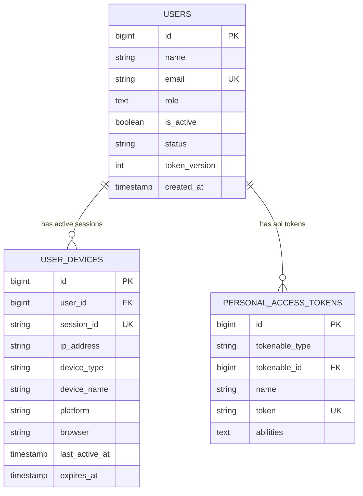
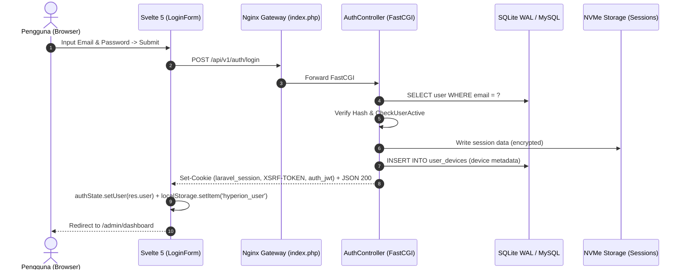

# [FEAT-01]: Autentikasi & Keamanan Sesi Multi-Perangkat (v6.31.0)
> **Modul Inti:** Otentikasi Sanctum Stateful, Signed JWT Cookie, Active Device Registry (`user_devices`), Inode Garbage Collection & POIN Defense.

---

## 1. USER STORY
- **Sebagai** pengguna terdaftar sistem,  
  **Saya ingin** dapat masuk ke dalam portal menggunakan email dan kata sandi secara aman dari peramban desktop maupun ponsel,  
  **Sehingga** saya dapat mengakses dashboard dan fitur sesuai wewenang saya dengan sesi yang terisolasi dan terlindungi dari manipulasi.
- **Sebagai** administrator sistem (SecOps),  
  **Saya ingin** memantau seluruh sesi perangkat fisik yang sedang aktif login, mencabut sesi yang mencurigakan, dan membersihkan berkas sesi kadaluarsa dari disk server,  
  **Sehingga** integritas sistem terjaga, tidak terjadi kebocoran sesi, dan kapasitas inode server tidak habis.

---

## 2. MVP SCOPE & BOUNDARIES
- **In-Scope (Termasuk):**
  - Autentikasi ganda: Cookie HttpOnly Sanctum (`laravel_session`, `XSRF-TOKEN`) untuk backend server + Signed JWT Cookie (`auth_jwt` ber-HMAC-SHA256) untuk reaktivitas instan Svelte 5.
  - Kuota konkurensi perangkat aktif: Maksimal 3 perangkat simultan (`AUTH_MAX_CONCURRENT_DEVICES=3`).
  - Forensik perangkat: IP Address, User-Agent, platform OS, nama browser, tipe perangkat (`desktop`/`mobile`/`tablet`).
  - Stateless Token Invalidation via `token_version` pada database.
  - Disk Session File Inode GC: `@unlink` fisik saat logout, terminating hooks pembersih sesi kosong, dan artisan command `session:prune-files`.
- **Out-of-Scope (Dilarang):**
  - DILARANG menyimpan sesi di database (`SESSION_DRIVER=database`) guna mencegah *MySQL connection exhaustion*.
  - DILARANG membiarkan berkas sesi fisik tertinggal di disk tanpa mekanisme unlink (mencegah PHP Object Injection).

---

## 3. ACCEPTANCE CRITERIA (BDD GIVEN-WHEN-THEN)

### AC-1: Login Sukses & Pencatatan Perangkat Fisik
- **Given:** Pengguna memasukkan kredensial valid (`admin@hyperion-vault.test` / `password123`).
- **When:** Pengguna menekan tombol "Masuk Sistem" (`POST /api/v1/auth/login`).
- **Then:** Server merespons HTTP 200, menerbitkan cookie `laravel_session`, `XSRF-TOKEN`, dan `auth_jwt`. Record baru tersimpan di tabel `user_devices`, dan pengguna diarahkan ke dashboard dalam waktu $\le 50\text{ ms}$.

### AC-2: Pencegahan Penumpukan Berkas Sesi Disk saat Logout
- **Given:** Pengguna sedang aktif login dengan berkas sesi fisik tersimpan di `storage/framework/sessions/`.
- **When:** Pengguna menekan tombol "Keluar Akun" (`POST /api/v1/auth/logout`).
- **Then:** Record `user_devices` dihapus, token Sanctum dicabut, file sesi fisik di disk langsung di-unlink (`@unlink`), dan terminating hook memastikan tidak ada file sesi baru kosong yang ditulis ulang oleh Laravel.

### AC-3: Revokasi Sesi Instan oleh Admin
- **Given:** Administrator melihat daftar sesi aktif di halaman `/admin/sessions`.
- **When:** Administrator menekan tombol "Cabut Sesi Ini" pada sesi perangkat tertentu (`POST /api/v1/admin/sessions/{id}/revoke`).
- **Then:** Sesi perangkat target langsung dicabut, file sesi target di-unlink, dan jika pengguna di perangkat target melakukan request API berikutnya, server langsung menolak dengan HTTP 401 Unauthorized.

### 3.1. SECURITY & RBAC ACCEPTANCE CRITERIA
- **Kriteria Otorisasi (BOLA Defense):** Pengelolaan sesi diproteksi oleh role `admin` dan verifikasi kepemilikan sesi. Pengguna biasa hanya berhak mencabut sesinya sendiri (`POST /api/v1/auth/logout-other-devices`), sedangkan akses `/api/v1/admin/sessions/*` dilindungi Policy / Middleware `role:admin`.
- **Kriteria Input:** Form Request validation ketat pada login (`email`, `password`) dengan batasan tipe string, sanitasi email, dan rate-limiting throttle (5 percobaan per menit).
- **Uji Coba Keamanan:** PHPUnit Feature Test memverifikasi respons `403 Forbidden` jika non-admin mengakses `/api/v1/admin/sessions`, dan `422 Unprocessable Entity` jika login dikirim tanpa email/password valid.

---

## 4. DATABASE SCHEMA & ERD

### Migrasi Tabel `user_devices`:
```php
Schema::create('user_devices', function (Blueprint $table) {
    $table->id();
    $table->foreignId('user_id')->constrained()->cascadeOnDelete();
    $table->string('session_id', 100)->unique();
    $table->string('ip_address', 45);
    $table->text('user_agent')->nullable();
    $table->string('device_type', 30)->default('desktop');
    $table->string('device_name', 100)->default('Desktop Device');
    $table->string('platform', 50)->default('Unknown');
    $table->string('browser', 50)->default('Unknown');
    $table->timestamp('last_active_at')->useCurrent();
    $table->timestamp('expires_at')->nullable();
    $table->timestamps();

    $table->index(['user_id', 'expires_at']);
    $table->index('session_id');
});
```

### Entity Relationship Diagram:


---

## 5. RESTFUL API CONTRACT

### `POST /api/v1/auth/login`
- **Request Headers:** `Content-Type: application/json`, `X-XSRF-TOKEN: ...`
- **Request Body:**
  ```json
  {
    "email": "admin@hyperion-vault.test",
    "password": "password123"
  }
  ```
- **Response Success (HTTP 200):**
  ```json
  {
    "message": "Login berhasil.",
    "user": {
      "id": 1,
      "name": "Super Administrator",
      "email": "admin@hyperion-vault.test",
      "role": ["admin"],
      "is_active": true
    },
    "token": "1|sanctum_personal_access_token_hash..."
  }
  ```

### `POST /api/v1/auth/logout`
- **Request Headers:** `Authorization: Bearer ...` (atau cookie session Sanctum)
- **Response Success (HTTP 200):**
  ```json
  {
    "message": "Logout berhasil. Sesi telah diakhiri."
  }
  ```

---

## 6. SEQUENCE ARCHITECTURE FLOW



---

## 7. FRONTEND UI/UX BLUEPRINT (SVELTE 5 RUNES)
- **Komponen Utama:** [`LoginForm.svelte`](../../frontend/src/lib/components/features/auth/LoginForm.svelte)
- **State Variables:**
  - `let email = $state('admin@hyperion-vault.test');`
  - `let password = $state('password123');`
  - `let showPassword = $state(false);`
  - `let loading = $state(false);`
- **Affordance & Aksesibilitas:**
  - 1-Klik Akun Demo Cepat (Super Admin & User biasa).
  - Tombol toggle password dengan ikon mata SVG eksplisit `type="button"`.
  - Tombol submit dengan spinner tactile dan status disabled saat memproses.
  - Kompatibel penuh dengan mode Daylight dan Dark Obsidian.

---

## 8. TEST CONTRACT (PHPUNIT 100% PASS)
- **Berkas Pengujian:** [`backend/tests/Feature/SanctumAuthTest.php`](../../backend/tests/Feature/SanctumAuthTest.php)
- **Skenario Uji Wajib:**
  1. `test_login_successful_with_valid_credentials`: Memastikan status 200 dan cookie diterbitkan.
  2. `test_login_fails_with_invalid_credentials`: Memastikan status 422 dan penolakan kredensial salah.
  3. `test_auto_remove_revoked_session_and_cookie_purge`: Memastikan sesi yang dicabut langsung terputus.
  4. `test_session_file_accumulation_prune_and_cleanup_endpoint`: Memastikan pembersihan file sesi usang di disk.
  5. `test_zero_session_file_duplication_on_login_and_logout`: Memastikan zero leakage file sesi fisik.
