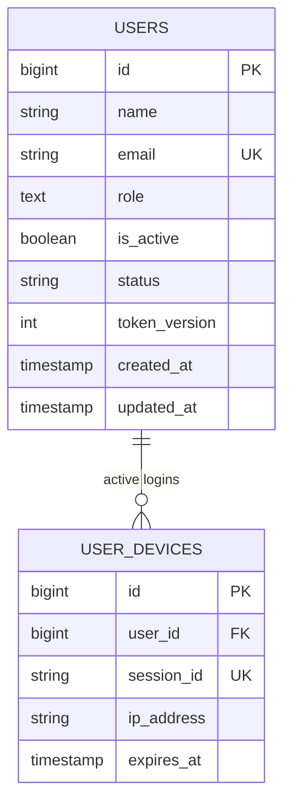
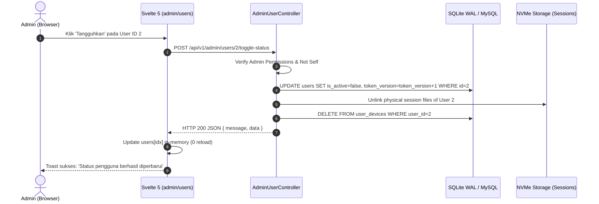

# [FEAT-02]: Manajemen Pengguna & Granular RBAC (v6.31.0)
> **Modul Inti:** CRUD Pengguna Lengkap, Matriks Peran Dinamis (`config/permissions.php`), Multiple Roles per Record, dan Stateless Invalidation (`token_version`).

---

## 1. USER STORY
- **Sebagai** Super Administrator sistem,  
  **Saya ingin** dapat menambah, mengubah, menangguhkan, dan menghapus akun pengguna serta menetapkan multiple roles (misal: `['admin', 'manager']`),  
  **Sehingga** saya dapat mengelola wewenang hak akses seluruh staf secara presisi tanpa perlu mengubah skema database.
- **Sebagai** pengguna terotentikasi,  
  **Saya ingin** antarmuka sistem secara otomatis menampilkan modul dan tombol yang hanya sesuai dengan izin otoritas saya,  
  **Sehingga** saya tidak mengalami kebingungan atau terpapar fungsi rahasia yang bukan wewenang saya.

---

## 2. MVP SCOPE & BOUNDARIES
- **In-Scope (Termasuk):**
  - Full CRUD Pengguna: Create, Read (dengan limit 1000 dan pencarian memori instan), Update, Toggle Status (Aktif/Tangguh), Revoke Sesi, dan Delete.
  - Dynamic Role-Permission Matrix: Didefinisikan di [`backend/config/permissions.php`](../../backend/config/permissions.php) dengan middleware `EnsurePermission`.
  - Multiple Roles dalam 1 Record: Kolom `role` tersimpan sebagai JSON array (misal: `['admin', 'manager']`), didukung helper `$user->hasRole(...)` dan `$user->hasPermission(...)`.
  - In-Memory State Mutation di Svelte 5: Perubahan status atau penambahan data langsung memutasi array lokal tanpa memicu request re-fetch seluruh tabel (`loadUsers()`).
- **Out-of-Scope (Dilarang):**
  - DILARANG menggunakan tabel pivot role yang berat jika kebutuhan peran dapat ditangani oleh skema array terindeks.
  - DILARANG melakukan query tanpa batas (`User::all()`), wajib `User::limit(1000)->get()`.
  - DILARANG memicu query pencarian ke database setiap pengguna mengetik di search bar.

---

## 3. ACCEPTANCE CRITERIA (BDD GIVEN-WHEN-THEN)

### AC-1: Tambah Pengguna Baru dengan Validasi Ketat
- **Given:** Administrator membuka modal "Tambah Pengguna" di `/admin/users`.
- **When:** Administrator mengisi nama, email unik, password minimal 8 karakter, memilih peran, dan menekan submit.
- **Then:** Record tersimpan di database dengan password ter-hash aman (bcrypt), modal tertutup, data baru langsung muncul di tabel paling atas secara in-memory, dan toast hijau muncul.

### AC-2: Penangguhan Akun & Pembatalan Sesi Instan
- **Given:** Akun pengguna target sedang aktif login di perangkat lain.
- **When:** Administrator menekan tombol "Tangguhkan" pada baris pengguna tersebut (`POST /api/v1/admin/users/{id}/toggle-status`).
- **Then:** Status `is_active` berubah menjadi `false`, kolom `token_version` dinaikkan (+1), seluruh sesi perangkat target di-unlink dari disk, dan pengguna target seketika tertolak pada request berikutnya dengan HTTP 403 Forbidden.

### AC-3: Larangan Menghapus atau Menangguhkan Akun Sendiri
- **Given:** Administrator sedang login dengan akun ID miliknya sendiri.
- **When:** Administrator mencoba menekan tombol "Tangguhkan" atau "Hapus" pada baris dirinya sendiri.
- **Then:** Sistem frontend menonaktifkan tombol atau memunculkan peringatan "Anda tidak dapat menonaktifkan/menghapus akun sendiri", dan backend menolak aksi tersebut dengan HTTP 400 Bad Request.

### 3.1. SECURITY & RBAC ACCEPTANCE CRITERIA
- **Kriteria Otorisasi (BOLA Defense):** Seluruh endpoint manajemen pengguna (`/api/v1/admin/users/*`) dilindungi oleh `UserPolicy` dan middleware `role:admin`. Larangan keras bagi pengguna biasa untuk mengakses atau memanipulasi entitas pengguna lain.
- **Kriteria Input:** Form Request validation ketat pada pembuatan & pembaruan pengguna (`name`, `email`, `password`, `roles` array) dengan pengecekan format email RFC, password minimal 8 karakter, dan larangan role aliases tidak terdaftar.
- **Uji Coba Keamanan:** PHPUnit Feature Test memverifikasi respons `403 Forbidden` saat non-admin mencoba memanggil endpoint admin, dan `422 Unprocessable Entity` saat payload gagal validasi.

---

## 4. DATABASE SCHEMA & ERD

### Kolom Kunci Tabel `users`:
- `id`: Bigint unsigned PK.
- `name`: String (255).
- `email`: String (255) Unique.
- `password`: String (255) Hash.
- `role`: Text / JSON Array (contoh: `["admin","manager"]`).
- `is_active`: Boolean default `true` (Switch akses otentikasi cepat).
- `status`: String default `'active'` (State machine bisnis: `'active'`, `'suspended'`, `'archived'`).
- `token_version`: Integer default `1` (Stateless token revocation gate).

### Entity Relationship Diagram:


---

## 5. RESTFUL API CONTRACT

### `GET /api/v1/admin/users`
- **Request Headers:** `Authorization: Bearer ...` (atau Sanctum Session)
- **Response Success (HTTP 200):**
  ```json
  {
    "data": [
      {
        "id": 1,
        "name": "Super Administrator",
        "email": "admin@valora-vault.test",
        "role": ["admin"],
        "is_active": true,
        "status": "active",
        "token_version": 1,
        "created_at": "2026-09-28T10:00:00.000000Z"
      }
    ],
    "meta": {
      "total": 1,
      "active_count": 1
    }
  }
  ```

### `POST /api/v1/admin/users`
- **Request Body:**
  ```json
  {
    "name": "Jane Doe",
    "email": "jane@valora-vault.test",
    "password": "password123",
    "role": ["manager", "user"],
    "is_active": true
  }
  ```
- **Response Success (HTTP 201):**
  ```json
  {
    "message": "Pengguna berhasil ditambahkan.",
    "data": { "id": 2, "name": "Jane Doe", "email": "jane@valora-vault.test" }
  }
  ```

---

## 6. SEQUENCE ARCHITECTURE FLOW



---

## 7. FRONTEND UI/UX BLUEPRINT (SVELTE 5 RUNES)
- **Halaman Utama:** [`frontend/src/routes/admin/users/+page.svelte`](../../frontend/src/routes/admin/users/+page.svelte)
- **Komponen Pendukung:**
  - [`DataTable.svelte`](../../frontend/src/lib/components/ui/DataTable.svelte): Pencarian < 0.1ms di memori, tombol paginasi dengan `type="button"`.
  - [`Modal.svelte`](../../frontend/src/lib/components/ui/Modal.svelte): Dialog tambah/edit dengan sticky header dan scrollable container.
  - [`Badge.svelte`](../../frontend/src/lib/components/ui/Badge.svelte): Status aktif/tangguh berkontras tinggi dan label peran terwarnai.
- **Standar Aksesibilitas:** Semua tombol aksi (Edit, Tangguhkan, Cabut Sesi, Hapus) menggunakan atribut `type="button"`, cursor-pointer, dan visual loading saat memproses.

---

## 8. TEST CONTRACT (PHPUNIT 100% PASS)
- **Skenario Uji Wajib:**
  1. `test_admin_can_list_users`: Memastikan hanya role dengan izin `users.view` yang dapat mengambil data.
  2. `test_admin_cannot_delete_or_suspend_self`: Memastikan perlindungan akun administrator sendiri.
  3. `test_user_toggle_status_invalidates_active_token`: Memastikan kenaikan `token_version` memutus sesi.
