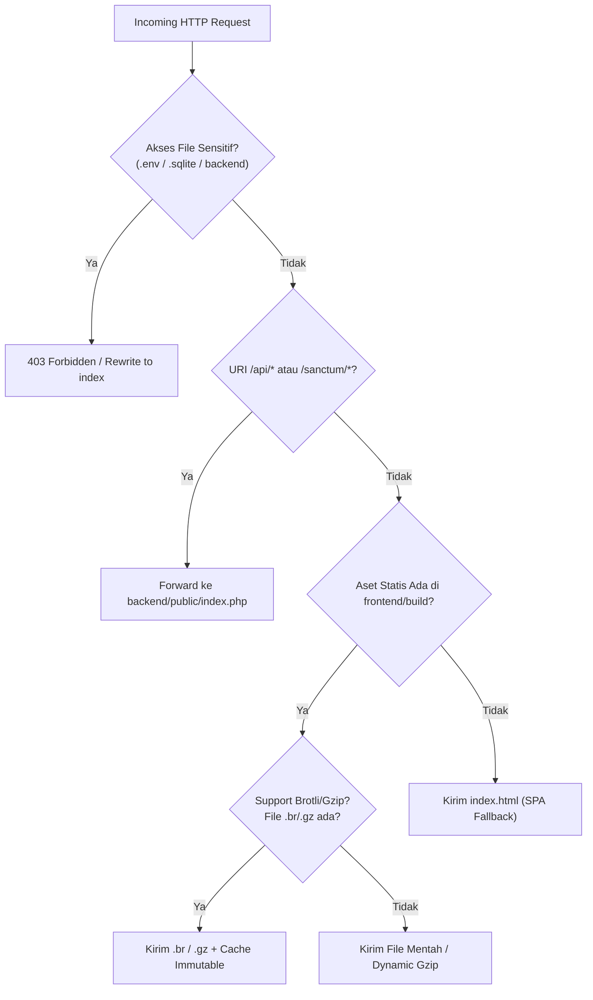
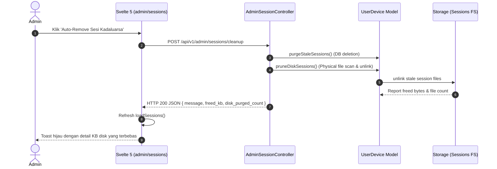

# [FEAT-03]: Gateway Performa, Telemetri SLO & Installer (v6.31.0)
> **Modul Inti:** Pre-Compressed Brotli/Gzip Delivery, Conditional ETag 304, Pemantauan Sesi Disk, Auto-Cleanup Inode, dan Diagnostic Installer / Safe Updater.

---

## 1. USER STORY
- **Sebagai** Full Stack Engineer / DevOps,  
  **Saya ingin** aset frontend Vite terkirim dalam format kompresi tinggi (Brotli/Gzip) dengan header cache `immutable` dan conditional response 304,  
  **Sehingga** waktu muat halaman awal instan, latensi P99 $\le 150\text{ ms}$, dan bandwidth hosting shared dihemat hingga 95%.
- **Sebagai** developer atau sysadmin yang memasang atau memperbarui template,  
  **Saya ingin** skrip diagnostik otomatis memvalidasi 13 prasyarat server dan melakukan pembaruan aman (*safe in-place update*),  
  **Sehingga** instalasi berjalan mulus tanpa risiko database terhapus secara tidak sengaja.

---

## 2. MVP SCOPE & BOUNDARIES
- **In-Scope (Termasuk):**
  - Gateway perantara [`index.php`](../../index.php) dan [`.htaccess`](../../.htaccess) pada root proyek dengan pemblokiran akses langsung ke file sensitif (`.env`, `.sqlite`, `.installed`, source code).
  - Pre-compressed file delivery: Deteksi otomatis berkas `.br` dan `.gz` pada folder `_app/immutable/` dengan fallback dynamic `gzencode()`.
  - Conditional ETag `304 Not Modified`: Memverifikasi kecocokan `If-None-Match` untuk menghentikan pengiriman payload berulang.
  - Sesi Disk Garbage Collection: Endpoint `POST /api/v1/admin/sessions/cleanup` yang menghapus file sesi kadaluarsa dan melaporkan kapasitas KB yang dibebaskan.
  - Skrip diagnostik dan pembaru aman [`install.php`](../../install.php) (CLI: `php install.php update`).
- **Out-of-Scope (Dilarang):**
  - DILARANG memodifikasi konfigurasi internal Laragon Nginx (`00-default.conf` dsb) agar phpMyAdmin dan virtual host lain tetap bekerja normal.
  - DILARANG menjalankan `php artisan migrate:fresh` pada proses update di production.

---

## 3. ACCEPTANCE CRITERIA (BDD GIVEN-WHEN-THEN)

### AC-1: Pengiriman Aset Terkompresi Brotli & Gzip
- **Given:** Klien mengirimkan header `Accept-Encoding: br, gzip, deflate`.
- **When:** Klien meminta berkas JavaScript atau CSS statis di `_app/immutable/`.
- **Then:** Gateway `index.php` mendeteksi keberadaan file `.br` atau `.gz`, menyajikannya secara langsung dengan header `Content-Encoding: br` (atau `gzip`), header `Cache-Control: public, max-age=31536000, immutable`, dan ukuran transfer terpangkas hingga 70-80%.

### AC-2: Conditional 304 Not Modified
- **Given:** Klien telah memiliki salinan aset di cache lokal dan mengirimkan header `If-None-Match: "etag_hash"`.
- **When:** Klien meminta ulang file `index.html`.
- **Then:** Gateway memvalidasi bahwa hash ETag tidak berubah dan langsung merespons dengan HTTP `304 Not Modified` tanpa mengirimkan body dokumen.

### AC-3: Auto-Cleanup Disk Sessions & Laporan KB
- **Given:** Terdapat puluhan file sesi usang yang terakumulasi di `storage/framework/sessions/`.
- **When:** Administrator menekan tombol "Auto-Remove Sesi Kadaluarsa" di `/admin/sessions`.
- **Then:** Server menghapus seluruh file sesi kadaluarsa, menghitung kapasitas byte yang terbebas, dan memunculkan toast: *"Pembersihan sesi selesai: X sesi database dihapus, Y file sesi PHP dibersihkan (Z KB disk dibebaskan)."*

### 3.1. SECURITY & RBAC ACCEPTANCE CRITERIA
- **Kriteria Otorisasi (BOLA Defense):** Akses metrik telemetri sistem (`/api/v1/telemetry`) dan pembersihan sesi wajib diproteksi oleh Policy / Middleware `role:admin`. Informasi beban internal server tidak boleh diakses oleh publik atau pengguna tanpa wewenang.
- **Kriteria Input:** Form Request validation terhadap parameter filter rentang waktu dan limit query telemetri dengan sanitasi ketat.
- **Uji Coba Keamanan:** PHPUnit Feature Test memverifikasi respons `403 Forbidden` jika non-admin mengakses endpoint telemetri, dan `422 Unprocessable Entity` jika parameter masukan tidak valid.

---

## 4. ARCHITECTURE BLUEPRINT & DELIVERY CONTRACTS

### Diagram Alir Pengiriman Aset di Gateway Root (`index.php`):


---

## 5. RESTFUL API CONTRACT

### `GET /api/v1/admin/sessions`
- **Response Success (HTTP 200):**
  ```json
  {
    "data": [],
    "meta": {
      "total_tracked": 1,
      "active_users": 1,
      "max_devices_cap": 3,
      "disk_sessions_count": 4
    }
  }
  ```

### `POST /api/v1/admin/sessions/cleanup`
- **Response Success (HTTP 200):**
  ```json
  {
    "message": "Pembersihan sesi selesai: 0 sesi database kadaluarsa dihapus, 2 file sesi PHP dibersihkan (8.4 KB disk dibebaskan).",
    "purged_count": 0,
    "disk_purged_count": 2,
    "freed_kb": 8.4
  }
  ```

---

## 6. SEQUENCE ARCHITECTURE FLOW



---

## 7. FRONTEND UI/UX BLUEPRINT (SVELTE 5 RUNES)
- **Halaman Utama:** [`frontend/src/routes/admin/sessions/+page.svelte`](../../frontend/src/routes/admin/sessions/+page.svelte)
- **Komponen 4 Kartu Metrik:**
  1. *Perangkat Aktif Login:* Menampilkan `meta.total_tracked`.
  2. *Pengguna Sedang Online:* Menampilkan `meta.active_users` dengan pulsing dot hijau.
  3. *Batas Maksimal Kuota:* Menampilkan `meta.max_devices_cap` (3 per akun).
  4. *Berkas Sesi Disk:* Menampilkan `meta.disk_sessions_count` (pemantau fisik inode disk).
- **Aksi Cepat:**
  - Tombol *Auto-Remove Sesi Kadaluarsa* dengan ikon sampah dan status loading.
  - Tombol *Cabut Semua Sesi Lain* (Emergency kill-switch).

---

## 8. TEST CONTRACT (PHPUNIT 100% PASS)
- **Skenario Uji Wajib:**
  1. `test_session_file_accumulation_prune_and_cleanup_endpoint`: Memverifikasi bahwa endpoint cleanup berhasil mengembalikan properti `freed_kb` dan memangkas file sesi usang.
  2. `test_disk_sessions_count_reported_in_meta`: Memverifikasi bahwa endpoint index menyertakan `disk_sessions_count`.

---

## 9. ENTERPRISE DEPLOYMENT SPECIFICATION (FTP & SSH ENGINES)
- **Jalur A: Single-Zip Stream FTP Deployer ([`deploy_ftp.php`](../../deploy_ftp.php)):**
  - Mengompilasi dan mengemas seluruh aplikasi ke dalam satu berkas `deploy_package.zip`.
  - Mengunggah berkas zip beserta runner temporer `deploy_runner.php` (dihasilkan oleh [`deploy_ftp.php`](../../deploy_ftp.php)) via FTP port 21 menggunakan streaming `curl.exe`.
  - Memicu ekstraksi aman di sisi server via HTTPS dengan autentikasi *one-time cryptographic token* (`hash_equals()`).
  - Runner melakukan unpack, set permissions `0775`/`0664`, mengeksekusi `migrate --force`, meng-cache config/routes/views, dan membersihkan dirinya sendiri secara mandiri (*self-destruct*).
- **Jalur B: Hardened OWASP SSH Deployer ([`deploy_ssh.sh`](../../deploy_ssh.sh) & [`deploy_ssh.php`](../../deploy_ssh.php)):**
  - Mengisolasi kode sumber backend di luar webroot publik (`~/apps/hyperion-vault/backend/`).
  - Menghubungkan gateway publik di `~/public_html/index.php` ke autoloader backend di luar webroot.
  - Memastikan berkas sensitif (`.env`, `database.sqlite`, vendor) 100% kebal dari akses HTTP langsung.
