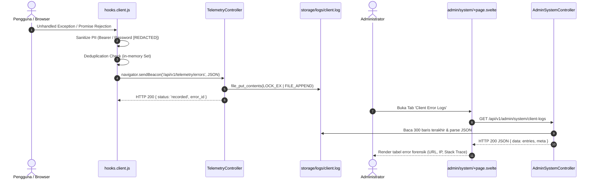

# [FEAT-04]: Mode Maintenance & Observabilitas Log Sistem (v6.31.0)
> **Modul Inti:** Zero-Lockout Maintenance Mode, Real-Time Laravel & Client JS Log Viewer, Non-Blocking Browser Telemetry, dan PII Sanitization.

---

## 1. USER STORY
- **Sebagai** Administrator Sistem / Lead DevOps,  
  **Saya ingin** mengaktifkan mode maintenance terjadwal dengan token bypass rahasia tanpa mengunci akses akun admin,  
  **Sehingga** proses migrasi atau pemeliharaan server dapat dilakukan dengan aman tanpa gangguan dari lalu lintas pengguna umum.
- **Sebagai** Site Reliability Engineer (SRE) / Developer,  
  **Saya ingin** memantau metrik kesehatan server, ukuran log, serta memeriksa entri error backend dan frontend secara terpusat dari dashboard web,  
  **Sehingga** deteksi bug, crash peramban pengguna, dan investigasi performa dapat diselesaikan dalam hitungan detik tanpa perlu membuka koneksi terminal SSH.

---

## 2. MVP SCOPE & BOUNDARIES
- **In-Scope (Termasuk):**
  - Toggle Mode Maintenance: Endpoint `POST /api/v1/admin/system/maintenance` dengan opsi `enable` (disertai secret token & retry parameter) dan `disable`.
  - Whitelist Rute Maintenance: Pengecualian rute `api/v1/admin/system/*` pada middleware `preventRequestsDuringMaintenance` di `bootstrap/app.php` untuk menjamin administrator kebal dari penguncian sesi (*zero admin lockout*).
  - Telemetri Error Klien Non-Blocking: Berkas `hooks.client.js` yang mengaitkan listener `unhandledrejection` dan `window.addEventListener('error')`, menyaring data sensitif (PII sanitization), serta mengirim laporan via `navigator.sendBeacon` ke `/api/v1/telemetry/errors`.
  - Log Viewer Backend (`laravel.log`): Parsing berbasis regex level (`EMERGENCY` s.d. `DEBUG`), ekstraksi `trace_id`, pencarian teks, dan pemfilteran level.
  - Log Viewer Frontend (`client.log`): Format terstruktur JSON Lines (`FILE_APPEND | LOCK_EX`) mencatat `error_id`, URL, user agent, IP, dan stack trace klien.
  - Antarmuka Admin Svelte 5: Tab navigasi terpadu di [`frontend/src/routes/admin/system/+page.svelte`](../../frontend/src/routes/admin/system/+page.svelte).
- **Out-of-Scope (Dilarang):**
  - DILARANG mengeksekusi log rotation yang menghapus file tanpa konfirmasi eksplisit dari administrator.
  - DILARANG mencatat password, token Bearer, atau kunci API ke dalam file log mentah (wajib lolos sanitasi regex).

---

## 3. ACCEPTANCE CRITERIA (BDD GIVEN-WHEN-THEN)

### AC-1: Zero-Lockout Maintenance Mode
- **Given:** Administrator mengaktifkan mode maintenance via dashboard atau Artisan `down --secret=...`.
- **When:** Pengguna umum mengakses rute web atau API aplikasi.
- **Then:** Pengguna umum menerima HTTP 503 Service Unavailable, sementara administrator yang mengakses `/admin/system` atau menggunakan URL bypass rahasia (`/{secret}`) tetap dapat beroperasi normal tanpa terputus.

### AC-2: Observabilitas Error Klien & PII Scrubbing
- **Given:** Terjadi unhandled JavaScript exception atau rejected Promise di peramban pengguna.
- **When:** Script peramban memicu pengiriman telemetri error.
- **Then:** Parameter sensitif (`Bearer ...`, `password=...`, `token=...`) disensor menjadi `[REDACTED]`, paket terkirim secara asinkron via `navigator.sendBeacon` tanpa memblokir antarmuka, dan tersimpan di `storage/logs/client.log`.

### AC-3: Pemantauan Log Real-Time & Pembersihan Aman
- **Given:** Administrator membuka tab "Laravel Backend Logs" atau "Client Error Logs" di `/admin/system`.
- **When:** Administrator melakukan pencarian kata kunci atau menekan tombol "Kosongkan Log".
- **Then:** Sistem memfilter entri log secara instan tanpa me-reload halaman, dan saat dikosongkan, file log direset ke 0 byte dengan konfirmasi aman.

### 3.1. SECURITY & RBAC ACCEPTANCE CRITERIA
- **Kriteria Otorisasi (BOLA Defense):** Pengendalian mode maintenance dan inspeksi berkas log server (`/api/v1/admin/system/*`) dilindungi secara ketat oleh Policy dan middleware `role:admin`. Dilarang keras akses dari publik atau user reguler.
- **Kriteria Input:** Form Request validation terhadap token bypass maintenance, parameter sanitasi scrub log, dan pencegahan path traversal saat membaca log file.
- **Uji Coba Keamanan:** PHPUnit Feature Test memverifikasi respons `403 Forbidden` jika non-admin mengakses `/api/v1/admin/system/status` atau logs, dan `422 Unprocessable Entity` saat masukan form tidak valid.

---

## 4. RESTFUL API CONTRACT

| Method | Endpoint | Proteksi Middleware | Deskripsi |
|---|---|---|---|
| `GET` | `/api/v1/admin/system/status` | `auth:sanctum`, `user.active`, `role:admin` | Status maintenance, metrik memori, PHP/Laravel version, ukuran log |
| `POST` | `/api/v1/admin/system/maintenance` | `auth:sanctum`, `user.active`, `role:admin` | Toggle aktifkan/nonaktifkan mode maintenance dengan secret token |
| `GET` | `/api/v1/admin/system/logs` | `auth:sanctum`, `user.active`, `role:admin` | Ambil dan parse daftar log backend `laravel.log` (filter level, search) |
| `GET` | `/api/v1/admin/system/client-logs` | `auth:sanctum`, `user.active`, `role:admin` | Ambil dan parse daftar log error front end `client.log` |
| `POST` | `/api/v1/admin/system/logs/clear` | `auth:sanctum`, `user.active`, `role:admin` | Kosongkan berkas log backend atau frontend secara instan |
| `POST` | `/api/v1/telemetry/errors` | Public API (`throttle:60,1`) | Ingest laporan unhandled exception JavaScript dari peramban klien |

---

## 5. SEQUENCE ARCHITECTURE FLOW

---

## 6. FRONTEND UI/UX BLUEPRINT (SVELTE 5 RUNES)
- **Halaman:** [`frontend/src/routes/admin/system/+page.svelte`](../../frontend/src/routes/admin/system/+page.svelte)
- **Komponen Utama:**
  1. *Banner Kontrol Maintenance:* Status aktif/non-aktif, input custom secret token, tombol aktifkan/nonaktifkan, dan tombol salin URL bypass satu klik.
  2. *Grid Metrik Server:* Versi PHP, versi Laravel, waktu server UTC, konsumsi memori PHP, limit memori, kapasitas sisa disk server.
  3. *Tab Switcher Terpadu:* Beralih antara "Laravel Backend Logs" dan "Client Browser Logs".
  4. *Toolbar Audit:* Pencarian pesan teks instan, dropdown filter level log, tombol muat ulang, dan tombol bahaya "Kosongkan Log".

---

## 7. TEST CONTRACT (PHPUNIT)
- **Uji Wajib:**
  1. `test_admin_system_status_and_maintenance_mode`: Memvalidasi bahwa pengguna reguler ditolak (HTTP 403), administrator dapat membaca metrik sistem, dan endpoint `/api/v1/telemetry/errors` berhasil merekam payload ke log disk.
