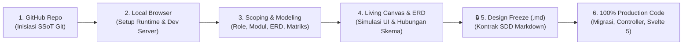
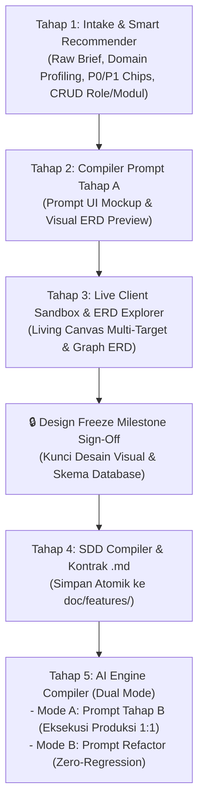
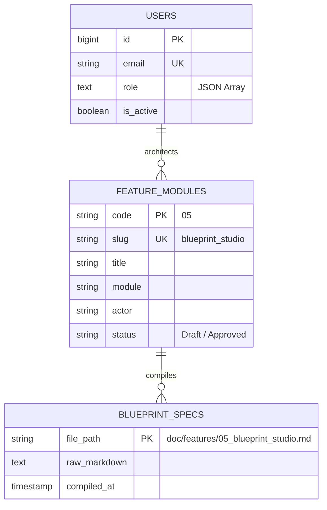

# [05]: Feature Blueprint Studio & Spec-to-Code Factory (v8.0.0)
> **Modul:** Universal Spec-to-Code Architecture Studio & Live Client Sandbox  
> **Aktor Utama:** Solution Architect, Lead Fullstack Engineer, Client Stakeholder  
> **Status:** Implemented & Verified (Production Ready)  
> **SSoT Governance:** [`.agents/rules/blueprint_studio_invariants.md`](../../.agents/rules/blueprint_studio_invariants.md)  

---

## 1. USER STORY & LATAR BELAKANG
- **Sebagai** Solution Architect dan Client Stakeholder,  
  **Saya ingin** memiliki antarmuka terintegrasi (`/admin/studio`) untuk menganalisis studi kasus bebas (*raw text*), memilih rekomendasi modul & fitur berbasis prioritas P0/P1, menguji simulasi antarmuka hidup (*Live Client Sandbox*) yang terhubung langsung dengan kolom ERD database, menyepakati *Design Freeze Milestone*, serta menyinkronkan dokumen kontrak SDD `.md` dan prompt AI eksekusi 100% kode produksi,  
  **Sehingga** seluruh siklus perancangan perangkat lunak dari brief awal hingga deployment dapat dituntaskan secara deterministik dengan jaminan fidelitas 1:1 tanpa risiko halusinasi atau kerja gratis.

---

## 2. REAL-WORLD PROJECT LIFECYCLE (6-STEP WORKFLOW)

Metodologi Blueprint Studio selaras 1:1 dengan alur kerja nyata (*end-to-end engineering workflow*) dalam membangun sistem enterprise:

1. **Step 1 — Pembuatan Repo GitHub:** Setup repository, branch protection, CI/CD pipeline, dan inisiasi SSoT kontrak kerja.
2. **Step 2 — Konfigurasi Repo hingga Bisa Diakses di Browser:** Setup database SQLite WAL mode, environment `.env`, server backend Laravel 13, dan frontend Svelte 5 berjalan sempurna secara lokal (`http://localhost:5173`).
3. **Step 3 — Perancangan Role, Modul, Dashboard Interaktif & Database:** Input brief bisnis mentah, deteksi domain otomatis, rekomendasi fitur P0/P1, serta penataan aktor RBAC dan skema entitas database.
4. **Step 4 — Terjemahkan Rancangan ke dalam Elemen UI, Living Canvas & ERD:** Validasi visual interaktif bersama stakeholder tanpa menulis kode dummy. Uji coba alur taktil sesuai delivery target (halaman, modal, drawer) dan archetype logika.
5. **Step 5 — Design Freeze Milestone menjadi Dokumen `.md`:** Stakeholder menyepakati mockup dan ERD, mengunci desain (*freeze*), dan mengompilasi kontrak resmi `doc/features/*.md` secara atomik.
6. **Step 6 — Eksekusi Kode ke dalam Halaman Asli:** AI Agent mengeksekusi kode 100% utuh tanpa placeholder (Migration, Model, Policy, Form Request, Controller, Test, dan view Svelte 5) dengan jaminan kepatuhan `[INV-07] UI_ERD_FIDELITY`.

---

## 3. METODOLOGI: 5-STAGE TWO-PROMPT STEPPER PIPELINE

Antarmuka `/admin/studio` mengorganisasikan perancangan melalui 5 tahap stepper:

### Taksonomi UI Delivery Target (Menghapus Asumsi Halaman Mandiri):
Logika custom tidak selalu membutuhkan rute halaman mandiri (`+page.svelte`). Pengguna dapat mengonfigurasi fitur ke dalam salah satu delivery target berikut:
1. `standalone_page`: Halaman penuh dengan rute khusus (Dedicated Route).
2. `modal_dialog`: Dialog pop-up taktil untuk konfirmasi terfokus, eksekusi voucher, atau alur transaksi cepat tanpa navigasi.
3. `slide_over_drawer`: Panel samping slide-over untuk melihat audit trail, inspector mendalam, atau formulir multi-tab.
4. `inline_action`: Tombol aksi langsung pada baris data tabel atau trigger header (misal: tombol sinkronisasi webhook).
5. `embedded_widget`: Kartu metrik KPI atau widget tersemat pada dashboard utama.
6. `headless_job`: Pekerjaan background/daemon tanpa representasi antarmuka visual langsung.

### Taksonomi Logic Archetype (Menghapus Pemaksaan CRUD):
Logika custom tidak selalu disimulasikan sebagai entri form dan tabel CRUD data:
1. `crud`: Operasi standar data entri (Create, Read, Update, Delete) dengan pattern PQTM.
2. `state_machine`: Alur persetujuan bertingkat (*Approval Pipeline*) dengan transisi status (`draft` ➔ `in_review` ➔ `approved`/`rejected`) dan audit log.
3. `calculation_engine`: Kalkulator matematis dan formula agregasi dinamis (volume, tarif, diskon, PPN) yang dihitung instan secara in-memory.
4. `data_pipeline`: Transformasi data batch/stream (ETL, migrasi, impor/ekspor data terstruktur).
5. `event_stream`: Penanganan webhook asinkron, antrean pesan, dan dispatch event berkecepatan tinggi.

### Standar Visual ERD Explorer & Graph Skema Database:
1. **Dukungan Enum Penuh:** Kolom bertipe `enum` menampilkan pilihan nilai secara visual via badge pills (misal: `'draft'`, `'in_review'`, `'approved'`, `'rejected'`) sehingga opsi skema database transparan.
2. **Relasi Antar Entitas & Foreign Key:** Setiap kolom relasi menampilkan atribut `FK` dengan panah tujuan (misal: `➔ users.id`).
3. **Kardinalitas Relasi:** Menampilkan kardinalitas Mermaid ERD (misal: `users ||--o{ projects : "manages"`).

---

## 4. ACCEPTANCE CRITERIA (BDD GIVEN-WHEN-THEN)

### AC-1: Analisis Kebutuhan Mentah & Rekomendasi Fitur
- **Given:** Solution Architect memasukkan deskripsi studi kasus bebas pada textarea Tahap 1.
- **When:** Tombol `💡 Analisis Kebutuhan & Rekomendasikan Fitur` ditekan.
- **Then:** Engine mendeteksi profil domain, menampilkan badge confidence match, dan merender kartu-kartu fitur P0/P1 yang siap diterapkan ke matriks.

### AC-2: Penataan Matriks Role, Modul, dan Fitur
- **Given:** Pengguna ingin menyusun arsitektur sistem.
- **When:** Pengguna membuka modal CRUD (Parameter Klien, Tambah/Edit Peran, Tambah/Edit Modul, Tambah/Edit Fitur).
- **Then:** Parameter `deliveryTarget` dan `logicArchetype` dapat dipilih, data diperbarui seketika secara reaktif di memori browser, dan tercermin pada matriks serta chart teknis.

### AC-3: Living Canvas Non-CRUD (State Machine & Calculation Engine)
- **Given:** Fitur yang dipilih memiliki archetype `state_machine` atau `calculation_engine`.
- **When:** Tab Living Mockup Canvas dibuka pada Tahap 3.
- **Then:** Antarmuka menampilkan visual stepper transisi status dengan catatan penolakan dan audit trail, atau kalkulator formula dinamis in-memory tanpa merender tabel CRUD standar.

### AC-4: Living Canvas Overlay (Modal Dialog & Slide-over Drawer)
- **Given:** Fitur yang dipilih memiliki delivery target `modal_dialog` atau `slide_over_drawer`.
- **When:** Pengguna menekan tombol simulasi pada canvas.
- **Then:** Modal dialog taktil atau slide-over drawer panel samping terbuka sebagai overlay tanpa memaksa navigasi rute halaman baru.

### AC-5: Visual ERD Explorer dengan Enum Pills & Foreign Key
- **Given:** Tab Visual ERD Explorer dibuka pada Tahap 3.
- **When:** Kartu-kartu tabel entitas dirender.
- **Then:** Kolom bertipe `enum` menampilkan opsi pill badge yang jelas, kolom `FK` menampilkan target referensi, dan panel relasi menampilkan kardinalitas Mermaid ERD.

### AC-6: Design Freeze & Penyimpanan Dokumen Kontrak SDD
- **Given:** Klien dan architect menyepakati prototipe visual dan skema ERD pada Tahap 3.
- **When:** Tombol `Setujui Desain (Design Freeze Milestone)` ditekan dan dokumen disimpan di Tahap 4.
- **Then:** Backend `AdminStudioController::saveSpec` menulis file spesifikasi ke `doc/features/` secara atomik dan merespons HTTP 201 Created.

### AC-7: Standar Emas CRUD Sandbox (PQTM Pattern)
- **Given:** Fitur yang dipilih memiliki tipe `CRUD` dan target `standalone_page`.
- **When:** Antarmuka Live Workspace Tahap 3 dirender.
- **Then:** Sistem menampilkan Summary Stat Pills, tombol Ekspor CSV, pencarian & filter in-memory (< 0.1ms), tabel zero window scroll, paginasi dinamis, modal form ber-tab, modal detail record, dan dialog konfirmasi hapus destruktif.

### AC-8: Dual-Mode AI Compiler (Eksekusi Fitur vs Zero-Regression Refactoring)
- **Given:** Dokumen spesifikasi SDD telah disetujui pada Tahap 4.
- **When:** Pengguna membuka Tahap 5 AI Engine Compiler.
- **Then:** Sistem menyediakan tab `⚡ Prompt Tahap B` untuk eksekusi fitur 100% produksi 1:1 terhadap mockup canvas, dan tab `🧹 Prompt Refactor` untuk audit forensik, dead code elimination, dan konsolidasi DRY bergaransi Zero-Regression lengkap dengan 1-klik copy dan integrasi CLI PowerShell.

### AC-9: Live Discovery Inspector & Anti-Slop Parser (Anthony Ulwick JTBD)
- **Given:** Pengguna mengetik atau mengubah teks kebutuhan bebas pada textarea Tahap 1.
- **When:** Panjang teks kebutuhan mentah melebihi 10 karakter.
- **Then:** Sistem secara reaktif (`$derived.by`) merender widget Live Discovery Inspector: mendeteksi formula JTBD Ulwick, mendeteksi kata-kata sifat subjektif ambigu (*Anti-Slop warning*), dan menampilkan pratinjau mini-bar audit 3-pilar seketika (< 0.1ms).

### AC-10: Triple-Pillar Audit Gate Enforcement (Design Freeze Lock)
- **Given:** Pengguna berada pada Tahap 3 (Live Workspace & ERD Explorer) dan ingin menyetujui desain (*Design Freeze*).
- **When:** Skor Kesiapan (*Readiness Score*) Audit 3-Pilar (Logika Bisnis DDD, Basis Data 3NF, UI/UX NN/g & WCAG AAA) berada di bawah ambang batas kelulusan $87.5\%$.
- **Then:** Tombol persetujuan `Setujui Desain (Design Freeze Milestone)` terkunci dalam status `disabled` dengan tooltip peringatan, dan hanya aktif setelah seluruh entitas tabel, peran, dan pemetaan target UI terpenuhi secara lengkap.

---

## 5. DATABASE SCHEMA & METADATA ARCHITECTURE

---

## 6. RESTFUL API CONTRACT

| Method | Endpoint URI | Middleware Guard | Deskripsi Fungsional |
|---|---|---|---|
| `GET` | `/api/v1/admin/studio/modules` | `auth:sanctum, role:admin` | Membaca daftar berkas spesifikasi aktif di `doc/features/` |
| `POST` | `/api/v1/admin/studio/generate-spec` | `auth:sanctum, role:admin` | Menulis & menyinkronkan file spesifikasi `.md` secara atomik |

---

## 7. TEST CONTRACT (PHPUNIT 100% PASS)
- **File Uji:** [`backend/tests/Feature/AdminStudioTest.php`](file:///D:/laragon/www/hyperion-vault/backend/tests/Feature/AdminStudioTest.php)
- **Skenario Uji:**
  1. `test_admin_can_list_existing_feature_specs` $\implies$ HTTP 200.
  2. `test_non_admin_cannot_access_studio` $\implies$ HTTP 403 Forbidden.
  3. `test_admin_can_generate_and_save_spec_atomically` $\implies$ HTTP 201 Created & berkas disk terverifikasi.
