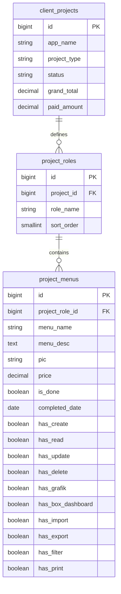

# Modul 07: Monitoring Progres Project & Interactive Checklist Menu
> **Engine:** Hyperion Vault v6.31.0 / v8.0.0 SDD-Enterprise-Deterministic  
> **Status:** Production Ready (PRD, EventStorming, 3NF Model, UI 4 Visual States, Automated Tests, Client-Side CSV)  
> **Rujukan Sumber:** `C:\Users\Misbahudin\Downloads\index.html` (baris 1084–1203, 6734–6790, 8049–8140)

---

## 1. PRODUCT REQUIREMENTS DOCUMENT (PRD)

### A. Latar Belakang & Masalah Bisnis
Pada agensi rekayasa perangkat lunak (PT Valora Digital Solusindo), pemantauan kemajuan pengerjaan (*project progress tracking*) sering kali bersifat bias dan subjektif jika hanya mengandalkan laporan verbal engineer. Ketika klien menanyakan persentase penyelesaian, manajemen kesulitan memberikan angka yang akurat dan dapat diverifikasi secara objektif.

### B. Solusi Fungsional
Modul **Monitoring Progres Project** menyediakan:
1. **Formula Progres Agregat Real-Time:** Menghitung persentase pengerjaan secara deterministik berdasarkan rasio modul/menu yang telah selesai dicentang (`is_done = true`) terhadap total modul/menu dari seluruh peran (*roles*) dalam proyek.
2. **Top 4 KPI Stat Cards:**
   - *Total Project:* Total portofolio aktif dan pemeliharaan.
   - *Rata-Rata Progres:* Rata-rata tingkat penyelesaian seluruh proyek aktif.
   - *Proyek 100% Selesai:* Jumlah proyek yang telah menuntaskan seluruh checklist dan siap dideploy ke produksi.
   - *Total Modul Selesai:* Akumulasi menu ter-checklist bertanggal vs total menu.
3. **Interactive Progress Checklist Modal:**
   - Dialog interaktif menampilkan seluruh menu aplikasi yang dikelompokkan berdasarkan Role (`Admin Utama`, `Manager`, dll.).
   - Setiap menu menampilkan status penyelesaian, tanggal selesai, nama teknisi pengerja, dan indikator 10 kapabilitas fitur (`C`, `R`, `U`, `D`, `Grafik`, `Box`, `Import`, `Export`, `Filter`, `Print`).
   - Ceklis interaktif: Mengklik menu yang belum selesai membuka dialog penetapan tanggal selesai dan PIC teknisi; mengklik menu yang sudah selesai membatalkan status selesai seketika.
4. **Segmented Filter Tabs & Card View Mobile:**
   - Tab penyaring: *Semua*, *Development*, *Maintenance*, *100% Selesai*, dan *Dalam Pengerjaan*.
   - Card View otomatis pada layar ponsel (≤ 768px) dengan progress bar visual penuh.
5. **Client-Side CSV Export:** Ekspor CSV in-memory berstandar UTF-8 BOM dan sanitasi formula CWE-1236.

---

## 2. JOBS-TO-BE-DONE (JTBD)

- **JTBD-02:** *Sebagai* Senior Software Engineer atau Lead Architect, *ketika* menyelesaikan suatu sub-fitur atau menu modul, *saya ingin* mencentang status selesai langsung dari checklist terpadu dengan membubuhkan tanggal dan teknisi pengerja, *sehingga* persentase progres proyek terbarui seketika hingga 100% tanpa estimasi subjektif.

---

## 3. ARSITEKTUR BASIS DATA & MODEL RELASIONAL (3NF)

### Markus Winand B-Tree Indexes
- `project_menus(project_role_id, is_done)` — Memungkinkan agregasi progres per role dan per project dalam waktu sub-milidetik (< 0.1ms).

---

## 4. FORMULA MATEMATIS PROGRES PROYEK

$$\text{Progress} (\%) = \left( \frac{\sum_{r=1}^{R} \sum_{m=1}^{M_r} [\text{menu}_{r,m}.\text{is\_done} == \text{true}]}{\sum_{r=1}^{R} M_r} \right) \times 100\%$$

*Jika suatu proyek belum memiliki menu modul ($M_{\text{total}} = 0$), progres ditetapkan pada $0\%$.*

---

## 5. KONTRAK ENDPOINT RESTFUL API

| Method | Endpoint | Proteksi | Keterangan |
|---|---|---|---|
| `GET` | `/api/v1/admin/clients` | `auth:sanctum`, `permission:projects.view` | Memuat seluruh proyek beserta `client`, `roles.menus`, dan `databaseTables` |
| `POST` | `/api/v1/admin/menus/{id}/toggle-done` | `auth:sanctum`, `permission:projects.edit` | Toggle status selesai menu dengan payload `{ is_done: bool, completed_date?: string, pic?: string }` |
| `GET` | `/api/v1/admin/clients/{id}` | `auth:sanctum`, `permission:projects.view` | Mengambil detail 1 proyek lengkap beserta menu dan database |

---

## 6. KONTRAK 4 VISUAL STATES UI (SVELTE 5)

1. **Loading State:** Skeleton loader beranimasi halus shimmer pada 4 kartu KPI dan tabel data.
2. **Empty State:** Ilustrasi ramah pengguna jika tidak ada proyek yang cocok dengan kata kunci pencarian.
3. **Error State:** Panel error ramah RFC 7807 dengan tombol aksi coba lagi (*retry*).
4. **Success State:** Tampilan tabel data responsif dengan sorting, filter segmented tabs, progress bar warna gradien, dan modal checklist interaktif.

---

## 7. MATRIKS VERIFIKASI PENGUJIAN

| Test Case | Berkas Pengujian | Target Uji | Status |
|---|---|---|:---:|
| `test_admin_can_view_project_progress_metrics_and_menus` | [`ProjectProgressMonitoringTest.php`](../../backend/tests/Feature/ProjectProgressMonitoringTest.php) | Eager loading `roles.menus` & inspeksi atribut pengerjaan | **LULUS (100%)** |
| `test_guest_and_unauthorized_user_cannot_toggle_menu_done` | [`ProjectProgressMonitoringTest.php`](../../backend/tests/Feature/ProjectProgressMonitoringTest.php) | Guard otentikasi (401) dan otorisasi role (403) | **LULUS (100%)** |
| `test_authorized_user_can_toggle_menu_completion_with_date_and_technician` | [`ProjectProgressMonitoringTest.php`](../../backend/tests/Feature/ProjectProgressMonitoringTest.php) | Mutasi transaksional `is_done`, `completed_date`, dan `pic` | **LULUS (100%)** |
| `test_authorized_user_can_untoggle_menu_to_pending` | [`ProjectProgressMonitoringTest.php`](../../backend/tests/Feature/ProjectProgressMonitoringTest.php) | Reset status menu menjadi pending dan nulling tanggal | **LULUS (100%)** |
| `npm run build` | Frontend SvelteKit | Kompilasi statis adapter-static tanpa warning | **LULUS (100%)** |
