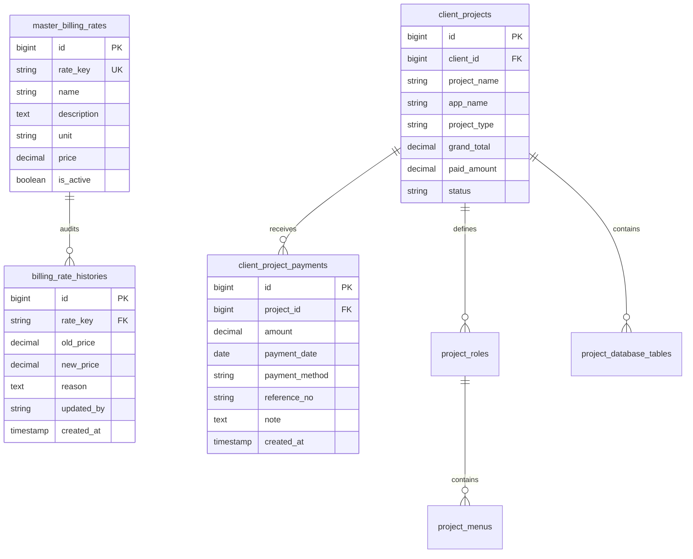

# Modul 08: Tagihan Klien, Master Tarif Standar & Integrasi Valuasi Biaya Proyek
> **Engine:** Valora Vault v6.31.0 / v8.0.0 SDD-Enterprise-Deterministic  
> **Status:** Production Ready (PRD, EventStorming, 3NF Model, UI 4 Visual States, Automated Tests, Client-Side CSV)  
> **Rujukan Sumber:** `C:\Users\Misbahudin\Downloads\index.html` (baris 1205–1480, 2850–3040, 4480–4585)

---

## 1. PRODUCT REQUIREMENTS DOCUMENT (PRD)

### A. Latar Belakang & Masalah Bisnis
Pada agensi perangkat lunak profesional, transparansi keuangan dan konsistensi perhitungan biaya proyek merupakan fondasi kepercayaan klien. Sering kali tarif per modul atau paket fitur ditetapkan secara acak (*ad-hoc*), menyebabkan ketidaksesuaian valuasi kontrak antara proposal, kesepakatan klien, dan pencatatan pembayaran cicilan/termin.

### B. Solusi Fungsional
Modul **Tagihan Klien & Master Tarif Standar** menyediakan:
1. **Master Settingan Tarif Acuan Valora (Single Source of Truth):**
   - Mengelola 6 tarif acuan standar resmi:
     - `landing`: Landing Page Promosi Perdana (Default Rp 2.500.000 / paket).
     - `login`: Autentikasi Login Pengguna (Default Rp 1.000.000 / paket).
     - `register`: Pendaftaran Akun Pengguna Baru (Default Rp 1.000.000 / paket).
     - `menu_price`: Modul Menu Aplikasi Operasional (Default Rp 750.000 / modul).
     - `database_table_price`: Tabel Skema Basis Data (Default Rp 100.000 / tabel).
     - `maintenance_menu_price`: Pemeliharaan Menu Aplikasi (Default Rp 150.000 / modul).
   - Setiap revisi tarif master wajib membubuhkan **Alasan Perubahan Tarif** untuk kepatuhan audit trail transparansi (`billing_rate_histories`).
2. **Koneksi Otomatis ke Modul Client & Proyek:**
   - Saat pendaftaran aplikasi baru (`ClientModal.svelte`), valuasi proyek otomatis mengacu pada tarif master aktif secara dinamis.
   - Saat penambahan menu modul atau tabel database di Detail & Setting Proyek (`ClientDetailSettingModal.svelte`), harga default langsung mengadopsi tarif master dengan tombol cepat *"Gunakan Tarif Acuan"*.
   - Saat penyesuaian tarif khusus (*custom billing agreement*), sistem menyediakan perbandingan harga terhadap tarif master aktif.
3. **Manajemen Tagihan Proyek & Status Pembayaran:**
   - Klasifikasi otomatis 3 status tagihan:
     - `Lunas`: Pembayaran telah mencapai atau melebihi total valuasi kontrak.
     - `DP / Termin`: Telah menerima pembayaran parsial/uang muka dengan sisa piutang tercatat.
     - `Belum Bayar`: Belum ada pembayaran masuk sama sekali.
   - Perekaman pembayaran transaksional multi-metode (Transfer BCA, Mandiri, Cash, dll.) dengan nomor referensi dan tanggal pencatatan.
4. **Faktur Invoice Interaktif & Integrasi WhatsApp:**
   - Generate nomor invoice otomatis (`INV-YYYY-XXXX`).
   - Rincian item faktur (Paket Landing, Autentikasi Login/Register, Subtotal Modul Menu, Subtotal Skema Database).
   - Tombol pengiriman pesan WhatsApp resmi yang menyertakan rincian tagihan, sisa piutang, dan instruksi rekening transfer.
   - Tombol cetak faktur standar profesional (*clean print layout*).
5. **Card View Mobile & Client-Side CSV Export:**
   - Tampilan Card Stack otomatis di layar HP (≤ 768px) dengan progress bar pembayaran visual.
   - Ekspor data CSV instan dari browser dengan UTF-8 BOM dan sanitasi CWE-1236.

---

## 2. JOBS-TO-BE-DONE (JTBD)

- **JTBD-04:** *Sebagai* Manajer Operasional atau Tim Keuangan, *ketika* mengonfigurasi proyek atau menagih pembayaran klien, *saya ingin* sistem menghitung total valuasi secara otomatis berdasarkan tarif acuan standar serta mencatat transaksi cicilan secara transaksional, *sehingga* invoice faktur dan pembukuan piutang selalu akurat 100% tanpa kesalahan manusia.

---

## 3. ARSITEKTUR BASIS DATA & MODEL RELASIONAL (3NF)

---

## 4. KONTRAK API BACKEND (LARAVEL 13 & RFC 7807)

| Method | Endpoint | Authorization | Deskripsi |
| :--- | :--- | :--- | :--- |
| `GET` | `/api/v1/admin/billing-rates` | `billing.view` | Mendapatkan daftar seluruh tarif acuan master dan histori revisinya. |
| `PUT` | `/api/v1/admin/billing-rates/{rateKey}` | `billing.manage` | Memperbarui nominal tarif standar master dan mencatat log audit ke `billing_rate_histories`. |
| `GET` | `/api/v1/admin/billing/projects` | `billing.view` | Mendapatkan rekap tagihan seluruh proyek, status pembayaran, dan total piutang. |
| `GET` | `/api/v1/admin/billing/projects/{projectId}/invoice` | `billing.view` | Mengambil detail faktur invoice, rincian biaya komponen, dan riwayat pembayaran proyek. |
| `POST` | `/api/v1/admin/billing/projects/{projectId}/payments` | `billing.manage` | Mencatat transaksi pembayaran baru dan memperbarui `paid_amount` proyek secara transaksional. |

---

## 5. UI/UX & TAMPILAN SVELTE 5

- **Route:** `/admin/tagihan`
- **Sub-Tab Navigasi:**
  1. *Tagihan & Pembayaran Client*: Rekap KPI finansial, filter segmented status pembayaran, DataTable dan Card View mobile dengan progress bar cicilan.
  2. *Master Settingan Tarif*: Tabel tarif acuan aktif dengan tombol aksi penyesuaian nominal, serta tabel audit trail histori perubahan tarif.
- **Komponen Interaktif:**
  - [`InvoiceModal.svelte`](frontend/src/lib/components/billing/InvoiceModal.svelte): Dialog faktur resmi INV-YYYY-XXXX, rincian biaya, formulir catat bayar, cetak, dan WhatsApp.
  - [`UpdateMasterRateModal.svelte`](frontend/src/lib/components/billing/UpdateMasterRateModal.svelte): Dialog revisi tarif master dengan audit reason wajib.
  - [`ClientModal.svelte`](frontend/src/lib/components/clients/ClientModal.svelte): Integrasi tarif master pada pendaftaran proyek dan maintenance.
  - [`ClientDetailSettingModal.svelte`](frontend/src/lib/components/clients/ClientDetailSettingModal.svelte): Integrasi acuan tarif master pada penambahan menu, tabel DB, dan kustomisasi tarif fitur.
