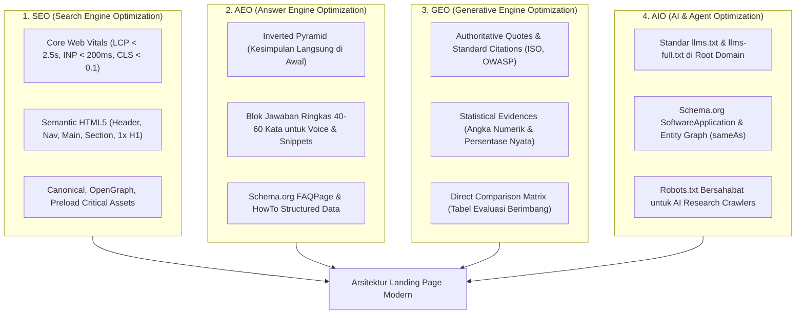

# Buku Putih Standar Rekayasa Landing Page & Arsitektur Pertumbuhan (landing_page_standards.md)
> **Engine:** Hyperion Vault v6.31.0 / v8.0.0 SDD-Enterprise-Deterministic  
> **Standar Industri:** Google Core Web Vitals (2024/2026), Princeton GEO (Aggarwal et al., 2023), Answer.ai llms.txt (Jeremy Howard, 2024), MECLABS Institute, StoryBrand SB7 (Donald Miller), Julian Shapiro CRO, Jakob Nielsen (NN/g), Steven Hoober (Thumb Zone), Rauno Freiberg (Perceptual Craft & Web Interface Guidelines), Emil Kowalski (Animations on the Web), Ethereum Foundation Web3 UX Heuristics, W3C WCAG 2.2 AAA, Schema.org JSON-LD.

---

## 1. EKSEKUTIF BLUEPRINT: EVOLUSI PENEMUAN & KONVERSI WEB

Landing page pada era modern tidak lagi berfungsi sekadar sebagai brosur digital statis. Ia merupakan **mesin konversi ganda** yang beroperasi di persimpangan dua dunia:
1. **Dunia Psikologi Manusia:** Menjawab rasa sakit (*pain points*), membangun kepercayaan melalui bukti sosial otentik, memitigasi keraguan (*risk reversal*), dan memandu pengunjung mengambil keputusan tindakan (*action*) dengan friksi minimal.
2. **Dunia Penalaran Mesin (Algoritmik & Generatif):** Menyajikan data yang terstruktur secara semantik agar mudah diindeks oleh crawler web konvensional (Google/Bing), diekstrak oleh mesin penjawab ringkas (Voice Search/Featured Snippets), disintesis sebagai sumber sitasi otoritatif oleh model penalaran AI (Perplexity, ChatGPT, Claude, Gemini), dan dibaca secara hemat token oleh agen otonom melalui berkas `/llms.txt`.

---

## 2. PILAR 1: KUARTET OPTIMASI PENEMUAN MODERN



### A. Rincian Teknis Core Web Vitals (SEO)
- **LCP ($\le 2.5\text{s}$):**
  - Aset visual terbesar (LCP hero image) wajib dimuat paling awal menggunakan:
    ```html
    <link rel="preload" as="image" href="/images/hero-dashboard.webp" type="image/webp" fetchpriority="high">
    ```
  - Hindari lazy-loading pada gambar pertama yang langsung terlihat di viewport atas.
- **INP ($\le 200\text{ms}$):**
  - Pastikan setiap tombol CTA langsung memberikan umpan balik visual saat disentuh/diklik ($< 50\text{ms}$) tanpa menunggu operasi jaringan selesai.
- **CLS ($\le 0.1$):**
  - Tentukan dimensi eksplisit atau `aspect-ratio` pada seluruh container media untuk mengunci ruang sebelum media selesai diunduh.

### B. Riset Akademis Generative Engine Optimization (GEO)
Berdasarkan eksperimen empiris Princeton University (*Aggarwal et al., 2023*):
- Menambahkan **data statistik numerik** pada teks meningkatkan probabilitas dikutip oleh mesin generatif sebesar **+37.2%**.
- Menyertakan **kutipan sumber otoritas dan standar industri formal** meningkatkan sitasi sebesar **+30.1%**.
- Taktik lama seperti pengulangan kata kunci (*keyword stuffing*) justru menghasilkan penalti atau diabaikan oleh mesin pembuat ringkasan AI.

---

## 3. PILAR 2: PSIKOLOGI KONVERSI & ANATOMI STORYBRAND (SB7)

Model matematis konversi mengacu pada **MECLABS Conversion Heuristic**:
$$C = 4m + 3v + 2(i - f) - 2a$$
Di mana:
- $C$ = Probabilitas Terjadinya Konversi
- $m$ = Motivasi Pengunjung (Kebutuhan intrinsik)
- $v$ = Kejelasan Proposisi Nilai (*Value Proposition*)
- $i$ = Insentif Tambahan (Uji coba gratis, bonus implementasi)
- $f$ = Friksi (*Friction*: formulir berbelit, registrasi rumit)
- $a$ = Kecemasan (*Anxiety*: takut salah beli, takut data bocor)

### Blueprint Anatomi 8 Section Berdaya Konversi Tinggi
1. **Hero Section:** Value proposition langsung terbaca dalam 5 detik. Memuat 1 tag `<h1>`, subheadline benefit konkret, primary CTA dengan warna kontras, mikro-bukti (tanpa kartu kredit), dan mockup visual antarmuka asli.
2. **Trust & Authority Bar:** Menghilangkan kecemasan (*anxiety*) melalui logo institusi/klien bereputasi dan lencana sertifikasi keamanan.
3. **Agitasi Masalah (3 Villains):** Memvalidasi frustrasi dan inefisiensi yang saat ini dirasakan pengunjung akibat cara-cara lama.
4. **Pilar Solusi & 3-Step Plan (The Guide):** Menunjukkan bahwa solusi mudah digunakan hanya dalam 3 langkah sederhana tanpa keahlian teknis rumit.
5. **Bukti Transformasi (Social Proof):** Testimoni pelanggan riil dengan metrik hasil kuantitatif.
6. **Matriks Komparasi Nilai:** Membantu penalaran logis pengunjung (dan mesin LLM) membandingkan solusi Anda dengan cara manual atau kompetitor.
7. **Mitigasi Keraguan & FAQ:** Menjawab pertanyaan seputar keamanan, migrasi data, dan masa uji coba dengan ringkasan padat 40-60 kata.
8. **Final CTA & Sticky Mobile Action:** Penutup tegas dengan tombol konversi yang selalu dapat dijangkau jempol pengguna di perangkat mobile.

---

## 4. PILAR 3: MATRIKS TIPOLOGI UI/UX BERDASARKAN MODEL BISNIS

| Model Bisnis | Densitas UI | Palet & Gaya Visual | CTA Utama | Fokus Pembuktian Nilai |
| :--- | :--- | :--- | :--- | :--- |
| **B2B Enterprise** | **Kompak Pro-Grade:** Garis 1px, tabel data, ringkasan eksekutif. | Netral elegan (Slate/Navy), kontras tajam. | *Jadwalkan Demo* / *Kontak Enterprise* | Kepatuhan hukum, SOC-2/ISO, audit trail, SLA 99.9%. |
| **B2C Micro-SaaS** | **Modern Product-Led:** Cuplikan kode, sandbox, terminal CLI. | Obsidian Dark / Aksen Neon, kartu glassy. | *Mulai Gratis* / *Install via CLI* | Uji coba instan tanpa kartu kredit, latensi sub-milidetik. |
| **High-Ticket Consulting** | **Editorial Authority:** Tipografi luas, spasi nyaman. | Warm Neutral, Serif + Sans-serif modern. | *Ajukan Konsultasi* / *Book Call* | Studi kasus mendalam (Before-After), metodologi berhak cipta. |
| **E-Commerce / DTC** | **Visual Gallery:** Fotografi produk resolusi tinggi. | Vibrant Accent, kartu produk kompak. | *Beli Sekarang* / *Add to Cart* | Foto asli ulasan pembeli (UGC), garansi pengembalian. |
| **EdTech / Kursus** | **Modular Course:** Silabus terstruktur minggu demi minggu. | Friendly Clean, progress badges. | *Daftar Batch* / *Mulai Belajar* | Portofolio alumni, sertifikat kelulusan, rekaman cuplikan materi. |
| **Web3 / DeFi Protocol** | **Sangat Tinggi (Telemetry):** Bento grid, TVL, volume, gas tracker, hash `font-mono`. | Dark Mode Luxury (Obsidian `#0a0a0a`), Hairline 1px, Neon Accent. | *Launch App* / *Explore Protocol* | Laporan Audit CertiK/OpenZeppelin, Proof of Reserves, verifikasi on-chain. |

---

## 5. PILAR 4: ARSITEKTUR MOTION DESIGN & PERFORMANCE BUDGET

```
┌────────────────────────────────────────────────────────────────────────┐
│ POHON KEPUTUSAN ANIMASI WEB BERKINERJA TINGGI                          │
├────────────────────────────────────────────────────────────────────────┤
│ 1. Pure CSS3 (GPU Composited) ➔ Default untuk 80% Kebutuhan UI        │
│    - Gunakan transform: translate3d(), scale(), opacity.               │
│    - Beban Bundle: 0 KB JS | Framerate: 120 FPS GPU                    │
│                                                                        │
│ 2. Svelte 5 Native Runes & Motion ➔ Transisi Siklus Hidup DOM         │
│    - Gunakan transition:slide, fade, fly, svelte/motion spring.        │
│    - Beban Bundle: 0 KB Eksternal | Bebas Layout Thrashing             │
│                                                                        │
│ 3. GSAP + ScrollTrigger ➔ Pinned Scrub Timeline Storytelling           │
│    - HANYA jika ada animasi bertahap terikat scroll.                   │
│    - Wajib Dynamic Import (Lazy Load).                                 │
│    - Wajib Isolasi Memori: gsap.context() & ctx.revert() saat unmount. │
│    - Wajib Mematuhi @media (prefers-reduced-motion: reduce).          │
│                                                                        │
│ 4. Canvas / WebGL Strict Budgeting ➔ Partikel 3D & Node Graph Interaktif│
│    - HANYA aksen pelengkap, DILARANG memblokir Main Thread (INP < 200ms)│
│    - Wajib jeda render loop via IntersectionObserver saat di luar layar│
│    - Wajib fallback gambar WebP statis (< 100 KB) untuk mobile         │
└────────────────────────────────────────────────────────────────────────┘
```

### Disiplin Koreografi Bersarang (Nested Motion) & Kontras APCA / WCAG AAA
1. **Pemisahan Gerak Makro vs Mikro:**
   - **Kontainer Makro (Card / Bento Section):** `y: 20px - 30px`, durasi $0.4\text{s} - 0.5\text{s}$, stagger $0.1\text{s} - 0.15\text{s}$.
   - **Tipografi Mikro (Judul / Paragraf):** DILARANG melempar teks $> 20\text{px}$. Teks bergerak mikro `y: 8px - 14px`, durasi $0.25\text{s} - 0.35\text{s}$, stagger halus $0.04\text{s} - 0.08\text{s}$.
   - **Plafon Durasi & Easing:** Plafon durasi total $\le 600\text{ms}$ dengan kurva perlambatan `cubic-bezier(0.16, 1, 0.3, 1)` / `power2.out`.
2. **Kaidah Warna 60-30-10, Elevasi Permukaan 3-Tier & Kontras APCA:**
   - **Proporsi 60-30-10:** 60% kanvas netral (`bg-slate-100/70` / `bg-[#070b12]`), 30% permukaan kartu & hairline border 1px, 10% aksen fungsional CTA.
   - **Arsitektur Elevasi 3-Tier (Anti-Camouflage Bento Grid):** Seluruh bento grid cards, pricing tables, dan kartu fitur wajib mematuhi pemisahan permukaan 3-Tier (L0 kanvas dasar teduh, L1 kartu solid dengan `border border-slate-200/80 dark:border-slate-800` & `shadow-2xs`, L2 badge/konten interaktif tersemat). Dilarang membuat kartu bento transparan pucat (`bg-white/40` atau `dark:bg-white/[0.02]`) di atas kanvas flat yang membuat kartu kehilangan batas fisiknya (*visual camouflage*).
   - **Batas Kontras APCA & WCAG AAA:** Kontras teks body wajib APCA $L_c \ge 75$ (WCAG AAA 7:1) dan heading $L_c \ge 60$ (WCAG AA 4.5:1). Garis batas interaktif wajib memenuhi rasio kontras minimal 3:1.

### Mandat Aksesibilitas Vestibular (WCAG 2.2 AAA)
Setiap animasi yang melibatkan perpindahan spasial signifikan wajib menyediakan jalur alternatif bagi pengguna dengan gangguan vestibular:
```css
@media (prefers-reduced-motion: reduce) {
  *, ::before, ::after {
    animation-duration: 0.01ms !important;
    animation-iteration-count: 1 !important;
    transition-duration: 0.01ms !important;
    scroll-behavior: auto !important;
  }
}
```

### Standar Apple-Grade Spatial Materials, Damped Spring Physics & Auditory UI Architecture
1. **Apple Spatial Materials & Dynamic Vibrancy (macOS / iOS / visionOS HIG):**
   - **Eliminasi Frosted Glass Murahan:** Dilarang meletakkan teks di atas kaca semi-transparan buram tanpa dasar kontras (*contrast backing floor*).
   - **Hierarki Ketebalan Material:** Gunakan `backdrop-blur-xl backdrop-saturate-150` dipadukan dengan latar belakang bertingkat (`bg-white/80` di light mode, `bg-slate-900/80` di dark mode) yang menjamin APCA $L_c \ge 75$ (WCAG AAA 7:1).
   - **1px Specular Edge Chamfer:** Setiap kartu kaca wajib memiliki garis pantulan cahaya spekular tipis di tepi atas (`before:absolute before:inset-x-0 before:top-0 before:h-px before:bg-gradient-to-r before:from-transparent before:via-white/20 before:to-transparent`) untuk mensimulasikan pembiasan fisik kaca tebal.
2. **Damped Spring Physics (Apple Fluid Motion Standards):**
   - Transisi interaksi menggunakan fisika pegas teredam (*damped springs*): awal sangat cepat (*fast-to-start*), dapat dibatalkan seketika (*interruptible*), dan berhenti lembut (`cubic-bezier(0.16, 1, 0.3, 1)` atau `active:scale-[0.98]`).
3. **Auditory UI Micro-Feedback (Apple Earcons & W3C Web Audio API):**
   - **Zero HTTP Overhead (0 KB Bundle):** Seluruh suara mikro disintesis secara prosedural menggunakan Web Audio API native (`AudioContext`, `OscillatorNode`, `GainNode`), tanpa permintaan file audio `.mp3`/`.wav`.
   - **Durasi Ringkas & Frekuensi Teredam:**
     - *Tap / Tick:* $40\text{ms}$ gelombang sine menurun ($360\text{Hz} \to 110\text{Hz}$) untuk klik tombol/tab.
     - *Pop / Expand:* $70\text{ms}$ gelombang sine ($240\text{Hz} \to 480\text{Hz}$) untuk modal/drawer/accordion.
     - *Success Chime:* Triad nada harmonis naik C5-E5-G5 ($180\text{ms}$) untuk konfirmasi formulir.
   - **Etika UX & W3C Autoplay Compliance:**
     - Dilarang autoplay suara pada saat pemuatan awal halaman (*zero unsolicited sound*).
     - Suara wajib memiliki kontrol bisu (*Mute Toggle*) yang persisten di `localStorage`.
     - Suara berfungsi sebagai umpan balik multimodal (*multimodal sensory reinforcement*), di mana seluruh informasi visual tetap terbaca utuh 100% meskipun audio dalam kondisi senyap.

### Standar Rekayasa Interaksi Modern & Arsitektur Kepercayaan Web3 (Craft & Trust Architecture)
1. **Snappy Physics & Fast-to-Start Timing (Emil Kowalski - *Animations on the Web*):**
   - Animasi mikro (hover, modal, dropdown) wajib bergerak dengan kurva pegas (*spring physics*) berdurasi ringkas $150\text{ms} - 250\text{ms}$.
   - Transisi wajib *interruptible*: pembalikan arah animasi terjadi secara instan tanpa glitch visual ketika pengguna membatalkan klik.
   - Titik pangkal ekspansi (*transform-origin*) wajib melekat pada elemen pemicu sentuhan, bukan dari titik tengah layar.
2. **Invisible Details & Predictable Intent (Rauno Freiberg - *Vercel Web Interface Guidelines*):**
   - Terapkan *safe triangle path / hover-intent* pada navigasi bertingkat.
   - Ruang warna OKLCH wajib digunakan untuk transisi tema dan batas kartu agar tidak menghasilkan bayangan kotor (*gray dead zones*).
   - Feedback multi-state wajib presisi: `default`, `hover`, `active (scale-98)`, `focus-visible (ring-2 ring-emerald-500)`, dan `disabled`.
3. **Arsitektur Kepercayaan Web3 (Ethereum Foundation UX Heuristics):**
   - **Progressive Custody:** Dilarang memblokir layar dengan popup *Connect Wallet* saat pertama kali berkunjung. Biarkan pengunjung menjelajahi simulasi fitur, membaca statistik, atau mencoba sandbox. Wallet connect hanya dipicu saat mutasi *on-chain* (misal: minting, staking, transaksi).
   - **Human-Readable Signatures (Anti-Blind Signing):** Setiap permintaan konfirmasi wajib menerjemahkan muatan biner/hex menjadi kalimat bahasa manusia yang dapat dipahami (misal: *"Tukar 100 USDC menjadi 0.03 ETH dengan batas slippage 0.5%"*).
   - **Multi-State Telemetry Real-Time:** Menampilkan ticker TVL, volume, dan status jaringan secara transparan dengan skeleton loader selama proses pemuatan data.

---

## 6. CONTOH KODE IMPLEMENTASI SVELTE 5 HERO SECTION

Berikut adalah contoh implementasi komponen Hero Section berstandar emas yang menggabungkan seluruh invarian di atas:

```svelte
<script>
  // Svelte 5 Runes Modern
  let email = $state('');
  let formState = $state('empty'); // 'empty' | 'loading' | 'success' | 'error'
  let errorMessage = $state('');

  async function handleSubmit(e) {
    e.preventDefault();
    if (!email || !email.includes('@')) {
      formState = 'error';
      errorMessage = 'Mohon masukkan alamat email bisnis yang valid.';
      return;
    }

    formState = 'loading';
    try {
      // Simulasi mutasi API endpoint prospek
      await new Promise(r => setTimeout(r, 600));
      formState = 'success';
    } catch (err) {
      formState = 'error';
      errorMessage = 'Terjadi gangguan jaringan. Silakan coba sesaat lagi.';
    }
  }
</script>

<svelte:head>
  <!-- Schema.org JSON-LD Ingestion -->
  {@html `<script type="application/ld+json">
  {
    "@context": "https://schema.org",
    "@type": "SoftwareApplication",
    "name": "Platform Enterprise",
    "applicationCategory": "BusinessApplication",
    "operatingSystem": "All"
  }
  </script>`}
</svelte:head>

<section class="relative overflow-hidden py-12 md:py-20 bg-slate-50 dark:bg-slate-950 border-b border-slate-200/80 dark:border-slate-800/80">
  <div class="max-w-6xl mx-auto px-4 sm:px-6">
    <div class="text-center max-w-3xl mx-auto">
      
      <!-- Micro-Badge -->
      <span class="inline-flex items-center gap-1.5 px-2.5 py-1 rounded-full text-[11px] font-semibold bg-emerald-500/10 text-emerald-600 dark:text-emerald-400 border border-emerald-500/20 mb-4">
        <span class="w-1.5 h-1.5 rounded-full bg-emerald-500 animate-pulse"></span>
        Audit OWASP ASVS 4.0 Terverifikasi
      </span>

      <!-- Single H1 Semantic Tag -->
      <h1 class="text-3xl sm:text-4xl md:text-5xl font-extrabold tracking-tight text-slate-900 dark:text-slate-100 leading-tight">
        Otomasi Tata Kelola & Rekonsiliasi Data Tanpa Selisih
      </h1>

      <!-- AEO Direct 40-60 Words Answer Box -->
      <p class="mt-4 text-sm sm:text-base text-slate-600 dark:text-slate-400 leading-relaxed max-w-2xl mx-auto">
        Platform rekayasa data enterprise yang memvalidasi setiap mutasi secara matematis dengan latensi sub-50ms. Dirancang khusus bagi pengelola institusi untuk mengeliminasi 100% human-error dan menjamin transparansi finansial seketika.
      </p>

      <!-- Lead Capture Form with 4 Visual States -->
      <form onsubmit={handleSubmit} class="mt-8 max-w-md mx-auto">
        {#if formState === 'success'}
          <div class="p-3 rounded-lg bg-emerald-500/10 border border-emerald-500/30 text-emerald-700 dark:text-emerald-300 text-xs font-medium">
            ✅ Permintaan demo berhasil dikirim! Tim konsultan kami akan menghubungi Anda dalam 2 jam kerja.
          </div>
        {:else}
          <div class="flex flex-col sm:flex-row gap-2">
            <input 
              type="email" 
              bind:value={email}
              placeholder="nama@institusi.ac.id" 
              required
              aria-label="Alamat email bisnis"
              disabled={formState === 'loading'}
              class="flex-1 min-h-[42px] px-3 text-xs rounded-lg border border-slate-300 dark:border-slate-700 bg-white dark:bg-slate-900 text-slate-900 dark:text-slate-100 placeholder:text-slate-400 focus:outline-none focus:ring-2 focus:ring-emerald-500"
            />
            <button 
              type="submit" 
              disabled={formState === 'loading'}
              class="min-h-[42px] px-5 py-2 text-xs font-bold rounded-lg bg-emerald-600 hover:bg-emerald-500 text-white shadow-2xs transition-transform active:scale-95 disabled:opacity-50 flex items-center justify-center gap-2"
            >
              {#if formState === 'loading'}
                <span class="w-3.5 h-3.5 border-2 border-white/30 border-t-white rounded-full animate-spin"></span>
                <span>Memproses...</span>
              {:else}
                <span>Mulai Uji Coba</span>
              {/if}
            </button>
          </div>
          {#if formState === 'error'}
            <p class="mt-2 text-left text-[11px] text-rose-500">{errorMessage}</p>
          {/if}
          <p class="mt-2 text-[11px] text-slate-500 dark:text-slate-500">
            Setup dalam 3 menit • Tanpa kartu kredit • Enkripsi AES-256
          </p>
        {/if}
      </form>

    </div>
  </div>
</section>
```
