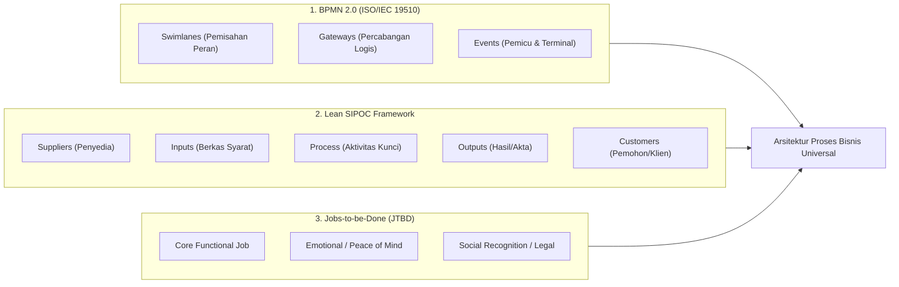
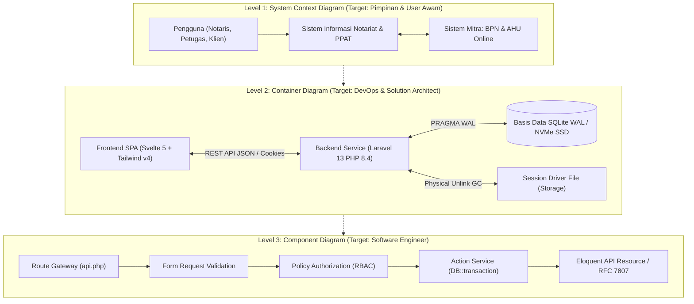

# Buku Putih Standar Arsitektur Dokumentasi Proyek Universal (project_documentation_standards.md)
> **Engine:** Hyperion Vault v6.36.0 SDD-Enterprise-Deterministic  
> **Standar Industri Internasional:** ISO/IEC/IEEE 29148:2018 (Requirements Engineering), IEEE Std 1016-2009 (Software Design Descriptions), BPMN 2.0 (ISO/IEC 19510), The C4 Model (Simon Brown), arc42 Architecture Framework, Diátaxis Documentation Framework (Daniele Procida), ISO 24495-1:2023 (Plain Language), US Federal Plain Writing Act, Edward Tufte (Information Design), Robert Bringhurst (Typography), Nielsen Norman Group (NN/g Senior Usability), AARP Human Factors Standards.  
> **Target Audience:** Solution Architects, Technical Writers, Lead Engineers, Domain Experts, Public Officers, AI Coding Agents.

---

## 1. EKSEKUTIF BLUEPRINT: EVOLUSI DOKUMENTASI & EMPATI UNIVERSAL

Dokumentasi proyek rekayasa perangkat lunak dan proses bisnis enterprise kerap mengalami kegagalan fatal di industri akibat **"The Curse of Knowledge"**—situasi psikologis di mana para perancang sistem menulis dokumen hanya untuk dipahami oleh sesama spesialis teknis. Akibatnya, dokumen dipenuhi oleh akronim kriptik, instruksi asumtif, dan diagram monolitik yang mengintimidasi masyarakat awam serta membingungkan pengguna lanjut usia (*baby boomer*).

Dokumentasi kelas dunia di lingkungan Hyperion Vault didefinisikan sebagai **antarmuka kognitif (*cognitive interface*)** yang menjembatani 4 dunia pembaca secara proporsional:
1. **Dunia Kebijakan & Bisnis (Eksekutif & Pimpinan):** Membutuhkan kejelasan tata kelola, mitigasi risiko hukum, dan alur nilai (*value stream*).
2. **Dunia Rekayasa Teknis (Engineer & DevOps):** Membutuhkan spesifikasi deterministik, kontrak API, skema basis data 3NF, dan bukti uji *zero-regression*.
3. **Dunia Operasional Harian (Operator & Staf):** Membutuhkan panduan tugas cepat, *checklist* verifikasi, dan prosedur pemulihan gangguan.
4. **Dunia Pengguna Layanan & Publik (Klien Awam & Generasi Senior/Baby Boomers):** Membutuhkan kepastian hak hukum, transparansi biaya, ketenangan batin (*peace of mind*), serta instruksi yang sangat mudah dipahami tanpa rasa takut salah menekan tombol.

---

## 2. PILAR 1: DOKUMENTASI PROSES BISNIS (BUSINESS PROCESS DOCUMENTATION)



### A. Standar Notasi BPMN 2.0 (ISO/IEC 19510)
Setiap pemodelan alur kerja bisnis wajib menggunakan notasi standar industri internasional:
1. **Swimlanes Eksplisit:** Memisahkan alur aksi pengguna ke dalam jalur horizontal berdasarkan peran legal (contoh: *Pemohon Layanan*, *Resepsionis/Petugas Berkas*, *Notaris/PPAT*, dan *Instansi Eksternal BPN/AHU Online*). Dilarang menyatukan aktor berbeda dalam satu jalur tanpa batas tanggung jawab.
2. **Gateways Percabangan Deterministik:**
   - *Exclusive Gateway ($\times$):* Hanya satu jalur keputusan yang dapat dilalui (contoh: *Lulus Cek Fisik? Ya / Tidak*).
   - *Parallel Gateway ($+$):* Seluruh jalur dieksekusi serentak (contoh: *Setor PPh Final sekaligus Setor BPHTB Pemda*).
3. **Kompensasi & Boundary Events:** Mendokumentasikan apa yang terjadi saat terjadi pembatalan transaksi, dokumen ditolak instansi, atau batas waktu kadaluarsa (*timer event*).

### B. Matriks Ringkasan SIPOC (Lean Enterprise)
Setiap bab proses bisnis wajib diawali oleh tabel ringkas 1-halaman format SIPOC:
- **Suppliers:** Pihak penyedia data awal (Klien, Bank pemberi kredit, BPN).
- **Inputs:** Dokumen fisik/digital yang diserahkan (KTP, KK, Sertipikat Asli, SPPT PBB).
- **Process:** 5–7 langkah utama pemrosesan tanpa detail kode.
- **Outputs:** Produk akhir sah yang diterbitkan (Minuta Akta, Salinan Akta, Validasi NTPN, Sertipikat Balik Nama).
- **Customers:** Penerima manfaat akhir (Klien Pembeli/Penjual, Ahli Waris, Perbankan).

### C. Artikulasi Jobs-to-be-Done (Anthony Ulwick & Clayton Christensen)
Dokumentasi dilarang hanya mendaftar fitur aplikasi, melainkan wajib mendeskripsikan *Job Execution*:
$$\text{Saat } [\text{Kondisi/Pemicu}], \text{ Pengguna Ingin } [\text{Tindakan Inti}], \text{ Agar Mereka Dapat } [\text{Hasil Emosional \& Legal}].$$
*Contoh Kenotariatan:* "Saat menerima warisan tanah keluarga, ahli waris ingin membagi hak waris secara sah di hadapan hukum, agar keluarga terhindar dari sengketa perdata di kemudian hari."

---

## 3. PILAR 2: DOKUMENTASI TEKNIS PENGERJAAN & SIKLUS REKAYASA (ENGINEERING EXECUTION)

### A. Spesifikasi Kebutuhan Berstandar IEEE Std 1016 (SDD) & ISO/IEC/IEEE 29148:2018
Spesifikasi rekayasa perangkat lunak wajib memenuhi 6 kriteria deterministik:
1. **Atomic:** Setiap butir kebutuhan hanya mendefinisikan tepat 1 perilaku sistem.
2. **Unambiguous:** Tidak menyisakan ruang interpretasi ganda bagi engineer manusia maupun agen AI.
3. **Verifiable / Testable:** Kebutuhan wajib memiliki kriteria kelulusan uji otomatis (PHPUnit / E2E).
4. **Complete:** Menangani kondisi normal (*happy path*), kondisi input salah (*validation error* 422), dan kondisi akses terlarang (*forbidden* 403).
5. **Traceable:** Memiliki kode identitas unik (misal: `[REQ-BERKAS-01]`) yang terlacak dari PRD $\to$ Migration $\to$ Test Case.
6. **Consistent:** Tidak bertentangan dengan kebutuhan lain dalam repositori.

### B. Architecture Decision Records (ADR — Michael Nygard Standard)
Setiap keputusan teknologi yang fundamental wajib dicatat dalam format ADR di [`doc/changes.md`](changes.md):
```markdown
# ADR-[Nomor]: [Judul Keputusan Singkat]
- **Status:** [Proposed | Accepted | Superseded | Deprecated]
- **Konteks:** [Kondisi lingkungan, beban masalah, keterbatasan server]
- **Keputusan:** [Solusi arsitektur yang dipilih secara definitif]
- **Konsekuensi:** [Dampak positif, efisiensi yang diraih, dan kompromi/trade-off]
```

### C. Manajemen Rilis SemVer 2.0.0
Seluruh versi perangkat lunak dikelola menggunakan format `MAJOR.MINOR.PATCH`:
- **MAJOR:** Perubahan skema database yang memecah kompatibilitas mundur (*breaking changes*).
- **MINOR:** Penambahan fitur baru yang 100% kompatibel dengan versi sebelumnya.
- **PATCH:** Perbaikan bug, audit keamanan, atau perapian kode (*zero regression*).

---

## 4. PILAR 3: DOKUMENTASI TEKNIS APLIKASI (APPLICATION ARCHITECTURE & MECHANICS)

### A. Visualisasi Arsitektur The C4 Model (Simon Brown)
Struktur sistem perangkat lunak didokumentasikan menggunakan 4 level visual berjenjang:



1. **Level 1 — Context Diagram:** Menjelaskan batas sistem (*system boundary*), siapa pengguna manusia, dan sistem luar apa yang diajak bicara.
2. **Level 2 — Container Diagram:** Menjelaskan aplikasi frontend, API backend, database persistensi, dan sistem penyimpanan file/sesi.
3. **Level 3 — Component Diagram:** Menjelaskan komponen internal MVC (Controller, Form Request, Policy, Service Action, Resource).
4. **Level 4 — Code Diagram:** Detail spesifikasi kelas atau skema relasi ERD 3NF.

### B. Template Arsitektur Enterprise arc42
Dokumentasi teknis utama (`doc/architecture.md`) mengadopsi 12 seksi arc42:
- §1 Sasaran Pengantar & Mutu | §2 Kendala Arsitektur | §3 Konteks & Lingkup | §4 Strategi Solusi | §5 Pandangan Blok Bangunan | §6 Pandangan Runtime | §7 Pandangan Deployment | §8 Konsep Lintas-Sektor | §9 Keputusan Arsitektur | §10 Skenario Kualitas | §11 Risiko & Utang Teknis | §12 Glosarium Teknis.

---

## 5. PILAR 4: DOKUMENTASI TEKNIS ALUR & KETAHANAN GANGGUAN (OPERATIONAL FLOWS)

### A. Finite State Machine (FSM) & Transisi Status Sah
Setiap alur transaksi wajib memetakan diagram status FSM lengkap dengan *Guard Clauses*:
- **Tabel Matriks Transisi:**
  | Status Asal ($S_A$) | Pemicu / Aksi Event | Peran Berwenang | Status Target ($S_B$) | Validasi & Syarat Tambahan |
  | :--- | :--- | :--- | :--- | :--- |
  | `draft` | `submit_review` | Pemohon / Staf | `in_review` | Seluruh dokumen wajib terunggah. |
  | `in_review` | `approve_legal` | Notaris / Pimpinan | `approved` | Verifikasi BPN & validasi PPh/BPHTB tuntas. |
  | `in_review` | `reject_notes` | Notaris / Pimpinan | `revision` | Catatan kekurangan berkas terisi. |

### B. Skenario Penanganan Gangguan & Pemulihan (Fail-Safe Recovery Flows)
Dokumentasi teknis wajib mencakup skenario mitigasi kegagalan sistem:
1. **Kegagalan Koneksi Jaringan:** Mekanisme penanganan error offline, idempotency key pada tombol mutasi keuangan untuk mencegah tagihan ganda saat re-try.
2. **Ketidaksesuaian Pembayaran Pajak:** Prosedur koreksi manual saat NTPN gagal tervalidasi secara asinkronus oleh sistem DJP.
3. **Pemulihan Bencana (*Disaster Recovery*):** Langkah restore berkas SQLite WAL dan rekonsiliasi berkas fisik warkah.

---

## 6. PILAR 5: SAINS TEKNIK PENULISAN & BAHASA AKSESIBEL (PLAIN LANGUAGE)

### A. Kerangka Kerja Dokumentasi Diátaxis (Daniele Procida)
Seluruh materi dokumentasi wajib dipisahkan secara disiplin ke dalam 4 kuadran:

```
┌────────────────────────────────────────────────────────────────────────┐
│ THE DIÁTAXIS DOCUMENTATION FRAMEWORK                                   │
├────────────────────────────────────────────────────────────────────────┤
│ 1. TUTORIALS (Berorientasi Belajar)                                    │
│    - Panduan onboarding langkah-demi-langkah bagi pemula dari nol.    │
│    - Menjamin keberhasilan instan dalam 10 menit pertama.              │
│                                                                        │
│ 2. HOW-TO GUIDES (Berorientasi Masalah / Problem-Solving)              │
│    - Resep terarah untuk menyelesaikan tugas spesifik dunia nyata.     │
│    - Contoh: "Cara Mencetak Salinan Akta Resmi Format A4".             │
│                                                                        │
│ 3. REFERENCE (Berorientasi Informasi Teknis / Kamus)                   │
│    - Uraian spesifikasi objektif, akurat, dan netral.                  │
│    - Berisi: Daftar rute API, parameter skema database, kode error.    │
│                                                                        │
│ 4. EXPLANATION (Berorientasi Pemahaman Konsep & Arsitektur)            │
│    - Menguraikan latar belakang, filosofi desain, dan 'mengapa'.       │
│    - Contoh: "Mengapa Hyperion Vault Memilih Session Berbasis File".   │
└────────────────────────────────────────────────────────────────────────┘
```

### B. Standar Plain Language (ISO 24495-1:2023 & Plain Writing Act)
1. **Gunakan Kalimat Aktif (*Active Voice*):**
   - ❌ *Pasif & Kriptik:* "Sertipikat tanah yang asli haruslah diserahkan oleh pemohon kepada petugas untuk dilakukan verifikasi yuridis."
   - ✅ *Aktif & Jelas:* "Anda perlu menyerahkan sertipikat asli kepada petugas kami. Petugas akan memeriksa keabsahan dokumen tersebut langsung ke Kantor BPN."
2. **Panjang Kalimat Terkendali (15–20 Kata):**
   - Pecah kalimat majemuk bertingkat yang panjang menjadi 2–3 kalimat lugas.
3. **Batas Indeks Keterbacaan Flesch-Kincaid (Target Grade 7–8):**
   - Teks panduan pengguna umum harus dapat dipahami seketika oleh pembaca lulusan sekolah menengah pertama tanpa kebingungan semantik.

---

## 7. PILAR 6: TATA LETAK, TIPOGRAFI, & EMPATI 4 PERSONA PEMBACA

### A. Matriks Adaptasi 4 Persona Pengguna

```
┌────────────────────────────────────────────────────────────────────────┐
│ MATRIKS ADAPTASI 4 PERSONA PEMBACA DOKUMEN                             │
├────────────────────────────────────────────────────────────────────────┤
│ 1. USER OPERASIONAL  │ Checklist tabular, alur cepat, warna status.    │
│ 2. USER AWAM         │ Bahasa menenangkan, transparansi biaya, FAQ.    │
│ 3. PROFESIONAL       │ Dasar hukum formal, diagram C4, schema 3NF.     │
│ 4. BABY BOOMERS      │ Kontras 7:1, teks besar, instruksi linier 1-2-3.│
└────────────────────────────────────────────────────────────────────────┘
```

#### 1. Persona User Operasional (Staf / Operator Kantor)
- **Tuntutan:** Kecepatan, akurasi tinggi, instruksi bebas basa-basi.
- **Penyajian:**
  - Gunakan *bulleted checklists* dengan kotak centang `[ ]`.
  - Tampilkan tabel pemetaan kode status dengan warna semantik (Hijau = Siap, Kuning = Butuh Dokumen, Merah = Batal).
  - Sertakan solusi cepat penanganan eror (*Troubleshooting Steps*).

#### 2. Persona User Awam (Masyarakat Umum / Klien)
- **Kondisi Psikologis:** Khawatir biaya tersembunyi, cemas dokumen hilang, tidak paham istilah birokrasi.
- **Penyajian:**
  - Nada bicara empati, transparan, dan menenangkan (*empathetic and reassuring tone*).
  - Terbuka 100% pada rincian biaya: pisahkan secara tegas mana biaya pajak negara (PPh, BPHTB, PNBP) dan mana jasa honorarium kantor.
  - Sediakan bab Tanya Jawab (FAQ) yang menggunakan pertanyaan bahasa manusia sehari-hari.
  - Sertakan Glosarium Istilah Hukum/Teknis yang dijelaskan menggunakan padanan sederhana.

#### 3. Persona Profesional (Notaris, PPAT, Auditor Hukum, Software Architect)
- **Tuntutan:** Keabsahan yuridis, integritas bukti, presisi matematis, kepatuhan undang-undang.
- **Penyajian:**
  - Cantumkan payung regulasi formal: UU Jabatan Notaris (UUJN), PP Pendaftaran Tanah, UU Hubungan Keuangan Pusat-Daerah (HKPD), Peraturan Menteri ATR/BPN.
  - Sajikan diagram teknis lengkap: C4 Model Container, ERD 3NF B-Tree Indexing, dan matriks hak akses RBAC.
  - Tampilkan bukti audit trail, status hash kriptografis warkah, dan hasil uji otomatis *zero-regression*.

#### 4. Persona Baby Boomers (Generasi Senior / Lansia / Non-Digital Native)
Pengguna generasi senior (usia 60+ tahun) memiliki karakteristik biologis dan psikologis khusus yang wajib dihormati dalam penulisan dokumen dan antarmuka (*Jakob Nielsen Senior Usability & AARP Guidelines*):

1. **Faktor Penglihatan & Tipografi (Presbiopia & Penurunan Kontras Optik):**
   - **Ukuran Teks Nyaman:** Dokumen cetak wajib menggunakan ukuran font body minimal **11pt–12pt** (judul **16pt–20pt** bold); pada panduan digital minimal **16px–18px**.
   - **Kontras Tinggi Tajam (WCAG AAA 7:1):** Gunakan teks hitam pekat (`#0f172a` / `#000000`) di atas latar putih bersih atau krem lembut. **DILARANG KERAS** menggunakan teks abu-abu tipis di atas latar putih.
   - **Dilarang Teks Miring Panjang (*No Long Italics*):** Huruf miring berparagraf panjang menyiksa retina mata lansia.
2. **Penghilangan Langkah Tersembunyi (*Zero Hidden Steps*):**
   - Lansia tidak memiliki intuisi terhadap gestur tersembunyi (seperti *swipe*, *hover*, atau ikon tiga garis "hamburger menu").
   - Seluruh langkah wajib disajikan secara **linier, eksplisit, bernomor urut**:
     ```
     Langkah 1: Buka kamera HP Anda, lalu arahkan ke gambar kotak barcode di atas.
     Langkah 2: Tekan tulisan tautan kuning yang muncul di layar HP Anda.
     Langkah 3: Masukkan nomor handphone Anda pada kotak putih yang tersedia.
     Langkah 4: Sentuh tombol hijau besar bertuliskan "Lihat Berkas Saya".
     ```
3. **Analogi Model Mental Dunia Nyata (*Real-World Analogies*):**
   - Jelaskan konsep digital menggunakan padanan fisik yang telah mereka kenal selama puluhan tahun:
     - *Escrow Account:* Jelaskan sebagai "Sistem Rekening Bersama (seperti menaruh uang di kasir perantara terpercaya) di mana uang pajak Anda hanya akan diteruskan ke kas negara saat berkas sudah dinyatakan sah oleh kantor pertanahan."
     - *Cloud Backup:* Jelaskan sebagai "Brankas cadangan digital anti-api dan anti-gempa."
4. **Peredam Kecemasan & Penegasan Keamanan (*Fear-of-Error Reduction*):**
   - Lansia sering merasa takut salah menekan tombol yang dapat merusak sistem atau menghilangkan uang mereka.
   - Sertakan kalimat penenang berulang di setiap panduan:
     > *"Jangan khawatir, berkas asli Anda tersimpan dengan aman di brankas fisik kantor kami. Anda tidak dapat merusak apa pun dengan membuka portal ini dari HP Anda."*
5. **Dukungan Bantuan Manusia Langsung (*Human Safety Net*):**
   - Selalu sertakan nomor telepon WhatsApp staf bantuan manusia asli dengan nama petugas dan jam pelayanan yang jelas, bukan sekadar chatbot robot.

---

## 8. INTEGRASI SISTEM & TATA KELOLA TRITUNGGAL REPOSITORI

| Komponen Tata Kelola | Repositori `hyperion-vault` (Upstream) | Repositori `irwan-baddu` (Legal Notariat) | Repositori `yayasan-pqtm` (Pendidikan Pesantren) |
| :--- | :--- | :--- | :--- |
| **Aturan Sistem (Rules)** | `[RULE-20-UNIVERSAL-DOCUMENTATION-ARCHITECTURE]` pada `GEMINI.md` & `AGENTS.md`. | Mengadopsi RULE-20 dengan penekanan pada hak hukum klien & kepatuhan UUJN. | Mengadopsi RULE-20 dengan penekanan pada transparansi SPP & raport santri. |
| **Buku Putih SSoT (`doc/`)** | `doc/project_documentation_standards.md` (Master Blueprint Netral). | `doc/panduan_user_awam_notaris_ppat.md` & `doc/panduan_lengkap_dan_ketentuan_notaris_ppat.md`. | `doc/DOKUMENTASI_PENGGUNA_AWAM_SIM_PQTM.md` & panduan kesantrian. |
| **Skill Playbooks** | `discovery-architect` & `prompt-architect`. | Matriks keputusan komponen ramah lansia (`ui_ux_component_decision_matrix.md`). | Matriks keputusan komponen ramah wali santri & dewan guru. |
| **Index Token (`llms.txt`)** | Pointer ringkas tabel routing dokumen. | Pointer ringkas tabel routing dokumen. | Pointer ringkas tabel routing dokumen. |

---

*Hyperion Vault Documentation Architecture Specification v6.36.0 — International Standards, Universal Usability, Multi-Persona Empathy.*
