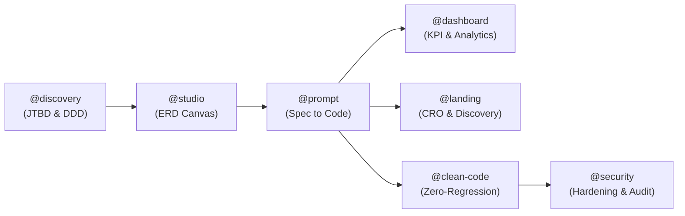
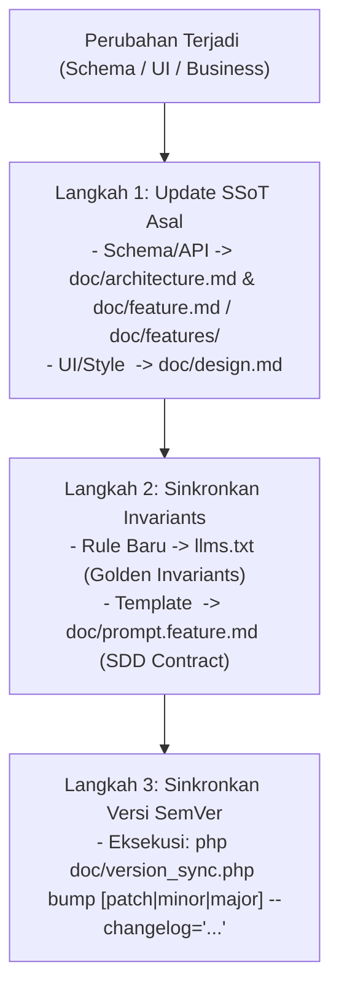
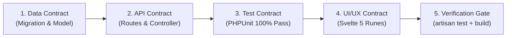
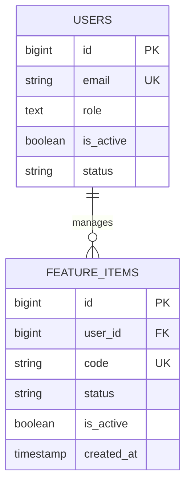
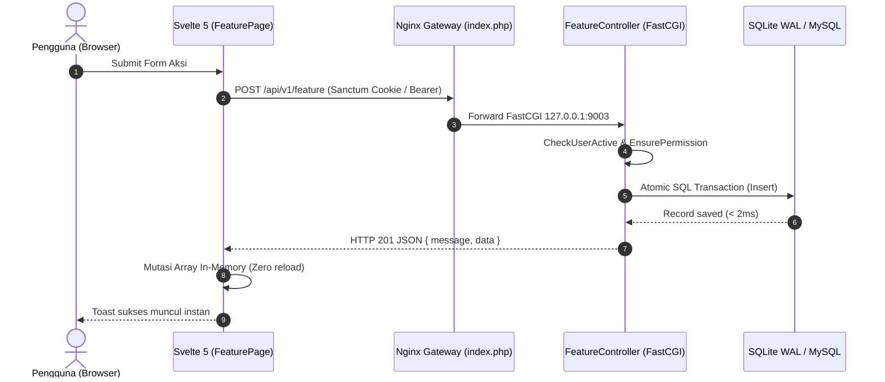
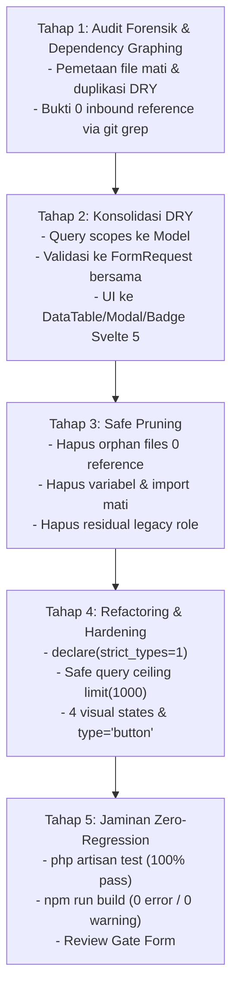

# Specification-Driven Development (SDD) Master Orchestrator (prompt.feature.md)
> **Standard:** Enterprise Autonomous Spec-to-Code Compiler v7.2.0 (Valora Vault v6.31.0)  
> **Target Execution:** 100% Deterministic Code Generation (Migrations, Eloquent Models, RBAC, REST API, PHPUnit Tests, Svelte 5 Runes SPA) tanpa celah asumsi (*Zero Hallucination Guarantee*).

---

## 0. PETA KESINAMBUNGAN DOKUMEN & URUTAN BACA
| Urutan | Berkas | Peruntukan & Tanggung Jawab Utama |
|---|---|---|
| **#1** | [`../llms.txt`](../llms.txt) | **Router Tugas AI & Token Saver:** Index cepat, 20 Golden Invariants, SOP safe update. |
| **#2** | [`../README.md`](../README.md) | **Pintu Masuk Human Developer:** Ikhtisar arsitektur, quickstart 1-klik, fitur unggulan. |
| **#3** | [`architecture.md`](architecture.md) | **Master Technical Blueprint:** SOP detail backend, auth, database, routing, FastCGI, pengujian. |
| **#4** | [`design.md`](design.md) | **Standar UI/UX & Desain:** SSoT visual (Daylight & Dark Obsidian), token warna, grid 8pt, WCAG AAA. |
| **#5** | [`prompt.feature.md`](prompt.feature.md) | **BERKAS INI:** Mesin orchestrator intake spesifikasi fitur (Track A), landing page & gaya (Track B), dan refactoring bergaransi zero-regression (Track C). |
| **#6** | [`feature.md`](feature.md) | **Master Feature Index:** Ringkasan seluruh domain fitur + folder modular [`features/*.md`](features/). |
| **#7** | [`local.inisiasi.md`](local.inisiasi.md) | **Runbook Deterministik Lokal:** Panduan instalasi langkah demi langkah dari nol di Laragon. |
| **#8** | [`changes.md`](changes.md) | **Immutable Audit Trail:** Log audit historis, evaluasi teknis, dan catatan evolusi rilis. |
| **#9** | [`version_sync.php`](version_sync.php) | **Automated SemVer Synchronizer:** Otomasi bumping versi semantik dan update dokumentasi lockstep. |
| **#10** | [`data_analysis_standard.md`](data_analysis_standard.md) | **Standar Analitika & BI:** SSoT CRISP-DM, DAMA-DMBOK, Kimball Rollup, kognisi Few/Tufte, dan Hubbard. |
| **#11** | [`software_design_standards.md`](software_design_standards.md) | **Standar Rekayasa 3-Pilar:** SSoT DDD/FSM, Normalisasi 3NF, B-Tree Indexing, dan Heuristik Usabilitas NN/g. |
| **#12** | [`security_standards.md`](security_standards.md) | **Standar Keamanan & Hardening:** SSoT RFC (7807/8725/6265bis/8446/9116), OWASP ASVS L2, NIST, CIS v8. |
| **#13** | [`landing_page_standards.md`](landing_page_standards.md) | **Standar Rekayasa Landing Page:** SSoT Kuartet Penemuan (SEO, AEO, GEO, AIO/llms.txt), StoryBrand SB7, MECLABS, Motion Tiering. |

---

## 0B. DOKUMENTASI SSOT & PROTOKOL KASKADE SINKRONISASI (ANTI-HALUSINASI)

Untuk menjaga kesinambungan dokumentasi dan mencegah halusinasi AI saat terjadi penambahan atau perubahan fitur:

### 1. Matriks Tanggung Jawab Dokumen (Single Responsibility)
- `../llms.txt`: Kernel AI, Fast Task Router 5+2 Engine, dan Golden Invariants (Bukan tempat deskripsi kode mentah).
- `architecture.md`: Master Foundation teknis (Infra, DB budget, Little's Law, Sanctum).
- `design.md`: SSoT Desain Visual (HEX tokens, button contrast WCAG AAA, Dual-Theme). DILARANG menulis query SQL/API di sini.
- `feature.md`: SSoT Fungsional Sistem (PRD, persona matrix, global AC, API map).
- `features/*.md`: Modular deep-dive per fitur starter kit (01 Auth & Session, 02 User & RBAC, 03 Telemetry).
- `prompt.feature.md`: Intake Spec Compiler (Template kontrak SDD: User Story, MVP, AC, API Contract, ERD, Test).
- `../README.md`: Pintu masuk developer manusia (Quickstart 1-klik, overview).
- `changes.md`: Immutable Audit Trail (Arsip log historis; BUKAN SSoT fitur aktif).
- `version_sync.php`: Mesin otomasi sinkronisasi versi SemVer 2.0.0 ke seluruh berkas dokumentasi.
- `data_analysis_standard.md`: SSoT Analitika, Dashboard, dan Reporting Multi-Temporal.
- `software_design_standards.md`: SSoT Rekayasa Kebutuhan, DDD, 3NF, dan Heuristik Usabilitas NN/g.
- `security_standards.md`: SSoT Keamanan, Hardening OWASP ASVS L2, dan RFC 7807.
- `landing_page_standards.md`: SSoT Halaman Pendaratan, Konversi StoryBrand SB7, AEO, GEO, dan Motion Design.

### 2. Peta Interoperabilitas 5+2 Engine (Lifecycle Chaining Pipeline)
Alur kolaborasi lintas-skill dari konsep awal hingga verifikasi produksi:



### 3. Protokol Kaskade Sinkronisasi Saat Terjadi Penyesuaian (3-Step Cascade Rule)


### 3. Golden Rules Penulisan Dokumen
1. **Tabel & YAML > Paragraf Prosa:** Gunakan format skema preskriptif, tolak deskripsi aspiratif.
2. **Negative Constraints Eksplisit:** Tulis larangan keras secara nyata (misal: `SESSION_DRIVER=database` is FORBIDDEN).
3. **Link, Don't Duplicate:** Tautkan referensi spesifikasi ke file aslinya, jangan menduplikasi baris kolom di berkas lain.

### 4. Aturan Tata Kelola Semantic Versioning 2.0.0 (SemVer Governance)
Valora Vault mematuhi secara ketat standar **SemVer 2.0.0 (`MAJOR.MINOR.PATCH`)**:
1. **MAJOR (X.0.0):** Perubahan arsitektur/database yang *breaking* (*backward-incompatible*).
2. **MINOR (x.Y.0):** Penambahan fitur baru yang *backward-compatible* (misal: modul CRUD baru, endpoint baru, role baru). Reset `PATCH` ke 0.
3. **PATCH (x.y.Z):** Perbaikan bug (*bugfix*), kontras UI/UX, atau refaktorisasi internal tanpa mengubah kontrak API.
4. **Aturan Sinkronisasi Lockstep Otomatis:**
   Gunakan alat otomasi [`doc/version_sync.php`](version_sync.php) atau Artisan command `php artisan version:sync`:
   - `backend/composer.json` (`"version": "X.Y.Z"`)
   - `frontend/package.json` (`"version": "X.Y.Z"`)
   - `install.php` (`define('APP_VERSION', 'X.Y.Z');`)
   - `backend/routes/api.php` (`$codebaseVersion = 'X.Y.Z';`)
   - `llms.txt` (`version: "X.Y.Z"`)
   - `README.md`
   - `doc/architecture.md`, `doc/design.md`, `doc/prompt.feature.md`, `doc/feature.md`
   - `doc/changes.md` (Pencatatan changelog otomatis ber-timestamp)

---

## 1. PROTOKOL KOMPILASI SPESIFIKASI KE KODE (5-STAGE PIPELINE)

Setiap blok fitur dirancang sebagai **Machine-Readable Contract**. Ketika Agen AI / Full Stack Engineer mengeksekusi instruksi dari dokumen ini, ikuti pipeline deterministik 5-langkah berikut:



1. **Step 1 - Data Layer:** Bangun migration table dengan B-Tree composite indices, buat Model Eloquent lengkap dengan `$fillable`, `$casts`, helper methods, dan relasi.
2. **Step 2 - API Layer:** Daftarkan route di `routes/api.php` dengan middleware `auth:sanctum`, `user.active`, dan `permission`, buat Controller dengan in-memory guard limit (1000) dan penanganan transaksi atomik.
3. **Step 3 - Test Barrier (TDD Gate):** Tulis Feature Test di `tests/Feature/`. Wajib menguji Happy Path (200/201), Validation Error (422), dan RBAC Unauthorized (403). Jalankan `php artisan test` hingga hijau 100%.
4. **Step 4 - UI Assembly:** Buat rute dan komponen Svelte 5 dengan Runes (`$state`, `$derived`, `$props`), terapkan tombol dengan `type="button"`, visual loading state, modal lifecycle eksplisit, dan filtrasi di memori browser.
5. **Step 5 - Build & Deploy Gate:** Verifikasi kompilasi statis SPA via `npm run build` dengan 0 peringatan a11y dan verifikasi 0 query leak ke database shared hosting ($L \le 0.16$).

---

## 2. HARD ARCHITECTURAL INVARIANTS (ATURAN MUTLAK SISTEM)

```yaml
infrastructure_invariants:
  hosting: "Hostinger Premium (Single Shared MySQL, Max 25 Concurrent Connections: L <= 25)"
  connection_budget: "Max simultaneous DB connection <= 25. Actual target L <= 0.16."
  session_storage: "SESSION_DRIVER=file (NVMe SSD). DILARANG 'database' (0 connection usage)."
  session_gc: "Physical @unlink on logout & revocation, terminating hook on CheckUserActive, hourly session:prune-files."
  cache_storage: "CACHE_STORE=file (NVMe SSD). In-flight request collapsing on frontend client.js."
  queue_driver: "QUEUE_CONNECTION=sync (Zero background supervisor daemon dependency)."
  frontend_runtime: "Pure ES2024 JS + Svelte 5 Runes ($state, $derived, $props). DILARANG TypeScript di frontend."
  build_target: "@sveltejs/adapter-static SPA (Universal index.php gateway, zero Node.js daemon)."
  semver_lockstep: "Setiap rilis WAJIB sinkron serentak di 6 berkas (composer, package, install.php, api.php, llms.txt, changes.md)."
  theme_engine: "Universal Dual-Theme (Daylight Mode & Dark Obsidian Mode) via Tailwind v4 @custom-variant dark."

system_invariants:
  zero_silent_failure: "Setiap tombol WAJIB memiliki atribut eksplisit type='button' / type='submit' dan loading indicator."
  memory_protection: "Query database WAJIB dibatasi limit(1000) dan eager loading with([...]) untuk mencegah N+1."
  filtering_in_memory: "Pencarian dan pemfilteran tabel WAJIB di browser pengguna via Svelte 5 $derived.by() (0 query DB)."
  modal_lifecycle: "Komponen Modal.svelte WAJIB default show=true (untuk rendering instan di dalam blok {#if showModal}) dengan pinned sticky headerTabs."
  rbac_pivot_ban: "RBAC dikonfigurasi dinamis di config/permissions.php; roles tersimpan sebagai array JSON pada tabel users."
  zero_alias_policy: "DILARANG KERAS membuat nama alias, mapping alias (aliases, alias_map), wrapper alias, shorthand re-export, atau sinonim buatan untuk peran, izin, rute, method, tabel, kolom basis data, variabel state, maupun komponen antarmuka. Seluruh penamaan wajib kanonikal eksplisit (SSoT)."
  zero_unauthorized_consolidation: "DILARANG KERAS mengonsolidasi sepihak berkas terpisah, komponen terpisah, controller, skrip, atau peran pengguna menjadi modul monolitik tanpa instruksi tertulis pengguna. Bounded Context dan Single Responsibility Principle (SRP) harus selalu dipertahankan."
  zero_regression_execution: "Setiap eksekusi prompt WAJIB menjamin 100% bebas dari regresi dan TIDAK menimbulkan masalah atau bug baru pada fitur yang telah ada. Wajib memvalidasi kelulusan 100% pengujian otomatis (php artisan test tests/Feature dan npm run build) sebelum turn berakhir."
  card_table_and_page_size: "Seluruh tabel data WAJIB mendukung transformasi mobile card stack (< 768px) dan kontrol interaktif pilihan jumlah entri per halaman (perPage: 10, 25, 50, 100 entri)."
  spacious_breathing_room: "Seluruh antarmuka pengguna DILARANG berdesakan atau terlihat penuh sesak. Gunakan padding, margin seimbang, kontainer max-w-7xl/6xl mx-auto, dan floating thumb dock di mobile agar konten bernapas lega baik di HP maupun laptop."
  tab_pane_visibility_wrap: "Panel tab navigasi moderat (<= 6 tab) DILARANG menyembunyikan tab di balik scroll horizontal (overflow-x-auto). Seluruh tab wajib langsung tampak utuh melalui pembungkusan responsif flex-wrap gap-1.5 baik di HP maupun laptop."
  elegant_minimalism_and_accessibility: "Desain wajib mematuhi standar minimalis elegan Dieter Rams ('Less, but better'), rasio data-ke-tinta Edward Tufte (0 visual noise), panjang baris ideal Bringhurst (45-75 CPL), font-mono untuk data teknis/tabular, kontainer terkontrol max-w-6xl/7xl, dan aksesibilitas universal WCAG 2.2 AAA (kontras >= 4.5:1, touch target >= 44px, keyboard focus visible ring)."
```

---

## 3. TEMPLATE RAW BUSINESS INPUT: FITUR FUNGSIONAL (TRACK A)

Gunakan template di bawah ini saat menerima permintaan fitur fungsional baru dari klien:

```markdown
### RAW BUSINESS INPUT REQUEST (TRACK A)
1. **Nama Fitur / Kebutuhan:**
   [Contoh: Modul Audit Log Aktivitas Pengguna & Ekspor CSV]

2. **Sebagai Siapa Anda Meminta Fitur Ini? (User Persona & Role):**
   [Contoh: Super Admin (`admin`) dan Auditor Keamanan (`manager`)]

3. **Apa Masalah Utama / Tujuan Bisnis yang Ingin Dicapai?**
   [Contoh: Saya butuh transparansi riwayat perubahan akun dan revokasi sesi untuk keperluan audit kepatuhan ISO 27001]

4. **Kapan & Di Mana Fitur Ini Digunakan? (Trigger & Lokasi Halaman):**
   [Contoh: Di panel admin bawah menu 'Audit Trail' `/admin/audit-logs`, terdapat tombol 'Ekspor CSV' di samping search bar]

5. **Data Apa Saja yang Dimasukkan atau Dipilih Pengguna? (Inputs):**
   [Contoh: Filter rentang tanggal awal/akhir, dropdown aksi (CREATE, UPDATE, DELETE, REVOKE), dan pencarian nama staf]

6. **Apa yang Ingin Dilihat di Layar Setelah Berhasil atau Gagal? (Expected Outcome):**
   [Contoh: Jika sukses, file CSV terunduh otomatis dan muncul toast hijau. Jika rentang tanggal kosong, muncul pesan validasi merah]

7. **Aturan Khusus / Batasan Bisnis yang Diketahui (Business Rules):**
   [Contoh: Hanya role 'admin' yang dapat mengekspor data. Pengguna 'user' biasa dilarang mengakses halaman ini (HTTP 403)]
```

---

## 4. TEMPLATE RESMI BERKAS FITUR BARU: `doc/features/XX_feature_name.md`

Ketika membuat berkas spesifikasi fitur baru di dalam folder `doc/features/`, **WAJIB** mengikuti struktur standar 8-bagian terstruktur berikut:

```markdown
# [KODE-FITUR]: [Nama Fitur Resmi] (v6.31.0)
> **Modul:** [Nama Modul]  
> **Aktor Utama:** [Admin / Manager / User]  
> **Status:** [Draft / Review / Implemented]

---

## 1. USER STORY
- **Sebagai** [Peran Pengguna / Persona],  
  **Saya ingin** [Tindakan / Aksi yang dilakukan di sistem],  
  **Sehingga** [Nilai Bisnis, Efisiensi, atau Keuntungan yang diperoleh].

---

## 2. MVP SCOPE & BOUNDARIES
- **In-Scope (Termasuk dalam Versi Ini):**
  - [Fitur A: Deskripsi fungsionalitas inti]
  - [Fitur B: Validasi dan guard]
  - [Fitur C: Respons UI dan notifikasi toast]
- **Out-of-Scope (Dilarang / Ditunda ke Versi Berikutnya):**
  - [DILARANG melakukan query tanpa limit(1000)]
  - [DILARANG memicu query database per ketikan di kotak pencarian]

---

## 3. ACCEPTANCE CRITERIA (BDD GIVEN-WHEN-THEN)

### AC-1: [Skenario Utama / Happy Path]
- **Given:** [Kondisi awal prasyarat sistem dan pengguna].
- **When:** [Tindakan atau request yang dikirimkan pengguna].
- **Then:** [Hasil yang diharapkan, status respons HTTP 200/201, mutasi database, dan pembaruan UI].

### AC-2: [Skenario Validasi Gagal / Edge Case]
- **Given:** [Kondisi input tidak lengkap atau tidak valid].
- **When:** [Pengguna menekan submit formulir].
- **Then:** [Sistem merespons HTTP 422 Unprocessable Entity, menampilkan pesan error merah di bawah input terkait].

### AC-3: [Skenario Otorisasi / Hak Akses]
- **Given:** [Pengguna dengan peran yang tidak berwenang mencoba mengakses endpoint atau halaman].
- **When:** [Request HTTP dikirimkan].
- **Then:** [Middleware EnsurePermission / Policy menolak dengan HTTP 403 Forbidden].

### 3.1. SECURITY & RBAC ACCEPTANCE CRITERIA (MANDATORI OWASP)
- **Kriteria Otorisasi (BOLA Defense):** Endpoint mutasi dan akses data spesifik WAJIB dilindungi oleh Laravel Policy (`[NamaPolicy]::class`). Pengguna hanya diizinkan membaca/memutasi data yang menjadi hak otorisasi sahnya.
- **Kriteria Validasi Input:** Seluruh data masukan wajib divalidasi via Form Request (`[NamaFormRequest]::class`) dengan aturan tipe data ketat, sanitasi string, regex eksplisit, dan larangan mass-assignment.
- **Uji Coba Keamanan (PHPUnit Gate):** Wajib menyertakan tes PHPUnit otomatis untuk:
  - Respons `403 Forbidden` jika otorisasi gagal.
  - Respons `422 Unprocessable Entity` jika validasi masukan tidak lengkap atau cacat.

---

## 4. DATABASE SCHEMA & ERD

### Migrasi Laravel (`database/migrations/YYYY_MM_DD_HHMMSS_create_feature_table.php`):
```php
Schema::create('table_name', function (Blueprint $table) {
    $table->id();
    $table->foreignId('user_id')->constrained()->cascadeOnDelete();
    $table->string('code', 50)->unique();
    $table->string('title', 150);
    $table->string('status', 30)->default('active'); // State machine bisnis
    $table->boolean('is_active')->default(true);     // Access gate switch
    $table->timestamps();

    // B-Tree Composite Indexing untuk pencarian cepat
    $table->index(['user_id', 'status']);
    $table->index('code');
});
```

### Entity Relationship Diagram:


---

## 5. RESTFUL API CONTRACT

### Endpoint List:
| Method | Endpoint URI | Middleware | Deskripsi |
|---|---|---|---|
| `GET` | `/api/v1/feature` | `auth:sanctum, user.active, permission:feature.view` | Ambil daftar data (limit 1000) |
| `POST` | `/api/v1/feature` | `auth:sanctum, user.active, permission:feature.create` | Buat data baru |
| `PUT` | `/api/v1/feature/{id}` | `auth:sanctum, user.active, permission:feature.edit` | Perbarui data |
| `DELETE` | `/api/v1/feature/{id}` | `auth:sanctum, user.active, permission:feature.delete` | Hapus data |

### Payload Schema: `POST /api/v1/feature`
- **Request Body (JSON):**
  ```json
  {
    "title": "Judul Item",
    "status": "active",
    "is_active": true
  }
  ```
- **Response Success (HTTP 201 Created):**
  ```json
  {
    "message": "Data berhasil disimpan.",
    "data": {
      "id": 1,
      "code": "ITEM-001",
      "title": "Judul Item",
      "status": "active"
    }
  }
  ```

---

## 6. SEQUENCE ARCHITECTURE FLOW



---

## 7. FRONTEND UI/UX BLUEPRINT (SVELTE 5 RUNES)
- **Komponen & Rute:** `frontend/src/routes/admin/feature/+page.svelte`
- **State Management (Runes):**
  - `let items = $state([]);`
  - `let loading = $state(false);`
  - `let showModal = $state(false);`
  - `let searchQuery = $state('');`
  - `let filteredItems = $derived.by(() => { ... });`
- **Design Tokens & A11y:**
  - Seluruh tombol menggunakan `type="button"` / `type="submit"` dengan cursor pointer.
  - Memanfaatkan `DataTable.svelte`, `Modal.svelte`, `Badge.svelte`, dan `toastState`.
  - Mendukung tema universal Daylight (`bg-white text-slate-800`) dan Dark Obsidian (`dark:bg-slate-900 dark:text-white`).

---

## 8. TEST CONTRACT (PHPUNIT 100% PASS)
- **File Uji:** `backend/tests/Feature/FeatureNameTest.php`
- **Kasus Uji Minimal:**
  1. `test_user_with_permission_can_view_items` (HTTP 200).
  2. `test_user_without_permission_is_forbidden` (HTTP 403).
  3. `test_validation_errors_when_required_fields_missing` (HTTP 422).
  4. `test_successful_creation_and_atomic_storage` (HTTP 201).
```

---

## 5. TEMPLATE KUSTOMISASI LANDING PAGE & GAYA (TRACK B)

Gunakan template di bawah ini saat klien meminta penyesuaian estetika, teks landing page, atau tema warna *white-label*:

```markdown
### WHITE-LABEL BRANDING & STYLE REQUEST (TRACK B)
1. **Nama Entitas Bisnis / Klien:** [Contoh: FinTech Vault International]
2. **Preset Tema Pilihan:**
   - [ ] Preset 1: Neo-Enterprise Dark Glassmorphism (Default Obsidian `#090d16`)
   - [ ] Preset 2: Clean Corporate Fintech Light (`bg-slate-50`, border `slate-200`)
   - [ ] Preset 3: Minimalist Swiss High-Contrast
   - [ ] Preset 4: Cyberpunk DevTool
   - [ ] Preset 5: Executive Midnight Navy
3. **Warna Brand Primer (HEX):** [Contoh: `#2563eb` (Royal Blue)]
4. **Warna Brand Aksen (HEX):** [Contoh: `#10b981` (Emerald Green)]
5. **Hero Headline (Tagline Utama):** [Contoh: Sistem Kasir Terpadu Multi-Outlet]
6. **Maskot AI:** [Gunakan Maskot Volt / Ganti Gambar Mockup Produk]
```

---

## 6. TEMPLATE REFACTORING & AUDIT FORENSIK KODE (TRACK C)

Gunakan template di bawah ini saat tim arsitek atau pengguna meminta pembersihan kode mati (*dead code elimination*), konsolidasi duplikasi (*DRY consolidation*), penegakan standar keamanan/aksesibilitas, dan refaktorisasi menyeluruh dengan **Jaminan Mutlak Zero-Regression**:

```markdown
### ZERO-REGRESSION REFACTORING & CODE AUDIT REQUEST (TRACK C)

1. **Lingkup Refaktorisasi:** [Backend Laravel / Frontend Svelte 5 / Full-Stack / Modul Spesifik]
2. **Target Evaluasi:**
   - [x] Eliminasi Berkas & Kode Mati (Dead Code & Orphan Files)
   - [x] Konsolidasi Duplikasi (DRY: Query Scopes, Form Requests, Reusable Components)
   - [x] Penegakan Strict Typing (PHP 8.3+ `declare(strict_types=1);` & Safe Query Ceilings)
   - [x] Standarisasi Aksesibilitas WCAG 2.2 AAA (`type="button"` & 4 Visual States)
   - [x] Verifikasi Zero-Regression (100% PHPUnit Pass & Static SPA Build Pass)
3. **Metode Eksekusi Cepat:**
   - **Via Blueprint Studio Web UI:** Buka `/admin/studio` ➔ Tahap 5 ➔ Pilih tab `🧹 Prompt Refactor` ➔ Klik `Salin Prompt Refactor`.
   - **Via PowerShell CLI:**
     ```powershell
     powershell -File ".agents/skills/prompt-architect/scripts/compile-prompt.ps1" -Mode refactor -WorkspaceName "Valora Vault Enterprise"
     ```
4. **SSoT Dokumen Lengkap:** [`doc/prompts/international_audit_and_refactor_prompt.md`](prompts/international_audit_and_refactor_prompt.md)
```

---

## 7. PROTOKOL EKSEKUSI 5 TAHAP DETERMINISTIK REFACTORING (TRACK C)

Setiap agen koding atau tim engineer yang menjalankan Track C WAJIB mematuhi 5 tahap sekuensial berikut:



