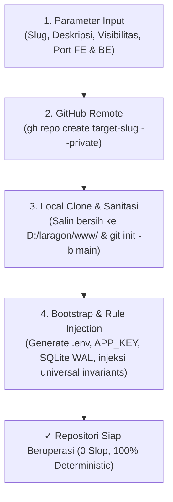

# SOP Universal Repository Provisioning Wizard
> **Standard:** Specification-Driven Development (SDD) & Enterprise Governance v8.0.0  
> **Target Scope:** Seluruh Pembuatan Repositori Baru Turunan Hyperion Vault

---

## 1. TUJUAN & RUANG LINGKUP

Dokumen Standard Operating Procedure (SOP) ini mengatur tata cara pembuatan repositori baru secara deterministik, bersih, terisolasi, dan langsung mewarisi seluruh standar arsitektur internasional, perlindungan OWASP Top 10, dan kebijakan Anti-Slop Hyperion Vault tanpa konfigurasi manual yang rawan kesalahan (*human error*).

---

## 2. PRASYARAT SISTEM

Sebelum menjalankan provisioning wizard, pastikan lingkungan host lokal memenuhi kriteria:
1. **PHP CLI:** PHP 8.3 atau 8.4 dengan ekstensi `pdo_sqlite`, `sqlite3`, `curl`, `mbstring`, `fileinfo`.
2. **Laragon Directory:** Berada di `D:\laragon\www\`.
3. **GitHub CLI (Opsional namun Disarankan):** `gh --version` dan `gh auth status` sudah terotentikasi ke akun GitHub developer/organisasi.
4. **Node.js & npm:** Node.js v18+ atau v20+ dengan npm aktif.

---

## 3. ALUR KERJA 4 TAHAP PROVISIONING WIZARD



### Tahap 1: Validasi Parameter Proyek
- **Nama Proyek (Slug):** Format `kebab-case` atau `snake_case` (hanya huruf, angka, minus, garis bawah).
- **Visibilitas:** `private` (default untuk ERP/enterprise) atau `public`.
- **Alokasi Port Jaringan Terisolasi:**
  - **Port Frontend (Vite):** Disetel `5174` (atau port unik lain) agar tidak bertabrakan dengan Hyperion Vault (`5173`).
  - **Port Backend (FastCGI):** Disetel `9005` (atau port unik lain) agar tidak bertabrakan dengan Hyperion Vault (`9003` & `9004`).

### Tahap 2: GitHub Remote Provisioning
- Wizard secara otomatis mendeteksi kredensial `gh auth status`.
- Jika terautentikasi, repositori remote langsung dibuat via `gh repo create <slug> --<visibility> --description="..."`.
- Jika `gh` tidak terpasang atau belum login, wizard memberikan peringatan informatif dan melanjutkan pembuatan repositori lokal tanpa menghentikan alur kerja.

### Tahap 3: Local Template Cloning & Sanitasi Git
- Fondasi bersih Hyperion Vault disalin ke `D:\laragon\www\<slug>`.
- Berkas yang **DIKECUALIKAN SECARA KETAT** dari penyalinan:
  - Direktori `.git/` lama.
  - Dependensi berat: `backend/vendor/`, `frontend/node_modules/`, `frontend/.svelte-kit/`, `frontend/build/`.
  - Berkas log dan cache sesi: `backend/storage/logs/*.log`, `storage/framework/sessions/*`.
  - Kunci instalasi: `.installed`.
- Sanitasi Git: Inisialisasi git baru via `git init -b main` dan penyambungan remote origin ke repositori GitHub baru.

### Tahap 4: Automated Bootstrapping & Rule Injection
- **Penyusunan `.env` Baru:**
  - `APP_NAME="<slug>"`
  - `APP_URL="http://<slug>.test"`
  - `SESSION_DRIVER=file` (MUTLAK NVMe disk isolation)
  - `DB_CONNECTION=sqlite`
  - `DB_DATABASE=database/database.sqlite`
- **Generasi APP_KEY:** Mengeksekusi `php artisan key:generate --force`.
- **Basis Data Terisolasi:** Pembuatan file database SQLite lokal `backend/database/database.sqlite`.
- **Injeksi Aturan Universal:**
  - `.agents/rules/universal_invariants.md`
  - `GEMINI.md`
  - `AGENTS.md`
  - `llms.txt` (5 Golden Invariants [INV-SEC-01] s.d. [INV-SEC-05])
- **Migrasi Awal:** Eksekusi `php artisan migrate --force`.

---

## 4. PANDUAN EKSEKUSI CLI & ANTARMUKA WEB

### Jalur A: Eksekusi Perintah CLI 1-Baris
```powershell
cd D:\laragon\www\hyperion-vault

# Jalankan provisioning dengan parameter lengkap:
php scripts/provision_repo.php --name=proyek-klien --desc="Sistem ERP Proyek Klien" --visibility=private --fe-port=5174 --be-port=9005
```

### Jalur B: Antarmuka Web Studio (Valora Vault)
1. Buka peramban ke `http://valora-vault.test/admin/studio` (Modul Studio Valora Vault).
2. Klik Tab **"🚀 Repo Wizard"**.
3. Isi parameter Nama Proyek, Deskripsi, Visibilitas, dan Alokasi Port.
4. Salin perintah CLI 1-baris yang digenerate otomatis atau jalankan langsung.

---

## 5. LANGKAH PASCA-PROVISIONING

Setelah wizard selesai:
1. Pindah ke folder proyek: `cd D:\laragon\www\<slug>`
2. Jalankan FastCGI Worker persisten di background:
   ```powershell
   $env:PHP_FCGI_MAX_REQUESTS = "0"
   Start-Process -FilePath "D:\laragon\bin\php\8.3\php-cgi.exe" -ArgumentList "-b 127.0.0.1:9005" -WindowStyle Hidden
   ```
3. Jalankan Vite dev server:
   ```powershell
   cd frontend
   npm run dev -- --port 5174
   ```
4. Lakukan Initial Commit:
   ```powershell
   git add .
   git commit -m "feat: initial repository provisioned from hyperion-vault v8.0.0"
   git push -u origin main
   ```
