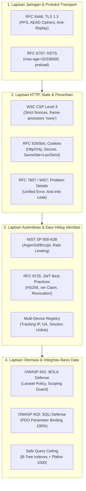

# Standar Rekayasa Keamanan Web & Hardening (doc/security_standards.md)
> **Engine:** Hyperion Vault v6.31.0 / v8.0.0 SDD-Enterprise-Deterministic  
> **Standar Rujukan Internasional:** IETF RFC (7807, 9457, 8725, 6265bis, 8446, 9116), OWASP Top 10 (2021/2025), OWASP ASVS v4.0.3 (Level 2 Enterprise), OWASP API Security Top 10 (2023), NIST SP 800-63B, CIS Critical Security Controls v8, ISO/IEC 27001:2022 Annex A.8, SOC 2 Type II.

Dokumen ini merupakan **Single Source of Truth (SSoT)** pertahanan keamanan siber tingkat internasional untuk seluruh aplikasi yang dibangun di atas kerangka arsitektur Hyperion Vault.

---

## 1. PRINSIP FILOSOFIS: DEFENSE-IN-DEPTH & ZERO-TRUST ARCHITECTURE

Keamanan sistem Hyperion Vault dibangun atas paradigma **Zero-Trust** (*Never Trust, Always Verify*):
1. **Asumsi Pelanggaran (*Assume Breach*):**
   Setiap request jaringan, meskipun berasal dari alamat IP internal atau antarmuka lokal, diperlakukan sebagai potensi ancaman hingga berhasil diverifikasi melalui signature kriptografi, token valid, dan otorisasi wewenang peran (*RBAC policy*).
2. **Pertahanan Berlapis (*Defense-in-Depth*):**
   Kegagalan satu lapisan pertahanan (misal: kebocoran token) wajib diredam oleh lapisan pertahanan berikutnya (misal: verifikasi atribut `token_version` dan pembatalan instan multi-device registry).
3. **Kerahasiaan Tertutup (*Least Privilege & Need-to-Know*):**
   Setiap aktor sistem hanya diberikan izin akses paling minim yang esensial untuk menyelesaikan tugas spesifiknya melalui matriks izin granular `backend/config/permissions.php`.

---

## 2. TAKSONOMI STANDAR INTERNASIONAL & RFC DE FACTO



---

## 3. BEDAH TEKNIS IMPLEMENTASI KRITIS

### 3.1 Mitigasi SQL Injection (OWASP A03)
- **Problem:** Penyerang menyisipkan payload kueri melalui parameter URL atau masukan form.
- **Solusi Hyperion Vault:**
  1. Dilarang konkatenasi string SQL (`DB::raw("WHERE id = $id")`).
  2. 100% kueri dieksekusi via Eloquent atau prepared statements berselubung binding:
     ```php
     // Benar & Aman:
     $santri = Santri::where('status_santri', $status)
         ->where('kamar_id', $kamarId)
         ->limit(1000)
         ->get();
     ```
  3. Indeks B-Tree majemuk disematkan pada seluruh kolom yang menjadi target penyaringan untuk mencegah eksploitasi *Denial of Service* kueri lambat (*Slow Query Exhaustion*).

### 3.2 Pertahanan Broken Object Level Authorization / BOLA (OWASP A01)
- **Problem:** Pengguna mengubah parameter ID di peramban (`GET /api/v1/santri/10` ➔ `GET /api/v1/santri/11`) untuk mencuri data santri/orang lain.
- **Solusi Hyperion Vault:**
  1. Setiap method di Controller wajib mengawali alur dengan Policy Guard:
     ```php
     public function show(Santri $santri): JsonResponse
     {
         $this->authorize('view', $santri);
         return response()->json(new SantriResource($santri));
     }
     ```
  2. Policy mengevaluasi relasi organisasi dan pembagian wilayah tugas (contoh: Wali Santri hanya berhak melihat santri dengan relasi `wali_id == user.id`; Wali Kamar hanya berhak melihat kamar tugasnya).

### 3.3 Penyeragaman Format Error RFC 7807 & RFC 9457
- **Problem:** Stack trace mentah PHP/Laravel membocorkan path berkas server (`D:\laragon\...`), versi PHP, dan kueri internal.
- **Solusi Hyperion Vault:**
  - Exception handler memformat respons kegagalan ke dalam standar RFC 7807:
    ```json
    {
      "type": "https://hyperion.vault/errors/unauthorized",
      "title": "Unauthorized",
      "status": 401,
      "detail": "Kredensial sesi tidak valid atau telah kadaluarsa.",
      "instance": "/api/v1/admin/users"
    }
    ```

### 3.4 Sesi Terisolasi & Multi-Device Instant Revocation
- **Problem:** Database session driver memicu deadlock saat concurrency tinggi; pencurian satu token sesi membuat penyerang persisten.
- **Solusi Hyperion Vault:**
  1. `SESSION_DRIVER=file` pada SSD NVMe lokal, zero connection overhead ke basis data.
  2. Tabel `user_devices` menyimpan sidik jari perangkat (IP address yang di-hash/masking, User-Agent, platform).
  3. Setiap token JWT menyertakan klaim `ver: <token_version>`. Saat tombol "Cabut Semua Sesi" ditekan oleh Admin atau Pengguna, sistem menaikkan nilai `token_version = token_version + 1` secara atomik di basis data, seketika mematikan seluruh token lama di seluruh perangkat tanpa restart aplikasi.

### 3.5 Header Pertahanan W3C CSP Level 3
- Seluruh lalu lintas HTTP wajib melewati middleware `SecurityHeaders`:
  - `Content-Security-Policy`: Mengunci aset ke origin `self`, menolak plugin (`object-src 'none'`), dan menolak embedding iframe pihak ketiga (`frame-ancestors 'none'`).
  - `X-Frame-Options: DENY`: Perlindungan anti-clickjacking lapis kedua.
  - `X-Content-Type-Options: nosniff`: Mencegah eksekusi MIME palsu.
  - `Permissions-Policy`: Mematikan sensor kamera, mikrofon, dan lokasi GPS secara default.

---

## 4. METRIK AUDIT & SERTIFIKASI BERKALA

Setiap pembaruan sistem dan rilis produksi wajib diverifikasi menggunakan skrip auditor otomatis:
```powershell
powershell -ExecutionPolicy Bypass -File .agents/skills/security-hardening/scripts/audit-security-posture.ps1
```
- **Plafon Minimum:** Skor $\ge 90\%$ (100% Lulus pada seluruh checkpoint kritis).
- **Audit Dependensi:** Wajib bebas celah keamanan tingkat *High/Critical* via:
  ```bash
  composer audit
  npm audit --omit=dev
  ```
