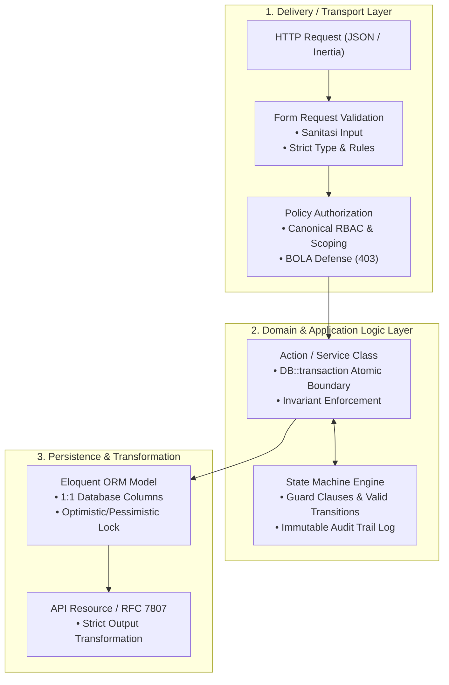

# Cetak Biru Standar Perancangan Logika Bisnis, Basis Data, & UI/UX (software_design_standards.md)
> **Engine:** Hyperion Vault v6.31.0 / v8.0.0 SDD-Enterprise-Deterministic  
> **Status:** Single Source of Truth (SSoT) — Standar Rekayasa Perangkat Lunak 3-Pilar  
> **Target Audience:** Solution Architects, Lead Engineers, Database Administrators, UI/UX Engineers, AI Coding Agents

---

## 1. PENDAHULUAN & FILOSOFI REKAYASA SISTEM

Membangun perangkat lunak skala enterprise yang deterministik dan tahan terhadap regresi membutuhkan keselarasan mutlak antara apa yang dipikirkan pengguna (*mental model*), bagaimana aturan bisnis ditegakkan (*business logic*), dan bagaimana data disimpan secara andal (*persistence model*).

Cetak biru ini menetapkan standar rekayasa perangkat lunak internasional di lingkungan Hyperion Vault dengan menyatukan **3 Pilar Desain Rekayasa**:
1. **Pilar Logika Bisnis:** Menjamin bahwa aturan domain institusi dieksekusi secara benar, transaksional, aman dari celah otorisasi (BOLA), dan deterministik.
2. **Pilar Basis Data:** Menjamin integritas referensial, bebas anomali redundansi (3NF), serta memiliki efisiensi kueri sub-50ms melalui indeks B-Tree yang tepat.
3. **Pilar UI/UX & Kognisi Pengguna:** Menjamin antarmuka intuitif, mematuhi 10 heuristik Jakob Nielsen, aksesibel penuh (WCAG 2.2 AAA), dan bebas dari beban kognitif yang melelahkan.

Dokumen ini menjadi rujukan konseptual (*Tier 3*) yang menopang aturan sistem mutlak [`.agents/rules/product_discovery_invariants.md`](../.agents/rules/product_discovery_invariants.md) & [`.agents/rules/blueprint_studio_invariants.md`](../.agents/rules/blueprint_studio_invariants.md) (*Tier 1*) serta playbook operasional [`.agents/skills/discovery-architect/SKILL.md`](../.agents/skills/discovery-architect/SKILL.md) (*Tier 2*).

---

## 2. TAKSONOMI STANDAR INTERNASIONAL TERPADU

```
┌──────────────────────────────────────────────────────────────────────────────────┐
│              SINTESIS STANDAR INTERNASIONAL TRIPLE-PILLAR HYPERION VAULT         │
├──────────────────────────────────────────────────────────────────────────────────┤
│ 1. DOMAIN & LOGIKA    │ Eric Evans (DDD), Martin Fowler (PoEAA), W3C SCXML / FSM │
│ 2. MODEL BASIS DATA   │ Edgar F. Codd (3NF), Markus Winand (SQL Indexing), Gray  │
│ 3. USABILITY & UI/UX  │ Jakob Nielsen (NN/g), Tidwell, Wroblewski, Hoober, WCAG  │
│ 4. PERSYARATAN & JTBD │ Anthony Ulwick (JTBD/ODI), Marty Cagan (4 Product Risks) │
└──────────────────────────────────────────────────────────────────────────────────┘
```

---

## 3. PILAR 1: ARSITEKTUR LOGIKA BISNIS & PERANCANGAN DOMAIN



### 3.1 Domain-Driven Design (Eric Evans & Vaughn Vernon)
- **Ubiquitous Language:** Setiap variabel, nama kolom database, metode kelas, dan teks label UI wajib menggunakan kosakata kanonikal institusi (misal: `santri`, `musyrif`, `marhalah`, `halqah`, `kamar`). Dilarang menciptakan sinonim atau padanan kata acak.
- **Aggregate Boundary:** Semua mutasi data yang memiliki ketergantungan erat wajib dikelompokkan ke dalam satu *Aggregate*. Akses mutasi luar hanya boleh melalui *Aggregate Root*.
- **Domain Invariants:** Kondisi kebenaran yang tidak boleh dilanggar (misal: "Santri tidak boleh ditempatkan di kamar yang melebihi kapasitas maksimum").

### 3.2 Finite State Machines (FSM) & Determinisme Alur Persetujuan
Untuk modul dengan *Logic Archetype* `state_machine` (seperti persetujuan beasiswa, mutasi santri, atau pengajuan anggaran):
1. **Daftar Status Terbatas (Finite States):** Seluruh status didefinisikan secara eksplisit menggunakan `enum` PHP (misal: `draft`, `in_review`, `approved`, `rejected`).
2. **Matriks Transisi Sah:** Transisi dari status $A \rightarrow B$ wajib divalidasi. Transisi ilegal (misal: dari `draft` langsung melompat ke `approved` tanpa melalui `in_review`) wajib dilempar sebagai exception HTTP 422.
3. **Guard Clauses:** Syarat otorisasi peran wajib dievaluasi sebelum status berubah (misal: peran `mudir` wajib menandatangani berkas sebelum transisi ke `approved`).
4. **Audit Trail Mutlak:** Setiap perubahan status wajib mencatat log pada tabel audit: waktu transaksi, ID aktor pengguna (`user_id`), status awal, status tujuan, dan catatan justifikasi.

### 3.3 Patterns of Enterprise Application Architecture (Martin Fowler)
- **Thin Controller:** Controller bertindak murni sebagai koordinator HTTP. Dilarang menulis logika kueri multi-tabel atau kalkulasi matematika di dalam Controller.
- **Atomic Transaction:** Mutasi multi-tabel wajib dibungkus `DB::transaction(fn() => ...)`. Jika terjadi kegagalan pada tabel kedua, seluruh perubahan pada tabel pertama otomatis dibatalkan (*rolled back*).
- **Anti-Anemic Model:** Model bukan sekadar kantong data (*data bag*). Logika domain esensial dan *scope queries* diletakkan pada model atau custom query builder.

---

## 4. PILAR 2: ARSITEKTUR BASIS DATA & PEMODELAN RELASIONAL

### 4.1 Normalisasi 3NF (Edgar F. Codd & C.J. Date)
Seluruh tabel transaksi operasional (OLTP) wajib memenuhi kaidah **Third Normal Form (3NF)**:
1. **1NF (First Normal Form):** Nilai setiap kolom bersifat atomik. Dilarang keras menyimpan daftar ID dalam bentuk teks terpisah koma (`"1,2,5"`). Gunakan tabel relasi *one-to-many* atau *many-to-many*.
2. **2NF (Second Normal Form):** Tidak ada kolom non-kunci yang hanya bergantung pada sebagian *composite primary key*.
3. **3NF (Third Normal Form):** Tidak ada ketergantungan transitif. Nilai yang merupakan hasil kalkulasi dari kolom lain (misal: `subtotal = jumlah * harga`) tidak boleh disimpan redundan pada tabel transaksi.

> **Pengecualian Terkendali (Kimball Standard):** Denormalisasi hanya diperbolehkan pada tabel *Periodic Snapshot Rollup* analitik (`*_temporal_rollups`) yang diisi secara otomatis oleh background scheduled jobs.

### 4.2 Optimasi Indeks Komposit B-Tree (Markus Winand: *Use The Index, Luke!*)
Kaidah penentuan urutan kolom pada indeks komposit:
$$\text{Aturan Urutan B-Tree: } \mathbf{[\text{Kolom Kesetaraan / Equality (=)}}] \longrightarrow \mathbf{[\text{Kolom Rentang / Range (<, >, BETWEEN)}}]$$

*Contoh Analisis Kasus Kueri:*
```sql
SELECT * FROM santri_pelanggaran 
WHERE unit_tugas = 'pesantren' AND kategori = 'kedisiplinan' AND tanggal >= '2026-10-01'
ORDER BY tanggal DESC;
```
- **Definisi Indeks Benar:**  
  `$table->index(['unit_tugas', 'kategori', 'tanggal']);`
  *(Kolom `unit_tugas` dan `kategori` dievaluasi dengan operator `=`, sehingga berada di depan; kolom `tanggal` dievaluasi dengan rentang `>=`, sehingga berada di akhir).*
- **Larangan Non-SARGable Query:** Dilarang membungkus kolom berindeks dengan fungsi matematis atau string (seperti `WHERE LOWER(nama) = 'ahmad'` atau `WHERE YEAR(tanggal) = 2026`) karena database terpaksa melakukan *Full Table Scan*.

### 4.3 Kontrak Integritas Referensial & Concurrency Control (Jim Gray)
1. **Foreign Key Restrict vs Cascade:**
   - Gunakan `restrictOnDelete()` untuk entitas data induk (seperti santri, pegawai, akun keuangan) agar tidak terhapus jika masih memiliki riwayat transaksi.
   - Gunakan `cascadeOnDelete()` hanya untuk data detail anak yang tidak memiliki arti tanpa induknya (misal: item baris voucher).
2. **Pencegahan Concurrency Race Conditions:**
   - Untuk data yang memiliki batasan kuota (stok inventaris, pagu anggaran, kursi kamar santri), gunakan *Pessimistic Locking* di dalam transaksi:
     ```php
     $kamar = Kamar::where('id', $kamarId)->lockForUpdate()->firstOrFail();
     if ($kamar->santri_count >= $kamar->kapasitas) {
         throw new DomainException('Kamar telah penuh.');
     }
     ```

---

## 5. PILAR 3: ARSITEKTUR UI/UX & KOGNISI INTERAKSI PENGGUNA

### 5.1 10 Usability Heuristics (Jakob Nielsen / NN/g)
Setiap antarmuka Svelte 5 di Hyperion Vault wajib diuji terhadap 10 heuristik usabilitas:
1. **Visibility of System Status:** Indikator visual seketika saat proses berlangsung (Skeleton shimmer saat loading data, spinner ikon dan status `disabled` pada tombol submit).
2. **Match Between System and Real World:** Bahasa dan ikonografi mencerminkan kegiatan nyata santri/pesantren, bukan nama tabel SQL atau kode error teknis.
3. **User Control and Freedom:** Dukungan pembatalan aksi modal, penutupan via tombol `Escape` dan klik area luar (*backdrop*).
4. **Consistency and Standards:** Konsistensi letak tombol primer (kanan bawah) dan palet semantik status (Emerald = Lulus/Aktif, Rose = Alpa/Bahaya, Amber = Menunggu Review, Sky = Informasi).
5. **Error Prevention:** Mencegah terjadinya kesalahan dengan menonaktifkan tombol submit saat form invalid atau sedang dikirim (*prevent double-submit*), serta modal konfirmasi untuk aksi destruktif (hapus, batalkan).
6. **Recognition Rather than Recall:** Menggunakan *searchable dropdown* atau *pill badges* dengan autocomplete daripada mengharuskan pengguna mengingat dan mengetikkan ID numerik.
7. **Flexibility and Efficiency of Use:** Tabel dilengkapi pencarian memori instan ($< 0.1\text{ ms}$ via `$derived.by()`) dan navigasi pintasan keyboard.
8. **Aesthetic and Minimalist Design (Few & Tufte):** Memaksimalkan rasio tinta-data (*Data-Ink Ratio*), mengeliminasi *chartjunk* (garis tebal, efek 3D, gradien menusuk mata).
9. **Help Users Recognize, Diagnose, and Recover from Errors:** Pesan error ramah pengguna berstandar RFC 7807 dilengkapi tombol aksi *"Coba Lagi"* (*Retry CTA*).
10. **Help and Documentation:** *Empty state* informatif yang memberikan panduan langkah nyata saat data belum tersedia.

### 5.2 Standar Aksesibilitas WCAG 2.2 AAA & Kontrak Komponen
1. **Rasio Kontras Minimum 7:1 (AAA):** Seluruh elemen tipografi wajib memenuhi rasio kontras warna terhadap latarnya minimal 7:1 (pada tema Daylight maupun Dark Obsidian).
2. **Atribut Eksplisit Tag Tombol:** Seluruh elemen `<button>` wajib memiliki atribut `type="button"` atau `type="submit"`. Dilarang meninggalkan elemen button tanpa deklarasi type.
3. **Penyajian Data Angka Monospace:** Seluruh tabel keuangan, persentase, dan angka statistik wajib menggunakan kelas `font-mono` (tabular figures) agar digit angka sejajar lurus vertikal.

### 5.3 Taksonomi UI Delivery Target (Anti-Asumsi Halaman Tunggal)
Tidak semua interaksi pengguna memerlukan rute halaman mandiri (`+page.svelte`):
- `standalone_page`: Halaman penuh untuk modul utama berbobot besar.
- `modal_dialog`: Dialog pop-up untuk alur cepat terisolasi (entri cepat, voucher).
- `slide_over_drawer`: Panel samping untuk inspeksi detail data atau audit trail tanpa berpindah rute.
- `inline_action`: Aksi langsung pada baris tabel (toggle status, cetak bukti).
- `embedded_widget`: Kartu metrik atau grafik yang disematkan pada dasbor utama.
- `headless_job`: Tugas otomatisasi latar belakang tanpa antarmuka visual.

### 5.4 Responsivitas Platform Mobile & Ergonomi Sentuh (Mobile-First UX)
1. **Ergonomi Zona Ibu Jari (*The Thumb Zone* — Steven Hoober):**
   Pada viewport mobile (`< 768px`), aksi primer (CTA Submit, Filter Cepat, Tambah Data) wajib ditempatkan pada sepertiga bawah layar (*sticky bottom action bar*) agar dapat dijangkau ibu jari tanpa meregangkan tangan.
2. **Transformasi Bottom Sheet:**
   Modal pop-up terpusat dilarang pada tampilan mobile karena tertutup oleh keyboard virtual. Seluruh dialog form wajib bertransformasi menjadi *Swipeable Bottom Sheet* yang menempel di dasar layar.
3. **Target Sentuh Ergonomis & Diferensiasi Ukuran (WCAG 2.2 AAA & Apple HIG):**
   - Tombol primer formulir dan field input wajib memiliki area sentuh $\ge 44 \times 44\text{ piksel}$ dengan spasi antar elemen minimal $8\text{ px}$. Kolom input wajib berukuran minimal 16px (`text-base`) guna mencegah auto-zoom iOS Safari.
   - Pada kartu dan baris tabel data padat (*dense data rows*), gunakan tombol aksi mikro berukuran `min-h-[30px] px-2.5 py-1 text-[11px]` dengan margin sentuh aman (mematuhi WCAG 2.2 SC 2.5.8 Target Size Minimum) guna menghindari pembengkakan visual kotak elemen yang tidak proporsional.
4. **Reflow Tabel Responsif (*Card Stack Transformation*):**
   Tabel data dengan banyak kolom wajib menyediakan susunan kartu vertikal (*Card Stack*) pada tampilan mobile (`hidden md:table` dan `md:hidden space-y-2`) guna mengeliminasi scroll horizontal yang membingungkan.
5. **Standar Visual Pro-Grade Compact (Edward Tufte Data-Ink Ratio on Mobile):**
   - Mengeliminasi anti-pattern *"Fisher-Price UI"* (border tebal 2px, padding bertumpuk `p-4`, font 16px pada kartu data) yang memboroskan ruang vertikal dan membuat viewport mobile terasa sesak dan penuh.
   - Wajib menggunakan batas tegas 1px (*hairline* `border border-slate-200/80 dark:border-slate-800/80`), bayangan mikro lembut `shadow-2xs`, padding kompak (`p-2` s/d `p-2.5`), dan tipografi proporsional (judul kartu `text-xs font-bold`, label/badge `text-[11px]` atau `text-[10px] uppercase font-bold`, angka `font-mono`).
   - Pada sidebar drawer mobile, seluruh accordion kelompok menu wajib tertutup (*collapsed*) secara default (`expandedTrees = { ...: false }`), hanya membuka rute yang sedang aktif. Lebar drawer dibatasi maksimal `w-60` (240px).
6. **Pola Navigasi Jempol Cepat (*Floating Thumb Dock*):**
   - Mengeliminasi friksi navigasi saat pengguna melakukan scroll panjang pada tabel/kartu data (tidak perlu scroll kembali ke atas untuk berpindah menu atau menekan hamburger bar).
   - Menolak anti-pattern bilah navigasi statis penuh (*Full Static Bottom Bar*) yang memotong permanen 60px viewport layar ponsel yang sempit.
   - Menerapkan kapsul mengambang (*frosted glass capsule*) di tengah bawah viewport mobile (`fixed bottom-3.5 left-1/2 -translate-x-1/2 z-30 md:hidden`) berisi 3 pintasan cepat: `[ 🏠 Beranda ]`, `[ ↻ Segarkan ]`, dan `[ ☰ Menu ]`. Area viewport `<main>` wajib memiliki safe padding bawah `pb-16 sm:pb-5`.
7. **Rujukan Komponen Terpadu:**
   Panduan pohon keputusan lengkap terdokumentasi di [`.agents/skills/discovery-architect/references/ui_ux_component_decision_matrix.md`](../.agents/skills/discovery-architect/references/ui_ux_component_decision_matrix.md).

### 5.5 Rujukan Kanonikal Desain Elegan, Minimalis, Negative Space, & Aksesibilitas
1. **Keanggunan & Reduksionisme Fungsional (Dieter Rams & Mies van der Rohe):**
   - Prinsip *"Weniger, aber besser"* (Less, but better). Antarmuka yang elegan bukanlah yang dipenuhi ornamen visual, melainkan yang mengeliminasi seluruh elemen yang tidak esensial sehingga fungsi produk berbicara dengan jernih.
   - Mengadopsi estetika *Swiss / International Typographic Style* (Josef Müller-Brockmann & Emil Ruder): ketertiban grid asimetris, perataan kiri (*flush-left, ragged-right*) untuk alur baca alami, dan ketiadaan ornamen artifisial.
2. **Keterbacaan & Ritme Tipografi (Robert Bringhurst & Ellen Lupton):**
   - **Ukuran Panjang Baris (*The Measure*):** Panjang baris teks paragraf dan form dibatasi antara 45 hingga 75 karakter per baris (CPL). Baris teks yang membentang terlalu panjang pada monitor lebar mengakibatkan kelelahan mata (*tracking fatigue*), sedangkan baris terlalu pendek memutus ritme membaca.
   - **Skala Modular Tipografi:** Menggunakan skala modular rasio minor third / major third (12px, 14px, 16px, 20px, 24px, 32px).
   - **Karakter Tabular:** Seluruh data angka, nilai mata uang, tanggal/waktu, UUID, dan hash teknis WAJIB menggunakan jenis huruf proporsional tetap (`font-mono`) guna mempermudah pemindaian perbandingan nilai secara vertikal.
3. **Negative Space & Rasio Data-ke-Tinta (Edward Tufte & Refactoring UI):**
   - **Memaksimalkan *Data-to-Ink Ratio*:** Menghapus elemen non-data (*chartjunk*), garis pembatas tebal, dan warna latar belakang yang terlalu jenuh.
   - **Struktur Melalui Whitespace:** Mengelompokkan item terkait menggunakan hukum kedekatan Gestalt (*Law of Proximity*) melalui spasi yang proporsional daripada membungkus setiap elemen ke dalam kotak bergaris tebal (*box-in-a-box anti-pattern*).
4. **Batas Kontainer Terkendali (*Restrained Layout Ceilings*):**
   - Konten aplikasi DILARANG dibiarkan meregang 100% tanpa batas (*wall-to-wall*) di monitor resolusi tinggi (2K/4K).
   - Terapkan kontainer terpusat: `max-w-3xl` s/d `max-w-4xl` untuk membaca dan formulir; `max-w-6xl` s/d `max-w-7xl` untuk dasbor analitik dan tabel data dengan `mx-auto px-4 sm:px-6 lg:px-8`.
5. **Aksesibilitas Universal (WCAG 2.2 AAA & Living Design Systems - Linear/Vercel):**
   - Rasio kontras teks minimal 4.5:1 untuk teks normal (AA) dan diutamakan 7:1 (AAA).
   - Target sentuh ergonomis $\ge 44 \times 44\text{px}$ untuk tombol utama (Apple HIG / Google Material) dan minimal $24 \times 24\text{px}$ untuk tombol mikro tabel (WCAG SC 2.5.8).
   - Cincin fokus keyboard yang jelas dan kontras tinggi (`focus-visible:ring-2 focus-visible:ring-emerald-500`).
   - Semantik HTML5 murni dan atribut ARIA eksplisit.

### 5.6 Masterpiece Craftsmanship, Keaslian Karya (Human-Crafted Feel), & Kebijakan Anti-AI Slop
1. **Eliminasi Klise Visual AI (Zero AI Design Clichés):**
   - **Latar Belakang & Gradasi Murahan:** Dilarang keras menggunakan palet "AI generic / SaaS template" seperti latar belakang gradient ungu-pink neon (`from-indigo-500 via-purple-500 to-pink-500`), cyan glow berlebihan, ornamen blob lingkaran kabur (`blur-3xl opacity-30`) yang melayang tanpa fungsi, dan dekorasi visual mengambang acak.
   - **Glassmorphism Berlebihan & Pseudo-Glassmorphism:** Dilarang menggunakan efek frosted glass buram tebal yang merusak kontras teks dan keterbacaan data. Dilarang keras menggunakan transparansi rendah (`bg-white/40`, `dark:bg-white/[0.02]`) di atas kanvas solid yang menyebabkan batas kartu lenyap (*visual camouflage*).
   - **Mandat Elevasi Permukaan 3-Tier (L0/L1/L2):** Seluruh antarmuka wajib menerapkan L0 Kanvas teduh (`bg-slate-100/70` / `dark:bg-[#070b12]`), L1 Kartu Makro solid (`bg-white` / `dark:bg-slate-900/90` ber-border 1px presisi & `shadow-2xs`), dan L2 Elemen Mikro tersemat dengan kontras diferensiasi nyata.
   - **Ikon & Pemanis Tanpa Nilai:** Dilarang menempatkan ikon bintang/sparkle atau ornamen dekoratif khas AI generatif yang tidak membawa makna fungsi nyata bagi tugas pengguna.
2. **Keaslian Karya & Human-Crafted Aesthetic:**
   - **Palet Tonal Teredam Bermartabat (*Dignified Muted Tonal Palette*):** Utamakan monokrom elegan (Slate/Stone/Obsidian) dengan saturasi tenang yang dikombinasikan dengan tepat 1 warna aksen fungsional berkarakter (Emerald tajam di Yayasan PQTM, Indigo/Emerald di Hyperion Vault).
   - **Ritme Tipografi Berbobot (*Editorial Typographic Rhythm*):** Menggabungkan hirarki heading tegas, label mikro terukur, dan `font-mono` untuk seluruh angka, tanggal, dan data teknis.
   - **Tekstur Presisi:** Mengandalkan hairline border 1px yang renyah (`border border-slate-200/80 dark:border-slate-800/80`), micro shadows `shadow-2xs`, dan negative space yang lapang.
3. **Harmoni Fungsionalitas & Zero Superfluous Elements (Ockham's Razor UI):**
   - Setiap elemen antarmuka wajib dapat mempertanggungjawabkan keberadaannya (*purpose-driven UI*). Elemen visual yang tidak membantu pengguna memahami informasi, menyelesaikan tugas, atau bernavigasi harus dihapus demi ketenangan kognitif (*visual serenity*).

---

## 6. MEKANISME AUDIT: TRIPLE-PILLAR REVIEW GATE

Sebelum spesifikasi fitur disetujui (*design freeze*) dan dikompilasi ke dalam kode produksi, fitur wajib diaudit menggunakan skrip otomatis:

```powershell
powershell -ExecutionPolicy Bypass -File .agents/skills/discovery-architect/scripts/audit-feature-design.ps1 -FilePath "doc/features/XX_feature_name.md"
```

### Ambang Batas Kelulusan:
- **Skor Kesiapan (*Readiness Score*):** Minimal **$87.5\%$** (Minimal 7 dari 8 checkpoint teknis terpenuhi).
- **Hard Blockers (Wajib 100%):**
  1. Pernyataan formula JTBD baku (Anthony Ulwick).
  2. Ketiadaan kata sifat subjektif/pemanis (*Anti-Slop*).
  3. Pemetaan 4 visual states (Loading, Empty, Error, Success).
  4. Pengikatan peran kanonikal resmi RBAC.

---

## 7. REFERENSI & BIBLIOGRAFI INTERNASIONAL

1. **Cagan, M. (2017).** *INSPIRED: How to Create Tech Products Customers Love (2nd Edition).* John Wiley & Sons.
2. **Codd, E. F. (1970).** *A Relational Model of Data for Large Shared Data Banks.* Communications of the ACM, 13(6), 377–387.
3. **Bringhurst, R. (2012).** *The Elements of Typographic Style (4th Edition).* Hartley & Marks Publishers.
4. **Evans, E. (2003).** *Domain-Driven Design: Tackling Complexity in the Heart of Software.* Addison-Wesley Professional.
5. **Fowler, M. (2002).** *Patterns of Enterprise Application Architecture.* Addison-Wesley Professional.
6. **Gray, J., & Reuter, A. (1993).** *Transaction Processing: Concepts and Techniques.* Morgan Kaufmann.
7. **Hoober, S. (2020).** *Designing for Touch & How Do Users Really Hold Flagship Phones?* UXmatters & A Book Apart.
8. **Krug, S. (2014).** *Don't Make Me Think, Revisited: A Common Sense Approach to Web Usability (3rd Edition).* New Riders.
9. **Lupton, E. (2014).** *Thinking with Type: A Critical Guide for Designers, Writers, Editors, & Students (2nd Edition).* Princeton Architectural Press.
10. **Marcotte, E. (2011).** *Responsive Web Design.* A Book Apart.
11. **Müller-Brockmann, J. (1981).** *Grid Systems in Graphic Design.* Niggli.
12. **Nielsen, J. (1994).** *Enhancing the Explanatory Power of Usability Heuristics.* ACM CHI'94 Conference Proceedings.
13. **Norman, D. (2013).** *The Design of Everyday Things (Revised and Expanded Edition).* Basic Books.
14. **Rams, D. (2017).** *Ten Principles for Good Design.* Prestel.
15. **Scott, B., & Neil, T. (2009).** *Designing Web Interfaces: Principles and Patterns for Rich Interactions.* O'Reilly Media.
16. **Tidwell, J., Brewer, C., & Valencia, A. (2020).** *Designing Interfaces: Patterns for Effective Interaction Design (3rd Edition).* O'Reilly Media.
17. **Tufte, E. R. (2001).** *The Visual Display of Quantitative Information (2nd Edition).* Graphics Press.
18. **Ulwick, A. W. (2016).** *Jobs to be Done: Theory to Practice.* Idea-Bite Press.
19. **Vernon, V. (2013).** *Implementing Domain-Driven Design.* Addison-Wesley Professional.
20. **Wathan, A., & Schoger, S. (2018).** *Refactoring UI.* Self-published.
21. **W3C. (2023).** *Web Content Accessibility Guidelines (WCAG) 2.2.* World Wide Web Consortium.
22. **Winand, M. (2012).** *SQL Performance Explained.* Markus Winand.
23. **Wroblewski, L. (2011).** *Mobile First & Web Form Design: Filling in the Blanks.* A Book Apart & Rosenfeld Media.
