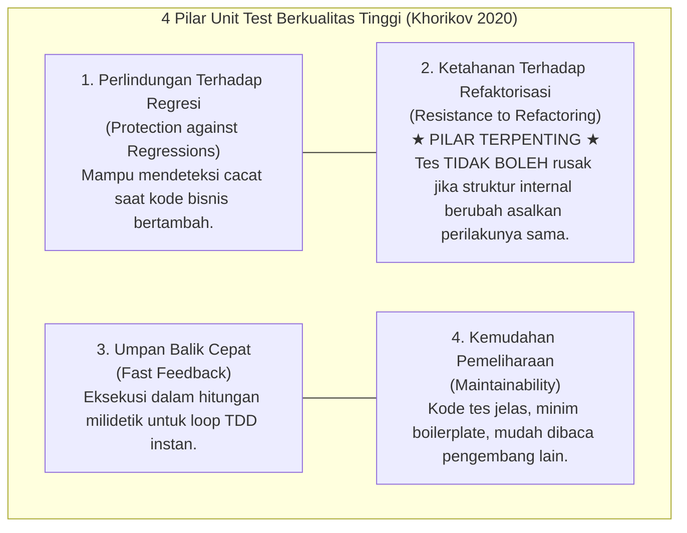
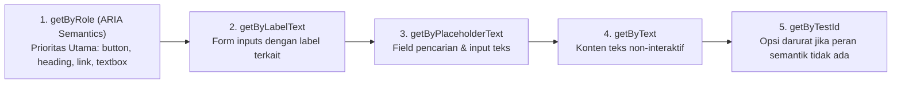
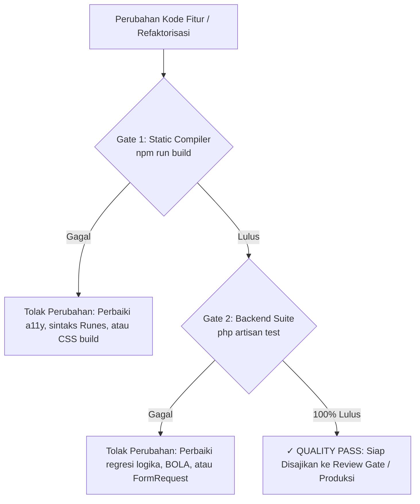

# Standar Rekayasa Pengujian Perangkat Lunak Korporasi (doc/testing_standards.md)
> **Engine:** Hyperion Vault v6.31.0 / v8.0.0 SDD-Enterprise-Deterministic  
> **Standar Rujukan Internasional:**  
> 1. Vladimir Khorikov (2020) — *Unit Testing: Principles, Practices, and Patterns* (Manning Publications)  
> 2. Martin Fowler & Mike Cohn — *The Practical Test Pyramid & Test Doubles Taxonomy*  
> 3. Kent C. Dodds — *The Testing Trophy & DOM Accessible Testing Philosophy*  
> 4. Kent Beck (2002 / 2023) — *Test-Driven Development: By Example* & *Tidy First?: Empirical Software Design*  
> 5. Titus Winters, Tom Manshreck, Hyrum Wright (Google Engineering) — *Software Engineering at Google* (Ch. 11–14 Testing)  
> 6. ISO/IEC/IEEE 29119 — *Software Testing: Concepts, Processes, and Techniques*  
> 7. W3C Web Accessibility Automated Verification — *WCAG 2.2 Level AAA Automated Rules*  

Dokumen ini merupakan **Single Source of Truth (SSoT)** metodologi, taksonomi, dan arsitektur pengujian otomatis (*automated software testing*) untuk backend dan frontend pada seluruh ekosistem Hyperion Vault.

---

## 1. PRINSIP FILOSOFIS & 4 PILAR UNIT TEST BERKUALITAS (VLADIMIR KHORIKOV)

Standar pengujian Hyperion Vault menolak "angka cakupan semu" (*vanity coverage metrics*). Kode pengujian yang banyak namun rapuh (*brittle tests*) adalah beban liabilitas arsitektur yang memperlambat inovasi.

Setiap unit test wajib dievaluasi berdasarkan **4 Pilar Tes Berkualitas Tinggi (*The 4 Pillars of a Good Test*)**:



> [!IMPORTANT]
> **Pilar #2 (Resistance to Refactoring) adalah Kunci Kualitas Enterprise:**
> *False Positive* (tes gagal padahal aplikasi tidak rusak) menyebabkan pengembang kehilangan kepercayaan pada test suite. Tes yang baik HANYA menguji **perilaku yang dapat diamati dari luar (*observable outcome / behavioral contract*)**, bukan detail algoritma internal atau pemanggilan fungsi privat.

---

## 2. DIKOTOMI ALIRAN PENGUJIAN: CLASSICAL (DETROIT) VS LONDON (MOCKIST)

Dalam arsitektur korporasi enterprise modern, Hyperion Vault menganut **Classical School (Detroit / Chicago)** dan memberlakukan pembatasan ketat terhadap *mocking*:

| Karakteristik | London School (Mockist) | Classical School (Detroit / Hyperion Standard) |
| :--- | :--- | :--- |
| **Definisi Unit** | Unit adalah 1 class atau 1 fungsi terisolasi. | Unit adalah 1 perilaku bisnis (*unit of behavior*), dapat melibatkan lebih dari satu class/fungsi. |
| **Penanganan Dependensi** | Mem-mock hampir semua dependensi internal (*over-mocking*). | Menggunakan dependensi nyata selama in-memory dan cepat (misal: class helper, domain model). |
| **Kapan Mock Digunakan?** | Pada hampir setiap interaksi objek. | **HANYA untuk dependensi eksternal tak terkelola (*out-of-process unmanaged dependencies*)** seperti server SMTP email, payment gateway, WhatsApp gateway, atau API pihak ketiga. |
| **Sensitivitas Refaktor** | **Sangat Rapuh (*Brittle*):** Refaktor internal method privat merusak mock assertion. | **Sangat Tangguh (*Robust*):** Tes tetap lulus selama kontrak output dan mutasi state akhir benar. |

> [!WARNING]
> **Larangan Over-Mocking Database & Domain Model:**
> DILARANG mem-mock kueri basis data Eloquent atau tabel relasional jika pengujian dapat dijalankan langsung di atas SQLite WAL In-Memory (`:memory:`). Menguji kueri dengan mock array fiktif memberikan rasa aman palsu (*false sense of security*) yang gagal mendeteksi ketidaksesuaian tipe kolom riil, constraint foreign key, atau deadlock transaksi.

---

## 3. TOPOLOGI PENGUJIAN: TEST PYRAMID (BACKEND) VS TESTING TROPHY (FRONTEND)

Arsitektur pengujian Hyperion Vault memisahkan topologi pengujian backend dan frontend sesuai karakteristik arsitekturnya:

```mermaid
flowchart TD
    subgraph BackendPyramid ["A. Backend: The Practical Test Pyramid (Fowler & Cohn)"]
        BE_E2E["End-to-End API Scenario Tests (10%)\nAlur lengkap transaksi pengguna dari drafting s.d finalisasi"]
        BE_Integration["Feature & Integration Boundary Tests (60%)\nFormRequest, Policy, Controller, DB Transaction, RFC 7807"]
        BE_Unit["Deterministic Domain Unit Tests (30%)\nDomain Services, Calculators, Helpers, Pure Business Rules"]
        BE_Unit --> BE_Integration --> BE_E2E
    end

    subgraph FrontendTrophy ["B. Frontend: The Testing Trophy (Kent C. Dodds)"]
        FE_E2E["End-to-End Visual Smoke (Playwright / 10%)\nAlur kritis: Login, Mutasi Data, Cetak Dokumen"]
        FE_Integration["Component Integration & 4-State UI (Testing Library / 50%)\nDataTable, Modal, Interaksi Form, Svelte 5 Runes"]
        FE_Unit["Unit Functions (Vitest / 20%)\ncsvExport sanitasi CWE-1236, formatters, utilities"]
        FE_Static["Static Analysis & Compiler (30%)\nTailwind v4 compiler, Svelte 5 a11y checks, Vite Build"]
        FE_Static --> FE_Unit --> FE_Integration --> FE_E2E
    end
```



---

## 4. STANDAR REKAYASA GOOGLE: DAMP OVER DRY & HERMETIC ISOLATION

Sesuai buku *Software Engineering at Google* (Titus Winters et al.), kode pengujian tunduk pada aturan khusus:

1. **DAMP over DRY (*Descriptive And Meaningful Phrases*):**
   * Di dalam kode aplikasi, duplikasi harus dihilangkan (DRY).
   * Namun dalam kode pengujian, **keterbacaan linier mandiri (*DAMP*) jauh lebih penting daripada DRY**.
   * Pengujian dilarang membungkus logic assert ke dalam helper bertumpuk-tumpuk yang memaksa pembaca melompat-lompat berkas untuk memahami skenario kegagalan.
2. **Hermetic Isolation (Uji Kedap Udara):**
   * Setiap test case wajib independen terhadap urutan eksekusi (*order-independent*).
   * Dilarang bergantung pada data yang ditinggalkan oleh test case sebelumnya (*zero state leakage*).
   * Gunakan trait `RefreshDatabase` atau transaksi rollback otomatis pada setiap skenario.
3. **Ukuran Uji Kecil (*Small Test Standard*):**
   * Seluruh unit test backend dan frontend wajib tuntas di bawah 100 milidetik per test.
   * Dilarang menyertakan `sleep()` atau penundaan waktu artifisial.

---

## 5. DISIPLIN POLA AAA (ARRANGE - ACT - ASSERT)

Setiap pengujian unit dan fitur WAJIB disusun dengan pemisahan 3 blok visual yang tegas:

```php
public function test_kalkulasi_domain_service_menghasilkan_nilai_presisi(): void
{
    // 1. ARRANGE (Persiapan data awal & dependensi domain)
    $inputData = 100_000_000;
    $expectedOutput = 2_500_000;

    // 2. ACT (Pemicu aksi / method tunggal yang diuji)
    $actualOutput = CalculatorService::calculate($inputData);

    // 3. ASSERT (Verifikasi hasil keluaran observable)
    $this->assertSame($expectedOutput, $actualOutput);
}
```

---

## 6. ARSITEKTUR PENGUJIAN BACKEND (LARAVEL 13 & PHPUNIT 11)

### A. Uji Unit Domain Murni (Deterministic Calculations)
* **Target:** `app/Services/`, `app/Helpers/`, Domain Math.
* **Karakteristik:** Eksekusi super cepat (< 5ms), 0 kueri database, 100% deterministik.

### B. Uji Integrasi Pintu Gerbang API (Feature & Boundary Testing)
* **Target:** `routes/api.php`, `app/Http/Controllers/Api/V1/`, `app/Policies/`, `app/Http/Requests/`.
* **Cakupan Wajib (5 Golden Invariants Security):**
  1. **BOLA / IDOR Verification:** Pengguna A dilarang membaca atau memodifikasi data milik Pengguna B (wajib mengembalikan status `403 Forbidden`).
  2. **FormRequest Strict Validation:** Input kotor atau tipe data salah wajib ditolak seketika di boundary dengan pesan validasi terperinci (`422 Unprocessable Entity`).
  3. **RFC 7807 Problem Details:** Setiap respons error sistem (4xx/5xx) wajib memiliki struktur terstandar (`type`, `title`, `status`, `detail`).
  4. **Database Transaction Rollback:** Kegagalan pada langkah mutasi kedua wajib membatalkan seluruh operasi multi-tabel (`DB::transaction`).

### C. Katalog 11 Suite Uji Fitur Backend Valora Vault (73 Tests / 768 Assertions)
| No | Test Suite (`backend/tests/Feature/`) | Fokus Pengujian & Skenario Perilaku | Metrik |
|---|---|---|---|
| **1** | `AdminStudioTest.php` | Pengujian Feature Blueprint Studio, isolasi markdown SDD, validasi slug & form request. | 4 tests |
| **2** | `AdminUserManagementTest.php` | Pengujian CRUD user lengkap, toggle status aktif/tangguh, session revocation, dan middleware `CheckUserActive`. | 5 tests |
| **3** | `AgencyProfileTest.php` | Pengujian master profil legal agensi (Singleton ID 1), policy gate otorisasi admin, dan pembaruan identitas. | 4 tests |
| **4** | `BillingAndMasterRateTest.php` | Pengujian 6 tarif standar inti, proteksi tarif sistem dari penghapusan, audit log riwayat perubahan, dan kalkulasi invoice. | 7 tests |
| **5** | `ClientProjectManagementTest.php` | Pengujian intake klien baru/lama, sanitasi formula injection CWE-1236 pada CSV, dan proteksi hapus proyek berbayar. | 7 tests |
| **6** | `ProjectProgressMonitoringTest.php` | Pengujian formula agregat rasio progres pengerjaan modul, checklist interaktif, dan pencatatan tanggal selesai/PIC. | 6 tests |
| **7** | `ProjectScopeManagementTest.php` | Pengujian builder peran dinamis, menu modul 12 kapabilitas, penambahan skema tabel DB, dan auto-recalculate grand total. | 10 tests |
| **8** | `RoleConsolidationTest.php` | Pengujian jaminan *zero unauthorized consolidation*, integritas multi-role, dan pemanggilan peran kanonikal. | 4 tests |
| **9** | `SanctumAuthTest.php` | Pengujian autentikasi Sanctum, issue JWT cookie, registrasi device fisik, batasan konkurensi (max 3), dan unlink sesi. | 10 tests |
| **10** | `SecurityHeadersTest.php` | Pengujian OWASP ASVS HTTP headers, CSP, X-Frame-Options, X-Content-Type-Options, dan respon RFC 7807. | 8 tests |
| **11** | `UserExtendedProfileAndProjectWorkersTest.php` | Pengujian profil staf agensi, penugasan pekerja proyek (`client_project_workers`), dan relasi `pic_user_id`. | 8 tests |
| **TOTAL** | **11 Feature Test Suites** | **100% Hermetic Isolation, SQLite WAL In-Memory, AAA Pattern, Zero Flaky Tests** | **73 Passed (768 Assertions)** |

---

## 7. ARSITEKTUR PENGUJIAN FRONTEND (SVELTE 5 RUNES & ACCESSIBILITY)

### A. Filosofi Accessible Queries (Testing Library Paradigm)
Pencarian elemen antarmuka dilakukan berdasarkan urutan prioritas aksesibilitas pengguna:



### B. Mandat Pengujian 4 Visual States (RULE-02)
Setiap komponen antarmuka yang mengonsumsi API wajib diuji terhadap 4 kondisi visual:
1. **Loading State:** Memastikan skeleton loader atau spinner aktif saat request berlangsung.
2. **Empty State:** Memastikan teks panduan atau ilustrasi ramah muncul jika payload data berupa array kosong (`[]`).
3. **Error State:** Memastikan komponen merender pesan error ramah pengguna format RFC 7807 dan menyediakan tombol interaktif 'Coba Lagi'.
4. **Success State:** Memastikan tabel data, pagination, dan kalkulasi ringkasan ter-render secara utuh.

### C. Keamanan Ekspor CSV Front-End (CWE-1236 Verification)
Pengujian front-end untuk modul ekspor CSV wajib memverifikasi:
* Penambahan prefix petik tunggal (`'`) pada data yang diawali karakter berbahaya formula spreadsheet (`=`, `+`, `-`, `@`).
* Keberadaan Byte Order Mark (BOM: `\uFEFF`) agar aksara dan karakter khusus tidak mengalami *mojibake* di Microsoft Excel.

---

## 8. QUALITY GATE & CONTINUOUS INTEGRATION (ZERO-FLAKY-TEST POLICY)

Setiap putaran kerja (*Single Feature Turn*) agen atau rekayasawan manusia WAJIB melewati gerbang kualitas mutlak berikut:



> [!CAUTION]
> **Kebijakan Nol Toleransi Pengujian Flaky (Zero Flaky Tests):**
> Pengujian yang kadang lulus dan kadang gagal tanpa adanya perubahan kode dilarang keras dibiarkan di dalam repositori. Tes tersebut wajib segera diisolasi, didiagnosis akar masalahnya (biasanya disebabkan oleh ketergantungan urutan eksekusi, manipulasi waktu real, atau race condition database), dan diperbaiki hingga 100% deterministik.

---

## 9. REFERENSI ARSITEKTUR TERKAIT
* **Aturan Invarian Rekayasa:** [`.agents/rules/clean_architecture_invariants.md`](../.agents/rules/clean_architecture_invariants.md)
* **Playbook Refaktorisasi:** [`.agents/skills/clean-code-refactor/SKILL.md`](../.agents/skills/clean-code-refactor/SKILL.md)
* **Standar Keamanan:** [`doc/security_standards.md`](./security_standards.md)
* **Standar Dokumentasi Universal:** [`doc/project_documentation_standards.md`](./project_documentation_standards.md)
* **Peta Routing Cepat AI:** [`llms.txt`](../llms.txt) & [`AGENTS.md`](../AGENTS.md)
